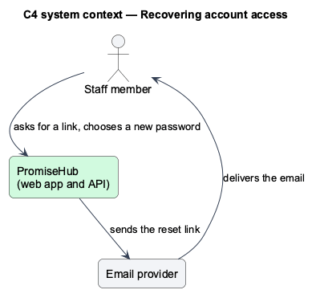
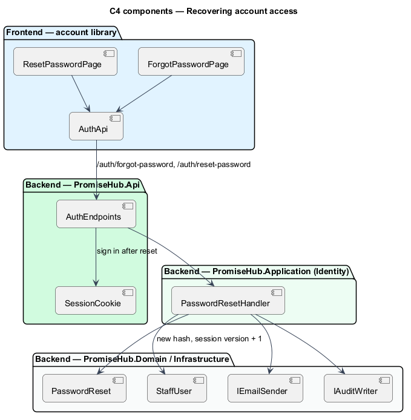
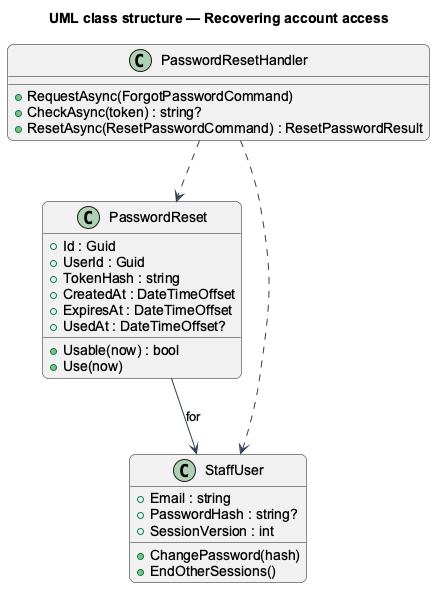
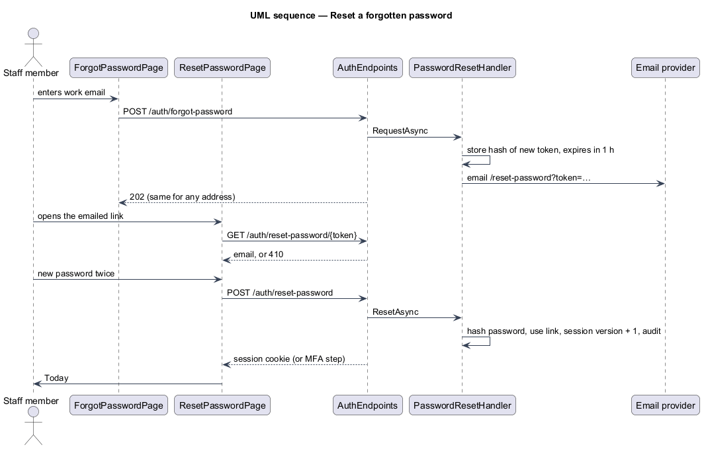

# Recover access

## Overview

PromiseHub is a multi-tenant, phone-first system of record for small youth-serving non-profits. This feature covers how a staff member who forgot their password gets back in without help from an admin.

From the `sign-in` page a staff member follows "Forgot your password?" to `forgot-password`, enters their work email and is told a link is on its way. The answer is the same whether or not the address has an account. The emailed link opens `reset-password`, which names the account; the person chooses a new password of at least 12 characters, every other device is signed out, and they land on Today signed in, through the MFA step when their role requires it. A link works once, for one hour; an old or used link says so and offers a new one.

Terms used in this document:

- **reset link** — emailed address carrying a random token; only the token's hash is stored
- **session version** — counter on the person that every session cookie carries; raising it signs out other devices (ADR 0039)

## Description

The feature is a vertical slice from the Angular auth pages to the identity tables. Business rules live in `PromiseHub.Application/Identity/PasswordResetHandler`, never in the endpoints or the pages.

Frontend, in `frontend/projects/account/`:

- **`ForgotPasswordPage`** — page at `/forgot-password` inside the authentication card, outside the staff shell. States: default, invalid (not an email), submitting, success and error.
- **`ResetPasswordPage`** — page at `/reset-password?token=…`. It checks the link first, then shows the new-password form (default, invalid, submitting) or the expired state; on success it navigates to Today, or to the MFA page.
- **`AuthApi`** — gains `forgotPassword`, `checkReset` and `resetPassword` behind the `AUTH_API` token.

All fields, alerts and buttons come from `frontend/projects/components/`.

Backend:

- **`AuthEndpoints`** — `POST /auth/forgot-password` (always 202), `GET /auth/reset-password/{token}` (email or 410) and `POST /auth/reset-password` (422 per field, 410, or a session through `SessionCookie`), all anonymous.
- **`PasswordResetHandler`** — issues links for people with a current membership, checks them, and resets: replaces the password hash, marks the link used, raises the session version, resolves the tenant from the person's first current membership and audits "Reset password by emailed link".
- **`PasswordReset`** — entity in `PromiseHub.Domain/Identity/` with the token hash, expiry and use time; not tenant-owned, like `StaffUser`.
- **`IEmailSender`**, **`IAuditWriter`**, **`IPasswordHasher`** — existing services.

## Built so far

Slice 46 delivered everything above (ADR 0040). Prompt 77 (ADR 0071) added the throttle of three links per account an hour, made only the newest link work and opened the pages to every role (`recover-password`).

## Requirements

| L2 ID | Refines (L1) | Requirement |
|-------|--------------|-------------|
| `L2-044` | `L1-003` | Staff reset a forgotten password through a one-hour, single-use emailed link and carry on signed in. |
| `L2-031` | `L1-016` | Secrets and tokens are never stored in the clear. |

## Diagrams

### System context

### Components

### Class structure

### Behaviour — reset a forgotten password

