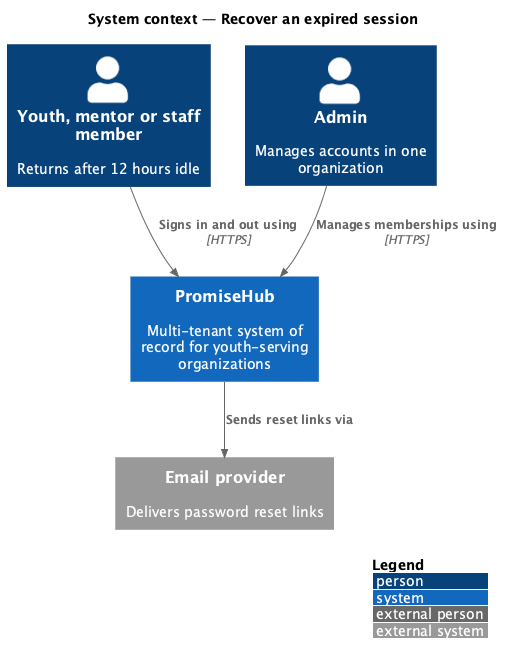
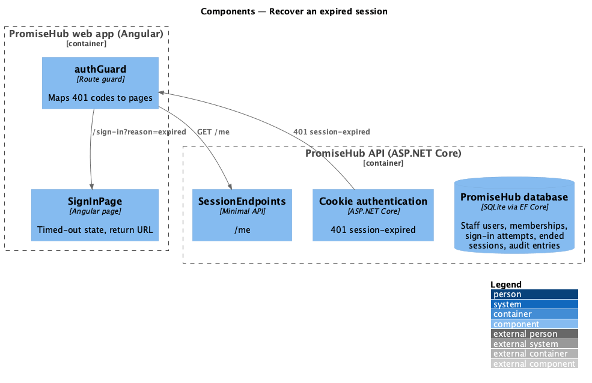
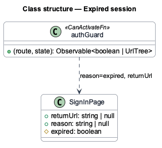
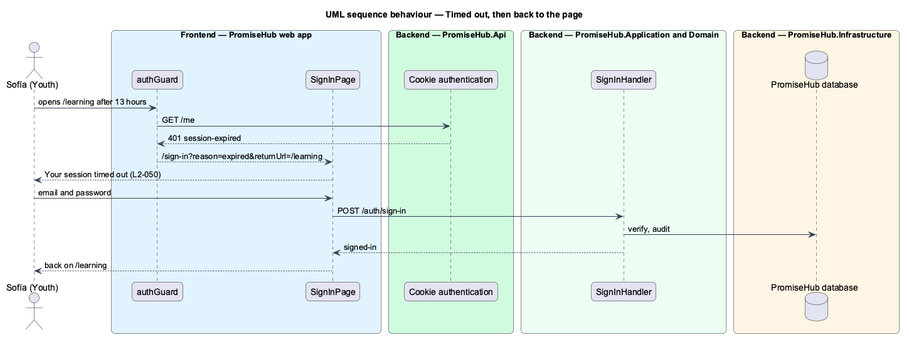

# Recover an expired session

## Overview

PromiseHub is a multi-tenant, phone-first system of record for small youth-serving organizations. A session that idles for 12 hours expires. This feature covers what a youth, mentor or staff member sees next and how they carry on: the app asks the server, learns the session timed out, and opens sign-in with the timed-out state (`sign-in/expired`); after signing in again the person returns to the page they were on.

Terms used in this document:

- **timed-out state** — the sign-in page with the heading "Your session timed out" and the reason it happened
- **return URL** — the page to return to after signing in, kept in the sign-in address

Ported from Waypoint `platform-services/recover-expired-session` (`L2-PLATFORM-010`). Waypoint's separate session-expired page is PromiseHub's existing `sign-in/expired` state (ADR 0044). The `session-expired` dialog that replays a pending form (`L2-006` criterion 4) is not part of this journey and stays deferred.

## Description

- **Cookie authentication** — answers 401 with the code "session-expired" when an expired session cookie is sent (`AuthenticationSetup`).
- **`authGuard`** — in `frontend/projects/promisehub/`. On 401 "session-expired" it redirects to `/sign-in?reason=expired&returnUrl=…`.
- **`SignInPage`** — shows the timed-out heading for `reason=expired` and, after signing in, follows the return URL before the role home.

## Built so far

Already built by slice 02; prompt 50 added the youth case and the role home when no page was open. Acceptance tests: `e2e/tests/account/account-states.spec.ts`, `backend/tests/PromiseHub.Api.Tests/DeactivatedAccountTests.cs`. The form-replaying `session-expired` dialog stays deferred.

## Requirements

| L2 ID | Refines (L1) | Requirement |
|-------|--------------|-------------|
| `L2-050` | `L1-003` | A session that timed out and an account that was turned off each show their own state with the one way forward. |
| `L2-006` | `L1-003` | Staff sign in with email and password; admins complete MFA; sessions expire after 12 hours of inactivity and can be revoked. |

## Diagrams

### System context

### Components

### Class structure

### Behaviour — timed out, then back to the page

