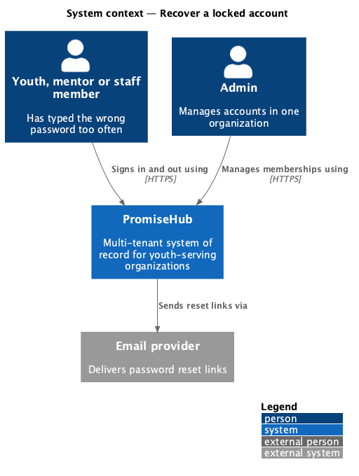
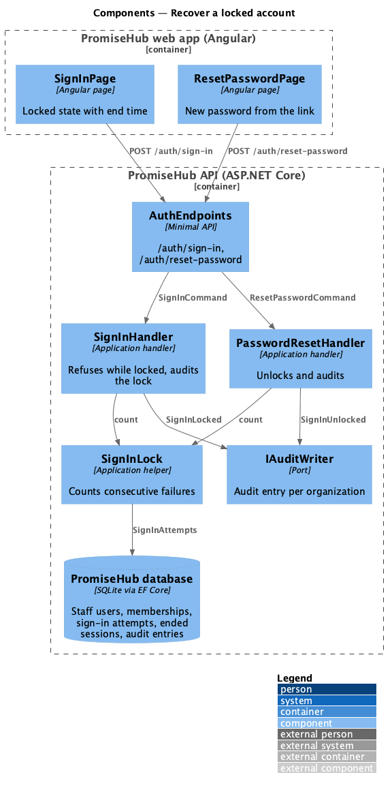
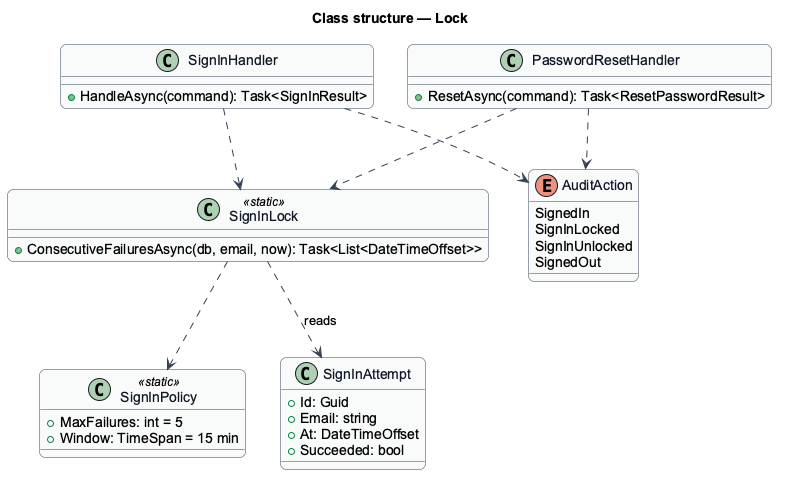
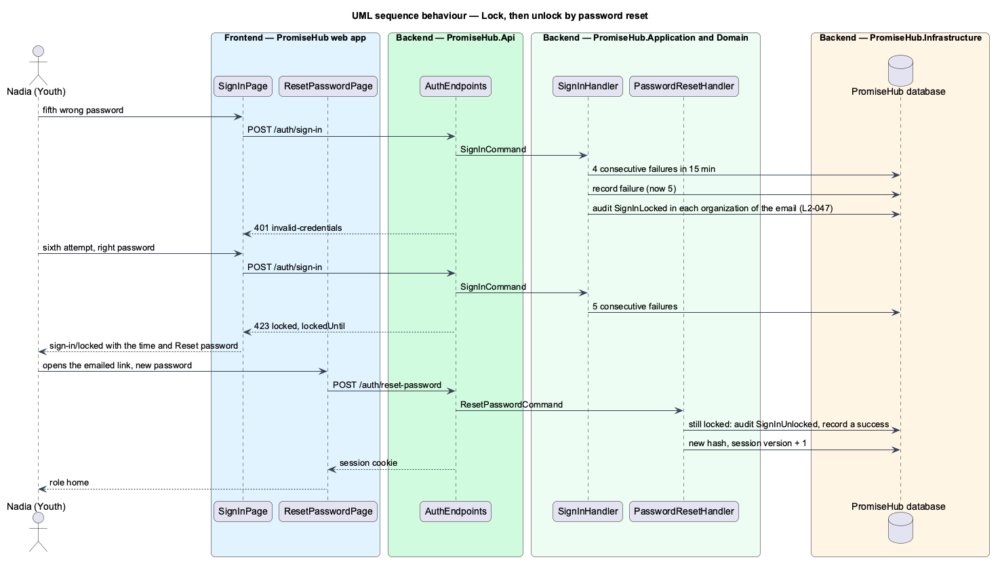

# Recover a locked account

## Overview

PromiseHub is a multi-tenant, phone-first system of record for small youth-serving organizations. Repeated wrong passwords for one email pause sign-in for that email for 15 minutes, so a guessed password cannot be found by trying many. This feature covers when the lock starts, what the person sees, how the lock ends and how the lock is recorded for the organization's admins.

After five consecutive failed sign-ins within 15 minutes, the sixth attempt answers 423 "locked" with the time the lock ends, even when the password is right, and whether or not the email has an account. The sign-in page shows the locked state (`sign-in/locked`) with that time and Reset password. The lock ends by itself after 15 minutes. A password reset by emailed link (`recover-access`) ends it at once and is audited as an unlock.

Terms used in this document:

- **consecutive failures** — failed attempts for an email since its last successful sign-in or reset, inside the 15-minute window
- **lock** — the period during which `SignInHandler` refuses an email; it ends 15 minutes after the newest failure

Ported from Waypoint `authentication/recover-locked-account` (`L2-AUTH-006`). Waypoint's "contact your mentor" path is not carried over: a locked person resets the password or waits. Waypoint's separate account-locked page is PromiseHub's existing `sign-in/locked` state (ADR 0044).

## Description

- **`SignInLock`** — static helper in `PromiseHub.Application/Identity/`. `ConsecutiveFailuresAsync(db, email, now)` reads the email's attempts inside the window, newest first, and counts failures until the first success.
- **`SignInHandler`** — refuses with `Locked` when the count reaches `SignInPolicy.MaxFailures`. When a new failure makes the count reach it, the handler writes a `SignInLocked` audit entry "Sign-in locked after 5 failed attempts" in every organization where the email holds a current membership, resolving the tenant per membership. An email with no account writes none.
- **`PasswordResetHandler`** — when a reset happens while the email is locked, it writes a `SignInUnlocked` audit entry "Unlocked sign-in by password reset" and records a successful `SignInAttempt`, so the count starts again from zero.
- **`SignInAttempt`** — existing entity: email, time, succeeded. Not tenant-owned; one row per password check.
- **`AuditAction`** — gains `SignInLocked` and `SignInUnlocked`; the audit log page offers both in its action filter.
- **`SignInPage`** — existing locked state: alert with the end time, Reset password, and the Sign in button disabled.

## Built so far

Prompt 50 delivered everything above. Acceptance tests: `e2e/tests/account/lockout.spec.ts`, the lock filter in `e2e/tests/administration/audit-log.spec.ts`, `backend/tests/PromiseHub.Api.Tests/LockoutTests.cs`.

## Requirements

| L2 ID | Refines (L1) | Requirement |
|-------|--------------|-------------|
| `L2-047` | `L1-016` | Repeated failed sign-ins lock the email for a fixed time, without revealing whether it has an account, and offer the password reset as the way back in. |
| `L2-044` | `L1-003` | A staff member who forgot their password gets a link by email, chooses a new password and carries on signed in. |
| `L2-032` | `L1-017` | Every sensitive action is recorded in an append-only audit trail. |

## Diagrams

### System context

The person who is locked out and the email provider that delivers the reset link.

### Components

`SignInHandler` and `PasswordResetHandler` share `SignInLock` to count consecutive failures.

### Class structure

### Behaviour — lock, then unlock by password reset

The fifth failure starts the lock and is audited per organization; a reset ends it and is audited as an unlock (`L2-047`).

