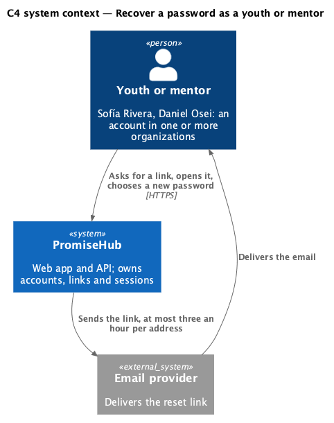
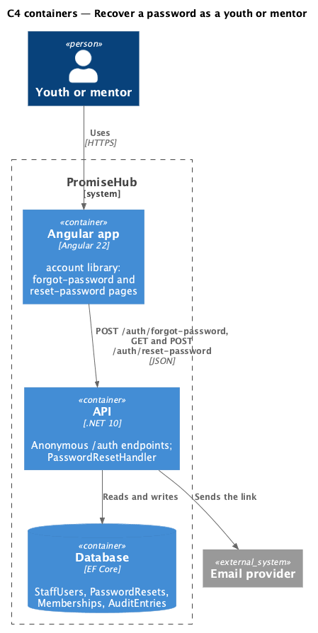
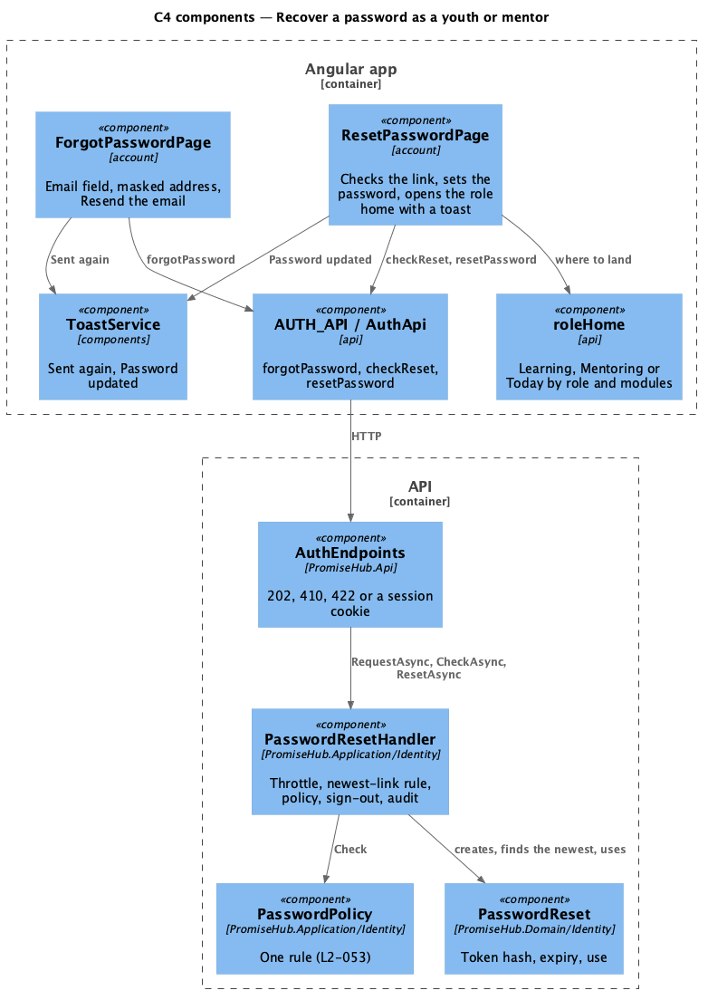
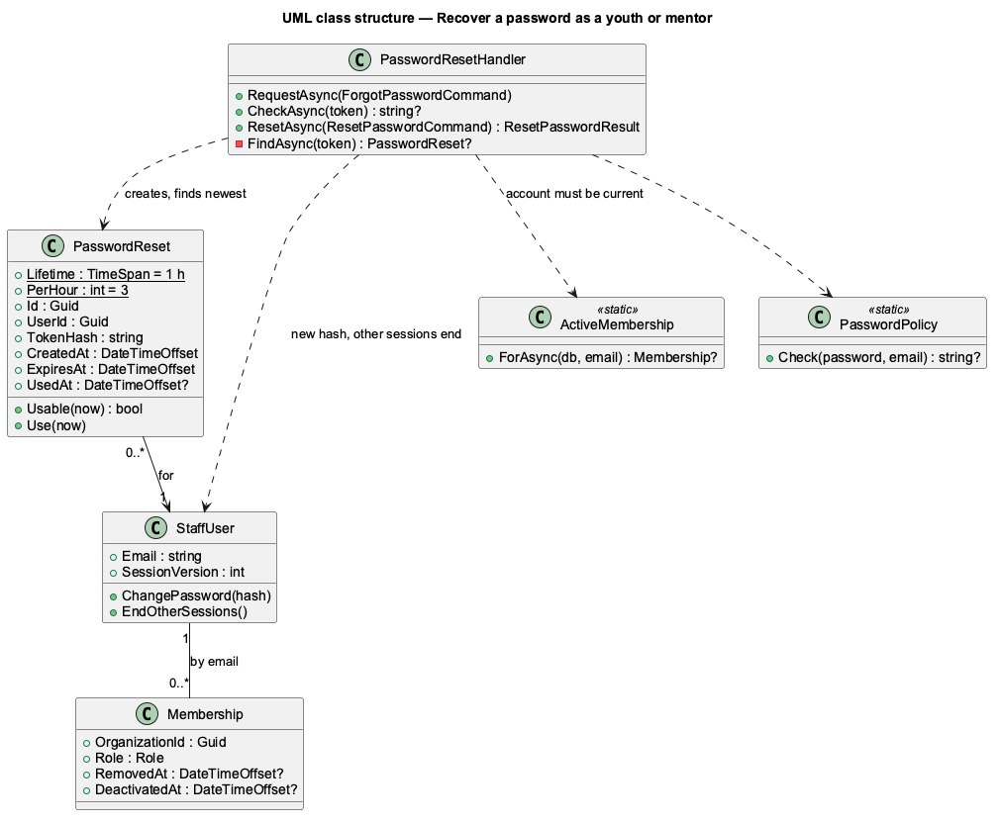
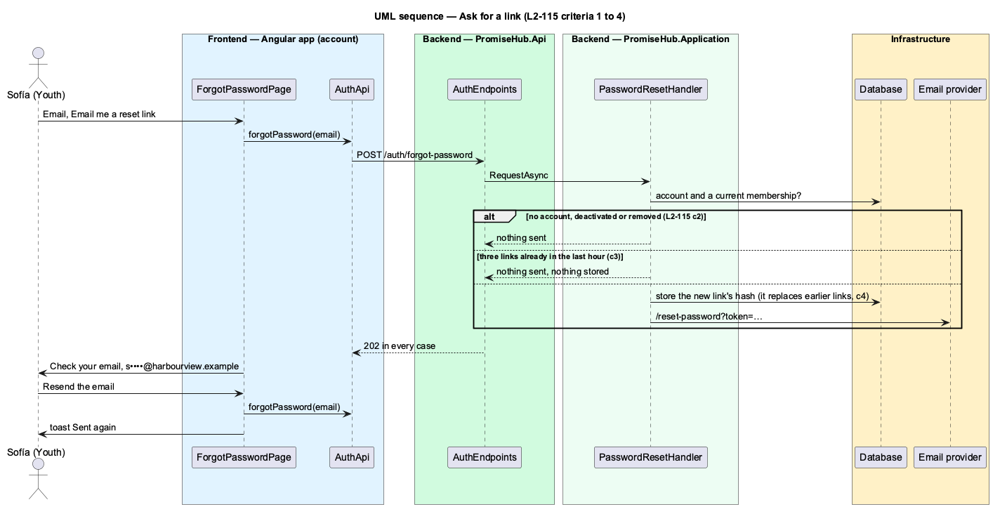
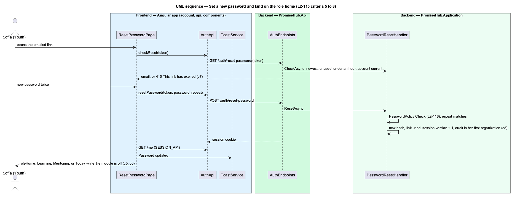

# Recover a password as a youth or mentor

## Overview

PromiseHub is a multi-tenant, phone-first system of record for small youth-serving organizations. Since ADR 0043 youth and mentors hold accounts too, and they sign in with the same form as staff (`sign-in-as-youth-or-mentor`). This feature lets any of them who forgot a password get back in on their own, the way staff already can (`recover-access`, `L2-044`).

From `sign-in`, "Forgot your password?" opens `forgot-password`. Sofía Rivera (Youth) types her email and is told a link is on its way, with her address masked so a shared phone does not show it in full. The answer is the same whether or not the address has an account, whether the account is deactivated, and whether she has already asked three times this hour. The emailed link opens `reset-password`, which names her account; she chooses a new password that meets the one policy, every other session of hers ends, and she lands on Learning with a toast. Daniel Osei (Mentor) lands on Mentoring; at Northgate, where Learning and Mentoring are off, Lucía and Samuel land on Today.

Terms used in this document:

- **reset link** — the emailed address `/reset-password?token=…`; only the token's hash is stored, and it works once, for one hour
- **newest link** — the most recent link of an account; sending a link makes every earlier one unusable
- **throttle** — at most three links per account in any hour; a further request answers like any other and sends nothing
- **role home** — Learning for Youth, Mentoring for Mentor, Today otherwise or while that module is off (`L2-046`)

Ported from Waypoint `authentication/recover-password` (`L2-AUTH-005`). Waypoint's `reset-link-sent` and `reset-success` pages are states of `forgot-password` and `reset-password` here; its refresh-token revocation is PromiseHub's session version (ADR 0039). Identity is not a module and is always on (ADR 0071).

## Description

Frontend, in `frontend/projects/account/`:

- **`ForgotPasswordPage`** — `/forgot-password`. The field is labelled "Email" for every role; an address without an @ is refused inline with "Enter your email address.". After a 202 it shows Check your email with `maskEmail(email)` (first character, four dots, the domain), Back to sign in and Resend the email; resending repeats the request and shows the toast "Sent again" through `ToastService`. States: default, invalid, submitting, success, resent and error.
- **`maskEmail`** — pure function beside the page (`mask-email.ts`).
- **`ResetPasswordPage`** — `/reset-password?token=…`. Checks the link (loading), then shows the form (default, invalid, weak, submitting, failed) or the expired state. After `signed-in` it reads the session through `SESSION_API`, shows the toast "Password updated" ("Other devices were signed out.") and navigates to `roleHome(session)`. The toast region lives in the app root, so the toast stays as the role home opens.
- **`AUTH_API`** (`frontend/projects/api/`) — `forgotPassword`, `checkReset` and `resetPassword`; unchanged.

Every field, button, alert and toast comes from `frontend/projects/components/`.

Backend:

- **`AuthEndpoints`** — `POST /auth/forgot-password` (always 202), `GET /auth/reset-password/{token}` (the email, or 410) and `POST /auth/reset-password` (422 per field, 410, or a session through `SessionCookie`); all anonymous, unchanged.
- **`PasswordResetHandler.RequestAsync`** — sends nothing when the address has no account or no current membership (`ActiveMembership` skips removed and deactivated memberships, ADR 0070), or when `PasswordReset.PerHour` (3) links were created for the account in the last hour; otherwise stores the new link's hash and emails it.
- **`PasswordResetHandler.FindAsync`** — a link is usable when it is unused, under an hour old and the newest of its account. **`CheckAsync`** also answers null (410) when the account no longer has a current membership, as `ResetAsync` already did.
- **`PasswordResetHandler.ResetAsync`** — `PasswordPolicy.Check` with the account's email (`set-secure-password`), the repeat, then the new hash, the link used, `StaffUser.EndOtherSessions()` (the session version is per person, so sessions in every organization end), the tenant resolved from the first current membership and the audit entry "Reset password by emailed link" in that organization only.
- **`PasswordReset`** — `PromiseHub.Domain/Identity/`; gains the `PerHour` constant. Not tenant-owned, like `StaffUser`: a password belongs to the person, not to an organization. No migration.
- **`RequestLoggingMiddleware`** — logs the route template, so neither the token nor the password reaches the log (`L2-116`).

The fake API in `e2e/fixtures/fake-api.ts` mirrors the throttle, the newest-link rule and the role home.

## Built so far

<TO SUPPLY> after implementation.

## Requirements

| L2 ID | Refines (L1) | Requirement |
|-------|--------------|-------------|
| `L2-115` | `L1-003` | A youth or a mentor who forgot their password asks for a link with their own email, gets a single-use link that works for one hour, chooses a new password and carries on signed in on the home of their role, while every other session ends; the answer never reveals whether an address has an account. |
| `L2-116` | `L1-016` | Whoever resets, the same policy applies with their own email, and neither the link's token nor the password is ever written anywhere but the email. |
| `L2-044` | `L1-003` | A staff member who forgot their password gets a link by email, chooses a new password and carries on signed in. |
| `L2-046` | `L1-003` | A youth or a mentor signs in with the same email and password form as staff and lands on the home of their role. |

## Diagrams

### System context

A youth or a mentor recovers their own account; the email provider delivers the link.

### Containers

The Angular app calls three anonymous endpoints; the API keeps only hashes in the database.

### Components

The account pages use `AUTH_API`, `roleHome` and `ToastService`; `PasswordResetHandler` holds every rule.

### Class structure

A `PasswordReset` belongs to a `StaffUser`; the handler finds the newest one and requires a current membership.

### Behaviour — ask for a link

Every request answers 202; only an account with a current membership under the throttle gets an email, and the new link replaces earlier ones.

### Behaviour — set a new password

The link is checked, the policy applies, other sessions end, and the page opens the role home with a toast.

