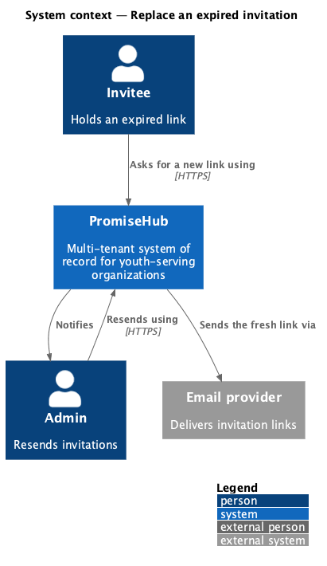
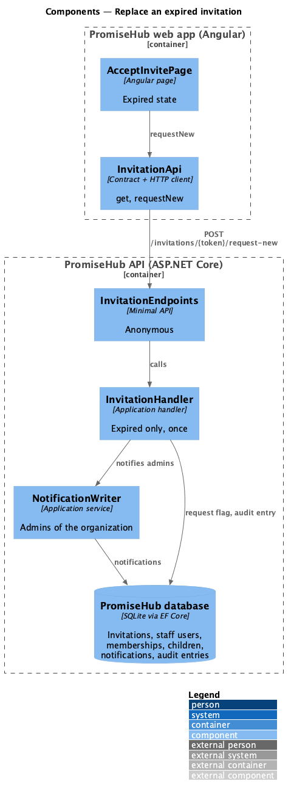
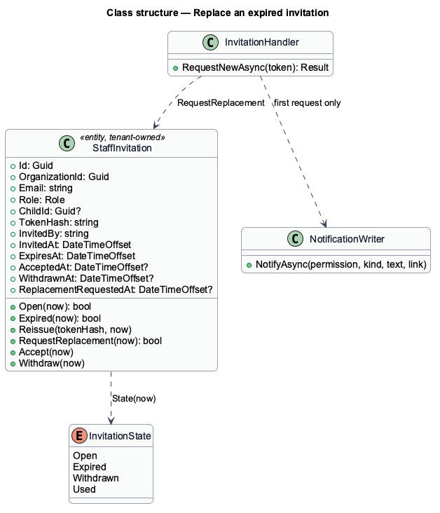
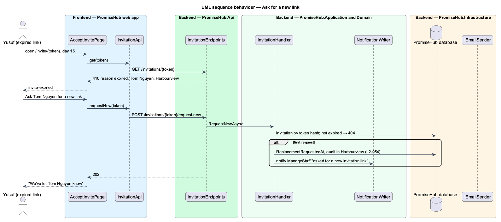

# Replace an expired invitation

## Overview

Invitations last 14 days. A youth who opens the link on day 15 should not be stuck: before this feature PromiseHub only said "Ask Tom Nguyen for a new one". This feature gives the expired link its own page (`invite-expired`) with one button, **Ask Tom Nguyen for a new link**. The request needs no account and no form: the expired token itself identifies the invitation. PromiseHub marks the invitation "Asked for a new link", notifies the organization's admins and audits the request; an admin resends from Staff and roles (`manage-pending-invitations`).

Only an expired invitation can be replaced this way. An open, withdrawn, used or unknown token answers 404, so the endpoint cannot be used to probe tokens or to undo a withdrawal. A second request records nothing more.

Terms used in this document:

- **replacement request** — `StaffInvitation.ReplacementRequestedAt`, set once by the first request and cleared by a resend
- **staff notification** — an in-app notification of kind `staff`, shown while Roster is on, sent to every member holding `ManageStaff`

Ported from Waypoint `platform-services/replace-expired-invitation` (`L2-PLATFORM-011` criterion 2). Waypoint's form with a name, email and note to the mentor is reduced to one button, since the invitation already carries the email and the inviter.

## Description

Frontend:

- **`AcceptInvitePage`** (`frontend/projects/account/`) — for gone reason `expired` it renders the invite-expired state: the heading "This invitation has expired", the inviter's name, **Ask {inviter} for a new link** and **I already have an account**; success says "We’ve let {inviter} know"; a failed request shows the alert "That didn’t go through" and keeps the button.
- **`InvitationApi.requestNew(token)`** (`frontend/projects/api/`).

Backend:

- **`InvitationHandler.RequestNewAsync(token)`** — finds the invitation by token hash; anything but an expired invitation answers not found. The first request calls `StaffInvitation.RequestReplacement`, resolves the tenant from the invitation, notifies admins through `NotificationWriter` ("{email} asked for a new invitation link", linking to `/settings/staff`) and audits; later requests change nothing.
- **`InvitationEndpoints`** — anonymous `POST /invitations/{token}/request-new` answering 202 or 404.
- **`NotificationsHandler`** — kind `staff` maps to Roster.

## Built so far

Prompt 51 delivered everything above: the expired state of `AcceptInvitePage`, `InvitationApi.requestNew`, `InvitationHandler.RequestNewAsync`, the anonymous endpoint and the `staff` notification kind. Acceptance tests: `backend/tests/PromiseHub.Api.Tests/ExpiredInvitationTests.cs`, `e2e/tests/account/invite-expired.spec.ts`.

## Requirements

| L2 ID | Refines (L1) | Requirement |
|-------|--------------|-------------|
| `L2-054` | `L1-003` | An invitation link that timed out shows its own state and lets the invitee ask, without an account, for a fresh link; the admins see the request and resend. |
| `L2-052` | `L1-003` | Admins resend a fresh link or withdraw one, and a link that was used, withdrawn or replaced never works again. |

## Diagrams

### System context

The invitee asks PromiseHub for a new link; PromiseHub tells the organization's admins.

### Components

`AcceptInvitePage` calls `InvitationApi.requestNew`; `InvitationHandler` marks the invitation, notifies and audits.

### Class structure

`RequestReplacement` answers whether this was the first request, so notifications and audit entries are written once.

### Behaviour — ask for a new link

The request is recorded in the invitation's organization only (`L2-054`).

