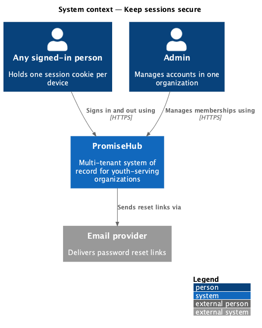
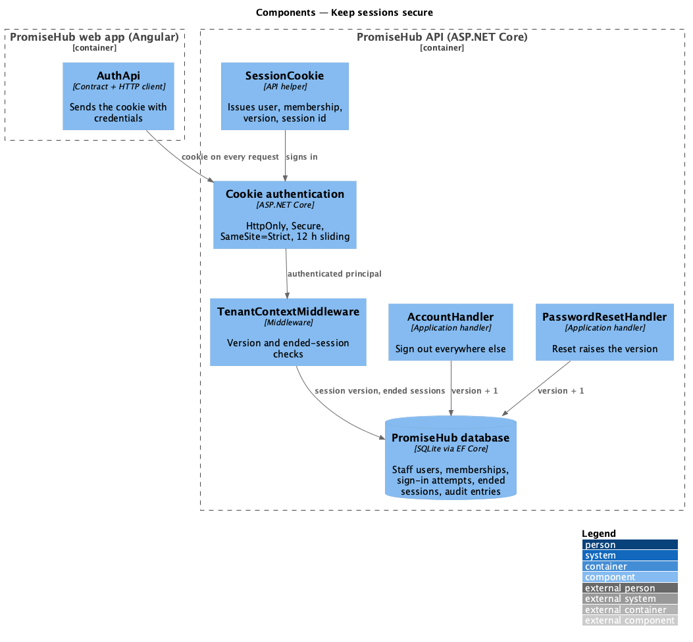
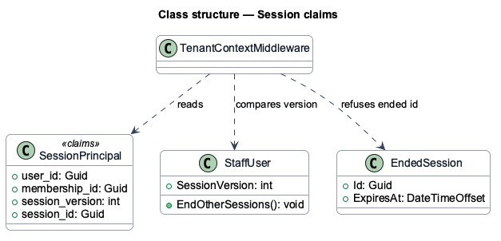
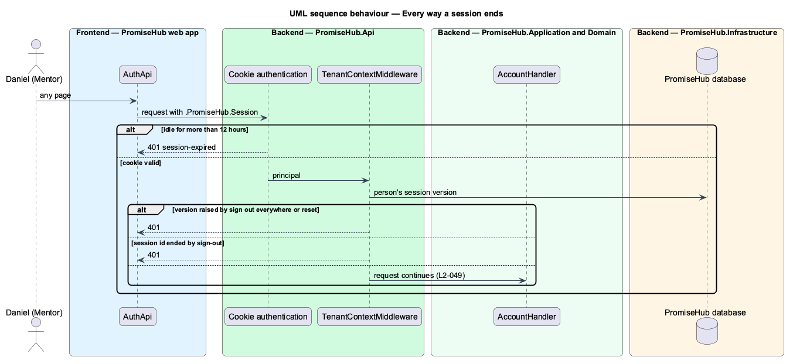

# Keep sessions secure

## Overview

PromiseHub is a multi-tenant, phone-first system of record for small youth-serving organizations. Every signed-in person, staff or participant, holds one session cookie. This feature states how that cookie is protected and every way it stops working, so a stolen or forgotten session cannot be used.

The cookie is HttpOnly, Secure and SameSite=Strict, so script cannot read it and other sites cannot send it. It slides for 12 hours of activity. With "Keep me signed in" off it is a browser-session cookie; with it on, it persists for the window. It stops working when it idles for 12 hours, when its session is signed out (`end-user-session`), when the person signs out everywhere else, and when the password is reset. Nothing that identifies the session is kept in browser storage.

Terms used in this document:

- **session version** — counter on the person carried in every cookie; raising it ends every other session (ADR 0039)
- **ended session** — a signed-out session id that the server refuses (`end-user-session`)

Ported from Waypoint `authentication/rotate-and-revoke-tokens` (`L2-AUTH-012`). PromiseHub has no access or refresh tokens (ADR 0005), so rotation and reuse detection have no counterpart; the session version and ended sessions give the same guarantees for cookies (ADR 0044).

## Description

- **`AuthenticationSetup.AddStaffAuthentication`** — the cookie scheme: name `.PromiseHub.Session`, HttpOnly, `Secure` always, `SameSite=Strict`, `ExpireTimeSpan` 12 hours, sliding. An expired cookie answers 401 "session-expired".
- **`AuthEndpoints.StartSession`** — sets `IsPersistent` from "Keep me signed in".
- **`SessionCookie`** — issues the cookie with the user id, membership id, session version and a new session id.
- **`TenantContextMiddleware`** — refuses a cookie whose session version is older than the person's, or whose session id is ended.
- **`AccountHandler.SignOutOthersAsync`**, **`PasswordResetHandler.ResetAsync`** — raise the session version.
- **`SessionSignOutHandler`** — records the ended session.

## Built so far

Prompt 50 added the session id and ended sessions; the cookie flags, the session version and the idle expiry already existed (ADR 0005, ADR 0039). Acceptance tests: `backend/tests/PromiseHub.Api.Tests/SessionEndingTests.cs`, `SignInTests.cs`, `AccountTests.cs`, `PasswordResetTests.cs`.

## Requirements

| L2 ID | Refines (L1) | Requirement |
|-------|--------------|-------------|
| `L2-049` | `L1-016` | The session lives only in a cookie that script cannot read, it expires when idle, and every way of ending it is enforced by the server. |
| `L2-031` | `L1-016` | TLS everywhere, encryption at rest, OWASP Top 10 defences, secrets outside the repository. |

## Diagrams

### System context

### Components

### Class structure

### Behaviour — every way a session ends

Each request passes the cookie checks in order: expiry, session version, ended session (`L2-049`).

