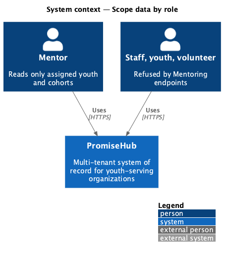
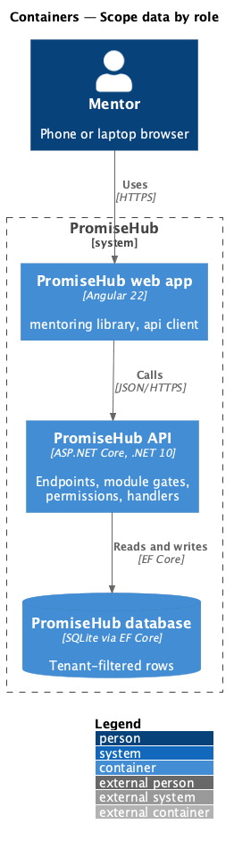
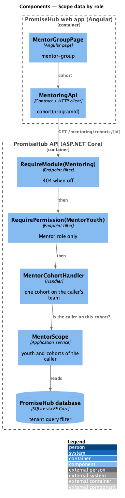
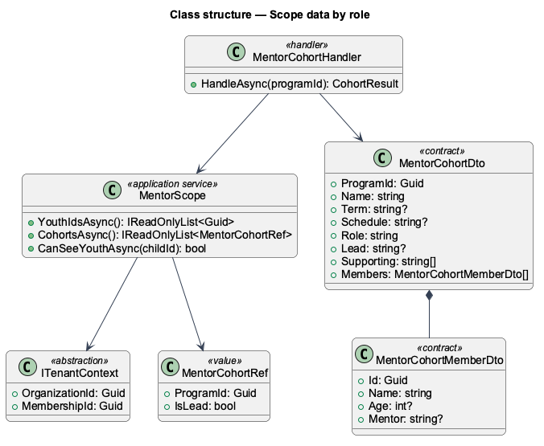
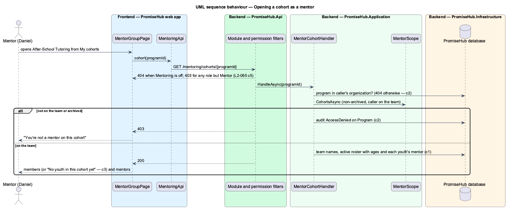

# Scope data by role

## Overview

PromiseHub checks permissions on the server for every endpoint and, where a role sees only part of the data, narrows the rows as well (L2-007). Staff roles were scoped by session and by field; guardians by household; youth by their own linked child. This design adds the mentor's scope: every Mentoring read returns only the youth assigned to the signed-in mentor and the cohorts they lead or support, and a mentor can open the page of a cohort they are on and nothing else.

Terms used in this document:

- **mentor scope** — the caller's youth (direct `YouthMentor` rows plus the active rosters of non-archived cohorts on their team) and those cohorts, from `MentorScope`
- **on the team** — the caller is the lead or a supporting mentor of a program (`CohortMentor`)

Ported from Waypoint `authentication/scope-data-by-role` (`L2-AUTH-010` criterion 1); its guardian, volunteer, youth and staff criteria are already L2-007 criteria 7, 9 and 11 and L2-019. In PromiseHub the Waypoint authentication subsystem is `identity` (ADR 0043).

## Description

- **`MentorScope`** (`PromiseHub.Application/Mentoring/`) — the single source of the mentor scope, built from `ITenantContext.MembershipId` and the tenant-filtered sets; `YouthIdsAsync`, `CohortsAsync` and `CanSeeYouthAsync`. Every Mentoring handler (`MentoringHandler`, `MentorDashboardHandler`, `MentorYouthRecordHandler`, `MentorCohortHandler`) asks it instead of writing its own query, so the rule of L2-062 criterion 5 lives in one place.
- **`MentorCohortHandler`** and **`GET /mentoring/cohorts/{programId}`** — the cohort page for a mentor (`mentor-group`): name, term, schedule, the caller's role, the lead and supporting mentors by name, and the active roster with ages and each youth's mentor. A program outside the caller's organization or unknown answers 404; a program the caller is not on, or an archived one, answers 403 with an `AccessDenied` audit entry on `Program`.
- **Endpoint filters** — every Mentoring endpoint carries `RequireModule(Mentoring)` (404 when off, checked first) and `RequirePermission(MentorYouth)` (the Mentor role only; staff, youth and volunteers get 403).
- **`MentorGroupPage`** (`frontend/projects/mentoring/`, `/mentoring/cohorts/:programId`) — members and mentors as `ph-list` cards; empty, error and forbidden states as `ph-empty-state`.

The changes to [authorize-request](../authorize-request/README.md) are one line: `MentorYouth` now also covers the dashboard, the youth record and the cohort page.

## Built so far

Prompt 55 delivered everything above. Acceptance tests: `backend/tests/PromiseHub.Api.Tests/MentorCohortTests.cs` and the scope cases in `MentorDashboardTests.cs` and `MentorYouthRecordTests.cs`, `e2e/tests/mentoring/mentor-group.spec.ts`.

## Requirements

| L2 ID | Refines (L1) | Requirement |
|-------|--------------|-------------|
| `L2-065` | `L1-003` | Every Mentoring read is scoped on the server to what the signed-in mentor is assigned: their youth, and the cohorts they lead or support. A mentor can open the cohort page of a cohort they are on and nothing else. |
| `L2-007` | `L1-003` | Permissions are enforced per endpoint and per field by role; the UI reflects them but never substitutes for them. |

## Diagrams

### System context

Who meets the mentor scope.

### Containers

The API applies the module gate, the permission and the scope on every request.

### Components

The filters, the cohort handler and the scope service.

### Class structure

`MentorScope` and the cohort contract.

### Behaviour — opening a cohort

The filters answer first; the handler then checks the cohort against the scope.

