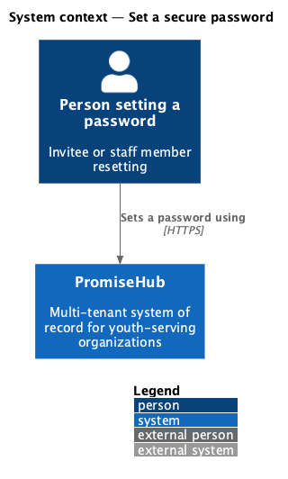
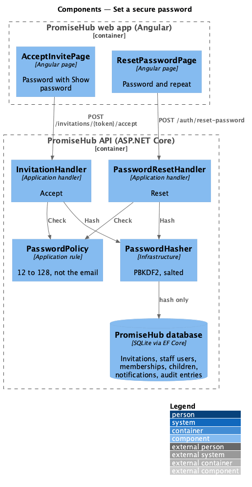
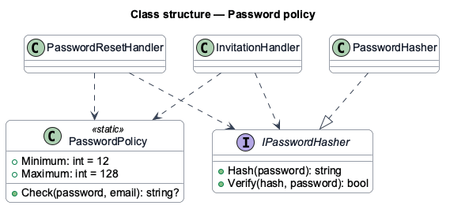
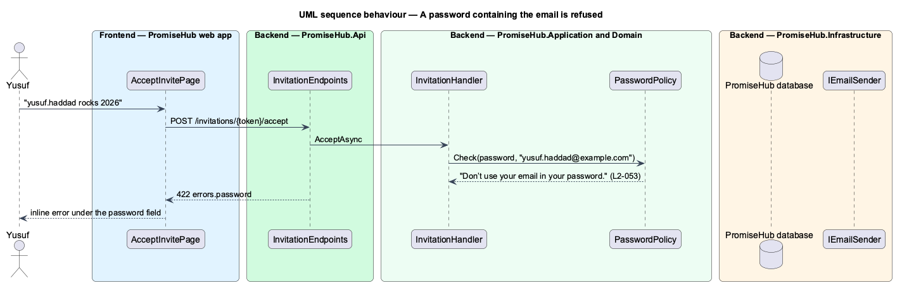

# Set a secure password

## Overview

A password is set in two places: accepting an invitation (`accept-invite`) and resetting a forgotten password (`reset-password`, `L2-044`). Before this feature each path checked only a 12-character minimum, written twice. This feature gives both one rule, `PasswordPolicy`, so the same password always gets the same answer, and documents how passwords are stored.

The rule: at least 12 characters, at most 128, and not containing the part of the email before the @ when that part has three characters or more, ignoring case. PromiseHub keeps its 12-character minimum instead of Waypoint's eight characters with a letter and a number (ADR 0045). Passwords are hashed with ASP.NET Core Identity's PBKDF2 hasher, salted per hash, and never written to the database, the audit log or the request log.

Terms used in this document:

- **password policy** — the rule above, applied by the server on every path that sets a password
- **local part** — the part of an email address before the @

Ported from Waypoint `authentication/set-secure-password` (`L2-AUTH-008`). Change password while signed in has no PromiseHub screen yet and is deferred.

## Description

- **`PasswordPolicy`** (`PromiseHub.Application/Identity/`) — static `Check(password, email)` answering null or the message for the `password` field: "Use at least 12 characters.", "Use at most 128 characters." or "Don’t use your email in your password.". `Minimum` is 12 and `Maximum` 128.
- **`InvitationHandler.AcceptAsync`** and **`PasswordResetHandler.ResetAsync`** — call `PasswordPolicy.Check` with the account's email; an existing account accepting an invitation confirms its current password instead.
- **`PasswordHasher`** (`PromiseHub.Infrastructure/Auth/`) — PBKDF2 through `PasswordHasher<StaffUser>`; unchanged.
- **`PhTextField`** (`frontend/projects/components/`) — a `password` field already renders a Show password toggle; `AcceptInvitePage` and `ResetPasswordPage` state the rule in the help text.

## Built so far

Prompt 51 delivered everything above: `PasswordPolicy` on both paths and the rule in both help texts. Acceptance tests: `backend/tests/PromiseHub.Api.Tests/PasswordPolicyTests.cs`, `e2e/tests/account/password-policy.spec.ts`.

Prompt 77 (`L2-116`, ADR 0071) applies the same rule to youth and mentors resetting their own password, with their own email, and confirms the request log keeps only route templates, so neither a reset token nor a password is logged.

## Requirements

| L2 ID | Refines (L1) | Requirement |
|-------|--------------|-------------|
| `L2-053` | `L1-016` | One password rule applies wherever a password is set, and passwords are stored only as adaptive hashes. |
| `L2-116` | `L1-016` | Whoever resets, the same policy applies with their own email, and neither the link's token nor the password is ever written anywhere but the email. |
| `L2-044` | `L1-003` | A staff member who forgot their password gets a link by email, chooses a new password and carries on signed in. |

## Diagrams

### System context

Anyone who sets a password goes through PromiseHub's one policy.

### Components

Both handlers that set passwords call `PasswordPolicy` and then `IPasswordHasher`.

### Class structure

`PasswordPolicy` is a pure rule with no state.

### Behaviour — a password containing the email is refused

The reset path and the invitation path give the same answer (`L2-053`).

