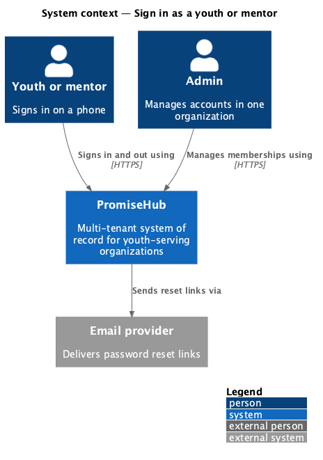
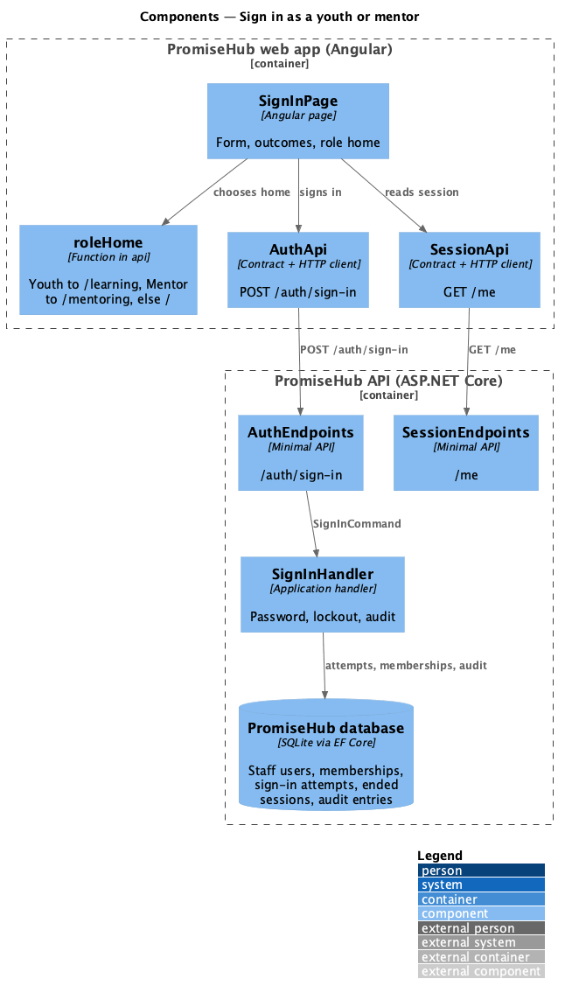
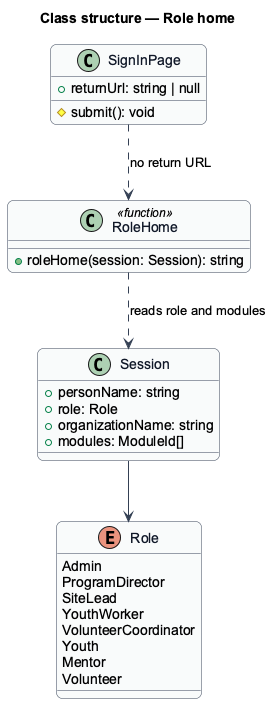
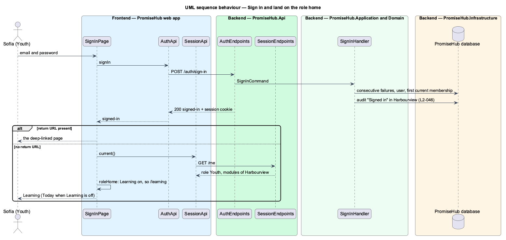

# Sign in as a youth or mentor

## Overview

PromiseHub is a multi-tenant, phone-first system of record for small youth-serving organizations. Since ADR 0043 a membership may hold a participant role: **Youth**, linked to the youth's own child record, or **Mentor**, who sees only the youth assigned to them. This feature lets those people sign in with the same email and password form as staff and land on the page that is home for their role.

A youth lands on Learning (`learning`) and a mentor on Mentoring (`mentoring`). Everyone else, and a youth or mentor whose module is off for their organization, lands on Today. A deep link opened before signing in wins over the home. The home is presentation only: the server still decides what each role may read (`L2-007`), and a module that is off answers 404 (`L2-005`).

Terms used in this document:

- **participant role** — Youth, Mentor or Volunteer; a role without the `UseStaffApp` permission (ADR 0043)
- **role home** — the first page after sign-in for a role whose module is on: `/learning` for Youth, `/mentoring` for Mentor, `/` (Today) otherwise
- **return URL** — the same-app path a person was sent away from to sign in; followed only when it starts with one `/`

Ported from Waypoint `authentication/sign-in` (`L2-AUTH-001`). Waypoint's access and refresh tokens are replaced by PromiseHub's cookie session (ADR 0005); its separate youth, mentor and admin home routes become the role home above.

## Description

Frontend:

- **`roleHome(session)`** — pure function in `frontend/projects/api/src/lib/session/role-home.ts`. Reads `Session.role` and `Session.modules` and returns `/learning`, `/mentoring` or `/`. It lives in `api` so the `account` library and the app share it without depending on each other.
- **`SignInPage`** — in `frontend/projects/account/`. After a `signed-in` outcome it follows the safe return URL when one is present; otherwise it loads the session through `SESSION_API` and navigates to `roleHome(session)`. The email field is labelled "Email" because youth sign in too.
- **`MfaPage`**, **`ResetPasswordPage`** — follow the same rule after their own `signed-in` outcomes.
- **`authGuard`** and **`Shell`** — unchanged; the shell composes navigation by role and module (ADR 0043).

Backend: unchanged. `SignInHandler` already finds the person's first current membership by organization name, verifies the password, applies the lockout (`recover-locked-account`), audits "Signed in" in that organization and issues the session cookie through `SessionCookie`. `GET /me` answers the role and the organization's modules from the session's membership. Participant roles never need a second factor (`SignInPolicy.RequiresMfa`).

## Requirements

| L2 ID | Refines (L1) | Requirement |
|-------|--------------|-------------|
| `L2-046` | `L1-003` | A youth or a mentor signs in with the same email and password form as staff and lands on the home of their role: youth on Learning, mentors on Mentoring, everyone else on Today. |
| `L2-006` | `L1-003` | Staff sign in with email and password; admins complete MFA; sessions expire after 12 hours of inactivity and can be revoked. |
| `L2-005` | `L1-002` | A module that is off is neither served nor rendered. |

## Diagrams

### System context

A youth or mentor signs in to PromiseHub from a phone browser; the email provider takes part only in the reset path.

### Components

`SignInPage` asks `AuthApi` to sign in, then `SessionApi` for the session that `roleHome` reads.

### Class structure

`roleHome` depends only on the `Session` contract; the role and the modules decide the path.

### Behaviour — sign in and land on the role home

The server answers `signed-in`; the page reads `/me` and chooses Learning, Mentoring or Today, unless a return URL was given (`L2-046`).

