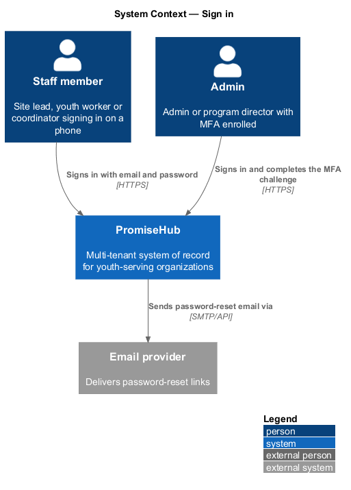
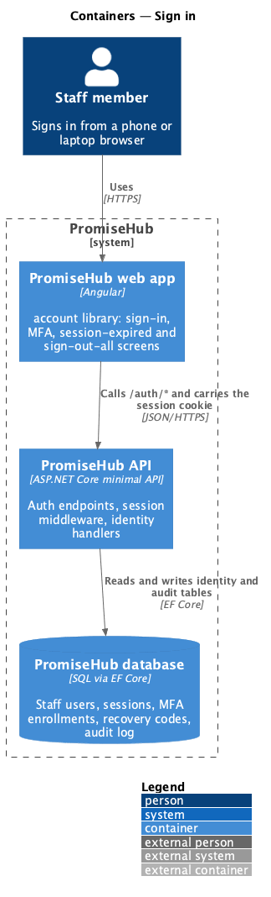
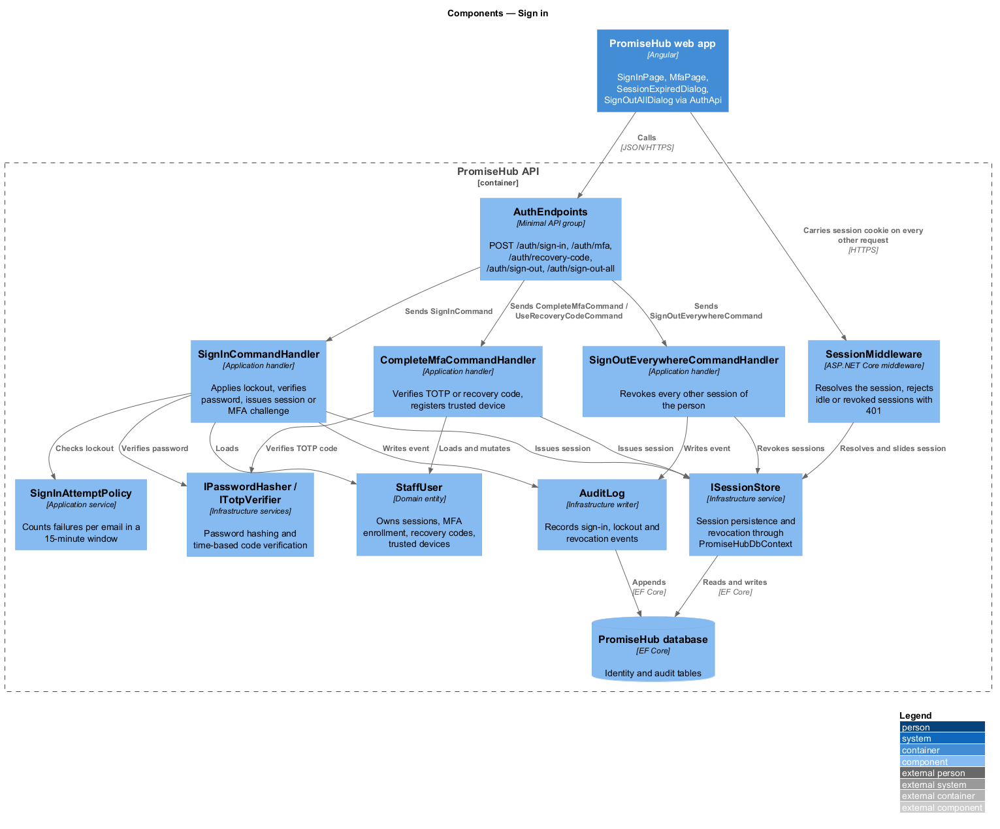
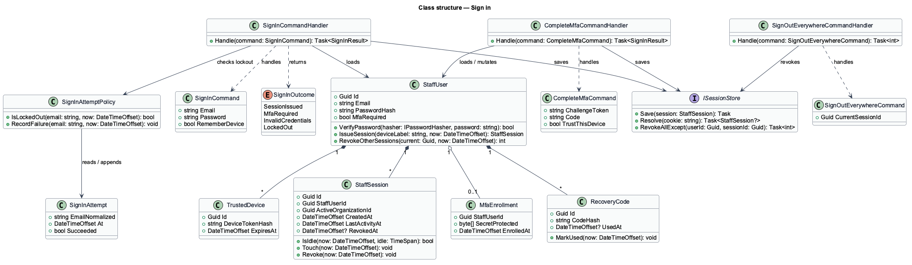
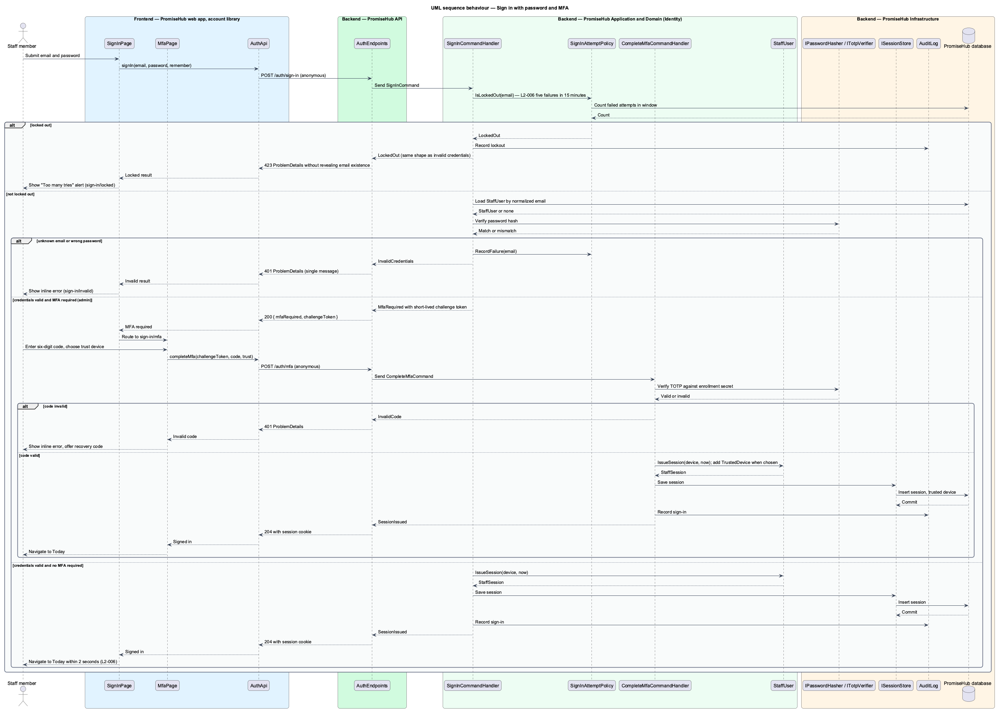
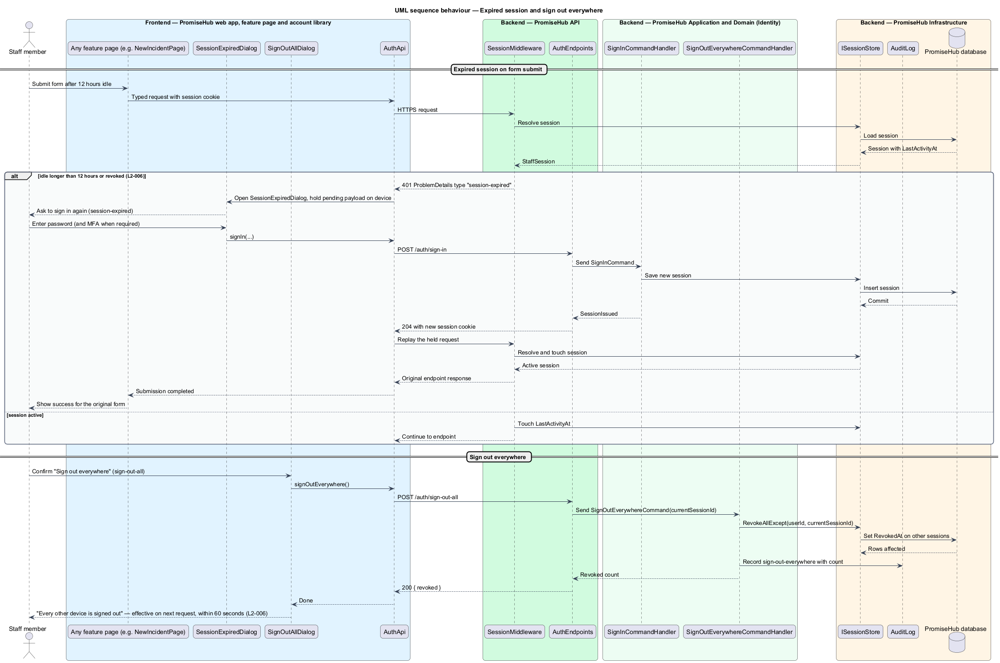

# Sign in

## Overview

PromiseHub is a multi-tenant, phone-first system of record for small youth-serving non-profits. Staff reach every staff screen through an authenticated session. This feature covers how a staff member obtains that session, how an admin completes a second factor, how a session ends and how a staff member revokes sessions on other devices.

A staff member signs in with a work email and a password on the `sign-in` page. An admin with multi-factor authentication (MFA) enrolled completes a second step with a six-digit code from an authenticator app (`sign-in/mfa`) or with a recovery code that works once (`recovery-codes`). Repeated failed attempts lock the account for a fixed period, and the lockout response never reveals whether the email exists. A session expires after 12 hours of inactivity; when a form is submitted against an expired session, the `session-expired` dialog asks the person to sign in again and the form content stays on the device. From the account menu, a staff member may choose "Sign out everywhere" (`sign-out-all`) to invalidate every other session.

Terms used in this document:

- **staff session** — server-issued, revocable credential that identifies one signed-in person and their active organization for 12 hours of inactivity
- **lockout** — 15-minute period after five failed sign-in attempts within 15 minutes during which sign-in for that email is refused
- **MFA challenge** — second sign-in step that requires a time-based six-digit code or a one-time recovery code
- **recovery code** — pre-generated single-use code that satisfies the MFA challenge when the authenticator is unavailable
- **trusted device** — browser that completed an MFA challenge and chose to skip the challenge for 30 days

## Description

The feature is a vertical slice from the Angular auth pages to the identity tables in the database. Business rules live in the `PromiseHub.Application/Identity/` handlers, never in the endpoints or the pages.

Frontend, in `frontend/projects/account/`:

- **`SignInPage`** — page component rendered inside the design system's centred authentication card. It shows the `default`, `invalid`, `submitting`, `error`, `expired` and `locked` states, and routes to `MfaPage` when the server requests a second factor.
- **`MfaPage`** — page component for `sign-in/mfa`. It collects the six-digit code, offers the "Don't ask again on this laptop for 30 days" switch and links to recovery-code entry.
- **`RecoveryCodesDialog`** — CDK dialog for `recovery-codes`. It lists the unused codes once after generation and warns that each works once.
- **`SessionExpiredDialog`** — CDK dialog for `session-expired`. It opens when any API call answers 401 with the `session-expired` problem type, keeps the pending form payload in memory, and replays the submission after re-authentication.
- **`SignOutAllDialog`** — CDK dialog for `sign-out-all`, opened from the account menu.
- **`AuthApi`** — typed client in `frontend/projects/api/` behind the `AUTH_API` injection token with `signIn`, `completeMfa`, `useRecoveryCode`, `signOut` and `signOutEverywhere`. The `promisehub` shell's auth guard reads session state from `AuthApi`.

All form controls, alerts, switches and buttons come from `frontend/projects/components/`.

Backend:

- **`AuthEndpoints`** — minimal-API group in `PromiseHub.Api` exposing `POST /auth/sign-in`, `POST /auth/mfa`, `POST /auth/recovery-code`, `POST /auth/sign-out` and `POST /auth/sign-out-all`. The first three opt into anonymous access; the rest require a session. The endpoints map results to responses and contain no business logic.
- **`SignInCommand` / `SignInCommandHandler`** — verifies the email and password hash, checks the lockout, and either issues a session or returns an MFA challenge token. Failures for unknown and known emails share one message and one response time budget.
- **`CompleteMfaCommand` / `CompleteMfaCommandHandler`** — validates the time-based code against the enrolled secret, optionally registers a trusted device and issues the session.
- **`UseRecoveryCodeCommand` / `UseRecoveryCodeCommandHandler`** — hashes the submitted recovery code, matches it to an unused code, marks it used and issues the session.
- **`SignOutEverywhereCommand` / `SignOutEverywhereCommandHandler`** — revokes every session of the person except the current one.
- **`SignInAttemptPolicy`** — application service that counts failed attempts per email within the 15-minute window and applies the lockout.
- **`StaffUser`**, **`StaffSession`**, **`MfaEnrollment`**, **`RecoveryCode`**, **`TrustedDevice`**, **`SignInAttempt`** — domain entities in `PromiseHub.Domain/Identity/`. `StaffSession` carries `LastActivityAt` and `RevokedAt`; `MfaEnrollment` is required for the `Admin`, `ProgramDirector` and `PlatformAdmin` roles.
- **`SessionMiddleware`** — `PromiseHub.Api` middleware that resolves the session cookie, rejects sessions idle for more than 12 hours or revoked with 401 and the `session-expired` problem type, and slides `LastActivityAt`.
- **`IPasswordHasher`**, **`ITotpVerifier`**, **`ISessionStore`** — infrastructure services in `PromiseHub.Infrastructure/Auth/`. `ISessionStore` is backed by `PromiseHubDbContext` so revocation is visible to every API instance on the next request; the 60-second revocation window in `L2-006` is met by the store, not by a cache.
- **`AuditLog`** — infrastructure writer that records sign-in, MFA, lockout and sign-out-everywhere events as administrative actions.

ADR 0005 settles the cookie name (`.PromiseHub.Session`), `SameSite=Strict` and hashing (ASP.NET Core Identity PBKDF2). Still open: the number of recovery codes per enrollment and the MFA enrollment deadline shown in the `account/mfa-off` banner are `<TO SUPPLY>`.

## Built so far

Prompt 50 (ADR 0044) opened this sign-in to youth and mentors with a role home (`sign-in-as-youth-or-mentor`), made the lock count consecutive failures and audited the lock and the unlock (`recover-locked-account`), ended sessions on the server at sign-out (`end-user-session`) and added the account-inactive state (`handle-deactivated-account`). The email field is labelled "Email".

Slice 45 added the account page (`GET /me/account`), recovery codes stored as hashes, and signing out everywhere through `StaffUser.SessionVersion` checked on every request (ADR 0039).

Slice 02 delivered `SignInPage` (default, invalid, submitting, error, expired and locked) and `MfaPage` in `account`, the auth guard and account-menu sign-out in the shell, `POST /auth/sign-in`, `/auth/mfa` and `/auth/sign-out`, `SignInHandler`, `CompleteMfaHandler`, the attempt-based lockout, TOTP verification and audited sign-ins. Sessions are cookie tickets (ADR 0005), so `SessionMiddleware`, `ISessionStore`, `StaffSession`, recovery codes, trusted devices, sign-out-everywhere and the session-expired dialog that replays a form are deferred to `manage-sessions` and `recover-account-access`; today an expired session returns to sign-in with the destination kept.

Prompt 77 (ADR 0071) opened "Forgot your password?" to every role: youth and mentors reset through the same pages and land on their role home (`recover-password`).

Passwords set through an invitation or a reset follow one rule, `PasswordPolicy` (`set-secure-password`, `L2-053`); sign-in itself only verifies the stored hash.

## Requirements

The feature realizes the following level-2 (L2) requirements. Each L2 requirement refines a level-1 (L1) requirement, cited by identifier.

| L2 ID | Refines (L1) | Requirement |
|-------|--------------|-------------|
| `L2-006` | `L1-003` | Staff sign in with email and password; admins complete MFA; sessions expire after 12 hours of inactivity and can be revoked. |
| `L2-031` | `L1-016` | TLS everywhere, encryption at rest, OWASP Top 10 defences, secrets outside the repository. |

## Diagrams

### System context

A staff member signs in to PromiseHub from a phone or laptop browser. No external system takes part in password or authenticator sign-in; the email provider is used only by the password-reset path that shares these pages.

### Containers

The `account` library of the PromiseHub web app calls the PromiseHub API, which reads and writes staff users, sessions and audit entries in the PromiseHub database.

### Components

`AuthEndpoints` dispatches commands to the identity handlers; `SessionMiddleware` guards every other endpoint. The handlers use the password hasher, the TOTP verifier and the session store from the infrastructure project.

### Class structure

`StaffUser` owns its sessions, MFA enrollment, recovery codes and trusted devices. `SignInAttemptPolicy` reads `SignInAttempt` rows to decide a lockout.

### Behaviour — sign in with password and MFA

The handler applies the lockout before verifying the password, returns one message for wrong password and unknown email, and requires the MFA challenge for admins (`L2-006`).

### Behaviour — expired session and sign out everywhere

`SessionMiddleware` rejects an idle session with 401; the `SessionExpiredDialog` keeps the form payload and replays it after sign-in. The second half shows session revocation from `sign-out-all`.

