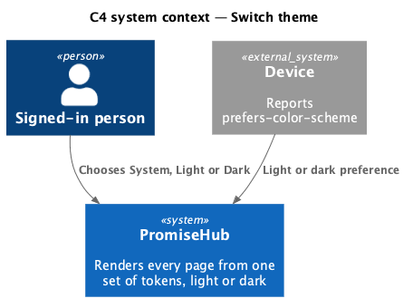
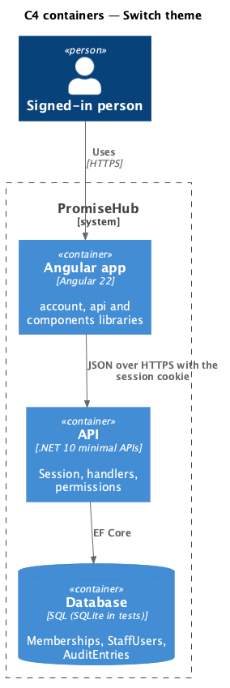
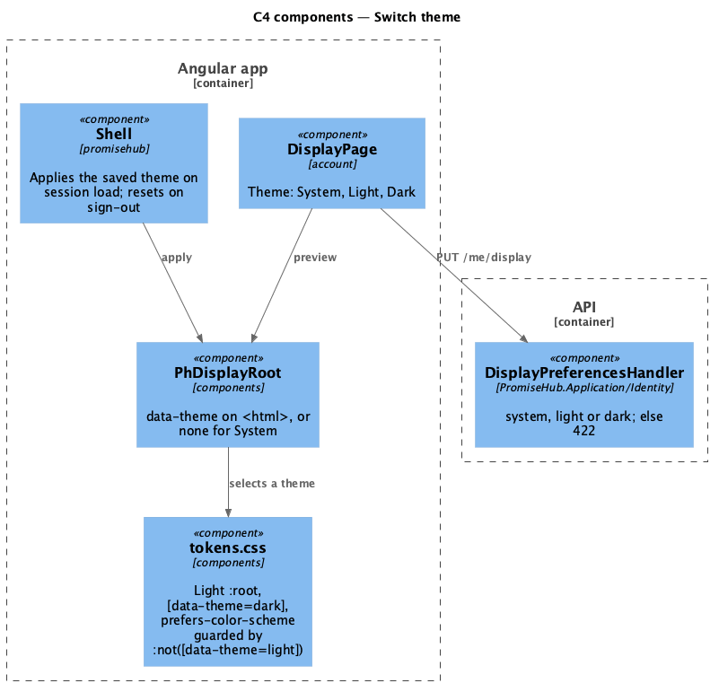
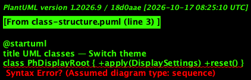
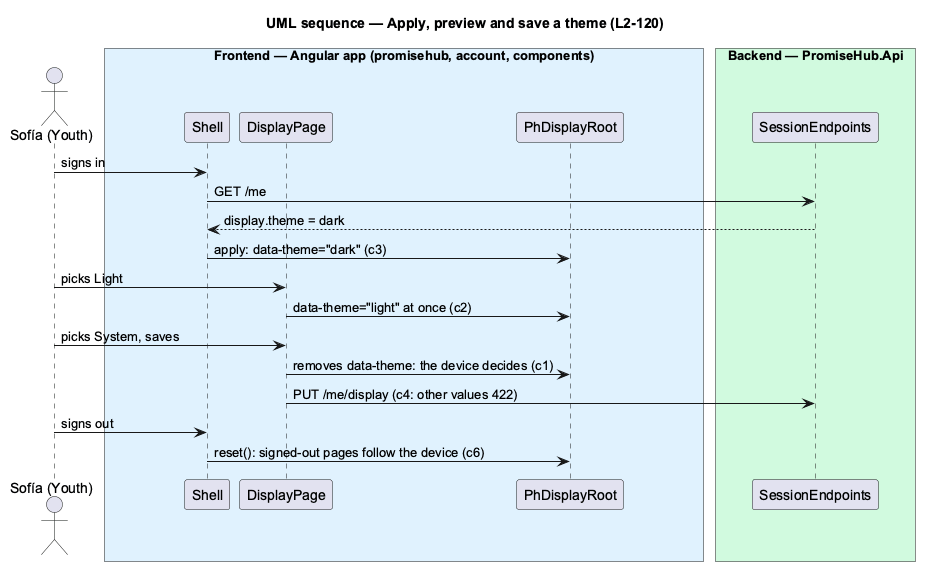

# Switch theme

## Overview

PromiseHub's design tokens already define a light and a dark **theme**: a complete set of colours for every surface, text, border and state. Components read tokens, never colours, so changing the token values in one place changes every page. Until now the device decided which one applied, through `prefers-color-scheme`. This feature lets each person choose **System** (the default, following the device), **Light** or **Dark**, saved with their account like the other display preferences.

Sofía picks Dark on Display; the whole app turns dark at once, before she saves. Saved, it is dark after a reload and on her next sign-in on any device, even one set to light. Signed-out pages (sign-in, guardian pages, the public website) have no saved theme and always follow the device.

Terms used in this document:

- **theme attribute** — `data-theme="light"` or `"dark"` on `<html>`; with no attribute the `prefers-color-scheme` media query, guarded by `:root:not([data-theme='light'])`, picks the dark tokens on a dark device
- **preview** — a theme applied on Display before it is saved

Ported from Waypoint `platform-services/switch-theme` (`L2-PLATFORM-013`), stored with the display preferences of [Configure display preferences](../configure-display/README.md) (ADR 0072).

## Description

- **`tokens.css`** (`frontend/projects/components/src/styles/`, a copy of `docs/design-system/tokens/tokens.css`) — light values on `:root`, dark values under `[data-theme='dark']` and under the media query guarded by `:not([data-theme='light'])`; each theme sets `color-scheme`, so native controls and scrollbars match. Unchanged by this feature.
- **`PhDisplayRoot.apply`** (`frontend/projects/components/`) — sets `data-theme` for `light` and `dark` and removes it for `system`; `reset()` removes it.
- **`DisplayPage`** — the Theme `ph-radio-group` (System with the hint "Follows your device’s light or dark setting.", Light, Dark); picking previews through `PhDisplayRoot`.
- **`Shell`** — applies the session's saved theme once per session and resets the root when the person signs out.
- **`DisplayPreferencesHandler`** — accepts only `system`, `light` and `dark` (`DisplayOptions.Themes`); anything else answers 422 and stores nothing.
- **`StaffUser.Theme`** — default `system`; migration `DisplayPreferences`.

## Built so far

Prompt 78 delivered everything above. Acceptance tests: `backend/tests/PromiseHub.Api.Tests/DisplayPreferencesTests.cs`, `e2e/tests/account/display-and-theme.spec.ts` (Sofía on a device that prefers light: Dark, Light and System previewed, Dark saved and applied after a reload, the device's theme again after sign-out).

## Requirements

| L2 ID | Refines (L1) | Requirement |
|-------|--------------|-------------|
| `L2-120` | `L1-019` | Every page renders from one set of tokens in a light and a dark theme. Each person chooses System, Light or Dark; System follows the device and is the default. |
| `L2-119` | `L1-019` | Each person chooses a text size and whether to reduce motion; the choice is kept with their account and applies to every page they open. |
| `L2-035` | `L1-019` | WCAG 2.2 AA on every screen in both themes. |

## Diagrams

The device supplies the colour scheme that System follows.

Only the signed-in app stores a theme; it travels with the session.

The shell and Display set the theme attribute through `PhDisplayRoot`; the tokens do the rest.

The theme field passes from the person's row to the root attribute.

Signing in applies the saved theme, Display previews and saves, and signing out hands the choice back to the device.

