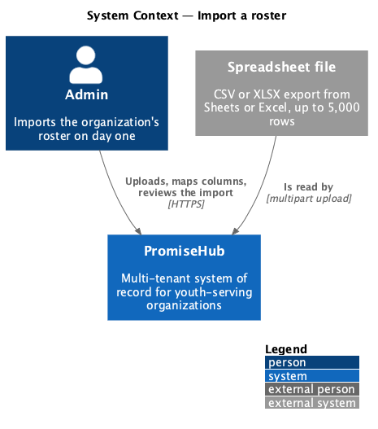
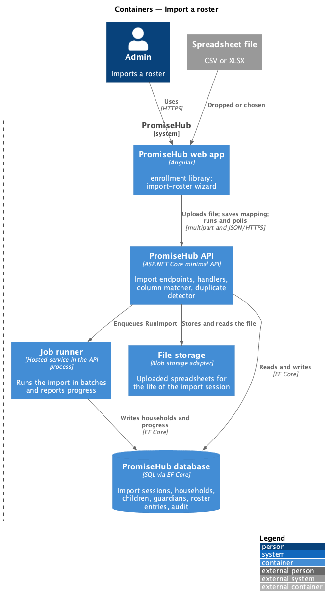
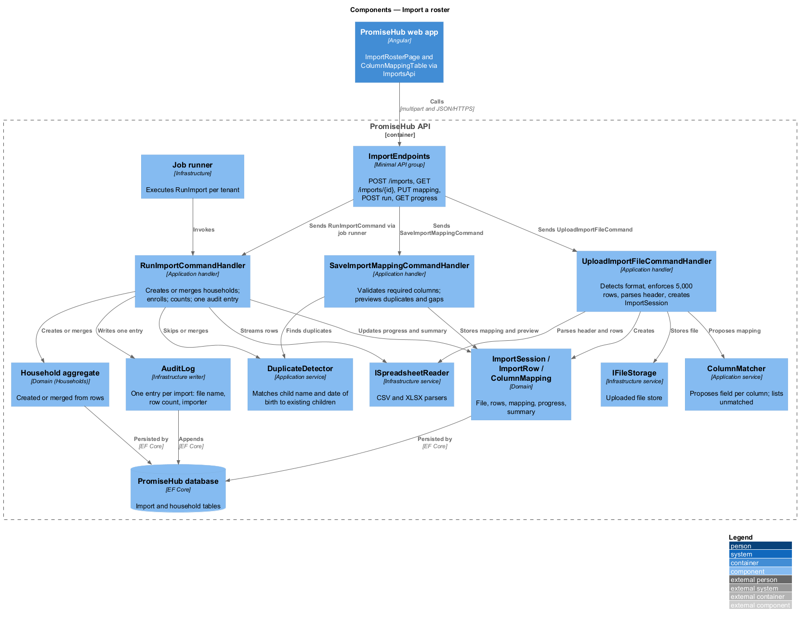
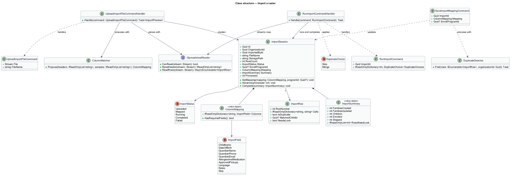
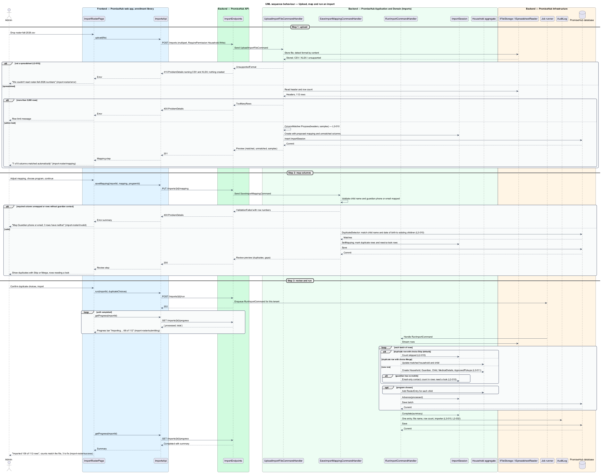

# Import a roster

## Overview

A new organization on PromiseHub usually already keeps its families in a spreadsheet. This feature lets an admin bring that roster in on day one: households, children, guardians, medical flags and approved pickups, from a CSV or XLSX file of up to 5,000 rows, in three steps on the `import-roster` screen: upload, map columns, review.

On upload, PromiseHub reads the file, matches its columns to PromiseHub fields automatically and lists the unmatched ones for the admin to map. The admin may choose a program to enroll every imported child in. The review step runs the import and reports what was created, what was merged and which rows need a look. A row whose child has the same name and date of birth as an existing child is shown as a duplicate and skipped unless the admin chooses to merge. A guardian row with no mobile number creates the household with email-only contact and counts it among "rows need a look". A file that is not a spreadsheet produces the error state that explains the accepted formats, and nothing is created. A completed import is one audit entry listing the file name, row count and importer.

Terms used in this document:

- **import session** — server-side record of one uploaded file, its parsed rows, the column mapping and the outcome
- **column mapping** — assignment of each spreadsheet column to one PromiseHub field or to "skip"
- **duplicate row** — row whose child name and date of birth match an existing child in the organization
- **merge** — choice to update the existing matched household and child from the row instead of skipping it
- **rows need a look** — count of imported rows that created a record with a known gap, such as a guardian without a mobile number

## Built so far

Slice 14 delivered `ImportRosterPage` at `/import` (upload with `ph-file-upload`, mapping with `ph-roster-mapping` and `ph-stepper`, the invalid summary, review of duplicates with merge switches and rows that need a look, results with counts and rows to fix), `IMPORTS_API`, `POST /imports`, `PUT /imports/{id}/mapping`, `POST /imports/{id}/run`, `ImportSession`, `ColumnMatcher`, the duplicate rule and `SpreadsheetReader` for CSV and XLSX (ADR 0017). Progress polling, file storage and the pickup column are not built yet.

## Description

The feature lives in the `enrollment` frontend library (roster import and review share that library in `AGENTS.md`) and the `Imports` application folder.

Frontend, in `frontend/projects/enrollment/`:

- **`ImportRosterPage`** — wizard page for route `/import` with the three steps. States: `default` (drop zone and required columns), `loading` (reading the file), `mapping`, `invalid` (unmapped required column, rows without guardian contact), `submitting` (determinate progress), `success` (counts, rows to fix, next steps) and `error` (file could not be read).
- **`ColumnMappingTable`** — composition of the design system's mapping component: source column, sample value and a select per row.
- **`ImportsApi`** — typed client in `frontend/projects/api/` behind `IMPORTS_API` with `upload(file)`, `getPreview(importId)`, `saveMapping(importId, mapping, programId)`, `run(importId, duplicateChoices)`, `getProgress(importId)`.

Backend:

- **`ImportEndpoints`** — minimal-API group in `PromiseHub.Api`: `POST /imports` (multipart upload), `GET /imports/{id}`, `PUT /imports/{id}/mapping`, `POST /imports/{id}/run`, `GET /imports/{id}/progress`. All require `Household.Write` and the Roster module.
- **`UploadImportFileCommand` / `UploadImportFileCommandHandler`** — stores the file through `IFileStorage`, detects the format by content, parses the header and the first rows with `ISpreadsheetReader`, rejects files over 5,000 rows or of an unsupported format, and creates the `ImportSession`.
- **`ColumnMatcher`** — application service that proposes a mapping from header names and sample values to `ImportField` values; unmatched columns are returned for manual mapping.
- **`SaveImportMappingCommand` / `SaveImportMappingCommandHandler`** — validates that child name and a guardian contact column are mapped, stores the mapping and the target program, and computes the preview: duplicate rows and rows without guardian contact.
- **`RunImportCommand` / `RunImportCommandHandler`** — iterates the rows in batches, creating or merging `Household`, `Guardian`, `Child`, `MedicalDetails` and `ApprovedPickup` through the household aggregate, enrolling children in the chosen program through `RosterEntry`, counting created, updated, skipped and need-a-look rows, and updating `ImportSession.Progress`. The import runs through the job runner so the page can poll progress; the batch size is `<TO SUPPLY>`.
- **`DuplicateDetector`** — application service matching rows to existing children by normalized name and date of birth within the organization.
- **`ImportSession`**, **`ImportRow`**, **`ColumnMapping`**, **`ImportField`**, **`ImportSummary`** — domain types in `PromiseHub.Domain/Imports/`.
- **`ISpreadsheetReader`** — infrastructure service in `PromiseHub.Infrastructure/Imports/` with CSV and XLSX implementations. **`IFileStorage`** holds the uploaded file for the life of the import session; the retention of uploaded files after completion is `<TO SUPPLY>`.
- **`AuditLog`** — one entry per completed import with file name, row count and importer.

## Requirements

The feature realizes the following level-2 (L2) requirements. Each L2 requirement refines a level-1 (L1) requirement, cited by identifier.

| L2 ID | Refines (L1) | Requirement |
|-------|--------------|-------------|
| `L2-010` | `L1-004` | Staff import households, children, guardians, medical flags and pickups from CSV or XLSX in three steps: upload, map columns, review (`import-roster`). |
| `L2-011` | `L1-005` | A household holds guardians and children; each child carries medical details, school, language, notes and approved pickups; everything has an audit trail. |
| `L2-032` | `L1-017` | Every change and every sensitive view is recorded and searchable by admins. |

## Diagrams

### System context

An admin uploads a spreadsheet exported from the organization's existing tool; PromiseHub creates the roster from it.

### Containers

The enrollment library of the PromiseHub web app uploads the file to the PromiseHub API, which stores it, parses it and writes households through the job runner.

### Components

`ImportEndpoints` dispatches upload, mapping and run commands; `ColumnMatcher` and `DuplicateDetector` support the handlers; `ISpreadsheetReader` reads CSV and XLSX; the run handler writes through the household aggregate and audits once.

### Class structure

`ImportSession` owns its rows, mapping and summary; `RunImportCommandHandler` turns mapped rows into households, children and roster entries.

### Behaviour — upload, map and run an import

Upload validates the format and row count, mapping validates required columns and previews duplicates and gaps, and the run creates or merges records and writes one audit entry (`L2-010`).

