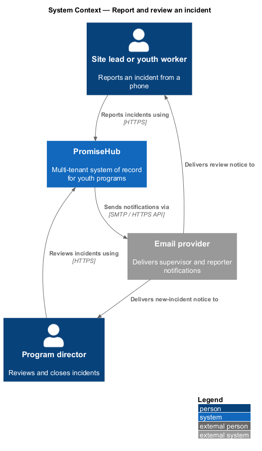
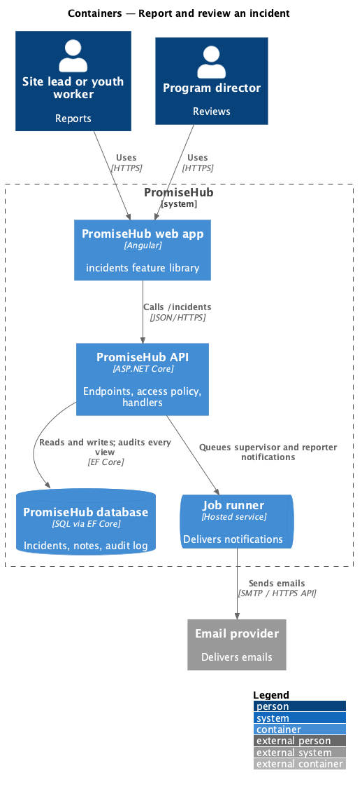
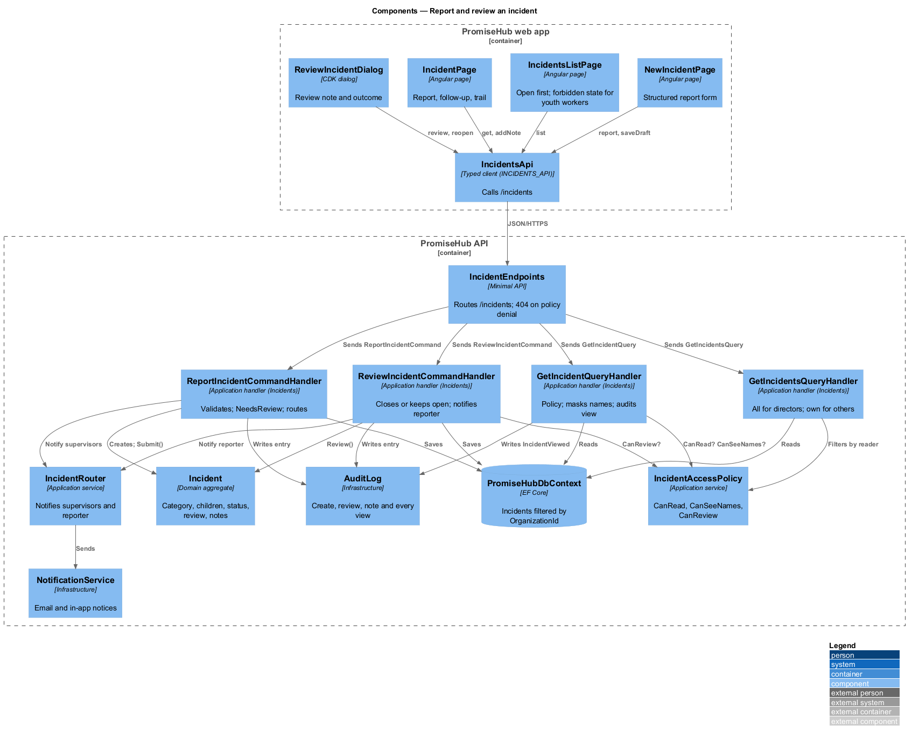
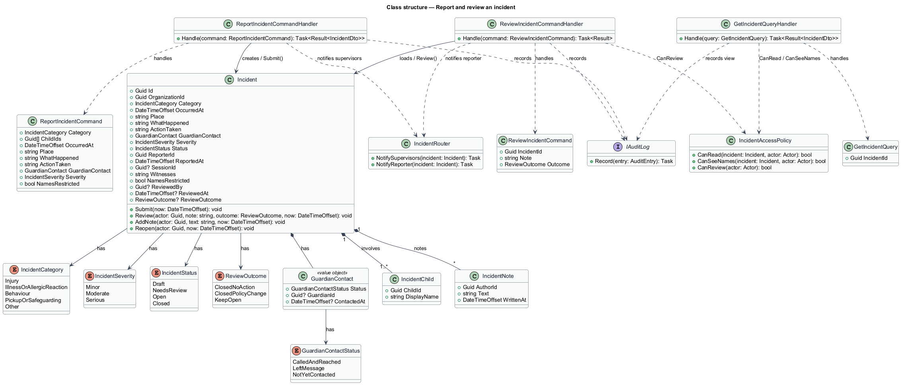
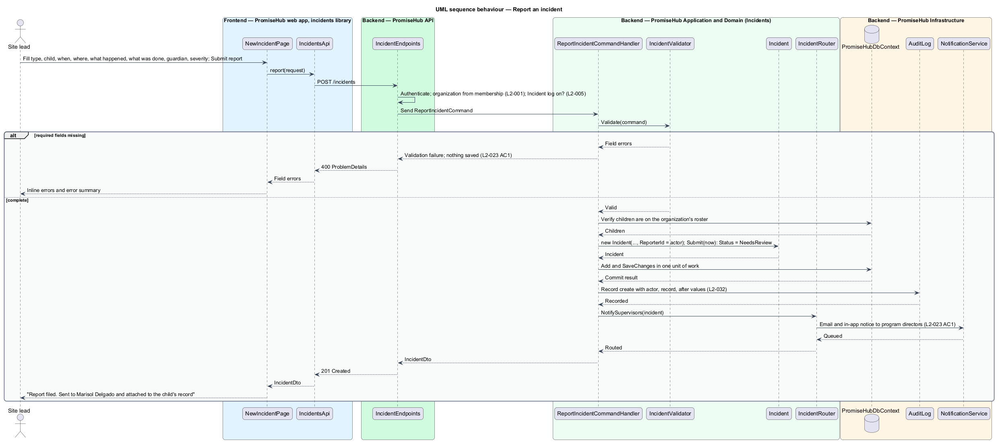
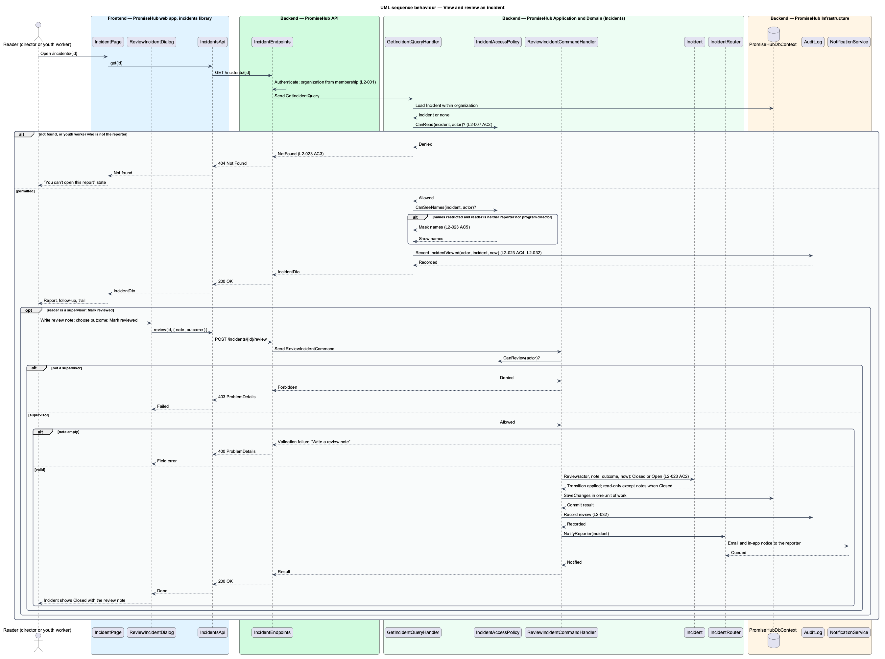

# Report and review an incident

## Overview

PromiseHub keeps an incident log for each organization. An **incident** — structured record of something that happened to or involving a child during a program session, such as an injury, an illness or allergic reaction, a behaviour concern, or a pickup or safeguarding concern. Staff report an incident from a phone with a structured form; the report routes to supervisors for review; access to the record is restricted and every view is audited (`L2-023`).

A **supervisor** — staff member with the program director role, or another role the organization designates `<TO SUPPLY>`, who receives new incident reports and reviews them. A **reporter** — staff member who submitted the incident. A youth worker may report an incident but may read only the incidents they reported; a request for any other incident answers 404, not 403, so the existence of the record is not disclosed.

A **review** — supervisor's note and outcome that closes an incident (`Closed, no further action` or `Closed, policy change needed`) or keeps it open. After closing, the incident is read-only except for notes, and the reporter is notified.

A **restricted name** — child name on an incident that is hidden from everyone except the reporter and program directors, used for incidents about more than one child or sensitive matters. The list and detail pages show `names restricted` in place of the names for other readers.

Local terms used below:

- **structured form** — the `new-incident` fields: type, child or children involved, when, where, what happened, what was done, guardian contact, severity
- **incident status** — `NeedsReview` on submit, `Open` while a review keeps it open, `Closed` after a closing review
- **incident view audit** — audit entry recording who opened an incident and when, written on every read

The Incident log module gates every page and endpoint here (`L2-005`).

## Built so far

Slice 19 delivered `NewIncidentPage`, `IncidentsPage` (the log for supervisors, the forbidden state with your reports for everyone else) and `IncidentPage`, `INCIDENTS_API`, `GET /incidents`, `GET /incidents/form`, `GET /incidents/{id}` (each view audited), `POST /incidents` with email to the program directors, and the `Incident` entity (ADR 0021). Slice 20 added acceptance tests for youth workers and volunteer coordinators reporting and never reading others' reports. Slice 21 delivered `ReviewIncidentDialog`, `AddFollowUpDialog`, `ReopenIncidentDialog`, the review alert, follow-ups and trail on `IncidentPage` with the new library `ph-timeline`, and the review, notes and reopen endpoints. Drafts, several children and restricted names are not built yet.

## Description

### Frontend (`frontend/projects/incidents/`)

- **`NewIncidentPage`** — page component for `new-incident` (`/incidents/new`). Fieldsets: type, child or children (typed from the session roster), when and where, what happened, what was done, guardian (`Called and reached`, `Left a message`, `Not yet contacted`), severity (`Minor`, `Moderate`, `Serious`), an info alert naming the supervisor the report goes to, and `Save draft`, `Cancel`, `Submit report`. On an invalid submit it renders inline errors and the error summary and saves nothing (`L2-023` AC 1). The `error` state keeps the report on the device for retry.
- **`IncidentsListPage`** — page component for `incidents` (`/incidents`). Supervisors see open items first with the `Open` / `Closed` / `All` chips and a program filter. Youth workers see the `forbidden` state: they can report and see their own reports, not the log.
- **`IncidentPage`** — page component for `incident` (`/incidents/:id`). Cards: the report facts, follow-up notes form, and the trail (submitted, emailed, opened). The `reviewed` state is read-only with the review note and `Reopen`. The `forbidden` state is shown when the API answers 404 for a youth worker following a link.
- **`ReviewIncidentDialog`** — CDK dialog for `review-incident`: review note (required) and outcome.
- Components from `frontend/projects/components/`: `page-header`, `form-field`, `radio`, `textarea`, `error-summary`, `alert`, `card`, `description-list`, `list`, `chip`, `badge`, `audit-trail`, `dialog`, `empty-state`.

### API client (`frontend/projects/api/`)

- **`IncidentsApi`** — contract behind the `INCIDENTS_API` token with `list(filter)`, `get(id)`, `report(request)`, `saveDraft(request)`, `review(id, request)`, `addNote(id, note)` and `reopen(id)`. The HTTP implementation calls `/incidents`.

### Backend

- **`IncidentEndpoints`** (`PromiseHub.Api`) — minimal-API group under `/incidents`: `GET /incidents`, `GET /incidents/{id}`, `POST /incidents`, `PUT /incidents/{id}/draft`, `POST /incidents/{id}/review`, `POST /incidents/{id}/notes`, `POST /incidents/{id}/reopen`.
- **`PromiseHub.Application/Incidents/`**
  - `ReportIncidentCommand` / `ReportIncidentCommandHandler` — validates required fields (type, child, when, what happened, what was done), creates the `Incident` with `Status = NeedsReview`, writes an audit entry and asks `IncidentRouter` to notify the supervisors (`L2-023` AC 1).
  - `IncidentRouter` — resolves the supervisors of the organization (program directors by default) and notifies them by email and in-app notification; it also notifies the reporter on close.
  - `GetIncidentsQuery` / `GetIncidentsQueryHandler` — applies `IncidentAccessPolicy`: program directors and admins see all incidents of the organization; youth workers and other roles see only incidents they reported (`L2-007` AC 2). Names flagged restricted are replaced by `names restricted` unless the reader is the reporter or a program director (`L2-023` AC 5).
  - `GetIncidentQuery` / `GetIncidentQueryHandler` — loads one incident under the same policy; a reader outside the policy receives `NotFound`, which the endpoint returns as 404 (`L2-023` AC 3). Every successful read writes an `IncidentViewed` audit entry with the reader (`L2-023` AC 4, `L2-032`).
  - `ReviewIncidentCommand` / `ReviewIncidentCommandHandler` — supervisor only; requires a review note; applies the outcome (`Closed` or keep `Open`), records `ReviewedBy` and `ReviewedAt`, notifies the reporter and writes an audit entry (`L2-023` AC 2).
  - `AddIncidentNoteCommand` / `AddIncidentNoteCommandHandler` — appends a follow-up note; allowed on a closed incident, which is otherwise read-only.
  - `ReopenIncidentCommand` / `ReopenIncidentCommandHandler` — supervisor only; returns a `Closed` incident to `Open`.
  - `IncidentAccessPolicy` — `CanRead(incident, actor)`, `CanSeeNames(incident, actor)`, `CanReview(actor)`.
  - `IncidentValidator` — required fields; guardian `Not yet contacted` requires a reason in what was done.
- **`PromiseHub.Domain/Incidents/`**
  - `Incident` — aggregate with `Id`, `OrganizationId`, `Category`, `Children`, `OccurredAt`, `Place`, `WhatHappened`, `ActionTaken`, `GuardianContact`, `Severity`, `Status`, `ReporterId`, `ReportedAt`, `SessionId`, `Witnesses`, `NamesRestricted`, `ReviewedBy`, `ReviewedAt`, `ReviewOutcome`, `Notes`. Methods `Submit(now)`, `Review(actor, note, outcome, now)`, `AddNote(actor, text, now)`, `Reopen(actor, now)`.
  - `IncidentChild` — `ChildId`, `DisplayName` (masked by the policy on read).
  - `IncidentNote` — `AuthorId`, `Text`, `WrittenAt`.
  - `GuardianContact` — `Status` (`CalledAndReached`, `LeftMessage`, `NotYetContacted`), `ContactedAt`, `GuardianId`.
  - `IncidentCategory` — `Injury`, `IllnessOrAllergicReaction`, `Behaviour`, `PickupOrSafeguarding`, `Other`. `IncidentSeverity` — `Minor`, `Moderate`, `Serious`. `IncidentStatus` — `Draft`, `NeedsReview`, `Open`, `Closed`. `ReviewOutcome` — `ClosedNoAction`, `ClosedPolicyChange`, `KeepOpen`.
- **`PromiseHub.Infrastructure`** — `PromiseHubDbContext` maps incidents, children, notes with the organization filter; `AuditLog` records create, review, note, reopen and every view; `NotificationService` and the email provider deliver supervisor and reporter notifications; the PDF export of an incident is designed in `reports/export-report`.

Undecided details: which roles besides program director count as supervisors `<TO SUPPLY>`; whether the site lead may read incidents reported in sessions they led `<TO SUPPLY>`; retention of incident records `<TO SUPPLY>`.

## Requirements

| L2 ID | Refines (L1) | Requirement |
|-------|--------------|-------------|
| `L2-023` | `L1-011` | A structured incident form (category, child, time, place, what happened, action taken, guardian contact) routes to supervisors; access is restricted and audited. |
| `L2-007` | `L1-003` | Permissions are enforced per endpoint and per field by role; the UI reflects them but never substitutes for them. |
| `L2-032` | `L1-017` | Every change and every sensitive view is recorded and searchable by admins. |
| `L2-001` | `L1-001` | Every tenant-owned table carries the organization id; every query, search, export and background job filters by the organization of the signed-in person's active membership, never by a value from the client. |
| `L2-005` | `L1-002` | A module that is off is neither served nor rendered. |

## Diagrams

### System context

A site lead or youth worker reports an incident; a program director reviews it. PromiseHub notifies supervisors and the reporter through the email provider and the in-app notification center.

### Containers

The `incidents` feature library calls the PromiseHub API, which stores incidents and audit entries in the PromiseHub database and queues notifications for the job runner.

### Components

`IncidentEndpoints` dispatches to the Incidents handlers. `IncidentAccessPolicy` decides who reads what; `IncidentRouter` notifies supervisors; every read writes to `AuditLog`.

### Class structure

`Incident` owns its children, notes and guardian contact and holds status, category and severity; the handlers consult `IncidentAccessPolicy` and `IncidentRouter`.

### Behaviour — report an incident

Missing required fields return inline errors and nothing is saved; a complete report is stored as `NeedsReview`, audited and routed to supervisors (`L2-023` AC 1).

### Behaviour — view and review an incident

A reader outside the access policy receives 404 (`L2-023` AC 3). Every permitted view is audited (`L2-023` AC 4), restricted names are masked (`L2-023` AC 5), and a closing review notifies the reporter and makes the incident read-only except for notes (`L2-023` AC 2).

