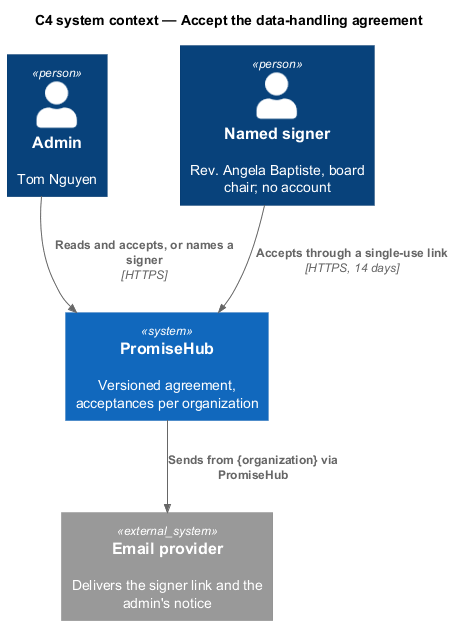
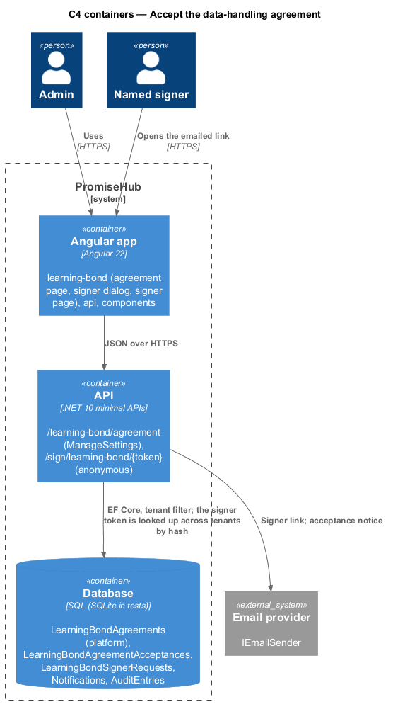
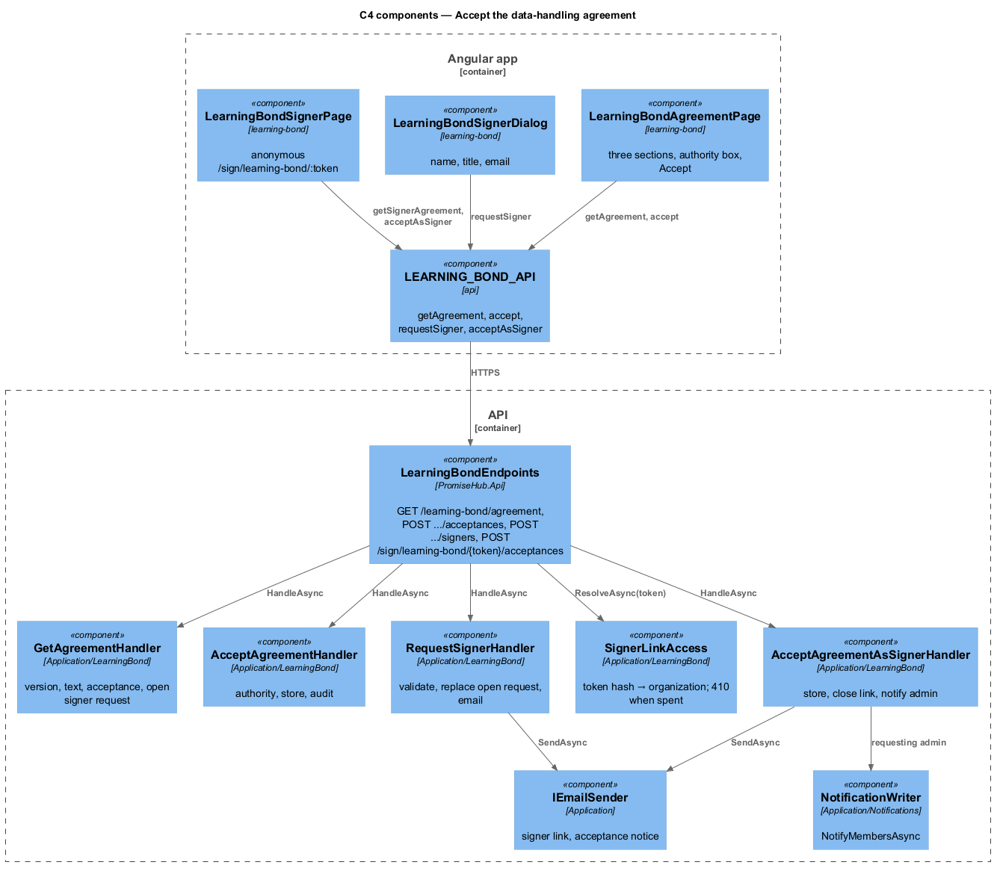
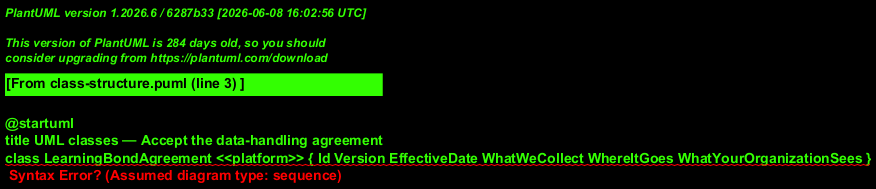
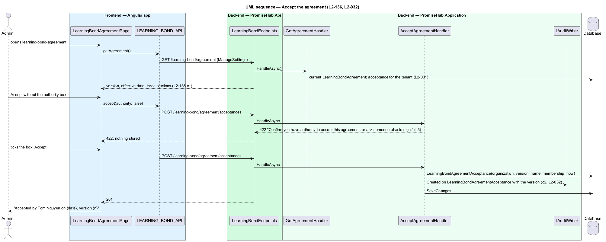
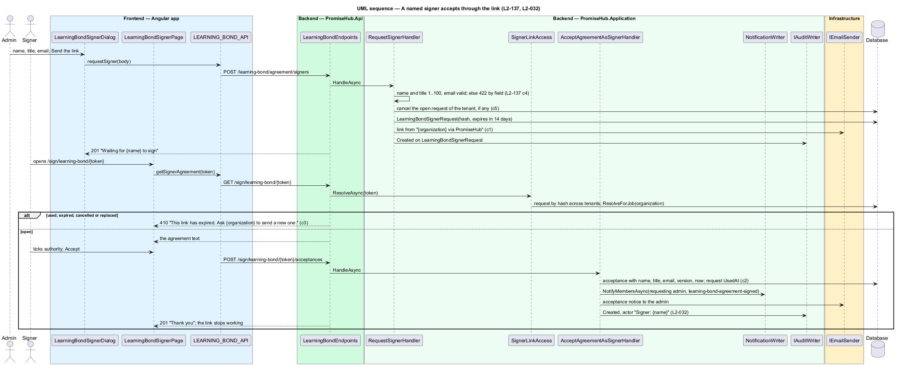

# Accept the data-handling agreement

## Overview

The data-handling agreement (`learning-bond-agreement`) is one page the platform versions: What we collect, Where it goes and What your organization sees. An admin with `ManageSettings` ticks the authority box and accepts it for the organization, or names a signer who accepts it through a single-use emailed link with no PromiseHub account (`learning-bond-signer`). Each acceptance records the organization, the version, who accepted and when. A new platform version keeps the module on for families in progress but disables Launch until the new version is accepted (ADR 0076).

Terms used in this document:

- **agreement** — `LearningBondAgreement`: platform row with version, effective date and three sections, no organization id, seeded by the Cli
- **acceptance** — `LearningBondAgreementAcceptance`: organization, version, accepter name, membership (or signer title and email) and time
- **signer request** — `LearningBondSignerRequest`: name, title, email, hashed single-use token, 14-day expiry, one open per organization

The agreement routes sit under `/learning-bond/agreement` but are not behind the Learning Bond module gate: the agreement is accepted before the module can be on (`gate-learning-bond-module`). They require `ManageSettings` and Roster and Messages on; the signer link is anonymous.

## Description

Frontend:

- **`LearningBondAgreementPage`** (`frontend/projects/settings/`, ADR 0077: it is served while Learning Bond is off, so it cannot live in the `learning-bond` library) — a reading `ph-card` with the three sections, a form `ph-card` with `ph-checkbox` ("I have authority to accept this agreement for {organization}"), `ph-error-summary`, Accept (`ph-button` primary, busy while submitting) and Ask someone else to sign (ghost). States: `invalid` (422 beside the box), `accepted` (`ph-alert` success "Accepted by {name} on {date}, version {n}"), `accepted-off` (accepted while the module is off: Turn on Learning Bond opens `settings-modules`), `waiting-signer` (named signer card with Resend and Cancel), loading, error, forbidden.
- **`LearningBondSignerDialog`** (`learning-bond-signer`, CDK Dialog, `frontend/projects/settings/`) — `ph-text-field` name, role or title, email; Send the link; field errors from the 422 body; success body "Waiting for {name} to sign".
- **`LearningBondSignerPage`** (`frontend/projects/settings/`, ADR 0078) — anonymous route `/sign/learning-bond/:token`, outside the signed-in shell, in `ph-guardian-shell`: the agreement, the box "I, {name}, have authority…" and Accept (states `signer`, `signer-invalid`, `signer-submitting`, `signer-loading`, `signer-error`, `signer-accepted`, `signer-expired`, `signer-unknown`). It reads `LEARNING_BOND_API.signerAgreement(token)` and calls `acceptAsSigner(token, authority)`.
- **`LearningBondSignerEmailDialog`** (`learning-bond-email/info`, CDK Dialog, `frontend/projects/settings/`) — See the email on the Named signer card: the email the signer received in `ph-email-preview`, "Read and accept" standing in for the link.
- **`LEARNING_BOND_API`** — `agreement()`, `acceptAgreement(authority)`, `requestSigner(request)`, `resendSigner(id)`, `cancelSigner(id)`, `signerAgreement(token)`, `acceptAsSigner(token, authority)`.

Backend:

- **`GetAgreementHandler`** — `GET /learning-bond/agreement`: current version, effective date, sections, the tenant's acceptance of that version if any, the open signer request if any (name, title, email, sent at; never the token). Audits nothing; reading the text reveals no family.
- **`AcceptAgreementHandler`** — `POST /learning-bond/agreement/acceptances`: 422 "Confirm you have authority to accept this agreement, or ask someone else to sign." when `authority` is false; otherwise stores the acceptance with the member's name and membership id, audits `Created` on `LearningBondAgreementAcceptance` with the version, answers 201 (L2-136 criteria 2 and 3).
- **`RequestSignerHandler`** — `POST /learning-bond/agreement/signers`: validates name and title (1 to 100 characters) and the email with `EmailAddressRule`, answering 422 by field; cancels any open request of the tenant (`CancelledAt`), stores the new one with `GuardianTokens.Hash(token)` and `ExpiresAt` 14 days ahead, queues the email through `IEmailSender` from "{organization} via PromiseHub" with the link, audits `Created`, answers 201. Resend mints a new single-use link to the same signer (only the hash is stored, so the old address cannot be re-sent) and the earlier link stops working; cancel sets `CancelledAt` and audits (ADR 0077).
- **`SignerLinkAccess`** — resolves `/sign/learning-bond/{token}`: finds the request by hash across tenants (`IgnoreQueryFilters`), then `ResolveForJob(organizationId)`; a request that is used, expired, cancelled or replaced answers 410 with "This link has expired. Ask {organization} to send a new one." (criterion 3).
- **`AcceptAgreementAsSignerHandler`** — `POST /sign/learning-bond/{token}/acceptances`: authority box required as above; stores the acceptance with the signer's name, title and email and no membership; marks the request `UsedAt`; audits `Created` with actor "Signer: {name}"; notifies the requesting admin through `NotificationWriter.NotifyMembersAsync` (kind `learning-bond-agreement-signed`, `learning-bond-staff-notice`) and by email (`learning-bond-email` success); answers 201 (L2-137 criterion 2).
- **`LearningBondAgreementGate`** — `PendingVersionAsync()` answers the new version when the current one has no acceptance for the tenant while an older one has; `ScheduleLaunchHandler` and `InviteHouseholdHandler` refuse with "A new version of the agreement needs accepting." and the hub and dashboard show the warning (criterion 4).

Tenant and module gate: acceptances and signer requests carry `OrganizationId`; Northgate's admin never sees or counts Harbourview's acceptance (L2-136 criterion 6). Nothing here reads a household, child or guardian record (criterion 5). Audited: acceptance, signer request, resend, cancel, signer acceptance.

## Built so far

Prompt 83 built the admin side; prompt 84 built the signer's own page behind the link.

- `LearningBondAgreementHandler` answers `GET /learning-bond/agreement` and `POST .../acceptances` (one handler where this design names two). The DTO adds `earlierAcceptance` (the latest acceptance of an earlier version while a new one is pending) and `moduleOn`, which picks the breadcrumb (Learning Bond or Modules) and the accepted state's next step (Choose coverage, or Turn on Learning Bond). Accepting a version already accepted answers 201 with the existing acceptance and audits nothing; accepting closes a request still waiting for a named signer.
- `LearningBondSignerHandler` answers `POST /learning-bond/agreement/signers`, `POST .../signers/{id}/resend` and `DELETE .../signers/{id}`. The email goes from "{organization} via PromiseHub" through `IEmailSender`. Resend mints a new link (ADR 0077) and is audited as Updated; cancel is audited as Updated. Another organization's request id answers 404. Migration `LearningBondSignerRequests`.
- Frontend: `LearningBondAgreementPage` and `LearningBondSignerDialog` in `frontend/projects/settings/` (ADR 0077), mounted at `/settings/learning-bond/agreement` with `moduleRoute(['Roster', 'Messages'])`; Settings › Modules shows Read the agreement beside the refusal. The signer dialog closes on success and the page shows the Named signer card with Resend and Cancel; a toast confirms the link went.
- Acceptance tests: `backend/tests/PromiseHub.Api.Tests/LearningBondAgreementTests.cs`, `LearningBondSignerTests.cs`, `e2e/tests/learning-bond/agreement.spec.ts` and `signer.spec.ts`.
- Prompt 84 (ADR 0078): `LearningBondSignerLinkAccess` (the design's `SignerLinkAccess`) finds the request through `LearningBondSignerToken`, every link issued for a request kept as its hash (migration `LearningBondSignerTokens`, which backfills each request's current link), so a link Resend replaced still names its organization; it resolves the tenant with `TenantContext.ResolveForSigner` (actor "Signer: {name}"). `LearningBondSignerLinkHandler` (the design's `AcceptAgreementAsSignerHandler`) answers `GET /sign/learning-bond/{token}` and `POST .../acceptances` through `LearningBondSignerEndpoints`, anonymous and outside the module gate. A used, expired, cancelled or replaced link, or a suspended organization's, answers 410 with the organization and "This link has expired. Ask {organization} to send a new one."; an unknown one answers 404 and the page names no organization. Accepting stores `LearningBondAgreementAcceptance.BySigner` with the signer's name, title and email and no membership (migration `LearningBondSignerAcceptances`), marks the request used, audits once, notifies the requesting admin with the new kind `agreement` (needs Roster and Messages, like the agreement, so it shows while Learning Bond is off) and emails them "{name} accepted the Learning Bond agreement". The signer's email and its preview come from one `LearningBondSignerEmailDto`, carried on the open request as `preview`.
- Acceptance tests (prompt 84): `backend/tests/PromiseHub.Api.Tests/LearningBondSignerLinkTests.cs`, `LearningBondSignerTests.cs` (the email), `e2e/tests/learning-bond/signer-page.spec.ts` and `signer.spec.ts`.

## Requirements

| L2 ID | Refines (L1) | Requirement |
|-------|--------------|-------------|
| `L2-136` | `L1-026` | The versioned data-handling agreement shall be shown as one page and accepted per organization and version, with authority confirmed, audited, and a new version shall disable Launch until accepted. |
| `L2-137` | `L1-026` | An admin shall name a signer by name, title and email who accepts the agreement through a single-use 14-day link without an account, one open request per organization. |
| `L2-032` | `L1-017` | Every change and every sensitive view shall be recorded in the organization's audit log. |

## Diagrams

The admin or a named signer accepts; the platform owns the text.

The signer's link reaches the API anonymously; the email goes out through the existing email provider.

The signer link is resolved by its own access service, not by `GuardianAccess`, because it names an organization and not a household.

One acceptance row serves both paths; the membership is null for a signer.

Acceptance stores who, which version and when, and is refused without the authority box.

The signer's acceptance closes the link and tells the admin in the app and by email.

