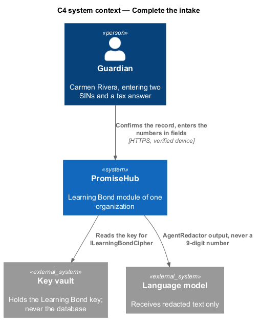
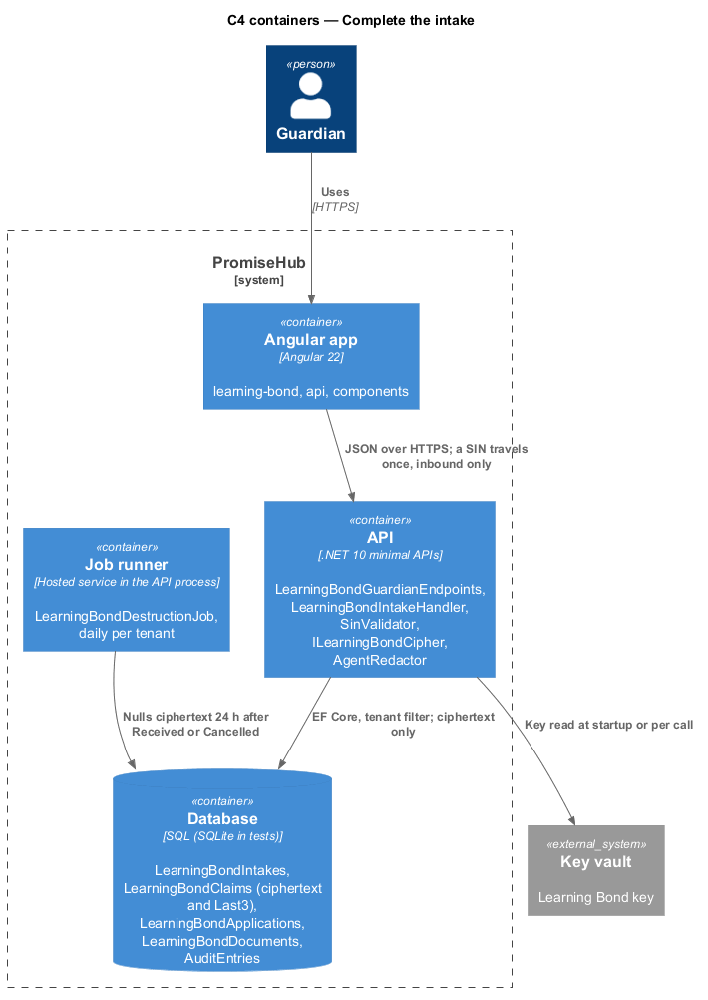
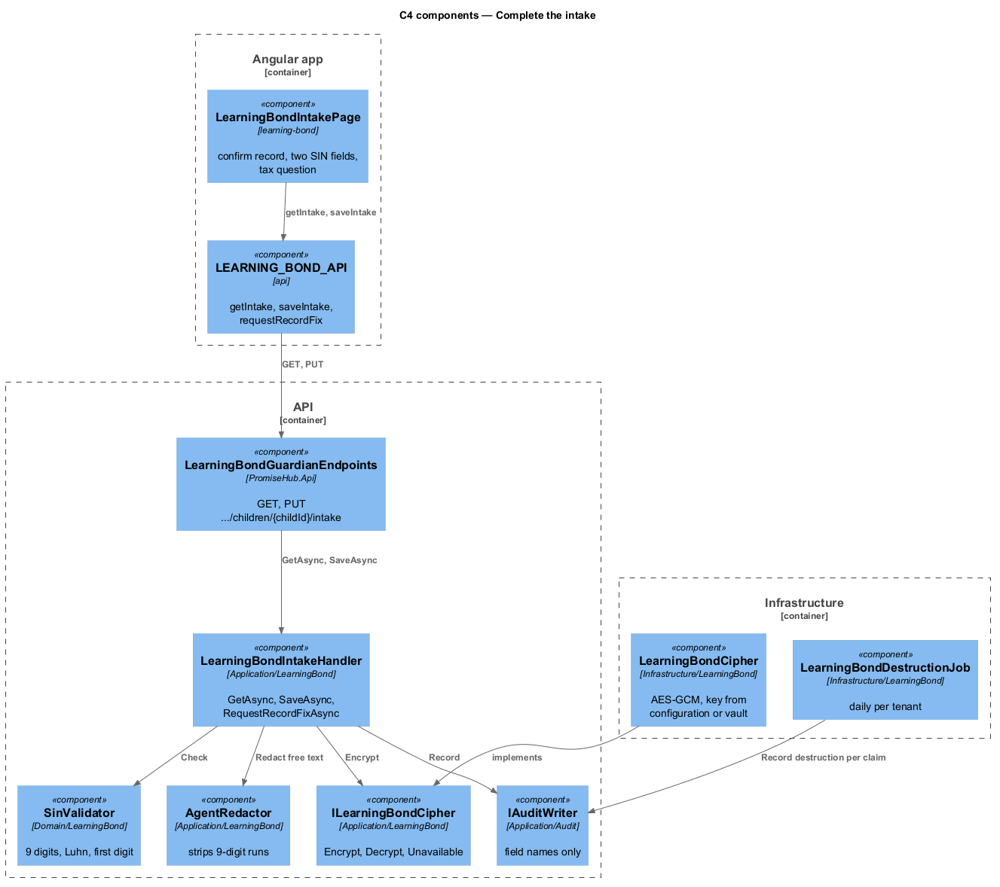
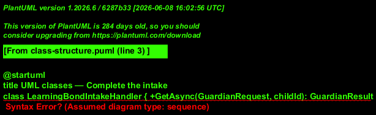
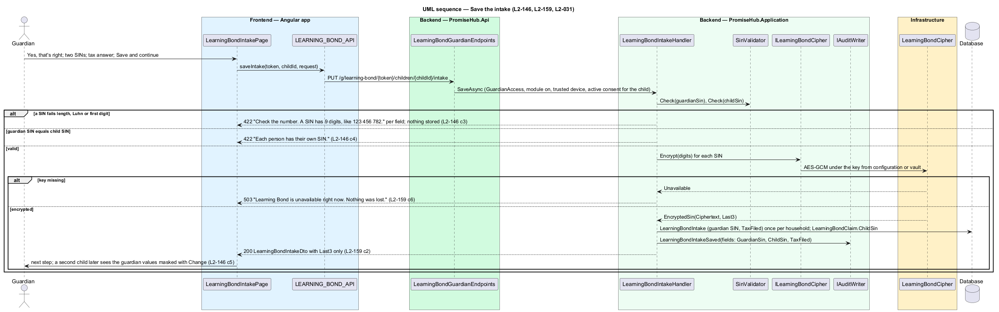
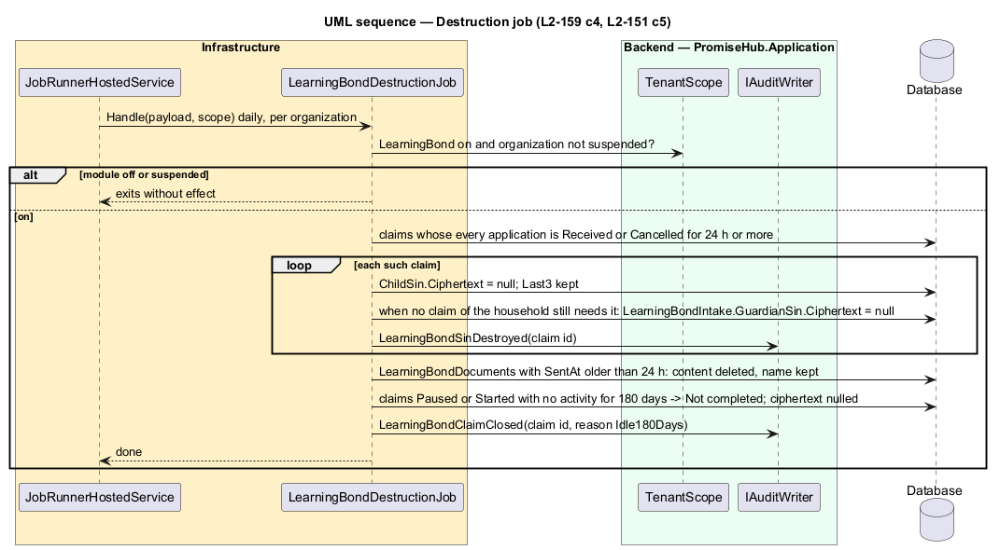

# Complete the intake

## Overview

`learning-bond-intake` confirms what the enrolment record already holds (the child's name and date of birth, with Yes, that's right and Fix this) and asks only three questions: the guardian's social insurance number, the child's social insurance number and "Did your family file a {year − 1} tax return?". Numbers go in form fields, never in a message to the agent. A SIN is validated on the server, encrypted at the field under a key the database never holds, and shown afterwards only as its last three digits. A second child of the same household reuses the guardian's SIN and tax answer, masked, with Change. The intake resumes at the first unanswered question, and `LearningBondDestructionJob` destroys ciphertext on schedule.

Terms used in this document:

- **SIN check** — 9 digits after removing spaces and hyphens, a Luhn check digit, and a first digit other than 0 or 8
- **`EncryptedSin`** — value object of `Ciphertext` and `Last3`; `Ciphertext` null means destroyed
- **record fix** — guardian update request raised by Fix this through the existing `guardian-update` path; the claim pauses with `PausedReason.AwaitingRecordFix` until staff accept it
- **resume point** — first of guardian SIN, child SIN and tax answer that is not yet stored for this claim

Every intake route resolves the tenant through `GuardianAccess` and answers 404 when the module is off. Saving is audited as `LearningBondIntakeSaved` naming the fields saved ("GuardianSin", "ChildSin", "TaxFiled"), never a value (`L2-032`); no log, trace, metric, notification or audit entry carries a SIN (`L2-159` criterion 3). Guardian DTOs carry `Last3` only.

## Description

Frontend:

- **`LearningBondIntakePage`** (`frontend/projects/learning-bond/`, route `/g/learning-bond/:token/intake`) — `ph-card` From {first name}'s enrolment with name and date of birth and `ph-button` Yes, that's right / Fix this; `ph-text-field` for each SIN as a masked numeric field with a Show toggle and the hint "9 digits, like 123 456 782"; a saved SIN renders as `••• ••• 286` with Change; `ph-radio-group` Yes / No / Not sure for the tax question; `ph-error-summary` and per-field errors from the 422 body; `ph-alert` for Welcome back, the record-fix notice and "{first name} doesn't have a SIN yet" (hand-off to `follow-application-progress`); the 503 state renders "Learning Bond is unavailable right now. Nothing was lost." with Try again. Free text to the agent uses the shared agent input, which never submits a SIN.
- **`LEARNING_BOND_API.getIntake(token, childId)`**, **`saveIntake(token, childId, request)`**, **`requestRecordFix(token, childId, fields)`**.

Backend:

- **`LearningBondIntakeHandler.GetAsync`** (`PromiseHub.Application/LearningBond/`) — scope, module gate, trusted device, active consent for the child (403 otherwise); answers `LearningBondIntakeDto` with the child's name and birth date from `Child`, `GuardianSinLast3`, `ChildSinLast3`, `TaxFiled`, `ResumeAt` and whether the guardian values are reused from an earlier child.
- **`LearningBondIntakeHandler.SaveAsync`** — `SinValidator.Check` on each submitted SIN (422 "Check the number. A SIN has 9 digits, like 123 456 782." per field); equal guardian and child SINs answer 422 "Each person has their own SIN."; nothing is stored on any 422. Valid digits go to `ILearningBondCipher.Encrypt`; `Unavailable` answers 503 and stores nothing. The guardian SIN and `TaxFiled` are written once on `LearningBondIntake` (one per household) and the child SIN on `LearningBondClaim`; a later child reads them back as `Last3` and never asks again. A tax answer of No or Not sure sets the claim `Paused` with `PausedReason.NeedsTaxReturn` after the estimate (`estimate-learning-bond`).
- **`LearningBondIntakeHandler.RequestRecordFixAsync`** — raises the guardian update for the named fields and sets `PausedReason.AwaitingRecordFix`; acceptance by staff clears it and the intake continues.
- **`SinValidator`** (`PromiseHub.Domain/LearningBond/`) — pure; strips separators, checks length, Luhn and the first digit.
- **`ILearningBondCipher`** (`PromiseHub.Application/LearningBond/`), **`LearningBondCipher`** (`PromiseHub.Infrastructure/LearningBond/`) — AES-GCM under a key from configuration or a key vault; the key is never in the database; a missing key answers `CipherResult.Unavailable`. Tests register `FakeLearningBondCipher`.
- **`AgentRedactor`** — strips every 9-digit run (with or without separators) from free text before storage on `AgentMessage` or the call to `ILanguageModel`; the agent then asks for the number in the field (`L2-146` criterion 7).
- **`LearningBondDestructionJob`** (`PromiseHub.Infrastructure/LearningBond/`, daily, per tenant, `IJobHandler`) — nulls `Ciphertext` 24 hours after every application that used the SIN is `Received` or `Cancelled`, deletes `LearningBondDocument` content 24 hours after `SentAt`, and leaves `Last3`. It exits without effect while the module is off.
- **`DataRequestHandler`** (existing, `Organizations/`) — the export includes consents, applications, statuses and amounts with SINs as `Last3`; a deletion destroys every Learning Bond record of the household except what `L2-152` criterion 3 keeps.
- **`GET`, `PUT /g/learning-bond/{token}/children/{childId}/intake`**, **`POST .../intake/record-fix`** — `LearningBondGuardianEndpoints`.

## Requirements

| L2 ID | Refines (L1) | Requirement |
|-------|--------------|-------------|
| `L2-146` | `L1-027` | The intake shall confirm what the enrolment record holds and ask only for the guardian's SIN, each consented child's SIN and the tax-filing answer, in form fields validated on the server. |
| `L2-159` | `L1-029` | SINs and financial details shall be encrypted under a key outside the database, shown only as the last three digits, kept out of logs and audit, and destroyed on schedule. |
| `L2-031` | `L1-016` | Transport, storage and application security: input shall be validated on the server and secrets kept outside the repository. |
| `L2-030` | `L1-015` | A guardian's data request shall export and delete the household's data according to the organization's privacy settings. |
| `L2-032` | `L1-017` | Every change and every sensitive view shall be recorded in the organization's audit log. |

## Diagrams

The key vault holds the only key that can read a SIN; the provider receives nothing at this step.

The API encrypts before the database sees a value; the job runner destroys ciphertext on schedule.

Validation, the cipher and the redactor are separate components with one job each.

The intake is one per household; the child SIN lives on the claim.

Nothing is stored on a 422 or a 503; a stored SIN leaves the server as three digits.

Destruction is driven by application status, 24 hours after the last use.

