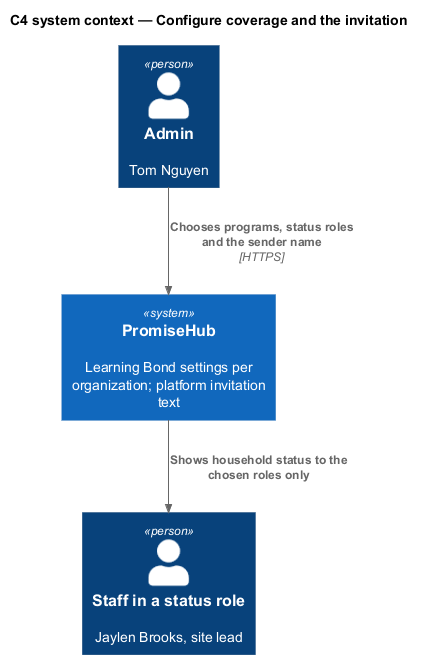
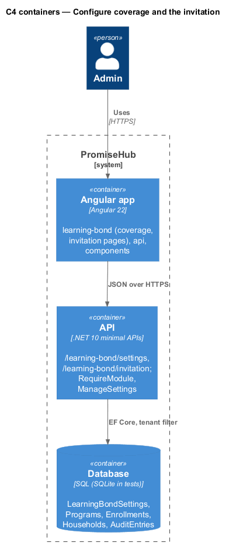
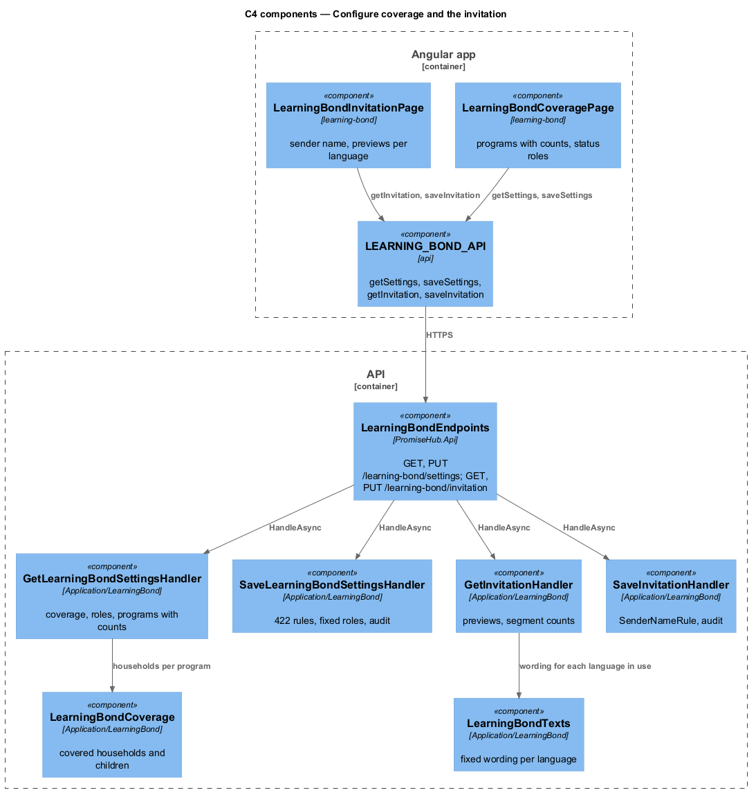
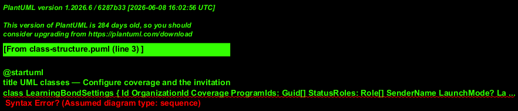
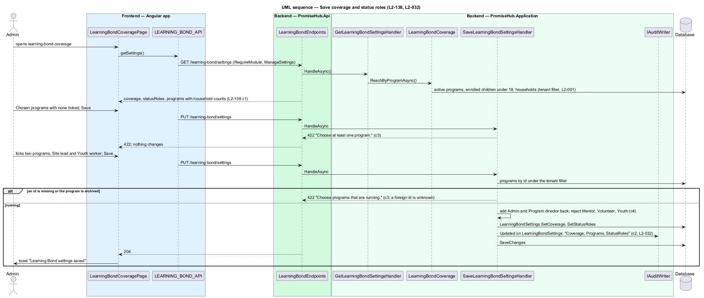
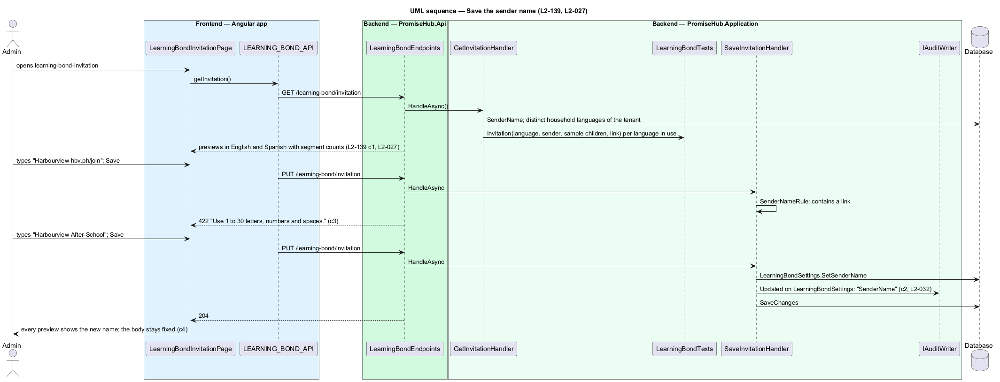

# Configure coverage and the invitation

## Overview

Coverage (`learning-bond-coverage`) decides which households Learning Bond reaches and which staff see a family's status: every program, or chosen programs, and a set of status roles in which Admin and Program director are fixed. The invitation (`learning-bond-invitation`) is platform text in English, Spanish and French; the admin previews it in each language the organization's households use and edits only the sender name. Both live on the organization's one `LearningBondSettings` row (ADR 0076).

Terms used in this document:

- **coverage** — `Coverage` of `LearningBondSettings`: `AllPrograms`, or `ChosenPrograms` with the program ids; a household is covered when a child under 18 is actively enrolled in a covered program
- **status roles** — `StatusRoles`: the staff roles that see `learning-bond-families`, the household card and the Invite to Learning Bond action; Admin and Program director are always present; Mentor, Volunteer and Youth are never offered
- **sender name** — `SenderName`: 1 to 30 characters of letters, numbers, spaces and `&'.-`, starting every text and signing every email
- **invitation text** — `LearningBondTexts`: the fixed platform wording per language, falling back to English

## Description

Frontend:

- **`LearningBondCoveragePage`** — `ph-radio-group` (Every program with the household count, Chosen programs), `ph-checkbox` per active program with "{n} households", `ph-checkbox` per offered role with Admin and Program director checked and disabled, `ph-error-summary`, Save changes with a save status; states `invalid`, `submitting`, `success` (toast "Learning Bond settings saved", `learning-bond-staff-notice` success), loading, error, forbidden.
- **`LearningBondInvitationPage`** — `ph-text-field` sender name (maxlength 30, hint with the rule), and for each language in use a `ph-sms-preview` with the segment count and an email preview `ph-card`; the previews re-render from the field as the admin types; states `invalid`, `submitting`, `success`, loading, error, forbidden.
- **`LEARNING_BOND_API`** — `getSettings()`, `saveSettings(request)`, `getInvitation()`, `saveInvitation(request)`.

Backend:

- **`GetLearningBondSettingsHandler`** — `GET /learning-bond/settings` (`ManageSettings`): `coverage`, `statusRoles`, and the organization's active programs with the number of covered households each would reach, computed by `LearningBondCoverage`. Archived programs are not listed (L2-138 criterion 1).
- **`SaveLearningBondSettingsHandler`** — `PUT /learning-bond/settings`: `ChosenPrograms` with no program answers 422 "Choose at least one program."; an archived program, or a program id the tenant filter does not find, answers 422 "Choose programs that are running." without confirming that the id exists elsewhere (criterion 3). Admin and Program director are added back when left out; Mentor, Volunteer and Youth are rejected (criterion 4). Stores the row, audits `Updated` on `LearningBondSettings` naming the fields changed (`Coverage`, `Programs`, `StatusRoles`), answers 204 (criterion 2). Removing a program stops new invitations through it; claims already started continue because they belong to the household, not the program (criterion 5).
- **`LearningBondCoverage`** — one query used by settings, launch, the families list and the dashboard: covered households of the tenant, their guardians' channels and each eligible child. It reads Roster and `ModuleConfiguration` only.
- **`GetInvitationHandler`** — `GET /learning-bond/invitation`: `senderName`, the languages the tenant's households use, and for each the SMS and email text from `LearningBondTexts` with the sender name and a sample child name filled in, plus the SMS segment count from the existing `SmsSegments` rule of Messaging (L2-139 criterion 1).
- **`SaveInvitationHandler`** — `PUT /learning-bond/invitation`: `SenderNameRule` rejects empty, longer than 30, a link, a phone number or characters outside letters, numbers, spaces and `&'.-` with 422 "Use 1 to 30 letters, numbers and spaces." (criterion 3); stores `SenderName`, audits `Updated` naming `SenderName`, answers 204 (criterion 2).
- **`LearningBondTexts`** (`PromiseHub.Application/LearningBond/`) — the platform-approved invitation, follow-up and reminder wording per language ("{child first name} may be owed up to $2,000 for school after high school. It costs nothing. Tap to check: {link}" and its Spanish and French wording). No endpoint writes it; every send reads the household's language and falls back to English (criterion 4, L2-027).

Tenant and module gate: both endpoints sit in the `/learning-bond` group behind `RequireModule(ModuleId.LearningBond)` and `ManageSettings`; the settings row and every program id are read under the tenant filter, so another organization's program is unknown. Audited: each save with the fields changed. The DTOs carry program names, counts, roles and the sender name only.

## Requirements

| L2 ID | Refines (L1) | Requirement |
|-------|--------------|-------------|
| `L2-138` | `L1-026` | The admin shall choose every program or chosen running programs and the staff roles that see status, with Admin and Program director fixed, and only guardians of children actively enrolled in a covered program shall be invited. |
| `L2-139` | `L1-026` | The invitation shall be platform text in English, Spanish and French previewed in the organization's languages, and the admin shall edit only a validated sender name. |
| `L2-027` | `L1-013` | Guardian pages, texts and emails shall be in English, Spanish or French as the household chose. |
| `L2-032` | `L1-017` | Every change and every sensitive view shall be recorded in the organization's audit log. |

## Diagrams

The admin shapes who is reached and who sees status; the platform owns the words.

Both pages read and write one settings row through the gated API.

`LearningBondCoverage` is the one place that computes covered households, reused by launch, the list and the dashboard.

The settings row holds coverage, roles, sender name and launch; the texts are code, not data.

Saving coverage is refused for an empty, archived or foreign program and always keeps the two fixed roles.

Saving the sender name applies one rule and re-renders every preview.

