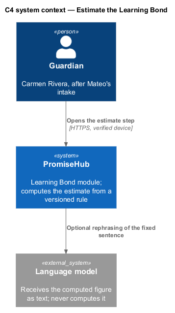
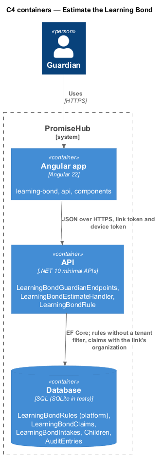
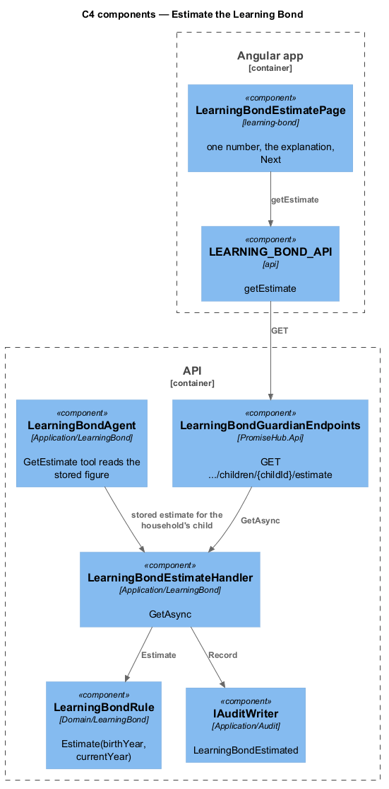
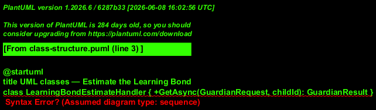
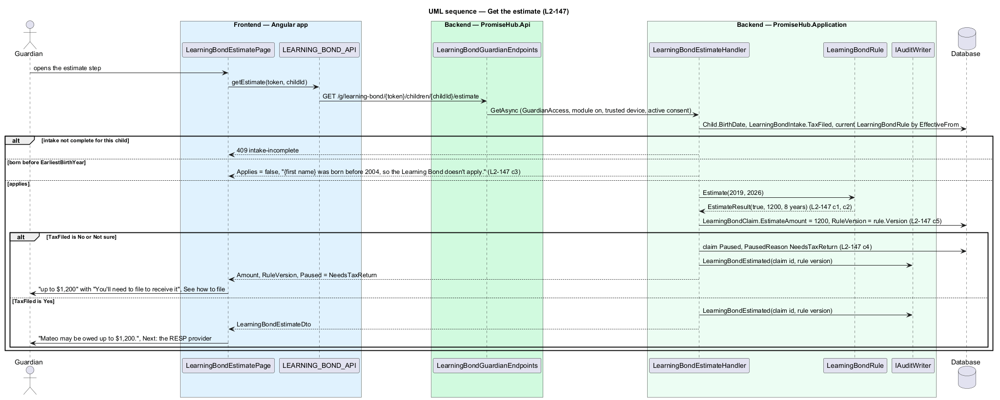

# Estimate the Learning Bond

## Overview

`learning-bond-estimate` shows one number: "{first name} may be owed up to {amount}." with "Based on the years since {first name} was born. The Government of Canada confirms the amount from your tax returns." The amount comes from `LearningBondRule`, a versioned platform rule computed on the server; the language model never computes or states an amount the rule did not produce. A child born before 2004 is told the bond does not apply and gets no application. A family that answered No to filing last year's taxes sees the estimate with "You'll need to file to receive it" and the claim pauses (`follow-application-progress`).

Terms used in this document:

- **eligible year** — calendar year from the child's birth year to the year the child turns 15, or the current year, whichever is earlier; the estimate assumes every one of them qualifies
- **rule** — `LearningBondRule`: `Version`, `EffectiveFrom`, `FirstYearAmount` (500), `LaterYearAmount` (100), `Cap` (2000), `EarliestBirthYear` (2004), `LastEligibleAge` (15), `ClaimUntilAge` (21)
- **estimate** — `Amount` and `RuleVersion` recorded on `LearningBondClaim` when computed

Worked examples under the current rule, in 2026:

| Birth year | Eligible years | Computation | Estimate |
|------------|----------------|-------------|----------|
| 2019 | 2019 to 2026, 8 | 500 + 7 × 100 | $1,200 |
| 2011 | 2011 to 2026, 16 | 500 + 15 × 100 = 2,000, at the cap | $2,000 |
| 2026 | 2026, 1 | 500 | $500 |
| 2003 | none | born before 2004 | not applicable |

The estimate route resolves the tenant through `GuardianAccess` and answers 404 when the module is off. Computing an estimate is audited as `LearningBondEstimated` with the claim id and the rule version, not the amount (`L2-032`). Staff DTOs never carry the estimate; the guardian DTO carries the amount and the rule version.

## Description

Frontend:

- **`LearningBondEstimatePage`** (`frontend/projects/learning-bond/`, route `/g/learning-bond/:token/estimate`) — `ph-stat` with the label Estimate and the amount formatted for the household's language ("1 400 $" in French), the explanation line, the agent's fixed sentence on how the rule counts years, `ph-button` Next: the RESP provider; `ph-alert` warning "You'll need to file to receive it" with See how to file when `Paused` is `NeedsTaxReturn`; `ph-alert` info and no next action for a child born before 2004; `ph-skeleton` while loading.
- **`LEARNING_BOND_API.getEstimate(token, childId)`** — `LearningBondEstimateDto`.

Backend:

- **`LearningBondEstimateHandler.GetAsync`** (`PromiseHub.Application/LearningBond/`) — scope, module gate, trusted device, active consent for the child, intake complete for the child (409 `intake-incomplete` otherwise). Reads the child's birth date from `Child`, the current rule from `LearningBondRules` (the latest `EffectiveFrom` not after today), computes through `LearningBondRule.Estimate`, stores `EstimateAmount` and `RuleVersion` on `LearningBondClaim`, and answers `LearningBondEstimateDto`. A birth year before `EarliestBirthYear` answers `Applies = false` with the fixed message and leaves the claim without an application. `TaxFiled = No` answers `Paused = NeedsTaxReturn`, and the handler sets the claim `Paused` with that reason; `Not sure` is treated the same (`L2-151` criterion 2).
- **`LearningBondRule.Estimate(birthYear, currentYear)`** (`PromiseHub.Domain/LearningBond/`) — pure: `years = min(currentYear, birthYear + LastEligibleAge) − birthYear + 1`; `years <= 0` or `birthYear < EarliestBirthYear` is not applicable; otherwise `min(Cap, FirstYearAmount + (years − 1) × LaterYearAmount)`.
- **`LearningBondRules`** — platform table with no organization id, seeded by the Cli, never editable by an organization. A new version is a new row; old estimates keep their version.
- **`LearningBondAgent.GetEstimate`** — the agent's tool returns the handler's stored figure for the household's own child; the model receives the number as text and may rephrase the sentence, never recompute (`L2-160`).
- **`GET /g/learning-bond/{token}/children/{childId}/estimate`** — `LearningBondGuardianEndpoints`.
- Performance: the computation is arithmetic on three integers and one indexed read; the page meets the `L2-033` guardian page budget with no extra round trip.

## Requirements

| L2 ID | Refines (L1) | Requirement |
|-------|--------------|-------------|
| `L2-147` | `L1-027` | The estimate shall be computed by a versioned rule on the server, never by the language model, and shown as "up to" one number with its rule version recorded. |
| `L2-033` | `L1-018` | Guardian pages shall meet the performance budgets measured on a mid-range Android phone over simulated 4G. |

## Diagrams

The estimate is an internal computation; nothing leaves PromiseHub.

The rule table is platform data read by every organization.

The rule is a domain type; the agent's tool reads the stored result.

Every estimate carries the version of the rule that produced it.

The handler computes, stores and answers in one pass; a No to taxes pauses the claim.

