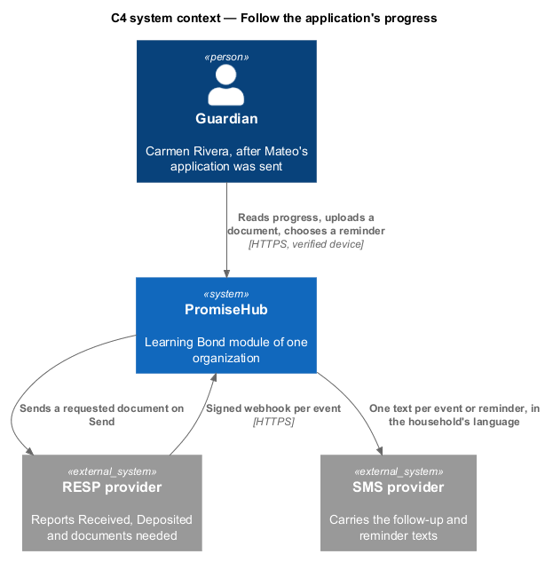
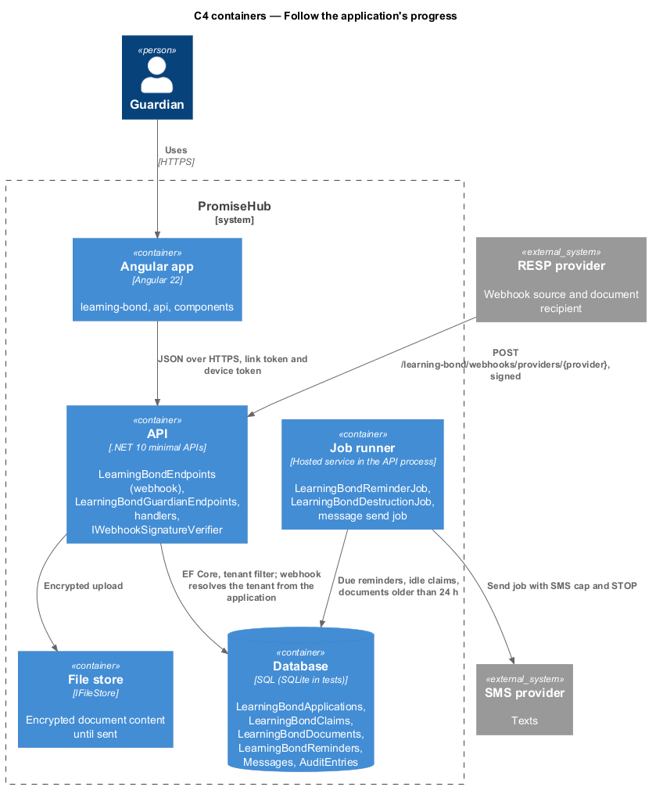
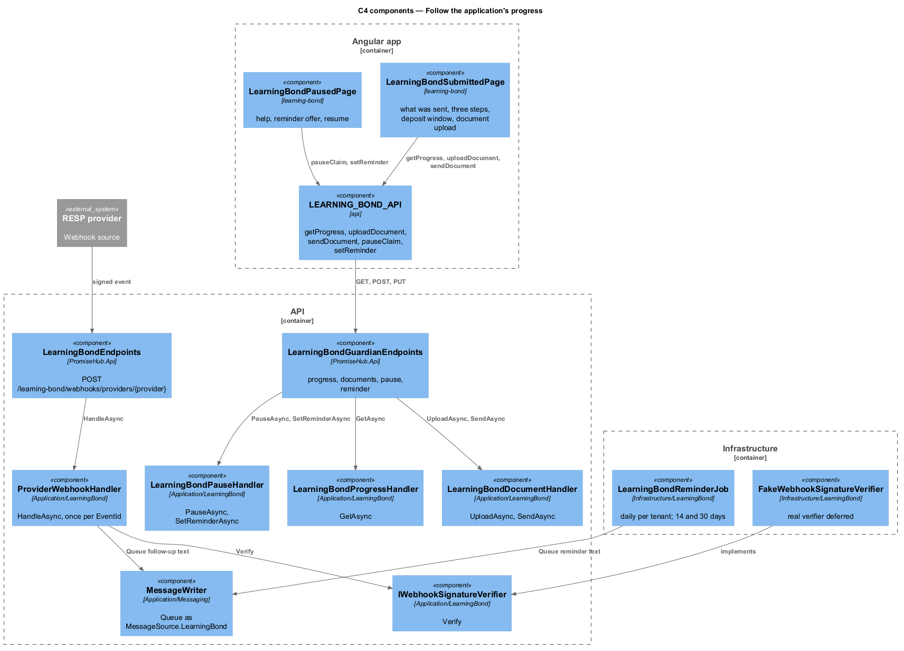
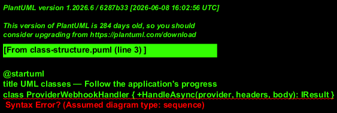
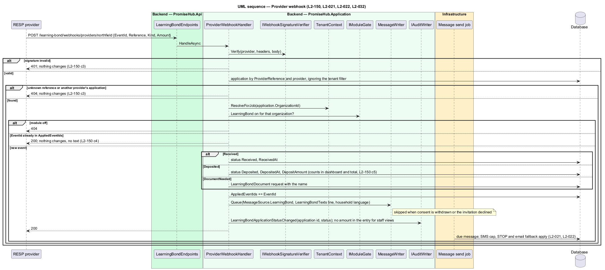
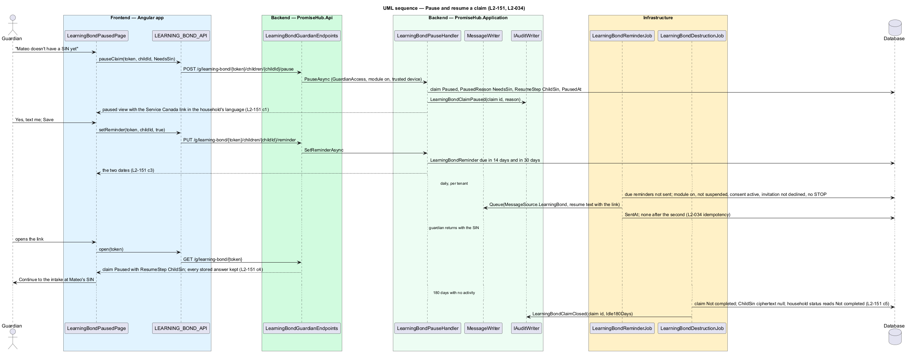

# Follow the application's progress

## Overview

After Submit, `learning-bond-submitted` shows "Sent to {provider} on {date}", the fields sent with SINs masked, the estimate, "What happens next" in three steps and a date chip for the expected deposit window from the provider's processing time. The provider reports progress through a signed webhook; each event is applied once, moves the application's status and texts the guardian in the household's language. A missing document is uploaded through the link and sent only on Send. A claim that cannot go on pauses on `learning-bond-paused` with plain help, offers a reminder at 14 and 30 days, resumes from the same link at the step it paused on, and closes as `Not completed` after 180 idle days.

Terms used in this document:

- **deposit window** — `ProcessingDaysMin` to `ProcessingDaysMax` days from the day sent, from `RespProvider`, shown as "Expected Jan 15 – Feb 28, 2027"
- **provider event** — webhook body with `EventId`, `Reference`, `Kind` (`Received`, `Deposited`, `DocumentNeeded`), `Amount`, `DocumentName`; applied once by `EventId`
- **paused reason** — `PausedReason.NeedsSin` or `NeedsTaxReturn` on `LearningBondClaim`, with the step to resume at
- **reminder** — `LearningBondReminder` of kind `ResumeClaim` due 14 and 30 days after the pause, each sent once by `LearningBondReminderJob`

Guardian routes resolve the tenant through `GuardianAccess`; the webhook has no token, so `ProviderWebhookHandler` finds the application by the provider's reference, takes the organization from it, and answers 404 when the module is off for that organization or the reference is unknown, 401 on a bad signature. Status changes, document sends, pauses, reminders and the 180-day close are audited by id and field name; no audit entry, text or log carries a SIN or a document's contents (`L2-032`, `L2-159`). Guardian DTOs carry `Last3` only.

## Description

Frontend:

- **`LearningBondSubmittedPage`** (`frontend/projects/learning-bond/`, route `/g/learning-bond/:token/children/:childId/submitted`). The review's success alert links to it. It shows, in order:
  - `ph-stepper` showing Step 5 of 5.
  - The heading "Sent to {provider} on {date}".
  - A `ph-alert` for what the provider last reported: received, deposited with the amount, or a document needed.
  - The agent's fixed line.
  - `ph-card` What happens next: a `ph-list` of the three steps, each led by the library's `ph-step-marker` and a Done `ph-badge` when reached, with a `ph-badge` for the deposit window.
  - When a document is requested, a `ph-card` with `ph-file-upload` (PDF, JPEG or PNG) and `ph-button` Send to {provider}, disabled until a file is kept.
  - `ph-card` What was sent, with the fields and the SINs masked.
  - Before Submit, the page says the application isn't sent yet and links back to the review.
- **`LearningBondPausedPage`** (route `/g/learning-bond/:token/children/:childId/paused`) shows:
  - The heading and a warning `ph-badge` with the pause reason.
  - The agent's fixed explanation.
  - `ph-card` How to get {first name}'s SIN, with Apply on canada.ca, or File for free, with Find a free clinic.
  - `ph-radio-group` "Remind you in 14 days?" (Yes, text me / No thanks) and Save; once answered, a `ph-alert` with the two dates or "No reminders".
  - Continue with {first name}'s details or Back to {first name}'s estimate, to the step it resumes at.
- **Pausing and resuming from other pages.** The intake offers "{first name} doesn't have a SIN yet", which pauses the claim. The estimate's tax-return warning offers What to do now. `GuardianLearningBondPage` links each child with an open claim to where it goes on.
- **API methods on `LEARNING_BOND_API`**: `progress(token, childId)`, `uploadDocument(token, documentId, file)`, `sendDocument(token, documentId)`, `pauseClaim(token, childId)`, `paused(token, childId)` and `setReminder(token, childId, remind)`.

Backend:

- **`LearningBondProgressHandler.GetAsync`** (`PromiseHub.Application/LearningBond/`) builds the submitted view:
  - the provider and `SubmittedAt`;
  - the fields as sent, with SINs as their last three digits;
  - the estimate;
  - the steps done (Received is 1, Deposited is 3);
  - the deposit window: `RespProvider.ProcessingDaysMin` and `ProcessingDaysMax` days after the day it was sent, in the organization's time zone;
  - the open document request.

  Before Submit it answers 409 `not-submitted`.
- **`LearningBondWebhookHandler.HandleAsync`** checks, in order: the signature (`IProviderWebhookVerifier`, an HMAC under `LearningBond:Webhooks:{channel}`, otherwise 401); the application, by the provider's reference and that provider's name across organizations (otherwise 404); the organization as tenant; the module (otherwise 404); and the event id, a repeat answering 200 and changing nothing.

  Then:
  - `Received` sets `ReceivedAt` and status `Received`.
  - `Deposited` sets `DepositedAt`, `DepositAmount` and status `Deposited` on the application and the claim, so staff see Deposited.
  - `DocumentNeeded` creates a `LearningBondDocument` request with the name.
  - Each writes a `LearningBondProviderEvent` and queues the `LearningBondTexts` line in the household's language through `LearningBondGuardianTexter` (Messages, every guardian with a mobile) (ADR 0081).
- **`LearningBondDocumentHandler`**:
  - `UploadAsync` accepts `application/pdf`, `image/jpeg` and `image/png` up to 10 MB (otherwise 422, naming the size). It encrypts with `ILearningBondCipher.EncryptDocument` (its own purpose) and stores the result in `IFileStore`, leaving `SentAt` null.
  - `SendAsync` is the guardian's own act. It writes `SubmissionKey` first, decrypts in memory and calls `IRespProviderChannel.SendDocumentAsync` once. A repeat answers 202, no file answers 409, and a refusal answers 502.
- **`LearningBondPauseHandler`**:
  - `PauseAsync` handles `NeedsSin` only. No tax return pauses at the estimate.
  - `GetAsync` returns the reason, the help link (`LearningBondHelpLinks`, in English or French) and the step it resumes at.
  - `SetReminderAsync` cancels open reminders, adds `LearningBondReminder` rows due 14 and 30 days on, and records the `LearningBondReminderChoice`.
  - `ResumeAsync` is called when the intake receives the missing SIN or the estimate sees Yes to the tax question. It clears the pause and cancels open reminders.
- **`LearningBondClaimJob.RunAsync`** runs from `MessageDispatchRunner` per organization, only with the module on (ADR 0081).
  - It texts each due reminder once with the link to the paused page. A reminder is cancelled instead after I'm not interested or once the consent ends.
  - It closes claims paused for 180 days as `NotCompleted`: the child's SIN ciphertext is destroyed, the consent is closed (`ClosedAt`), open reminders are cancelled, and the guardian's SIN is destroyed once no other claim needs it.
  - Reopening the link starts again from consent; the page has no separate closed state.
- **Endpoints**:
  - `POST /learning-bond/webhooks/providers/{provider}`, in `LearningBondWebhookEndpoints`: anonymous, with the handler gating per organization.
  - In `LearningBondGuardianEndpoints`: `GET /g/learning-bond/{token}/children/{childId}/progress`, `POST .../documents/{id}/file`, `POST .../documents/{id}/send`, `POST .../children/{childId}/pause`, `GET .../children/{childId}/paused` and `PUT .../children/{childId}/reminder`.

## Requirements

| L2 ID | Refines (L1) | Requirement |
|-------|--------------|-------------|
| `L2-150` | `L1-027` | After submitting, the guardian shall see what was sent, to whom and what happens next, and shall be texted as the provider reports progress through a signed webhook applied once per event. |
| `L2-151` | `L1-027` | A claim that cannot go on shall pause with plain help, offer reminders at 14 and 30 days, resume from the same link where it stopped, and close as Not completed after 180 idle days. |
| `L2-021` | `L1-010` | Messages to guardians shall be composed and sent through the Messages module in the chosen channels. |
| `L2-022` | `L1-010` | Texts shall pause at the organization's monthly SMS cap while email continues. |
| `L2-034` | `L1-018` | Background jobs shall run per tenant, recover from failure and never send a message twice. |
| `L2-032` | `L1-017` | Every change and every sensitive view shall be recorded in the organization's audit log. |

## Diagrams

The provider calls back into PromiseHub; PromiseHub texts the guardian through the SMS provider.

The webhook enters the API without a guardian link; the job runner sends reminders per tenant.

Four handlers and one job share the application and claim records.

Applied event ids live on the application so a repeated event is a no-op.

Signature, reference, tenant and module are checked before any status changes; the text goes through Messages.

A pause stores the step to resume at; reminders stop after the second text or on STOP.

