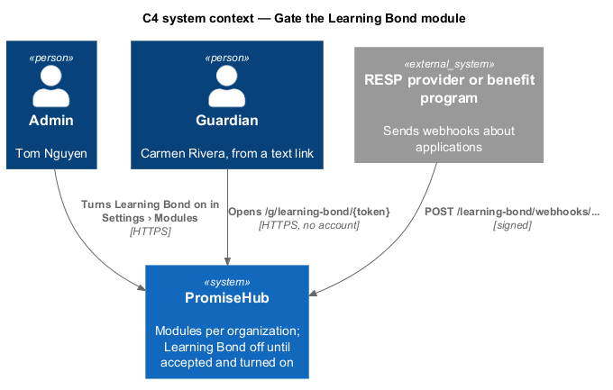
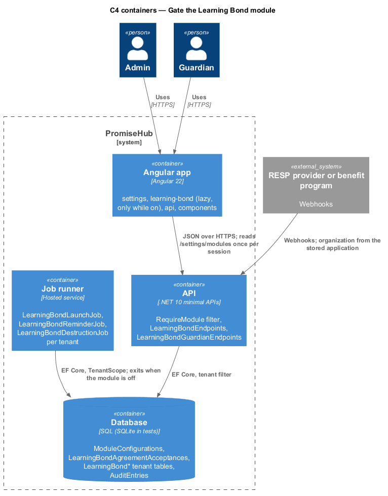
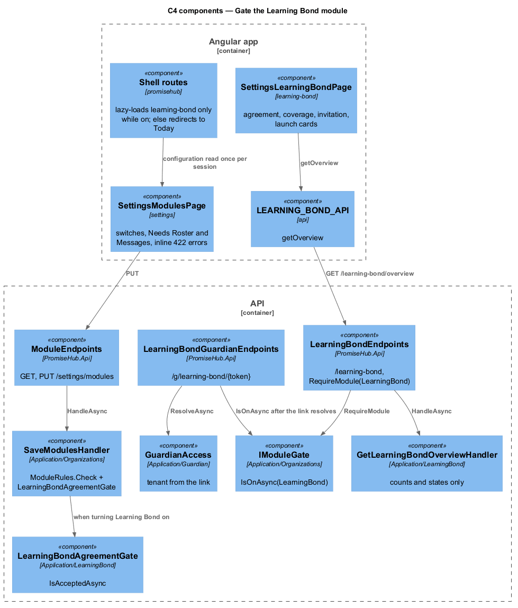
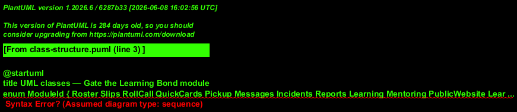
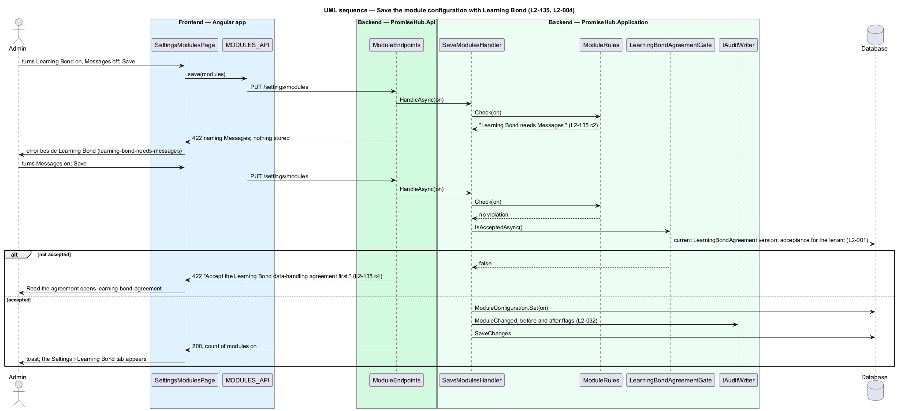
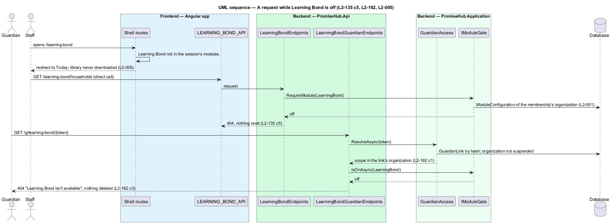

# Gate the Learning Bond module

## Overview

Learning Bond is the twelfth module (`ModuleId.LearningBond`). It is off for every organization until an admin turns it on in `settings-modules`, and the server refuses the save unless Roster and Messages are on and the current data-handling agreement has been accepted for that organization. While it is off, every `/learning-bond` staff endpoint, every `/g/learning-bond/{token}` guardian endpoint and every webhook answers 404 for that organization, the frontend never loads the `learning-bond` library and its routes redirect to Today. Turning it off deletes nothing; turning it back on restores every claim, consent and figure (ADR 0076).

Terms used in this document:

- **module gate** — `RequireModule(ModuleId.LearningBond)` on an endpoint group, answered from the tenant's `ModuleConfiguration` through `IModuleGate`
- **agreement gate** — `LearningBondAgreementGate`: the rule that the current `LearningBondAgreement` version has a `LearningBondAgreementAcceptance` for the organization
- **tenant** — organization of the signed-in member's active membership, of the guardian link, or of the stored application a webhook names; never a value from the client

Settings › Learning Bond (`settings-learning-bond`) is the hub that the other five designs of this subsystem open from.

## Description

Frontend:

- **`SettingsModulesPage`** (`frontend/projects/settings/`) — existing page; `MODULE_CATALOG` gains Learning Bond last with "Claims every dollar the government already owes your child, from birth to university." and the caption "Needs Roster and Messages". The 422 body maps to `ph-error-summary` and the inline error beside the switch: "Learning Bond needs Messages." (state `learning-bond-needs-messages`), "Learning Bond needs the roster." or "Accept the Learning Bond data-handling agreement first." with a Read the agreement link to `learning-bond-agreement` (state `learning-bond-agreement`).
- **`ModulePresetTilesComponent`** (`onboard-modules`) — unchanged presets; "Let me choose" shows the same row. No preset turns Learning Bond on.
- **`SettingsLearningBondPage`** (`frontend/projects/learning-bond/`, `settings-learning-bond`) — four `ph-card`s (agreement, coverage, invitation, launch), each linking to its page; `ph-alert` (warning) when a new agreement version is pending; `ph-skeleton` while loading; the forbidden state for roles without `ManageSettings`. Reads `LEARNING_BOND_API.getOverview()`.
- **Shell** (`frontend/projects/promisehub/`) — the `/learning-bond/**` routes and the Settings tab are composed only when the module is on in the session's configuration; otherwise the route redirects to Today and `learning-bond` is never downloaded (L2-005, L2-162).

Backend:

- **`ModuleId.LearningBond`**, **`ModuleCatalog.Name`** ("Learning Bond") and **`ModuleCatalog.Needs`** ([Roster, Messages]); `ModuleCatalog.Suite` is unchanged. `ModuleRules.Check` already renders "Learning Bond needs Messages." and names Learning Bond among Roster's dependents (L2-135 criteria 2 and 3).
- **`LearningBondAgreementGate`** (`PromiseHub.Application/LearningBond/`) — `IsAcceptedAsync()`: true when the current `LearningBondAgreement` version has an acceptance for the tenant. **`SaveModulesHandler`** calls it when the set turns Learning Bond on and adds a `ModuleViolation` for `LearningBond` with "Accept the Learning Bond data-handling agreement first." (criterion 4). The ADR names this check `SaveModuleConfigurationCommandValidator`; the built handler is `SaveModulesHandler` with `ModuleRules`, so the check lives there.
- **`LearningBondEndpoints`** (`PromiseHub.Api/Endpoints/`) — group `/learning-bond` with `RequireModule(ModuleId.LearningBond)`. The agreement routes (`/learning-bond/agreement/**`, `accept-data-handling-agreement`) are the one exception: they require `ManageSettings` and Roster and Messages on, because the agreement is accepted before the module can be on.
- **`LearningBondGuardianEndpoints`** — group `/g/learning-bond/{token}`; `GuardianAccess.ResolveAsync` puts the request in the link's organization, then `IModuleGate.IsOnAsync(ModuleId.LearningBond)` answers 404 when off. Webhooks take the organization from the stored `LearningBondApplication` and check the gate the same way.
- **`GetLearningBondOverviewHandler`** — the hub's DTO: agreement version and acceptance, pending version, coverage summary, sender name and launch state. Counts only; no household record is read before invitations go out (L2-136 criterion 5).
- **Jobs** — `LearningBondLaunchJob`, `LearningBondReminderJob` and `LearningBondDestructionJob` (`PromiseHub.Infrastructure/LearningBond/`) run per tenant inside `TenantScope` and exit when the module is off or the organization is suspended.
- **Audit** (L2-161, L2-032) — `SaveModulesHandler` already records `ModuleChanged` with before and after. Every Learning Bond handler records its own entry through `IAuditWriter` with actor, organization, record, action and time; entries name fields, never values. A cross-tenant request by id answers 404 and is audited as `Denied`.
- **Seed** — Harbourview has Learning Bond on with an accepted agreement version and claims in several statuses; Northgate has it off.

Tenant and module gate: every Learning Bond table carries `OrganizationId` under the tenant filter; a request from another organization, or while the module is off, answers 404 and never confirms that a record exists. Staff DTOs carry statuses, counts and dates only, never a SIN, income, marital status, household size, benefit name or dollar amount of a family.

## Requirements

| L2 ID | Refines (L1) | Requirement |
|-------|--------------|-------------|
| `L2-135` | `L1-026` | Learning Bond shall be the twelfth module, needing Roster and Messages, off until an admin turns it on, and shall not turn on before the data-handling agreement is accepted. |
| `L2-162` | `L1-029` | Every Learning Bond record shall carry the organization id, the tenant shall come from the membership or the guardian link, and every endpoint shall answer 404 when the module is off or the record belongs to another organization. |
| `L2-161` | `L1-029` | Every Learning Bond action that changes or reveals something shall be audited with actor, organization, record, action and time, without the sensitive values. |
| `L2-004` | `L1-002` | Admins shall switch modules on or off in `settings-modules` or by a preset in `onboard-modules`, with dependencies declared and enforced on the server. |
| `L2-005` | `L1-002` | A module that is off shall be neither served nor rendered. |
| `L2-001` | `L1-001` | Every query shall filter by the organization of the active membership, never by a value from the client. |
| `L2-032` | `L1-017` | Every change and every sensitive view shall be recorded in the organization's audit log. |

## Diagrams

The admin turns the module on; the server checks dependencies and the agreement before anything is stored.

The Angular app composes navigation from the configuration it reads once per session; the API reads the same configuration on every request.

The agreement gate is consulted by the module save; the module gate is consulted by every Learning Bond endpoint and job.

The configuration stores only the modules that are on, so Learning Bond is off for every existing organization.

Saving the configuration is refused twice before it succeeds: once for Messages and once for the agreement.

A request while the module is off answers 404 from the gate, whichever door it came through.

