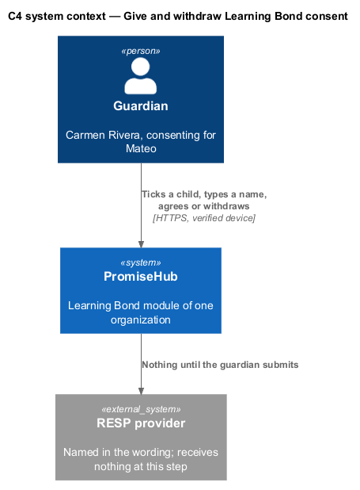
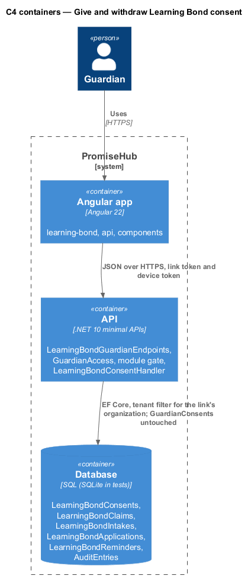
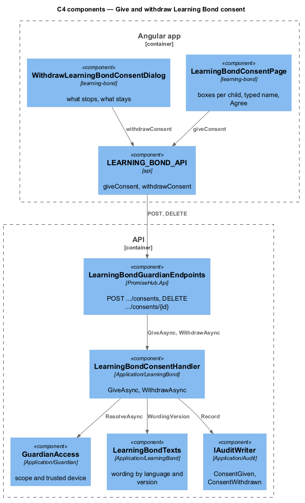
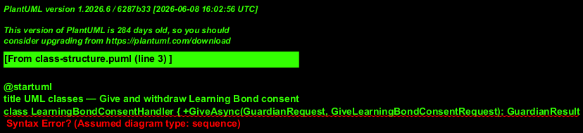
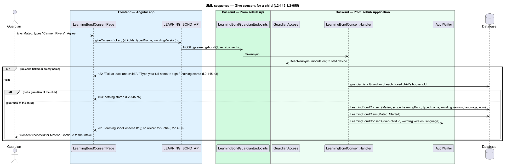
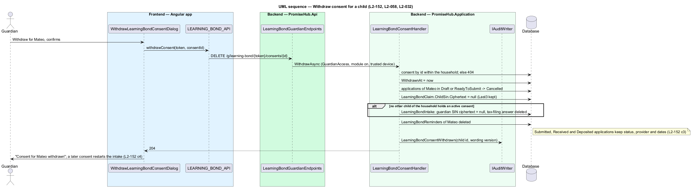

# Give and withdraw Learning Bond consent

## Overview

Before the intake asks anything, the guardian gives an explicit financial consent for each child on `learning-bond-consent`: one unticked box per eligible child with the exact wording, a typed full name and Agree. The consent is its own record, `LearningBondConsent` with `Scope` `LearningBond`, and no program consent or other `GuardianConsent` ever stands in for it. From the returning view of `guardian-learning-bond`, Your consents offers Withdraw per child; the dialog `withdraw-learning-bond-consent` says what stops and what stays, and confirming cancels every unsubmitted application, destroys the child's SIN and intake answers, keeps the status, provider and dates of anything already sent, and stops every text about the child.

Terms used in this document:

- **consent wording** — platform text from `LearningBondTexts` with a version: "I agree that Learning Bond may collect {first name}'s and my social insurance numbers and tax-filing status and send them to the RESP provider I choose and the Government of Canada to apply for the Canada Learning Bond."
- **eligible child** — covered child under 18 with no active `LearningBondConsent` (`open-guardian-learning-bond`)
- **destruction** — replacing an `EncryptedSin.Ciphertext` with null so only `Last3` remains, and deleting intake answers; the record of the application survives without the SIN

Both endpoints resolve the tenant through `GuardianAccess` and answer 404 when the module is off; a token of another organization never reaches that organization's children because the household comes from the link. Giving consent is audited as `LearningBondConsentGiven` and withdrawing as `LearningBondConsentWithdrawn`, each naming the child id, the wording version and the language, never a SIN (`L2-032`).

## Description

Frontend:

- **`LearningBondConsentPage`** (`frontend/projects/learning-bond/`, route `/g/learning-bond/:token/consent`) — `ph-checkbox` per eligible child with the child's name and the wording in the household's language, `ph-text-field` for the typed name (`autocomplete="name"`), `ph-error-summary` and per-field errors from the 422 body, `ph-button` Agree with a busy state, `ph-alert` on success with Continue to the intake. The page sends the wording version it displayed.
- **`WithdrawLearningBondConsentDialog`** (`ph-dialog`, danger) — the fixed sentence "We'll stop and delete {first name}'s information here. Anything already sent to {provider} stays with them; contact them to close the RESP.", a Stops and Stays facts list, Withdraw consent and Cancel. No input to validate.
- **`LEARNING_BOND_API.giveConsent(token, request)`** — 201 with the stored consents, or the 422 errors; **`LEARNING_BOND_API.withdrawConsent(token, consentId)`** — 204.

Backend:

- **`LearningBondConsentHandler.GiveAsync`** (`PromiseHub.Application/LearningBond/`) — scope through `GuardianAccess` (trusted device required), module gate, then validation: at least one child ("Tick at least one child.") and a non-empty typed name ("Type your full name to sign."), both 422 with nothing stored. Each ticked child is checked against the household record: the signing guardian shall be a `Guardian` of that child's household or the answer is 403. One `LearningBondConsent` per ticked child is stored with `Scope.LearningBond`, `GuardianId`, `TypedName`, `WordingVersion`, `Language` and `GivenAt`; a `LearningBondClaim` in status `Started` is created for the child. Unticked children get no record and the intake never asks about them.
- **`LearningBondConsentHandler.WithdrawAsync`** — loads the consent by id within the household (404 otherwise), sets `WithdrawnAt`, then in one unit of work: every `LearningBondApplication` of the child in `Draft` or `ReadyToSubmit` becomes `Cancelled`; the child's `LearningBondClaim.ChildSin` is destroyed; when no other child of the household holds an active consent, `LearningBondIntake` loses the guardian SIN and the tax-filing answer; every `LearningBondReminder` of the child is deleted; applications in `Submitted`, `Received` or `Deposited` keep status, provider and dates (`L2-152` criterion 3). Follow-up texts check for an active consent before queueing.
- **Independence from `GuardianConsent`** — `LearningBondConsent` is a separate entity in a separate table; no query joins the two and `GuardianConsentHandler` is unchanged (`L2-145` criterion 4).
- **Re-consent** — a new consent after a withdrawal creates a new `LearningBondClaim`; the intake starts from the first question because the destroyed answers are gone (`L2-152` criterion 4).
- **`POST /g/learning-bond/{token}/consents`**, **`DELETE /g/learning-bond/{token}/consents/{id}`** — `LearningBondGuardianEndpoints`.
- The consent DTO carries child first name, typed name, wording version, language and time; no `Last3` and no financial field.

## Requirements

| L2 ID | Refines (L1) | Requirement |
|-------|--------------|-------------|
| `L2-145` | `L1-027` | The guardian shall give an explicit per-child consent with the exact wording and a typed name before anything is asked, stored with scope LearningBond and separate from every other consent. |
| `L2-152` | `L1-027` | A guardian shall be able to withdraw Learning Bond consent for a child at any time, cancelling unsubmitted applications and destroying the child's financial data while keeping what was already sent. |
| `L2-055` | `L1-013` | A guardian shall consent through a verified link by reading the wording, ticking the box and typing their name. |
| `L2-058` | `L1-013` | A guardian shall see the consent record from the same link and be able to withdraw it, with every action audited. |
| `L2-032` | `L1-017` | Every change and every sensitive view shall be recorded in the organization's audit log. |

## Diagrams

The consent names the RESP provider and the Government of Canada as the recipients; nothing is sent at this step.

The consent table stands apart from the program consents.

One handler owns both the give and the withdraw paths and the destruction they cause.

`LearningBondConsent` shares nothing with `GuardianConsent`.

Validation and the guardian-of-child check run before anything is stored.

Withdrawal destroys ciphertext and cancels drafts in one unit of work; submitted applications keep their status.

