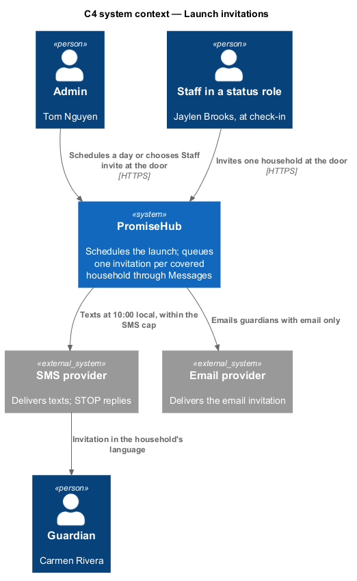
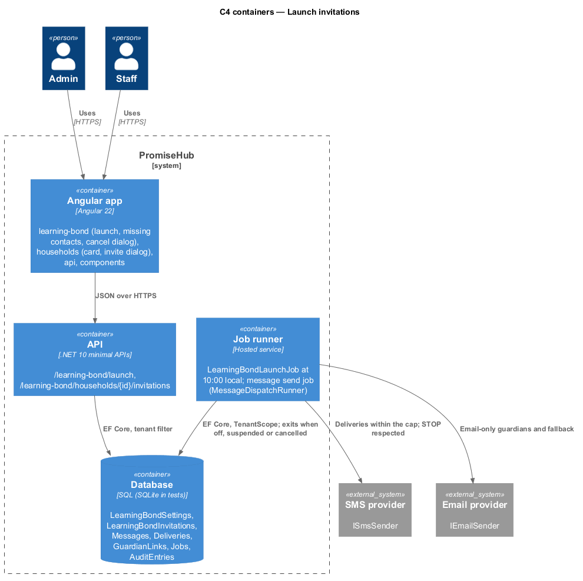
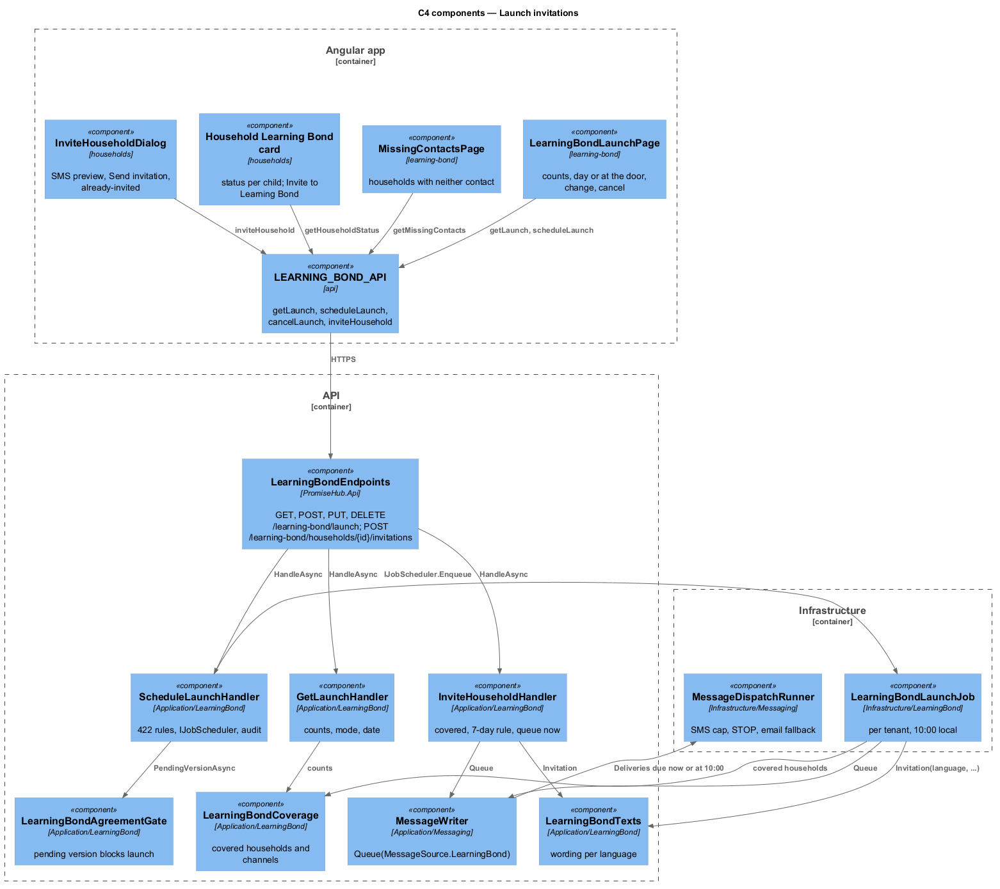
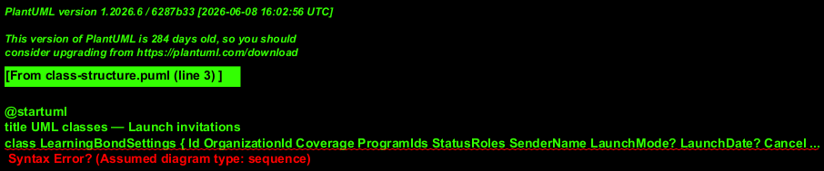
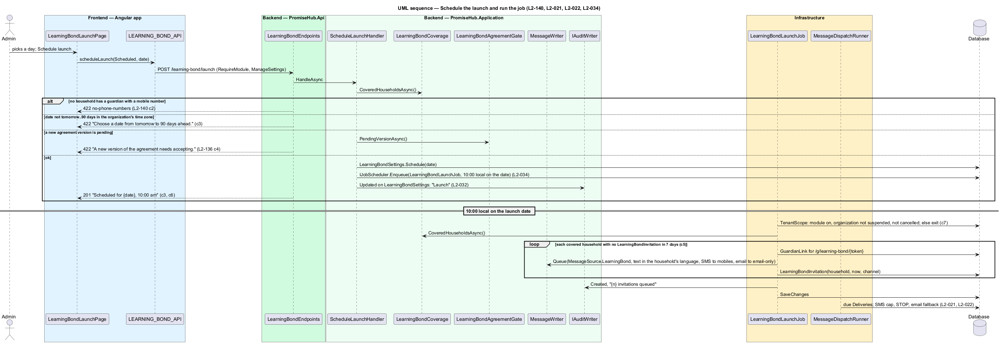
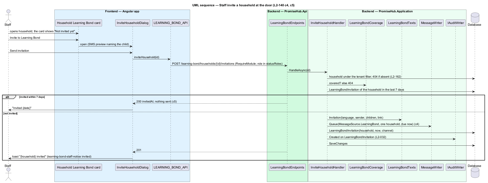

# Launch invitations

## Overview

Launch (`learning-bond-launch`) shows how many covered households there are and how each can be reached, then sends one invitation per household on a chosen day at 10:00 in the organization's time zone, or sends nothing in bulk and lets staff in a status role invite a household at the door from `household`. Every invitation is queued through `MessageWriter` as `MessageSource.LearningBond`, so the SMS cap, STOP replies and the email fallback of Messages apply. A household is never invited twice within 7 days, a scheduled launch can be changed or cancelled until the job starts, and a suspended organization or a module turned off sends nothing (ADR 0076).

Terms used in this document:

- **launch** — `LaunchMode` (`Scheduled` or `AtTheDoor`), `LaunchDate` and `CancelledAt` on `LearningBondSettings`
- **invitation** — `LearningBondInvitation`: household, sent at, channel; the record the 7-day rule and "Invited {date}" read
- **launch job** — `LearningBondLaunchJob` (`PromiseHub.Infrastructure/LearningBond/`): per-tenant job due at 10:00 local on the launch date
- **missing contacts** — covered households with no guardian who has a mobile number or an email (`learning-bond-launch/missing-contacts`)

## Description

Frontend:

- **`LearningBondLaunchPage`** — four `ph-stat`s (covered, with a mobile number, email only, neither with a link to the missing-contacts view), `ph-radio-group` (Send invitations on a day with a `ph-date-badge` date field; Staff invite at the door), `ph-error-summary`, Schedule launch or Launch without a mass send. States: `blocked` (Launch disabled with "Add guardians' mobile numbers before launching. Staff can collect them at check-in."), `invalid`, `submitting`, `scheduled` (`ph-alert` success with Change the date and Cancel launch), `at-door` (`ph-alert` info), `cancelled` (toast), loading, error, forbidden.
- **`MissingContactsPage`** — the households with neither contact, each linking to `household` with a `ph-badge` "No mobile".
- **`CancelLaunchDialog`** (`learning-bond-cancel-launch`, CDK Dialog) — danger confirmation; nothing has been sent.
- **Household card** (`frontend/projects/households/`, `household`) — a `ph-card` "Learning Bond" rendered only when the module is on and the member's role is in `statusRoles`: status per child or "Not invited yet" with Invite to Learning Bond, which opens **`InviteHouseholdDialog`** (`learning-bond-invite-household`): a `ph-sms-preview` of the text, Send invitation, or the `already-invited` state "Invited {date}". Because feature libraries never depend on each other, the card and dialog live in `households` and depend only on `LEARNING_BOND_API`.
- **`LEARNING_BOND_API`** — `getLaunch()`, `getMissingContacts()`, `scheduleLaunch(request)`, `changeLaunchDate(date)`, `cancelLaunch()`, `inviteHousehold(householdId)`, `getHouseholdStatus(householdId)`.

Backend:

- **`GetLaunchHandler`** — `GET /learning-bond/launch` (`ManageSettings`): counts from `LearningBondCoverage` (covered, with mobile, email only, neither), launch mode, date, cancellation and the agreement's pending version. `GET /learning-bond/launch/missing-contacts` lists the households with neither (L2-140 criterion 1).
- **`ScheduleLaunchHandler`** — `POST /learning-bond/launch`: 422 `no-phone-numbers` when no covered household has a guardian with a mobile number (criterion 2); 422 "Choose a date from tomorrow to 90 days ahead." outside that range in the organization's time zone (criterion 3); 422 "A new version of the agreement needs accepting." from `LearningBondAgreementGate` (L2-136). Stores mode and date, enqueues `LearningBondLaunchJob` through `IJobScheduler` for 10:00 local on that date, audits `Updated` on `LearningBondSettings` naming `Launch`, answers 201. `AtTheDoor` stores the mode and enqueues nothing (criterion 4). `PUT /learning-bond/launch` moves the date and the job; `DELETE /learning-bond/launch` sets `CancelledAt`, removes the job, sends nothing and audits (criterion 6).
- **`LearningBondLaunchJob`** — runs in `TenantScope`; exits when Learning Bond is off, the organization is suspended or the launch is cancelled (criterion 7). For each covered household without a `LearningBondInvitation` in the last 7 days it builds the text from `LearningBondTexts` in the household's language with each eligible child's first name and a `GuardianLink` to `/g/learning-bond/{token}`, and queues one message through `MessageWriter.Queue(MessageSource.LearningBond, …)` with SMS to each guardian with a mobile number and email to guardians with email only; the send job applies the SMS cap, STOP and email fallback (L2-021, L2-022). It stores one `LearningBondInvitation` per household and audits `Created` with the count. Delivery failures surface as the existing dead-letter notification (`learning-bond-staff-notice` danger, L2-034).
- **`InviteHouseholdHandler`** — `POST /learning-bond/households/{id}/invitations` (role in `statusRoles`): the household shall be covered and in the tenant, 404 otherwise; an invitation within 7 days answers 200 with `invitedAt` and sends nothing (criterion 5); otherwise queues the same message at once, stores the invitation, audits `Created`, answers 201. A guardian who replied STOP is skipped by the send job, never by this handler.

Tenant and module gate: the launch endpoints are in the `/learning-bond` group behind `RequireModule(ModuleId.LearningBond)`; the job runs per tenant and reads the household, guardians and children of that organization only. Audited: schedule, change, cancel, the job's send and each invitation at the door. The DTOs carry counts, dates and channel availability; no guardian contact leaves the API except on the missing-contacts list, which names the household and the reason only.

## Requirements

| L2 ID | Refines (L1) | Requirement |
|-------|--------------|-------------|
| `L2-140` | `L1-026` | The admin shall schedule one invitation per covered household for a day from tomorrow to 90 days ahead, or let staff invite at the door, with no household invited twice within 7 days and nothing sent when blocked, cancelled, suspended or off. |
| `L2-021` | `L1-010` | Messages shall be composed and sent to guardians through the message path, with channels and a preview of the SMS segment count. |
| `L2-022` | `L1-010` | Each organization shall have a monthly SMS segment cap; at the cap texts pause and email continues. |
| `L2-034` | `L1-018` | Background jobs shall run per tenant, retry and never send a message twice. |
| `L2-032` | `L1-017` | Every change and every sensitive view shall be recorded in the organization's audit log. |

## Diagrams

The admin schedules; the job sends through Messages; the guardian receives one text in their language.

The job runner and the API share the database; the SMS and email providers are reached only by the message send job.

Both the scheduled job and the at-the-door handler queue through `MessageWriter`; neither talks to a provider.

The invitation row, not the message, is what the 7-day rule reads.

Scheduling stores the date and enqueues the job; the job queues one message per household and stores one invitation each.

A staff member invites one covered household at the door; a second attempt within 7 days sends nothing.

