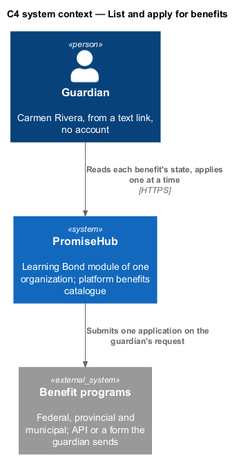
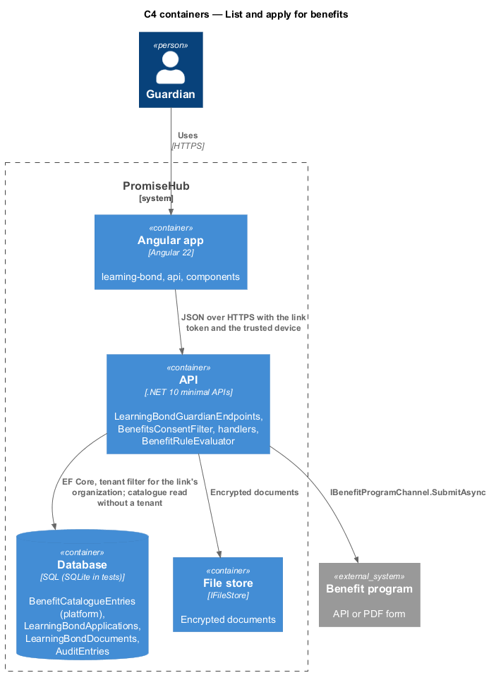
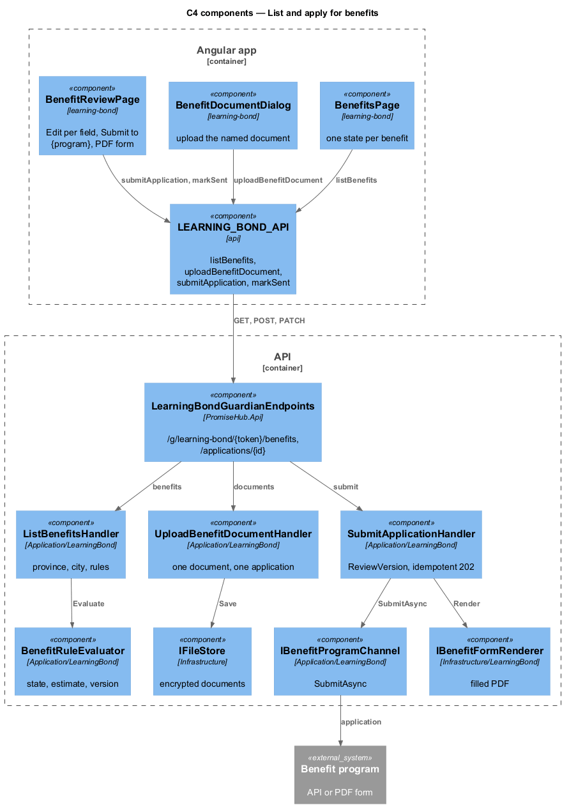
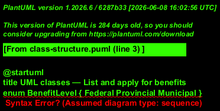
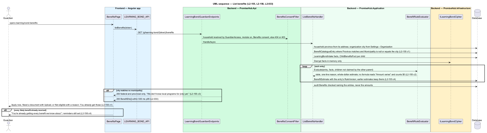
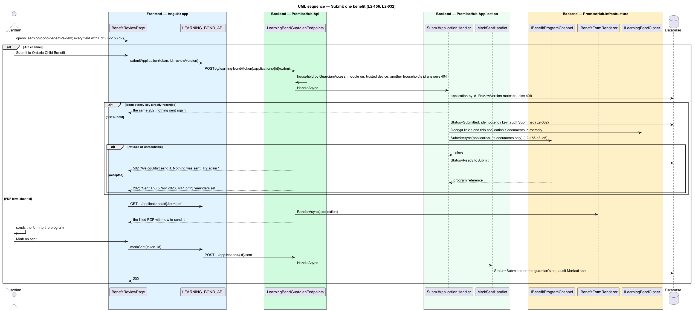

# List and apply for benefits

## Overview

Once the benefits intake is saved, `learning-bond-benefits` lists each child benefit the household is likely entitled to, from a catalogue the platform maintains: federal and provincial entries for every province and territory, municipal ones where the organization's city matches. Each entry carries exactly one of Apply now, Need a document (with Upload) or Not eligible with a one-line reason; benefits the household already receives sit under You already get these. Apply now opens `learning-bond-benefit-review`, a pre-filled application with Edit per field and one Submit to {program}; the submission reuses the idempotent 202 path of the Learning Bond application (`../review-and-submit-application/README.md`). A program whose channel is a form the guardian sends offers the filled PDF, and marking it Sent is the guardian's act. There is no Submit all.

Terms used in this document:

- **catalogue entry** — `BenefitCatalogueEntry`: platform data with no organization id, versioned eligibility rule and estimate formula, source link, level, municipality, channel and renewal rule
- **benefit state** — one of `ApplyNow`, `NeedDocument`, `NotEligible` or `AlreadyReceived`, computed on the server from the facts and the rule
- **benefit application** — `LearningBondApplication` with `Kind = Benefit`, the program, the fields as sent, `ReviewVersion` and status

The catalogue is read without a tenant filter; every application, document and estimate carries the organization id from the link, and another household's benefit or application answers 404. Estimates computed, documents uploaded and submissions are audited by field name, never by amount or value, and no staff DTO carries a benefit name or dollar figure (ADR 0076).

## Description

Frontend:

- **`LearningBondBenefitsPage`** (route `/g/learning-bond/:token/benefits`) shows:
  - the agent's line;
  - the notes: local programs unknown, a child the check stopped for, and the income note;
  - each benefit not already received as the library's `ph-benefit-card`, with its name, a state badge, level and amount ("About $1,680 a year" or "Amount varies"), one line of why, the action and its source with the rule version.

  The actions are Apply now (a link to the benefit's page), or `ph-file-upload` for Need a document. Not eligible has none. You already get these is a `ph-list` of received benefits. When the family gets everything, an empty state says so. There is no Submit all.
- **`LearningBondBenefitReviewPage`** (route `.../benefits/:key`):
  - For an electronic program: the fields as a `ph-list`, with Edit (in `LearningBondFieldDialog`, which edits either kind of application) on address, phone and email, the line "This sends your application to the {program}. Only this one.", and Submit to {program}.
  - For a form program: Send it yourself, with Attach and Send to, a link to Download the filled form (PDF), and Mark as sent.
- **API methods on `LEARNING_BOND_API`**: `benefits`, `uploadBenefitDocument`, `prepareBenefit`, `editBenefitField`, `submitBenefit`, `markBenefitSent` and `benefitFormUrl`.

Backend:

- **`LearningBondBenefitsHandler.ListAsync`** answers 409 until the intake is done. It takes `BenefitCatalogue.For(province, city)` and the children the household may claim for: Not sure stops the check for a child, and The other parent leaves the child out.
  - Each entry gets exactly one state: Submitted once applied for, AlreadyGet, NotEligible with its reason, NeedDocument until its document is kept, otherwise ApplyNow.
  - The amount is the rule's per-child amount summed over those children, or null.
  - The response also carries the rule version, the source and link, the local note when the city matches no municipality, the income note, and whether everything is already received (ADR 0082).
- **`LearningBondBenefitApplicationHandler`**:
  - `PrepareAsync` makes one `LearningBondBenefitApplication` per benefit, with contact details reused from the Learning Bond application or the primary guardian.
  - `UploadDocumentAsync` accepts a PDF, JPEG or PNG up to 10 MB and keeps it encrypted as a `LearningBondDocument` on that application.
  - `EditFieldAsync` handles address, phone and email, moving the review version.
  - `SubmitAsync`, for electronic programs only, requires the review version and a complete application. It writes the key first, decrypts the guardian's SIN in memory, sends once through `IBenefitChannel` with a 202, and audits as `Submitted` without a SIN.
  - `FormAsync` builds the one-page PDF with the SIN boxes left blank (`LearningBondFormPdf`).
  - `MarkSentAsync` records the guardian's own act.
- **Endpoints**, in `LearningBondGuardianEndpoints`: `GET /g/learning-bond/{token}/benefits`, `POST .../benefits/{key}/document`, `POST .../benefits/{key}/applications`, `PATCH .../benefits/applications/{id}/fields/{field}`, `POST .../benefits/applications/{id}/submit`, `GET .../benefits/applications/{id}/form` and `POST .../benefits/applications/{id}/sent`.

## Requirements

| L2 ID | Refines (L1) | Requirement |
|-------|--------------|-------------|
| `L2-155` | `L1-028` | Likely benefits shall come from a platform catalogue with versioned rules, estimated on the server by those rules and never by the language model. |
| `L2-156` | `L1-028` | Each benefit the family does not receive shall show exactly one of three states, and each application shall be submitted on its own. |
| `L2-032` | `L1-017` | Every change and every sensitive view shall be recorded in the organization's audit log and searchable by admins. |
| `L2-033` | `L1-018` | Guardian pages shall meet the performance budget measured on a mid-range phone over simulated 4G. |

## Diagrams

The guardian applies to each program one at a time; PromiseHub sends only what the guardian submitted.

The catalogue is platform data in the same database; benefit programs sit behind `IBenefitProgramChannel`.

The rule evaluator computes every amount; the handler depends on the channel abstraction, never on a program's SDK.

Each estimate keeps the rule version it used, and each document belongs to one application.

Province and city select the entries; the rules decide the state and the amount.

One benefit is sent once with a 202, through the API channel or as a PDF the guardian sends and marks Sent.

