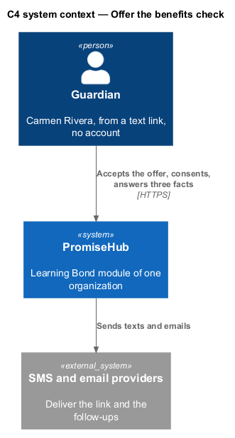
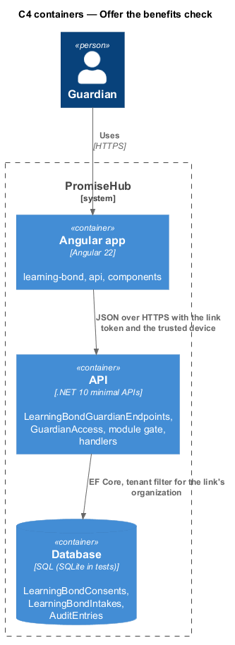
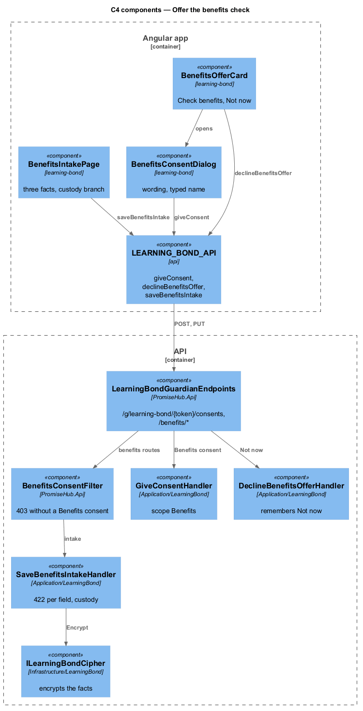
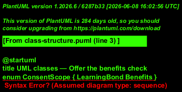
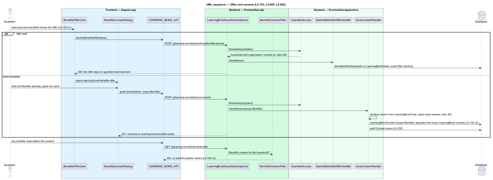
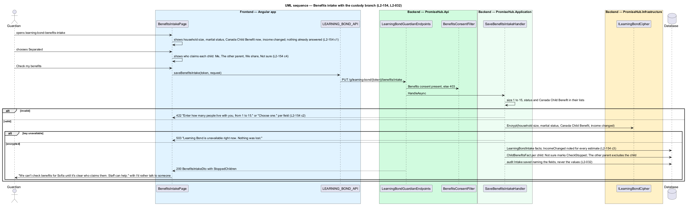

# Offer the benefits check

## Overview

After a Learning Bond application is sent, the agent offers to check child benefits (`learning-bond-submitted`, dialog `learning-bond-benefits-offer`): "I can also check whether your family gets every child benefit it qualifies for. It takes about 3 questions." Check benefits opens a consent of its own, with the Benefits wording and a typed name, stored as a `LearningBondConsent` with scope `Benefits` and never counted as a Learning Bond consent. Not now is remembered and the offer stays on `guardian-learning-bond`; a household with no claim to start sees the offer there directly. Without a Benefits consent every benefits endpoint of the household answers 403. The intake (`learning-bond-benefits-intake`) reuses the Learning Bond intake and asks at most three facts: household size, marital status and the Canada Child Benefit now, plus the income-changed question and, for Separated or Divorced, who claims each child.

Terms used in this document:

- **Benefits consent** — `LearningBondConsent` with `Scope = Benefits`: guardian, typed name, wording version, language, time
- **benefits facts** — household size, marital status, Canada Child Benefit now, income changed and the custody answer per child, stored encrypted on `LearningBondIntake`
- **custody branch** — the who-claims question asked only for Separated or Divorced, answered per child

The guardian link resolves the organization through `GuardianAccess` and then the module gate; another household's intake or a module that is off answers 404. Consents given, Not now and intake saves are audited with the field names, never the values (ADR 0076).

## Description

Frontend:

- **The offer.** On `LearningBondSubmittedPage`, a `ph-card` Child benefits shows the agent's offer, Check benefits and Not now. Not now calls `dismissBenefitsOffer` and the offer goes from the confirmation. On `GuardianLearningBondPage`, the same offer stays until the Benefits consent is given, then becomes Your benefits.
- **`LearningBondBenefitsConsentPage`** (route `/g/learning-bond/:token/benefits/consent`) shows `ph-checkbox` with the Benefits wording, `ph-text-field` for the typed name, and Agree. Not ticked: "Tick the box to agree." After it, the three questions.
- **`LearningBondBenefitsIntakePage`** (route `.../benefits/intake`) shows the agent's line naming what is reused, then, in a `ph-card` About your household:
  - `ph-text-field` (number) for household size;
  - `ph-select` for marital status;
  - `ph-radio-group` for the Canada Child Benefit now and for income changed;
  - for Separated or Divorced, one `ph-radio-group` per child for who claims them.

  Check my benefits saves the answers and opens the list. Errors show per field.
- **API methods on `LEARNING_BOND_API`**: `dismissBenefitsOffer`, `benefitsConsent`, `giveBenefitsConsent`, `benefitsIntake` and `saveBenefitsIntake`.

Backend:

- **`LearningBondConsentHandler.GiveAsync`** with scope `Benefits` stores one `LearningBondConsent` per child under 18 with the Benefits wording version. It starts no claim and is audited per child (ADR 0082).
- **`LearningBondBenefitsAccess`** gives the Learning Bond guardian scope plus a Benefits consent in force (otherwise 403). It also reads and writes the encrypted answers on `LearningBondBenefitsCheck`.
- **`LearningBondBenefitsHandler`**:
  - `DismissOfferAsync` stamps `OfferDismissedAt`.
  - `ConsentPageAsync` returns the wording and whether the consent is given.
  - `IntakeAsync` returns the children under 18 and whether the SIN and the tax answer are already given.
  - `SaveIntakeAsync` validates household size (1 to 15, "Enter how many people live with you, from 1 to 15."), marital status, the Canada Child Benefit and income changed ("Choose one."), and who claims each child when separated or divorced. It encrypts the answers and audits the field names only.
- **The offer on other responses.** `GuardianLearningBondDto.Benefits` (offered, consented) and `LearningBondProgressDto.BenefitsOffer` (no consent and no Not now) carry it.
- **Endpoints**, in `LearningBondGuardianEndpoints`: `POST /g/learning-bond/{token}/benefits/offer/dismiss`, `GET .../benefits/consent`, `POST .../consents` with `scope: "Benefits"`, and `GET` and `PUT .../benefits/intake`.

## Requirements

| L2 ID | Refines (L1) | Requirement |
|-------|--------------|-------------|
| `L2-153` | `L1-028` | The agent shall offer the benefits check on the Learning Bond confirmation, and benefit data shall need a consent of its own, recorded separately from the Learning Bond consent. |
| `L2-154` | `L1-028` | The benefits intake shall reuse the children, birth dates, SINs and tax-filing status already given and ask at most three facts more. |
| `L2-055` | `L1-013` | A guardian shall consent through a verified link, with no account, by reading the wording, ticking the box and typing their name. |
| `L2-032` | `L1-017` | Every change and every sensitive view shall be recorded in the organization's audit log and searchable by admins. |

## Diagrams

The guardian consents to the benefits check from a text link; the catalogue and the language model stay outside this feature.

The Angular guardian pages call the guardian endpoints, which resolve the household through the link before the module gate.

The consent filter sits in front of every benefits route; the handlers write only through the cipher.

The Benefits consent is a scope of `LearningBondConsent`, and the benefits facts live on the household's single `LearningBondIntake`.

Not now is remembered, Check benefits records a separate consent, and until it exists the benefits routes answer 403.

The intake asks three facts, then the custody branch for Separated or Divorced; Not sure stops the check for that child.

