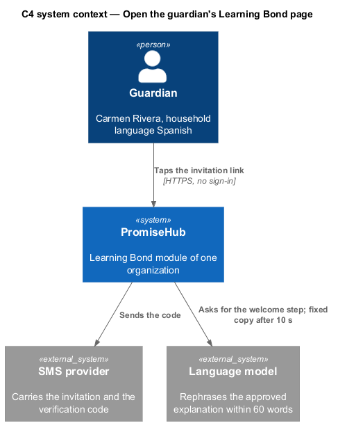
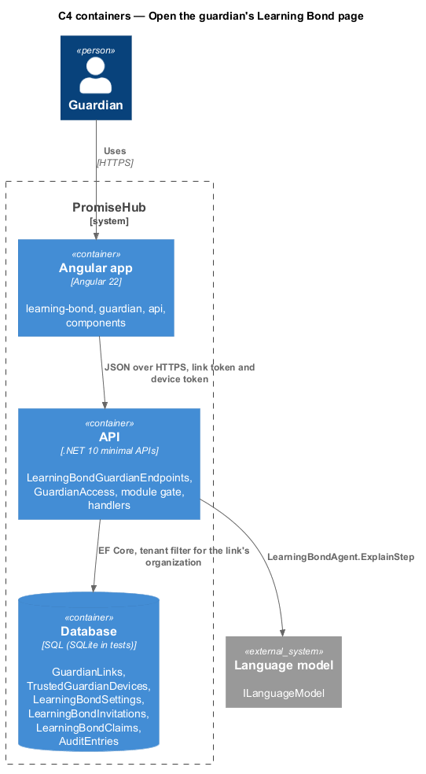
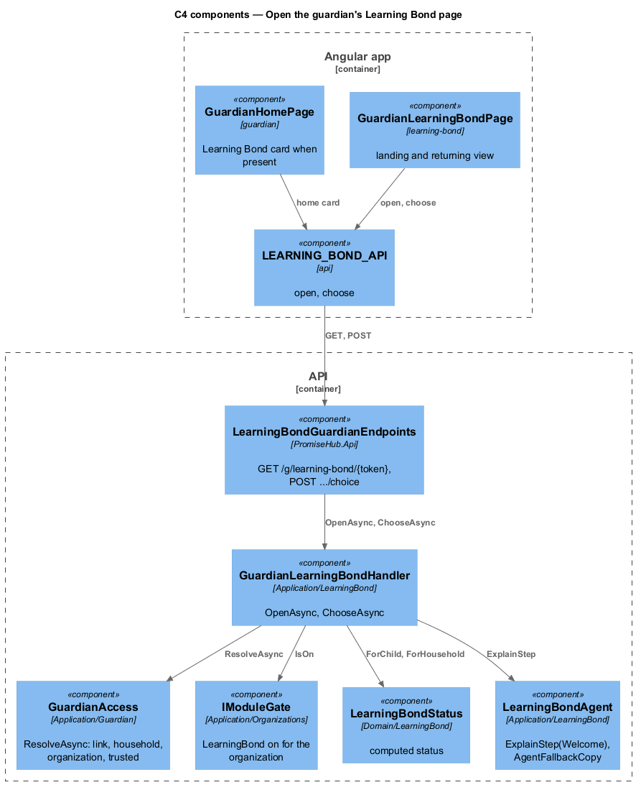
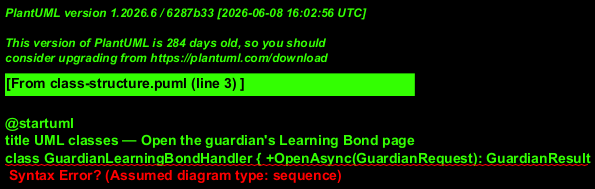
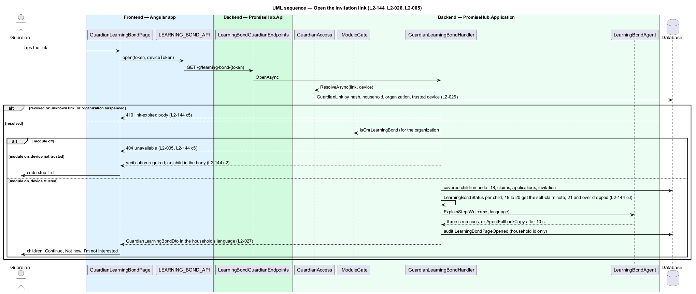
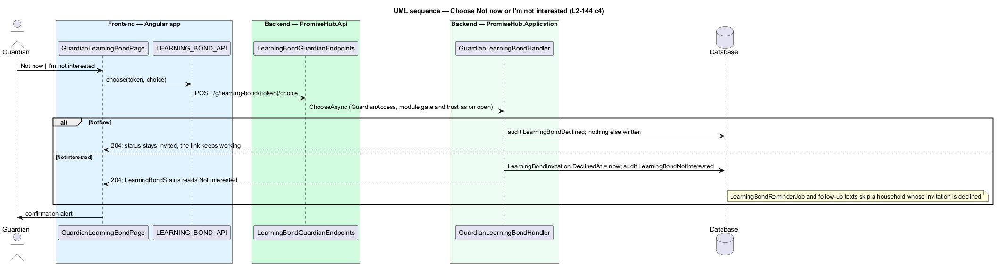

# Open the guardian's Learning Bond page

## Overview

The invitation text carries a guardian link. Tapping it opens `guardian-learning-bond` in the household's language, with no account and no download: the agent's three-sentence explanation, each child of the household who is in a covered program and under 18 with the amount they may be owed, and Continue, Not now and I'm not interested. Because the page leads to social insurance numbers, an unknown device sees the six-digit code step of `L2-026` first and nothing about the children before it succeeds. The portal home (`guardian-home`) shows a Learning Bond card with the household's standing while the module is on and nothing at all while it is off.

Terms used in this document:

- **covered child** — child of the household enrolled in a program that `LearningBondSettings.Coverage` includes, aged under 18 on the day the page opens
- **self-claim note** — line shown for a child aged 18 to 20: "{first name} can claim the Learning Bond for themselves until they turn 21."
- **household status** — value `LearningBondStatus` computes from invitations, consents, claims and applications: `Not invited`, `Invited`, `Started`, `Paused`, `Submitted`, `Completed`, `Not completed`, `Not interested`

The organization comes from the link through `GuardianAccess`, never from the URL; the module gate runs after the organization is known, so a tenant with Learning Bond off or a suspended organization answers 404 on every `/g/learning-bond/{token}` route and the page says Learning Bond isn't available. Opening the page and each choice are audited as `LearningBondPageOpened`, `LearningBondDeclined` and `LearningBondNotInterested` with the household id only (`L2-032`).

## Description

Frontend:

- **`GuardianLearningBondPage`** (`frontend/projects/learning-bond/`, route `/g/learning-bond/:token`) — the landing and the returning view in one page. `ph-card` with the children as a list, `ph-badge` for "Up to $1,400" and the per-child status, `ph-button` (Continue primary, Not now, I'm not interested ghost), `ph-alert` for the Not now and Not interested confirmations, `ph-skeleton` while loading. A child aged 18 to 20 renders the self-claim note and no badge; a child aged 21 or over is absent from the response. The returning view adds Your consents (Withdraw opens `withdraw-learning-bond-consent`, `give-and-withdraw-consent`), the running total and the benefits offer.
- **`GuardianVerifyPage`** (`guardian`, existing) — handles the `verification-required` outcome before any Learning Bond content; the `learning-bond` library never renders children until the device is trusted.
- **`LEARNING_BOND_API.open(token)`** — `GuardianLearningBondDto` or the `expired`, `verification-required` or `unavailable` outcome; **`LEARNING_BOND_API.choose(token, choice)`** — `NotNow` or `NotInterested`.
- **`GuardianHomePage`** (`guardian`, existing) — renders the Learning Bond card from `GuardianHomeDto.learningBond` when present; the field is absent while the module is off, so nothing is rendered, linked or prefetched (`L2-005`).

Backend:

- **`GuardianLearningBondHandler.OpenAsync`** (`PromiseHub.Application/LearningBond/`) — `GuardianAccess.ResolveAsync`; null answers the expired body. Then `IModuleGate.IsOn(ModuleId.LearningBond)` for the resolved organization; off answers 404 with `unavailable`. An untrusted device answers `GuardianAccess.VerifyBody` and nothing else (`L2-144` criterion 2). A trusted device loads the covered children, computes each child's status through `LearningBondStatus`, asks `LearningBondAgent.ExplainStep(Welcome)` for the three sentences in the household's language with `AgentFallbackCopy` as the answer after 10 s, and returns `GuardianLearningBondDto`. The explanation names the organization and says the data goes to the RESP provider and the Government of Canada (`L2-144` criterion 3).
- **`GuardianLearningBondHandler.ChooseAsync`** — `NotNow` stores nothing and leaves the status `Invited`; `NotInterested` writes `LearningBondInvitation.DeclinedAt`, which `LearningBondStatus` reads as `Not interested` and which `LearningBondReminderJob` and the follow-up texts treat as a stop (`L2-144` criterion 4).
- **`LearningBondStatus`** (`PromiseHub.Domain/LearningBond/`) — pure domain service; `ForChild(claim, applications)` and `ForHousehold(invitation, consents, claims)`. Nothing stores a status twice.
- **`LearningBondHomeCard`** (`Application/LearningBond/`), called by **`GuardianHomeHandler`** — adds `GuardianHomeLearningBondDto` (each covered child under 18 with `Invited` or its claim status) to the home response only when the module is on, the household was invited and has not chosen I’m not interested; otherwise null. The card's Open Learning Bond button opens `/g/learning-bond/{token}` on the home's own link, which `GuardianAccess` resolves like any household link (`L2-144` criterion 7).
- **`GET /g/learning-bond/{token}`**, **`POST /g/learning-bond/{token}/choice`** — `LearningBondGuardianEndpoints`, anonymous, resolved through `GuardianAccess`.
- DTOs carry first names, ages, program names, statuses and "up to" estimates; no SIN, no `Last3` on this page, no income or tax answer.

## Requirements

| L2 ID | Refines (L1) | Requirement |
|-------|--------------|-------------|
| `L2-144` | `L1-027` | The invitation link shall open the guardian's Learning Bond page in the household's language, after device verification, naming each covered child under 18 with Continue, Not now and I'm not interested. |
| `L2-026` | `L1-013` | Guardian pages shall be reached by links tied to a phone number or email, with a six-digit code verifying the device and no password. |
| `L2-027` | `L1-013` | Guardian pages, texts and emails shall be in English, Spanish or French as the household chose, with one primary action per page. |
| `L2-005` | `L1-002` | A module that is off shall be neither served nor rendered. |

## Diagrams

The guardian reaches PromiseHub from a text; this page sends nothing to a provider or a government service.

The Angular app calls the guardian endpoints with the link token and the device token; the API resolves the tenant from the link.

The handler runs link resolution, the module gate and the trust check in that order before any child is read.

Status is computed from records, never stored.

Nothing about the children leaves the server before the device is trusted.

Not now stores nothing; I'm not interested stops every Learning Bond text.

