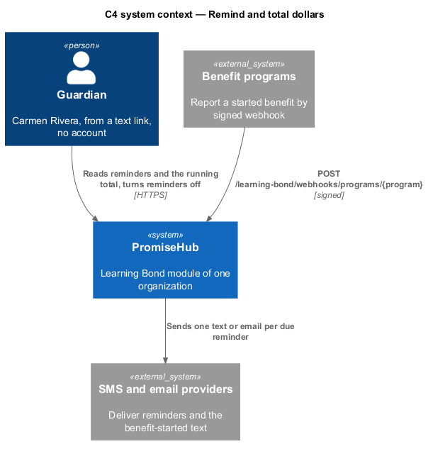
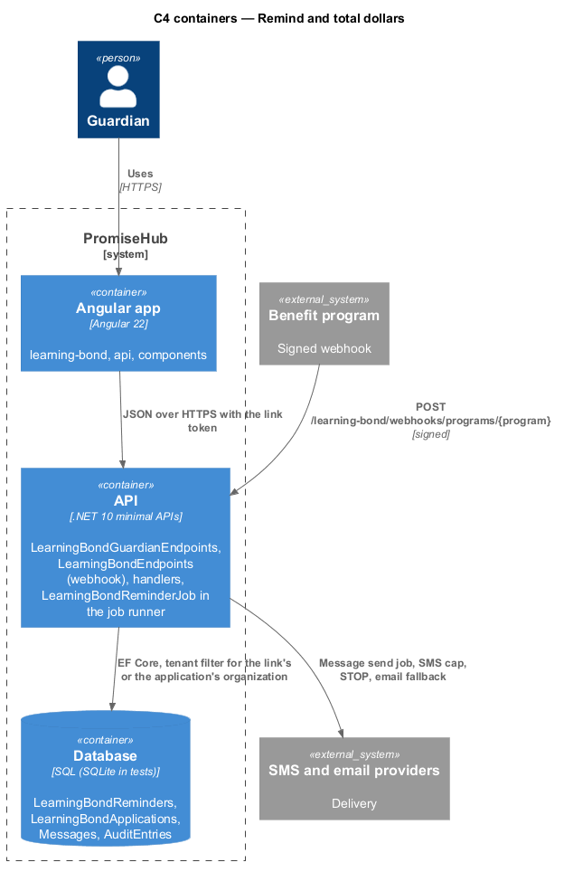
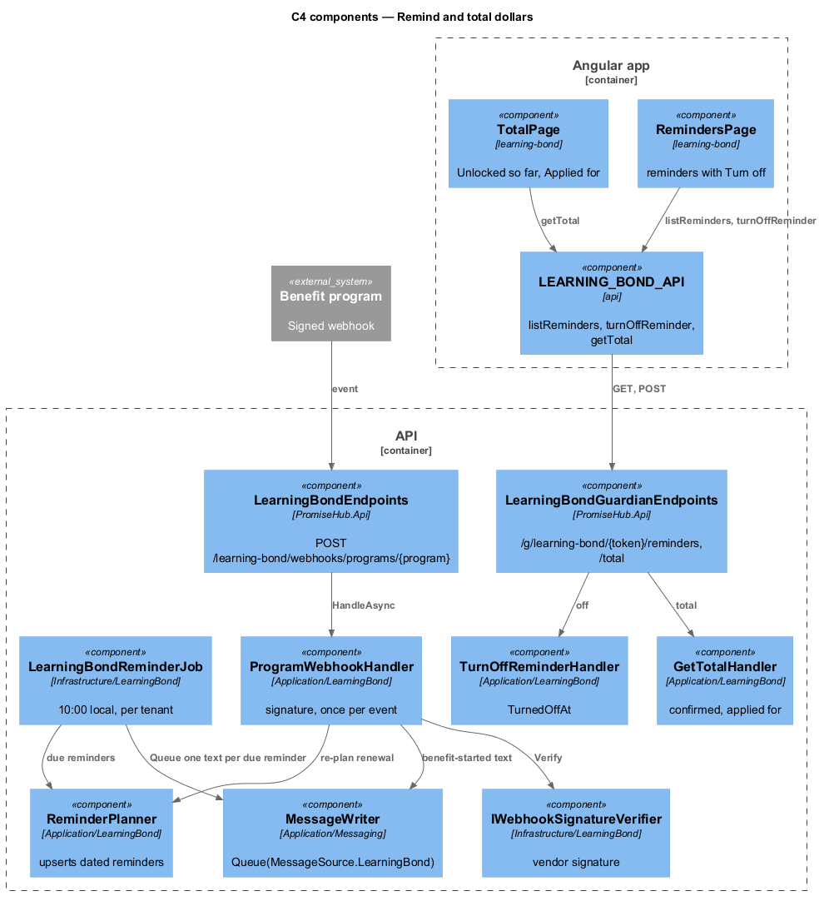
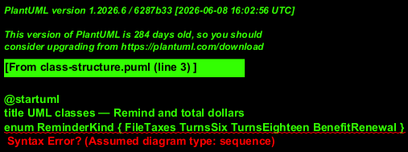
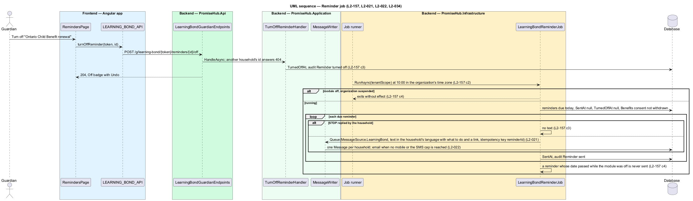
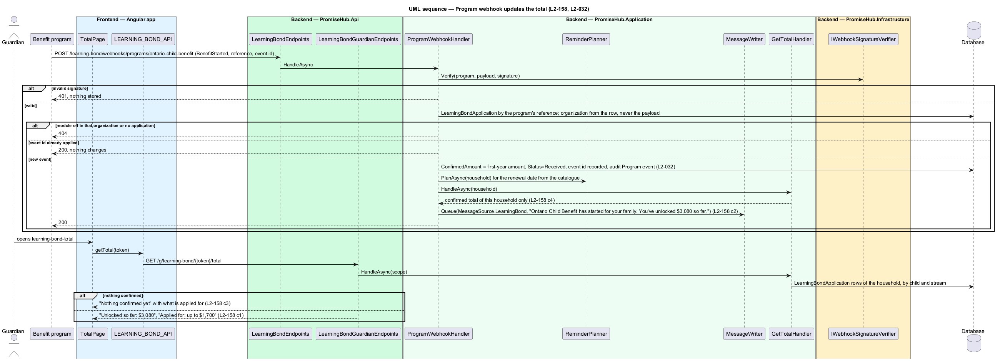

# Remind and total dollars

## Overview

A finished benefits check sets reminders tied to the household's dates (`learning-bond-reminders`): "File your {year} taxes" on March 15 each year, "{first name} turns 6" and "{first name} turns 18" 30 days before each birthday still ahead, and each received or applied-for benefit's renewal date from the catalogue, each with Turn off. `LearningBondReminderJob` runs per tenant at 10:00 in the organization's time zone and sends each due reminder once, as one text through `MessageWriter`, with email when the household has no mobile number or the SMS cap is reached. The guardian also sees a running total (`learning-bond-total`): "Unlocked so far: ${confirmed}" and "Applied for: up to ${estimated}", split by child and stream, or "Nothing confirmed yet". A program reports a started benefit through a signed webhook, which updates the total and texts "{benefit} has started for your family. You've unlocked ${total} so far."

Terms used in this document:

- **reminder** — `LearningBondReminder`: kind (`FileTaxes`, `TurnsSix`, `TurnsEighteen`, `BenefitRenewal`), household, child or application, due date, turned off, sent at
- **confirmed** — deposits of the Learning Bond and the first year of each benefit that started, read from `LearningBondApplication` rows with `ConfirmedAmount`
- **applied for** — estimates of submitted applications not yet confirmed, read from `EstimatedAmount`

Both jobs and both pages run in the link's organization; the webhook takes its organization from the stored application. Reminders turned off, reminders sent and program events are audited; the total is never answered to a staff endpoint and no staff DTO carries an amount (ADR 0076).

## Description

Frontend:

- **`LearningBondRemindersPage`** (route `/g/learning-bond/:token/reminders`): the agent's line, then the reminders still ahead as a `ph-list`. Each has its words in the guardian's language: File your {year} taxes, {first name} turns 6 or 18, or {benefit} renews. The date follows, and a ghost Turn off labelled with the reminder, or an Off badge once it is off. With none, an empty state says reminders appear after a benefits check.
- **`LearningBondTotalPage`** (route `.../total`): `ph-stat` Unlocked so far (or Nothing confirmed yet), the Applied for line, and `ph-table` By child and stream, with Confirmed and Applied for columns.
- **The total card.** `GuardianLearningBondPage` shows Unlocked so far, Applied for, See your total and Your reminders once the total has lines.
- **API methods on `LEARNING_BOND_API`**: `reminders`, `turnOffReminder` and `total`.

Backend:

- **`LearningBondDatePlanner.SyncAsync`** runs after the benefits intake is saved and after a benefit application is submitted or marked sent. It adds the date reminders idempotently (ADR 0083).
- **`LearningBondRemindersHandler`**: `ListAsync` returns the household's reminders not yet sent or missed (kind, subject, due and event dates, turned off). `TurnOffAsync` handles the household's own reminders only, otherwise 404.
- **`LearningBondClaimJob.SendDateRemindersAsync`** runs per organization from the dispatch runner:
  - it sends a reminder due today from 10:00 local, once, through `LearningBondGuardianTexter` with `LearningBondTexts.DateReminder`, while the Benefits consent is in force;
  - it marks a reminder whose day passed unsent as missed;
  - a tax reminder sent sets next year's.
- **`LearningBondTotals.LinesAsync`** and **`LearningBondTotalHandler.GetAsync`** compute the household's own lines: Learning Bond deposits or estimates per child, and benefits confirmed or estimated, split by the catalogue's per-child rule.
- **`LearningBondProgramWebhookHandler.HandleAsync`** checks, in order: the signature for the program (otherwise 401); the benefit application, by the program's reference (otherwise 404); the module on in its organization (otherwise 404); and the event id, applied once. It records `ConfirmedAmount` and `StartedAt`, and, while the Benefits consent is in force, texts "{benefit} has started for your family. You've unlocked ${total} so far." in the household's language.
- **Endpoints**: `GET /g/learning-bond/{token}/reminders`, `PUT .../reminders/{id}/off` and `GET .../total` in `LearningBondGuardianEndpoints`, and `POST /learning-bond/webhooks/programs/{program}` in `LearningBondWebhookEndpoints`.

## Requirements

| L2 ID | Refines (L1) | Requirement |
|-------|--------------|-------------|
| `L2-157` | `L1-028` | The agent shall set reminders tied to the household's dates: filing taxes, a child turning 6 or 18, and each benefit's renewal. |
| `L2-158` | `L1-028` | The guardian shall see the dollars unlocked so far across the Learning Bond and benefits, and each follow-up text shall carry it. |
| `L2-021` | `L1-010` | Messages to guardians shall be composed and sent through Messages with the chosen channels. |
| `L2-022` | `L1-010` | Each organization shall have a monthly SMS segment cap by plan; at the cap, texts pause and email continues. |
| `L2-034` | `L1-018` | Background jobs shall run per tenant, recover from failure and never send a message twice. |
| `L2-032` | `L1-017` | Every change and every sensitive view shall be recorded in the organization's audit log and searchable by admins. |

## Diagrams

Reminders reach the guardian through the messaging providers; benefit programs report started benefits back.

The reminder job runs in the API process per tenant; the webhook enters through the API and finds its tenant in the database.

The job and the webhook handler both queue through `MessageWriter`; the total handler only reads.

A reminder is one row with one send; the total is computed from application rows, never stored.

The job sends each due reminder once at 10:00 local and nothing while the module is off, the organization suspended or the consent withdrawn.

A signed program event updates one application, the total and the guardian's text, once.

