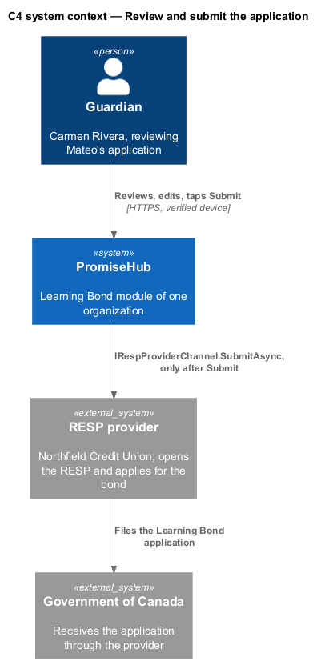
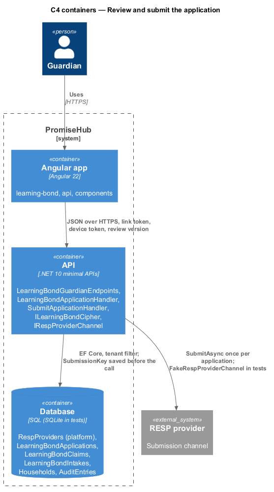
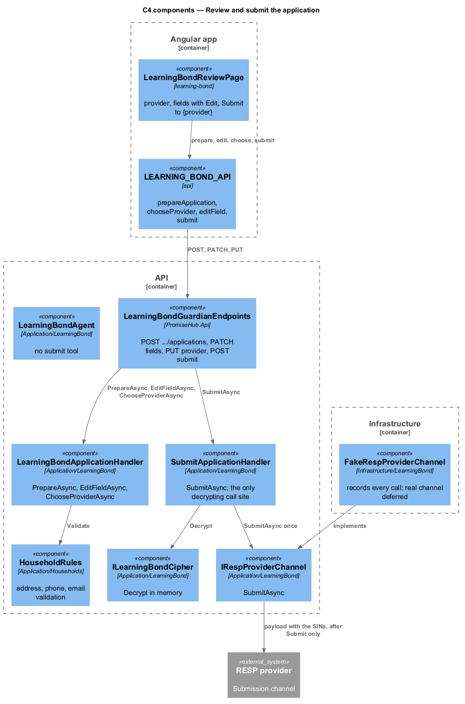
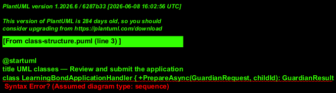
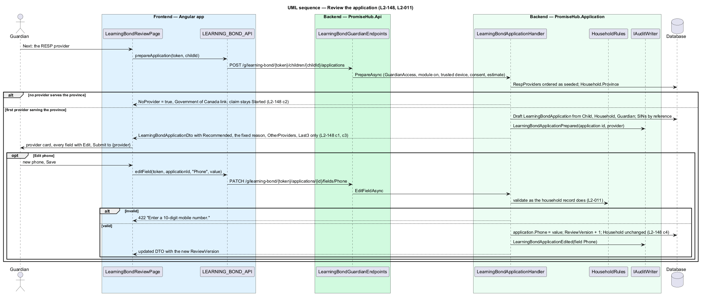
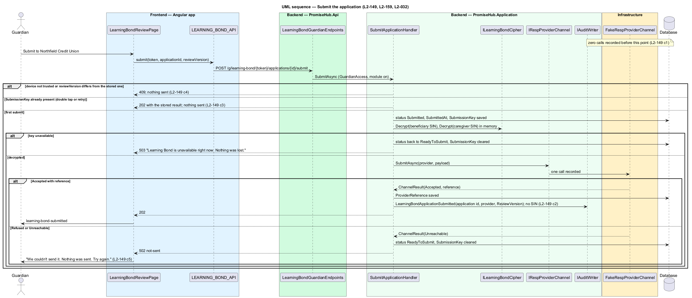

# Review and submit the application

## Overview

`learning-bond-review` recommends a no-fee RESP provider from the platform's list, shows every field of the pre-filled application with Edit per field, and offers Submit to {provider} as the only way to send it. Nothing reaches the provider or a government service before the guardian taps Submit: the fake channel used in tests records no request before that moment. Submit carries the review's version, requires a trusted device, answers 202 and sends once; a double tap or a retry answers the same 202 and sends nothing more. A provider that refuses or cannot be reached leaves the application `ReadyToSubmit` with "We couldn't send it. Nothing was sent. Try again."

Terms used in this document:

- **provider catalogue** — `RespProviders.All`: a static platform list of `RespProvider` (`Name`, `NoFee`, `AdministersLearningBond`, `Provinces`, `Channel`), identical for every organization and editable by none (ADR 0080)
- **recommendation** — first catalogue entry whose `Provinces` include the household's province, with the fixed reason "No fees, no deposit needed, and it handles the Learning Bond"
- **review version** — `LearningBondApplication.ReviewVersion`, incremented by every edit and every provider change; Submit shall quote the current value
- **idempotency key** — `LearningBondApplication.SubmissionKey`, written before the channel is called so a repeat finds it and sends nothing

Every route resolves the tenant through `GuardianAccess` and answers 404 when the module is off. Preparing, editing, choosing a provider and submitting are audited; the submission entry is `LearningBondApplicationSubmitted` with the application id, provider and `ReviewVersion`, and no audit entry, log or DTO carries a SIN (`L2-032`, `L2-159`). The guardian DTO carries both SINs as `Last3` only.

## Description

Frontend:

- **`LearningBondReviewPage`** (`frontend/projects/learning-bond/`, route `/g/learning-bond/:token/children/:childId/review`) has:
  - `ph-stepper` showing Step 4 of 5, then the `ph-agent-message` fixed line.
  - A `ph-card` for the RESP provider: the name, a `ph-badge` Recommended, the reason sentence, and Choose another, which opens `LearningBondProviderDialog` (a CDK dialog with a `ph-radio-group` of the providers serving the province).
  - A `ph-card` for the RESP and Learning Bond application: a `ph-list` of every field, the SINs masked. Address, phone and email each have a `ph-button` Edit that opens `LearningBondFieldDialog`, a CDK dialog with one `ph-text-field`, validated on the server, and the help "For this application only. Your family’s record isn’t changed."
  - The line "This sends {first name}’s application to {provider} and the Government of Canada.", above `ph-button` Submit to {provider}, whose busy state ignores a second tap.
  - A `ph-alert` for each outcome: success for sent, danger for not sent, warning for stale.
  - With no provider, the Government of Canada link and no Submit.
- **API methods on `LEARNING_BOND_API`**: `prepareApplication(token, childId)`, `editApplicationField(token, id, field, value)`, `chooseProvider(token, id, name)` and `submitApplication(token, id, reviewVersion)`.

Backend:

- **`LearningBondApplicationHandler.PrepareAsync`** (`PromiseHub.Application/LearningBond/`) runs in the guardian scope, behind the module gate and on a trusted device.
  - It answers 403 for a child without a claim, and 409 `not-ready` before the estimate or while the claim is paused.
  - Otherwise it creates or reloads the child's open `LearningBondApplication`. The province comes from `RespProviders.ProvinceOf(organization time zone)`, the provider is the first one serving it, and the phone and email come from the primary guardian.
  - The beneficiary name, date of birth, caregiver name and language are read from the records on every review. The SINs are only referenced, as their last three digits.
  - With no provider serving the province, the provider is null and the DTO carries `NoProvider = true` (`L2-148` criterion 2).
- **`LearningBondApplicationHandler.EditFieldAsync`** handles the phone (ten digits, formatted `905-555-0177`), email, address (10 to 200 characters) and province.
  - It answers 422 with the field's message, stores the value on the application only, increments `ReviewVersion` and audits Updated with the field's name.
  - The household record is unchanged (`L2-148` criterion 4), and a SIN can't be edited here.
- **`LearningBondApplicationHandler.ChooseProviderAsync`** accepts only a catalogue entry serving the province (otherwise 422 "Choose a provider that serves your province.") and increments `ReviewVersion`. The application is `ReadyToSubmit` once it has both a provider and an address.
- **`LearningBondSubmitHandler.SubmitAsync`** works in this order:
  1. An application already Submitted answers 202 and calls nothing (`L2-149` criterion 3).
  2. Otherwise `ReviewVersion` must equal the stored value (409 `stale-review`), and the application must be `ReadyToSubmit` (409 `incomplete`).
  3. The cipher must be available (503).
  4. It writes and saves `SubmissionKey`, decrypts both SINs in memory (the only decrypting call site in the module) and calls `IRespProviderChannel.SubmitAsync`.
  5. A send marks the application and the claim Submitted, stores `ProviderReference` and audits Submitted on `LearningBondApplication`, naming the provider and no SIN. A refusal answers 502 `not-sent`, the application stays `ReadyToSubmit`, and a retry reuses the key (`L2-149` criterion 5).
- **The channel and its fake.** `IRespProviderChannel` is in `Application/LearningBond/`. Until a provider is integrated, `UnconfiguredRespProviderChannel` (`Infrastructure/LearningBond/`) answers not sent (ADR 0080). `FakeRespProviderChannel` (`PromiseHub.Api.Tests`) records every call, so tests assert zero calls before Submit and one after.
- **The agent** has no tool that reaches `LearningBondSubmitHandler` (`L2-149` criterion 4). Its model-backed answers are prompt 92.
- **Endpoints**, in `LearningBondGuardianEndpoints`: `POST /g/learning-bond/{token}/children/{childId}/applications` (prepare), `PATCH /g/learning-bond/{token}/applications/{id}/fields/{field}`, `PUT /g/learning-bond/{token}/applications/{id}/provider` and `POST /g/learning-bond/{token}/applications/{id}/submit`.

## Requirements

| L2 ID | Refines (L1) | Requirement |
|-------|--------------|-------------|
| `L2-148` | `L1-027` | The system shall recommend the first no-fee provider serving the household's province from a platform list no organization can change, and pre-fill its application for field-by-field review. |
| `L2-149` | `L1-027` | The server shall send an application to a provider only on the guardian's own Submit request with the review's current version, exactly once, and never on the agent's. |
| `L2-032` | `L1-017` | Every change and every sensitive view shall be recorded in the organization's audit log. |
| `L2-011` | `L1-005` | Household and child records shall validate contact details on the server and keep an audit trail. |

## Diagrams

The RESP provider is the only external recipient, and only after Submit.

The provider channel sits behind an abstraction with a fake in tests.

Two handlers: one prepares and edits, one submits and decrypts.

The application stores its own copy of the contact fields and references the encrypted SINs.

The recommendation is the first catalogue match; edits touch the application only.

Status and the idempotency key are saved before the channel is called; a failure rolls the status back.

