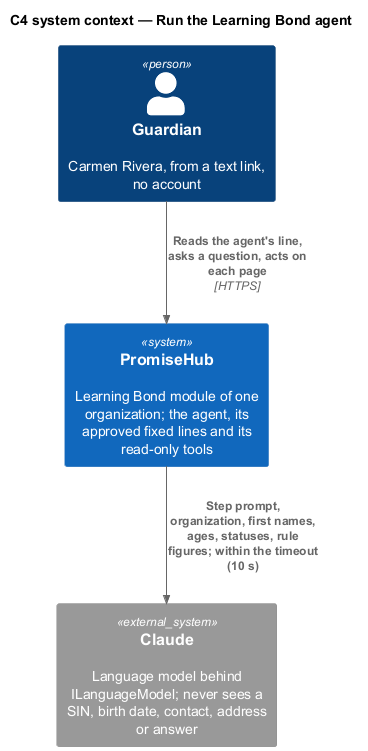
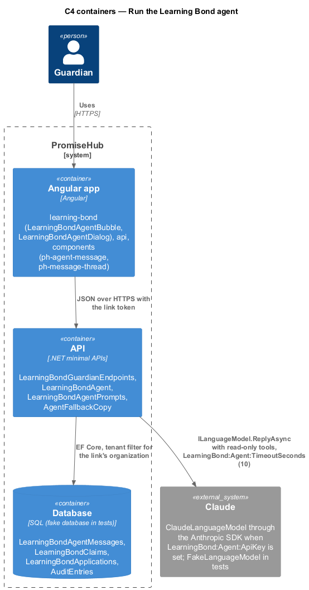
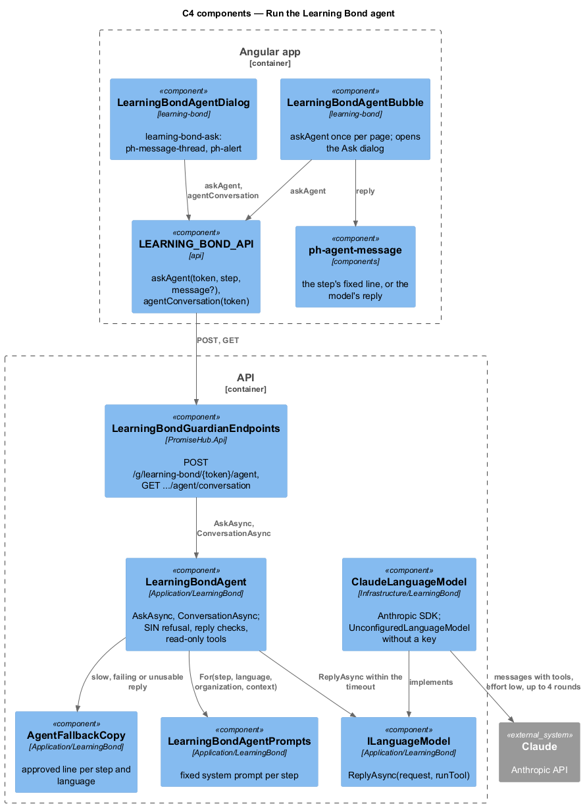
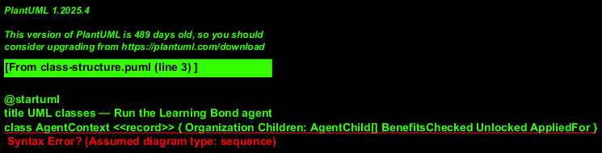
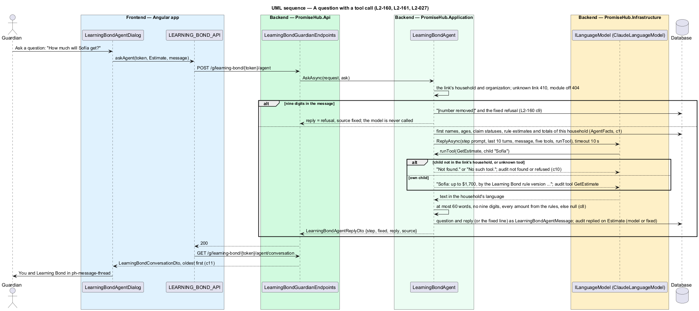
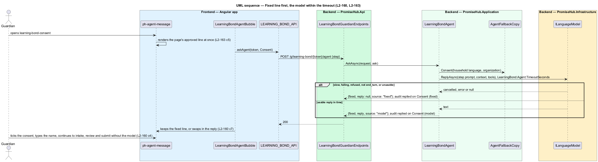

# Run the Learning Bond agent

## Overview

The Learning Bond agent is the bubble at the top of every guardian Learning Bond page (`agent()` in the mocks) and the Ask Learning Bond dialog (`learning-bond-ask`) under it. It explains the step and answers questions; the server decides. `LearningBondAgent` talks to a language model behind `ILanguageModel` with a fixed system prompt per step and nothing but the organization's name, the household's language, the children's first names and ages, statuses and the figures the rules computed. It has five read-only tools, each a server method answered for the link's household, and no tool for consent, submit, withdraw or another household. Every step has an approved fixed line (`AgentFallbackCopy`) that the page shows first; the model's reply replaces it only when it comes within the timeout and passes the server's checks, so consent, intake, review and submit complete without the model (ADR 0085). This design also fixes the accessibility, responsiveness, language and performance rules every Learning Bond screen follows.

Terms used in this document:

- **step prompt** — `LearningBondAgentPrompts.For(step, language, organization, context)`: the same rules on every step plus a focus line for `Landing`, `Consent`, `Intake`, `Estimate`, `Review`, `Submitted`, `Benefits`, `Reminders` or `Total`; platform text with no organization edits
- **agent context** — `AgentContext`: the organization's name, each child as `AgentChild` (first name, age, claim status, paused reason, the rule's estimate), whether the benefits check was done, and the unlocked and applied-for totals. Never a SIN, a birth date, a contact, an address, an intake answer or a document
- **fixed line** — `AgentFallbackCopy`: the approved line of a step in English, Spanish and French, shown as is when the model is slow, down, refuses or answers something unusable
- **tool** — `GetStatus`, `GetEstimate`, `ListBenefits`, `ExplainStep`, `OfferCallback`, each answered by `LearningBondAgent` for the household of the link, never one the model names

The conversation (`LearningBondAgentMessage` rows) belongs to the household of the link and is read only through `GET /g/learning-bond/{token}/agent/conversation`; no staff route reads it. An unknown link answers 410, the agent and the conversation answer 404 while the module is off, and another organization's link never reads them. Each reply and tool call is audited by step and tool name, never by content (ADR 0076, L2-161).

## Description

Frontend:

- **`ph-agent-message`** (`components`) — the bubble with the sprout icon tile and a visually hidden speaker name; each page renders its approved line at once and swaps in the model's reply when it comes.
- **`LearningBondAgentBubble`** (`learning-bond`) — one per page; `load(token)` calls `LEARNING_BOND_API.askAgent(token, step)` once and sets `reply` when the answer's `reply` is not null; `open(token, text)` opens `LearningBondAgentDialog` through `PhDialogs`. The Landing, Consent, Intake, Estimate, Review, Submitted, Benefits and Reminders pages put a ghost Ask a question button (sparkle icon) under the bubble; the paused, benefits questions and benefit application pages keep their bubble without it.
- **`LearningBondAgentDialog`** (`learning-bond`, `learning-bond-ask`) — title Ask Learning Bond; while the conversation is empty, an agent message "Ask anything about this step. I explain; you decide."; the conversation in `ph-message-thread` (You and Learning Bond) with the field Your question, the hint "Don’t type your SIN or any number here." and Send; Close. A failed send shows a danger alert and keeps the words. After each answer it re-reads `agentConversation(token)`. Words in English, Spanish and French are in `guardian-learning-bond-text.ts`; `ph-message-thread` gained `help`, `composerLabel`, `fieldLabel`, `sendLabel`, `notSentLabel` and `tryAgainLabel` inputs for them, with the old English words as defaults.
- **Every guardian page** — one column, one primary action, `ph-*` components only, 24 by 24 px targets, visible focus, no sideways scroll from 360 to 1440 px; the SIN field is masked (visible label, format hint, `inputmode="numeric"`, `autocomplete="off"`, error linked with `aria-describedby` and announced, masked on blur with Show); amounts and dates follow the household's locale ("1 200 $" in French).

Backend:

- **`LearningBondAgent.AskAsync(request, AskLearningBondAgentRequest { Step, Message? })`** (`Application/LearningBond/`) — resolves the link through `LearningBondGuardianScope.TrustedAsync` (410 unknown, 404 module off), builds `AgentFacts` (the `AgentContext` and the set of amounts the rules produced: each estimate, each total line, the unlocked and applied-for sums and the rule's 500, 100 and 2,000), and the step's fixed line. A message with nine digits (alone or grouped by spaces or hyphens) is answered with `AgentFallbackCopy.SinRefused` in the household's language, never reaches the model, and is stored with the number replaced by `NumberRemoved` ("[number removed]"). Otherwise it calls `ILanguageModel.ReplyAsync(LanguageModelRequest, runTool, ct)` with the step prompt, the household's last 10 turns, the message (or "Explain this step to me.") and the five tools, cancelled after `ILearningBondAgentSettings.Timeout`. A reply is used only when it has 60 words or fewer, no nine-digit number and every dollar amount in the set; otherwise the fixed line answers. A question and its answer are stored as two `LearningBondAgentMessage` rows (Guardian, Agent; at most 2,000 characters each). It answers `LearningBondAgentReplyDto { Step, Fixed, Reply?, Source }` with `Source` "model" or "fixed".
- **`LearningBondAgent.ConversationAsync(request)`** — the household's messages oldest first as `LearningBondConversationDto { Messages: LearningBondAgentMessageDto { Role, Text, Step, At } }`.
- **Tools** — run through the `runTool` callback: `GetStatus` (each child's first name and claim, and whether benefits were checked), `GetEstimate(child)` (the rule's estimate and version, or "Not found." for a name not in the household), `ListBenefits` (benefits applied for), `ExplainStep(step)` (that step's fixed line), `OfferCallback` (tells the family to choose I’d rather talk to someone on the page). Any other name answers "No such tool.". Audited as "Learning Bond agent tool {name}" (Viewed), "Learning Bond agent tool {name}: not found" (Viewed) or "Learning Bond agent tool refused: {name}" (AccessDenied); each reply as "Learning Bond agent replied on {step} ({source})" (Sent); record type `LearningBondAgentMessage`, never the words.
- **`ILanguageModel`** (`Application/LearningBond/`) — `Task<string?> ReplyAsync(request, runTool, ct)`; null means nothing usable. `ClaudeLanguageModel` (`Infrastructure/LearningBond/`) calls Claude through the official Anthropic C# SDK (`Anthropic` 13.3.0) with the model from `LearningBond:Agent:Model` (default `claude-opus-5-5`), effort low, 1,024 output tokens and a tool loop of at most 4 rounds; a refusal, a stop reason other than `end_turn` or an unsettled loop answers null. It is registered only when `LearningBond:Agent:ApiKey` is set; otherwise `UnconfiguredLanguageModel` answers null and every step keeps its fixed line. `ConfiguredLearningBondAgentSettings` reads `LearningBond:Agent:TimeoutSeconds` (10 when absent). Tests register `FakeLanguageModel`, which records each request, runs scripted tool calls through the server's tools and answers a set reply, nothing, slowly or with an error.
- **Endpoints** — `POST /g/learning-bond/{token}/agent` and `GET /g/learning-bond/{token}/agent/conversation` (`LearningBondGuardianEndpoints.cs`), no business logic.
- **Persistence** — `LearningBondAgentMessages` (migration `LearningBondAgentMessages`): `OrganizationId`, `HouseholdId`, `Step`, `Role`, `Text`, `CreatedAt`; tenant-owned and filtered by organization.
- **Budgets and checks** — `GET .../estimate` answers within 500 ms p95 and the agent's first words appear at once (the fixed line renders before the model answers); every Learning Bond screen in every state is axe clean in `e2e/tests/learning-bond/`.

## Built in prompt 92

- Acceptance tests: `backend/tests/PromiseHub.Api.Tests/LearningBondAgentTests.cs` (the model's answer replaces the fixed line; slow or failing keeps it; what goes to the model has no personal or financial detail; a SIN in the chat is refused and never sent; tools read-only and for the link's household; an unruled amount or a long reply falls back; the conversation is the household's; module off 404 and unknown link 410; another organization never reads it; audit without words) with `FakeLanguageModel.cs`; `e2e/tests/learning-bond/agent.spec.ts` with `e2e/pages/learning-bond-agent-dialog.page.ts`.
- Open questions: none. Decisions: the fixed line is the product's fallback, so no second model is configured on the server (ADR 0085); amounts are checked against the rules' figures after the model answers rather than trusted from the prompt; a SIN is refused by pattern before the model, not redacted and sent.
- Changed from the earlier design: there is no `AgentRedactor` (the context is built from allowed fields only, and the only free text, the guardian's message, is refused when it holds nine digits), no separate `AgentTools` class (the tools are methods of `LearningBondAgent`), no conversation table above the messages, and no `ph-agent-bubble` with its own field (the page bubble is `ph-agent-message`; questions go to the Ask dialog).
- Deferred: `ClaudeLanguageModel` is not exercised against the live API, since no key exists in CI; there is no evaluation set for reply quality or language; the page does not open `learning-bond-callback` by itself when the agent offers a call (the reply points to I’d rather talk to someone on the page); the 3-second first-words budget is not measured on a device.

## Requirements

| L2 ID | Refines (L1) | Requirement |
|-------|--------------|-------------|
| `L2-160` | `L1-029` | The agent shall explain, ask and prepare through tools authorized for the verified household's link; consent, submission and withdrawal shall never be available to it. |
| `L2-163` | `L1-029` | Every Learning Bond screen shall be accessible, responsive, in the household's language and within the performance budgets. |
| `L2-159` | `L1-029` | A SIN shall never be in a message to the agent, a log or an answer. |
| `L2-161` | `L1-029` | Agent replies and tool calls shall be audited without their words. |
| `L2-035` | `L1-019` | Every screen shall meet WCAG 2.2 AA in both themes. |
| `L2-036` | `L1-019` | Layouts shall adapt at the design system's breakpoints from 360 px phones up to 1600 px screens. |
| `L2-027` | `L1-013` | Guardian pages, texts and emails shall be in English, Spanish or French as the household chose, with one primary action per page. |
| `L2-033` | `L1-018` | Guardian pages shall meet the performance budget measured on a mid-range phone over simulated 4G. |

## Diagrams

The language model sees the step prompt and allowed facts only; the guardian's actions never pass through it.

The agent runs in the API; Claude sits behind `ILanguageModel` and is registered only with a key, with a fake in tests.

The page glue and the Ask dialog call one endpoint; the agent owns the fixed lines, the checks and the tools.

The context carries first names, ages, statuses and figures; the conversation is one household's messages.

A question with a tool call is answered for the link's household, checked, stored and audited.

The fixed line shows first; a slow or unusable model leaves it and the flow continues.

