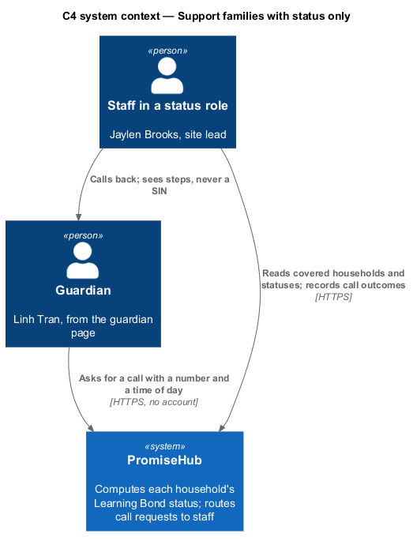
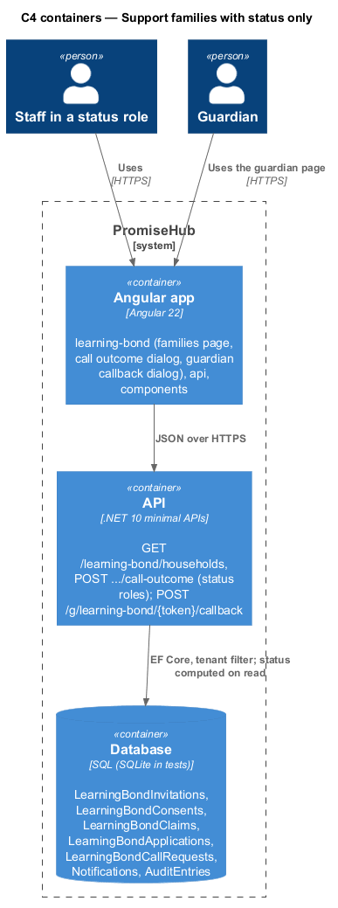
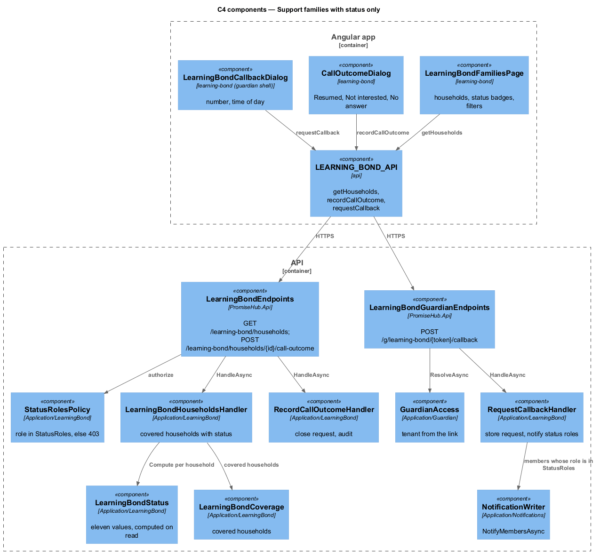
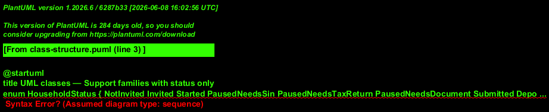
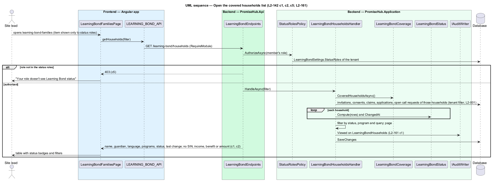
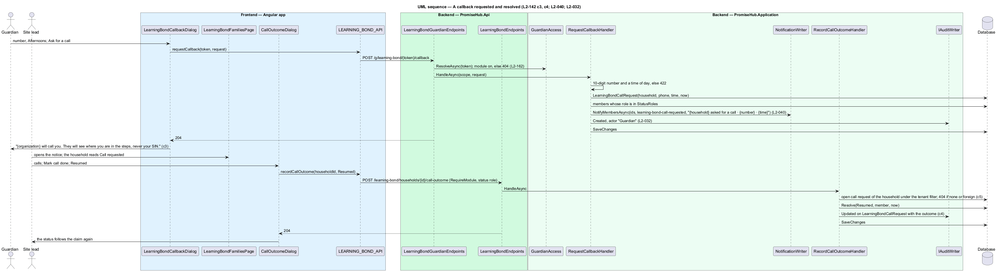

# Support families with status only

## Overview

Staff whose role is in the organization's status roles help families in person from `learning-bond-families`: every covered household by name with its computed status, the date of its last change and a filter by status and program, and nothing else about the claim. A guardian who would rather talk asks for a call from the guardian page (`learning-bond-callback`); the household's status becomes Call requested, staff in the status roles are notified in the app with the household, the number and the time of day, and the staff member who makes the call records its outcome (`learning-bond-call-outcome`). No staff response from any `/learning-bond` endpoint carries a social insurance number, income, marital status, household size, benefit name, estimate or deposit amount (ADR 0076).

Terms used in this document:

- **status** — one of the eleven values computed by `LearningBondStatus` from a household's invitations, consents, claims, applications and call requests: Not invited, Invited, Started, Paused: needs a SIN, Paused: needs a tax return, Paused: needs a document, Submitted, Deposited, Call requested, Not completed, Not interested; never stored
- **status roles** — `StatusRoles` of `LearningBondSettings`, the roles authorized for this list, the household card and the call outcome
- **call request** — `LearningBondCallRequest`: household, phone number, time of day, requested at, outcome and resolved at

## Description

Frontend:

- **`LearningBondFamiliesPage`** — a search field, `ph-chips` for status, a program select, a `ph-table` with household (avatar, name, guardian and language), `ph-badge` status, program, last change and row actions (Mark call done, Invite to Learning Bond), paging. States: `call-requested` (`ph-alert` warning with the number, the time of day and a `tel:` link), `no-results`, `long`, `empty`, loading, error, forbidden (role not in the status roles, with the admin to ask). The Learning Bond item is composed into the shell's More menu only when the module is on and the role is in `statusRoles`.
- **`CallOutcomeDialog`** (`learning-bond-call-outcome`, CDK Dialog) — `ph-radio-group` Resumed, Not interested, No answer; Save outcome; 422 "Choose what happened." inline; a hint that the staff member sees steps, never a SIN or income.
- **`LearningBondCallbackDialog`** (`learning-bond-callback`, CDK Dialog, guardian shell) — `ph-text-field` best number (tel) and `ph-radio-group` Mornings, Afternoons, Evenings; Ask for a call; success "{organization} will call you. They will see where you are in the steps, never your SIN."; 422 "Enter a 10-digit mobile number." inline.
- **`LEARNING_BOND_API`** — `getHouseholds(filter, page)`, `recordCallOutcome(householdId, outcome)`, `requestCallback(token, request)`.

Backend:

- **`StatusRolesPolicy`** (`PromiseHub.Application/LearningBond/`) — reads `LearningBondSettings.StatusRoles` for the tenant and answers 403 when the member's role is not in it; Admin and Program director always pass. It guards the households list, the household card status, the invite at the door and the call outcome.
- **`LearningBondHouseholdsHandler`** — `GET /learning-bond/households?status=&programId=&q=&page=`: covered households from `LearningBondCoverage`, their status from `LearningBondStatus`, the last change date and the covered programs. The DTO is `LearningBondHouseholdDto(HouseholdId, Name, Guardian, Language, Programs, Status, ChangedAt, CallRequest?)`, where `CallRequest` carries the number and the time of day only when the status is Call requested (L2-142 criterion 1 and 3). Opening the list is audited as `Viewed` on `LearningBondHouseholds` (L2-161 criterion 1).
- **`LearningBondStatus`** — pure function from a household's rows to the status: Call requested while an open call request exists; otherwise the furthest claim state (Deposited over Submitted over Paused over Started), Not interested from the guardian's choice, Not completed from the 180-day close, Invited from an invitation, else Not invited.
- **No-financial-data rule** — every staff DTO of `LearningBondEndpoints` is a record whose members are statuses, counts, names, programs and dates. The integration test `LearningBondStaffResponsesCarryNoFinancialDataTests` calls every staff endpoint as every role against the seed, which holds a known SIN, income answer, marital status, household size, benefit name, estimate and deposit, and asserts that none appears in any response body (criterion 2, L2-159 criterion 3). Guardian DTOs carry `Last3` only.
- **`RequestCallbackHandler`** — `POST /g/learning-bond/{token}/callback`: `GuardianAccess` resolves the household and the module gate answers 404 when off; validates the phone number (10 digits) and the time of day (422 by field); stores `LearningBondCallRequest`; notifies every current member whose role is in `statusRoles` through `NotificationWriter.NotifyMembersAsync` (kind `learning-bond-call-requested`, text with the household, the number and the time, link to `learning-bond-families` filtered to Call requested); audits `Created` with actor "Guardian"; answers 204 (criterion 3, L2-040).
- **`RecordCallOutcomeHandler`** — `POST /learning-bond/households/{id}/call-outcome` (status role): 404 for a household of another organization or without an open call request; `Resumed` closes the request so the status follows the claim; `NotInterested` closes it and marks the household's claims Not interested, so no reminder or follow-up is sent; `NoAnswer` records the attempt and leaves the request open. Each is audited as `Updated` on `LearningBondCallRequest` with the outcome (criterion 4).

Tenant and module gate: the staff endpoints are in the `/learning-bond` group behind `RequireModule(ModuleId.LearningBond)` and `StatusRolesPolicy`; the guardian endpoint takes its tenant from the link. Another organization's household answers 404 (criterion 5). Audited: opening the list, each call request and each outcome.

## Built in prompt 85

- `LearningBondFamiliesHandler` answers `GET /learning-bond/households?status=&program=` for roles in the status roles: the covered households in name order with their primary guardian, programs, status and last change, the covered programs to filter by, and the count. The status (`LearningBondFamilyStatus`) is computed from the household's records: Not invited, Invited (its latest invitation), Call requested (an open call request, with the number and time of day so staff can call) and Not interested; the claim's steps (Started, Paused, Submitted, Deposited) arrive with the claim.
- The session carries `learningBondStatus` (Learning Bond on and the role in the status roles), and the shell's Learning Bond menu item requires it, so a role outside the status roles has no item.
- Call requests: `LearningBondGuardianHandler.RequestCallAsync` answers `POST /g/learning-bond/{token}/callback` (200 with "{organization} will call you…", 422 by field, 404 for an unknown link, a suspended organization or the module off), stores a `LearningBondCallRequest` (migration `LearningBondCallRequests`) and notifies the members in the status roles with the new kind `learning-bond`. `LearningBondHouseholdHandler.RecordCallAsync` answers `POST /learning-bond/households/{id}/call-outcome`: Resumed and Not interested close the request, No answer keeps it open, each audited; no open request answers 409.
- Frontend: `LearningBondFamiliesPage` (Status and Program `ph-select`s, a `ph-list` with a `ph-badge` per status and Mark call done) and `LearningBondCallOutcomeDialog` in `learning-bond`. The guardian's own I'd rather talk to someone dialog arrives with the guardian pages (prompt 86); its API is in place.
- An integration test (`LearningBondFamiliesTests`) asserts that no staff Learning Bond response names a SIN, income, marital status, household size, benefit, estimate or amount (L2-142 criterion 2).
- Acceptance tests: `backend/tests/PromiseHub.Api.Tests/LearningBondFamiliesTests.cs`, `LearningBondCallbackTests.cs` and `e2e/tests/learning-bond/families.spec.ts`.

## Requirements

| L2 ID | Refines (L1) | Requirement |
|-------|--------------|-------------|
| `L2-142` | `L1-026` | Staff in the status roles shall see each covered household's status and last change only, receive guardians' call requests with the number and time of day, and record the call's outcome, with 403 for other roles and no financial detail in any staff response. |
| `L2-040` | `L1-021` | A notification center shall list what needs attention with unread counts. |
| `L2-032` | `L1-017` | Every change and every sensitive view shall be recorded in the organization's audit log. |
| `L2-001` | `L1-001` | Every query shall filter by the organization of the active membership, never by a value from the client. |

## Diagrams

Staff see where a family is; the guardian decides to talk; the financial data stays on the guardian's side.

The staff list and the guardian callback meet in the database through the call request and the notification.

`LearningBondStatus` is the one place a status is computed; `StatusRolesPolicy` is the one place the roles are checked.

The staff DTO has no member that could hold a financial value.

Opening the list computes each status on read and audits the view.

A callback request notifies the status roles; the outcome closes it and the status follows.

