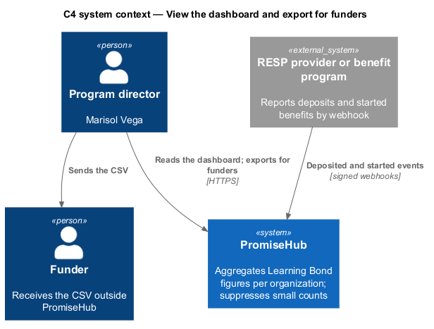
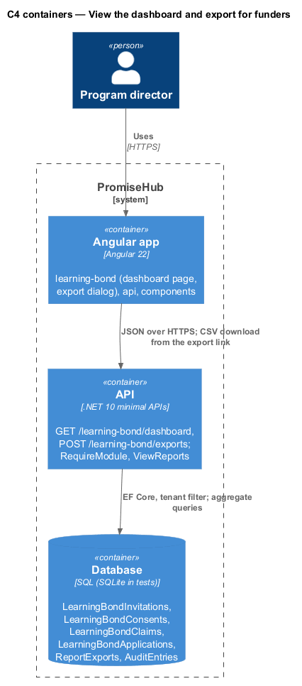
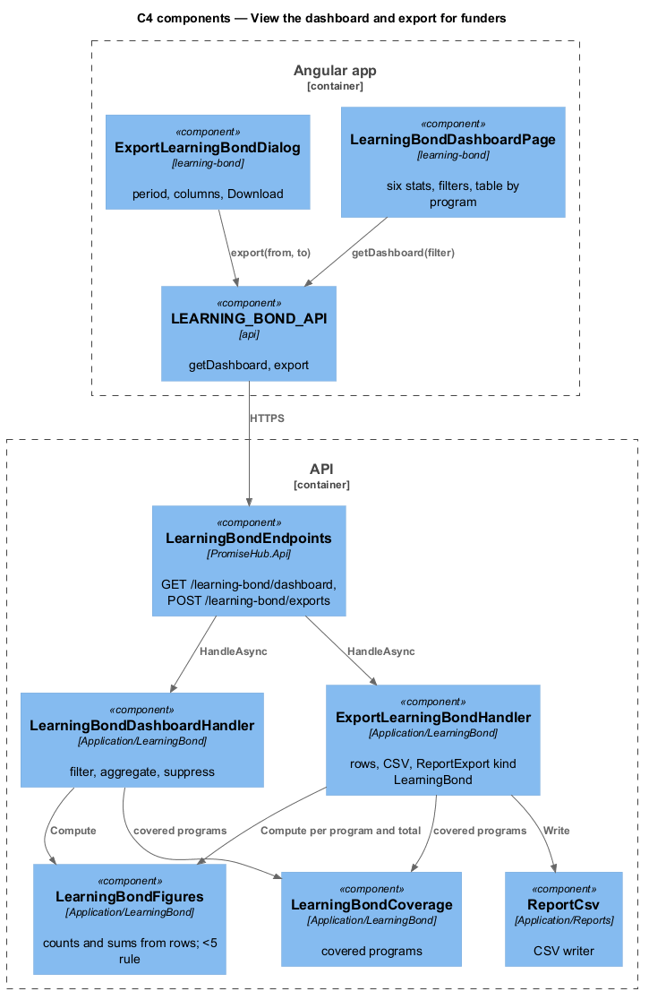
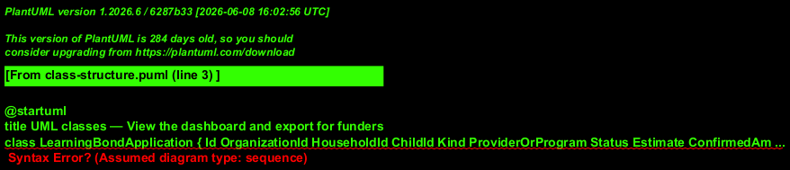
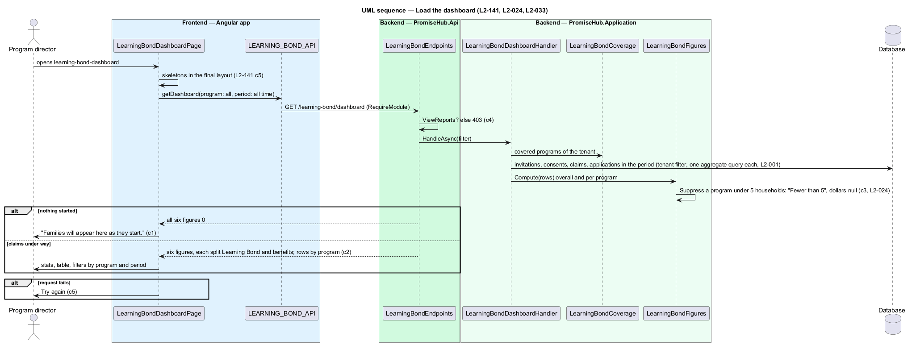
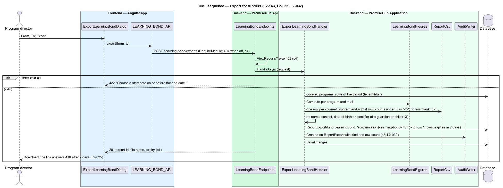

# View the dashboard and export for funders

## Overview

The Learning Bond dashboard (`learning-bond-dashboard`) shows admins and program directors six figures for the organization: households invited, started and completed, children with a submitted Learning Bond application, estimated dollars unlocked and confirmed dollars deposited, the two dollar figures split into Learning Bond and benefits, filtered by covered program and by the last 30 days, 90 days or all time. Export for funders (`export-learning-bond`) writes the same figures per covered program and a total row to a CSV kept for 7 days. Every figure is computed on read from `LearningBondApplication`, `LearningBondInvitation` and `LearningBondClaim` rows, never stored twice, and any figure resting on fewer than 5 households is suppressed as `L2-024` does (ADR 0076).

Terms used in this document:

- **figure** — count or sum over the covered households of the tenant for a program and period; "started" means a consent exists, "completed" means at least one application is `Submitted` or later
- **estimated dollars** — sum of the estimates of submitted Learning Bond applications plus the annual estimates of submitted benefit applications
- **confirmed dollars** — sum of the amounts providers and programs reported as `Deposited` or started
- **suppression** — a figure for a program resting on fewer than 5 households reads "Fewer than 5" on the page and "<5" in the CSV, with its dollars suppressed or blank

## Description

Frontend:

- **`LearningBondDashboardPage`** (`frontend/projects/learning-bond/`, route `/learning-bond`) shows:
  - `ph-page-header` with Export for funders and Covered households;
  - `ph-select` filters for Program (all covered programs, or one) and Period (Last 30 days, Last 90 days, All time);
  - six `ph-stat` figures, where the dollar ones carry "Learning Bond $X · benefits $Y" or "Withheld: fewer than 5 households";
  - `ph-table` By covered program, or, just launched, the empty state "Families will appear here as they start.";
  - a forbidden state for roles without `ViewReports`, with Covered households.
- **`LearningBondExportDialog`** (`export-learning-bond`, CDK dialog) offers the period and Export. Once ready, a success `ph-alert` shows the file name and Download.
- **`LearningBondFamiliesPage`** gains a Dashboard button for roles that read reports.
- **API methods on `LEARNING_BOND_API`**: `dashboard(program, period)`, `exportForFunders(period)` and `exportUrl(id)`.

Backend:

- **`LearningBondFigures`** computes the raw `LearningBondFigureSet` for any set of covered programs and period, applies the one suppression rule, and maps it to `LearningBondFiguresDto` (ADR 0084).
- **`LearningBondDashboardHandler`**:
  - `GetAsync(program, period)` returns the covered programs, the organization's figures and a row per program.
  - `ExportAsync(period)` writes the CSV per program plus a total row: "<5" counts, blank dollars, and confirmed dollars per completed household. It stores a `ReportExport` (7 days) and audits it as Created, naming it a Learning Bond export with its row count.
- **Endpoints**, in `LearningBondEndpoints`, behind the module gate and `RequirePermission(ViewReports)`: `GET /learning-bond/dashboard?program=&period=` and `POST /learning-bond/exports`. The download is `GET /reports/exports/{id}`, which answers 410 after 7 days.

## Requirements

| L2 ID | Refines (L1) | Requirement |
|-------|--------------|-------------|
| `L2-141` | `L1-026` | Admins and program directors shall see uptake and dollars unlocked as counts and sums split by Learning Bond and benefits, filtered by program and period, with figures under 5 households suppressed and 403 without `ViewReports`. |
| `L2-143` | `L1-026` | Admins and program directors shall export the dashboard per covered program and a total row as a CSV without any family identifier, with "<5" suppression, audited and kept for 7 days. |
| `L2-024` | `L1-012` | Report numbers shall be shown for a period and program, with small counts suppressed. |
| `L2-025` | `L1-012` | One click shall export a CSV or funder template, kept for 7 days. |
| `L2-033` | `L1-018` | Reads shall answer within the performance budget measured on a mid-range phone over 4G. |

## Diagrams

A program director reads aggregates; a funder receives the CSV outside PromiseHub.

The API aggregates on read; the export file is stored with the other report exports.

One figures component serves both the dashboard and the export, so the two never disagree.

The application row is the source of every dollar figure; the export is a `ReportExport` of kind `LearningBond`.

Loading the dashboard aggregates in one pass and suppresses small programs before answering.

Exporting writes the same rows to a CSV, audits the row count and answers a 7-day link.

