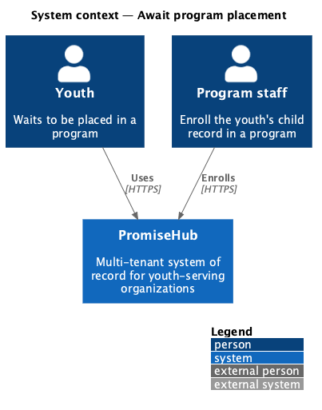
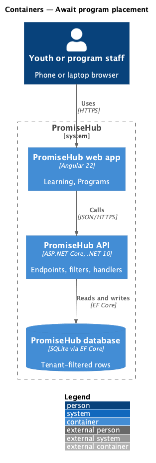
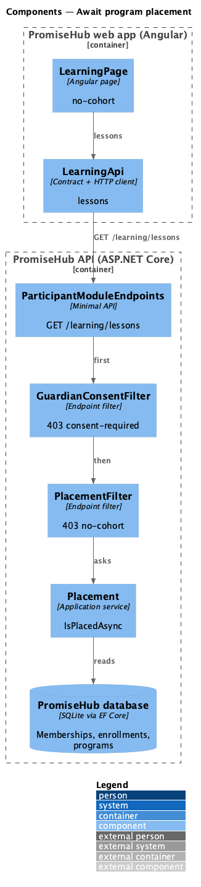
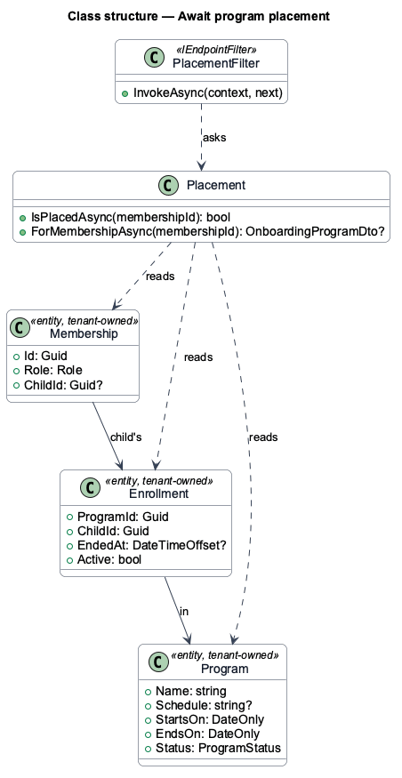
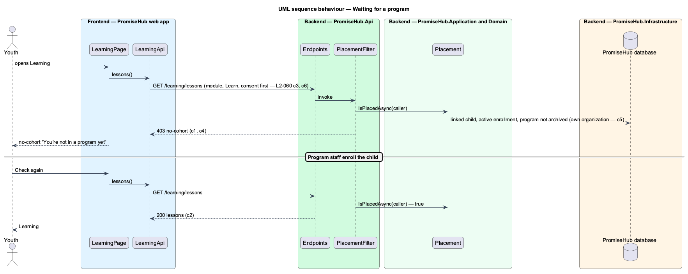

# Await program placement

## Overview

A youth can hold an account before program staff place them anywhere: an admin links the account to a child record, and enrollment in a program follows. Until then Learning has nothing to show. Instead of an empty page, the youth sees a friendly waiting state (`no-cohort`) that says they are not in a program yet, that Learning opens the moment staff add them, and offers **Check again**. The lock is on the server: lessons answer 403 `no-cohort` until the youth is placed.

Terms used in this document:

- **placement** — the youth's linked child having an active enrollment (no end date) in a program that is not archived, in the caller's organization; the Waypoint cohort is a PromiseHub program (ADR 0043)
- **no-cohort** — the problem code the lessons endpoint answers for a youth who is not placed; the name is kept from Waypoint so the lock reads the same in both specifications

Ported from Waypoint `platform-services/await-cohort-placement` (`L2-PLATFORM-011` criterion 3), with tenancy, the Learning module gate and PromiseHub types (ADR 0043, ADR 0047). The consent-required state of the same Waypoint requirement is [obtain-required-consent](../obtain-required-consent/README.md); the expired invitation is [replace-expired-invitation](../../identity/replace-expired-invitation/README.md).

## Description

Frontend:

- **`LearningPage`** — the `no-cohort` state: `ph-empty-state` "You’re not in a program yet" with the hint "Waiting to be added" and **Check again**, which reloads the lessons; loading and error keep the shell.
- **`LearningApi.lessons`** — maps 403 `no-cohort` to `{ status: 'no-cohort' }` beside `consent-required`.

Backend:

- **`Placement`** (`Application/Learning/`) — `IsPlacedAsync(membershipId)` and `ForMembershipAsync(membershipId)`: reads the membership's `ChildId`, then the child's enrollments joined to programs, filtered by the organization; a membership with no linked child is not placed.
- **`PlacementFilter`** (`Api/Authorization/`) — an endpoint filter that answers 403 `{ code: "no-cohort" }` when the caller is a youth who is not placed; added after the consent filter, so the consent gate answers first (`L2-060` criterion 3).
- **`ParticipantModuleEndpoints`** — `GET /learning/lessons` gains `RequirePlacement()`; the youth's own record, the consent request and the onboarding endpoints stay open so setup can say where the youth stands.

Every query filters by the organization (ADR 0002). Placement is read on every request, so enrolling or ending an enrollment takes effect on the next call.

Open questions: Waypoint offered "Message your mentor" from this state; a youth with no program has no mentor, and youth messaging arrives with prompt 74, so the action is deferred. Naming the next program that starts soon is deferred until programs carry tracks (prompt 54).

## Built so far

Prompt 53 delivered everything above. Acceptance tests: `backend/tests/PromiseHub.Api.Tests/NoCohortTests.cs`, `e2e/tests/learning/no-cohort.spec.ts`.

## Requirements

| L2 ID | Refines (L1) | Requirement |
|-------|--------------|-------------|
| `L2-060` | `L1-023` | A youth who is not placed in a program sees a friendly waiting state instead of an empty Learning page, and program content stays locked on the server until they are placed. |
| `L2-056` | `L1-023` | A youth whose linked child record is under the organization's consent age cannot use Learning until a guardian has consented. |

## Diagrams

### System context

The youth reads Learning; program staff place them through Programs.

### Containers

The web app calls the API; the API owns the database.

### Components

The Learning page and client, and the lessons endpoint with its consent and placement filters.

### Class structure

The membership, the child's enrollments and programs, and the placement service that reads them.

### Behaviour — waiting, then placed

The steps in order, with the requirement each enforces.

