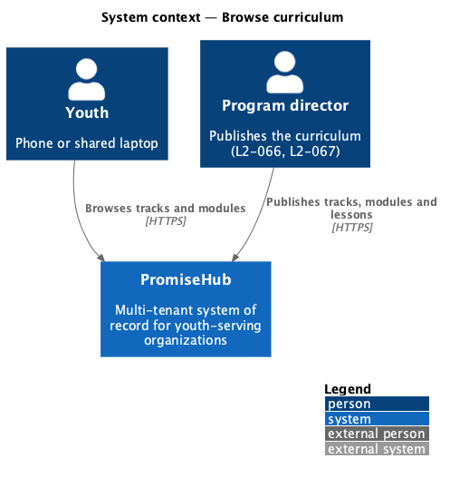
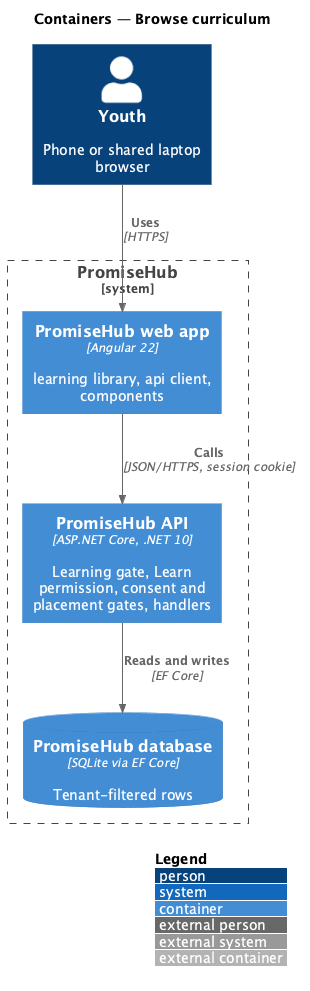
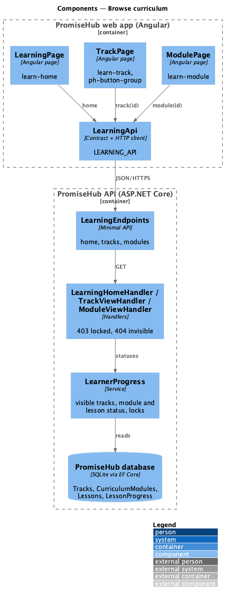
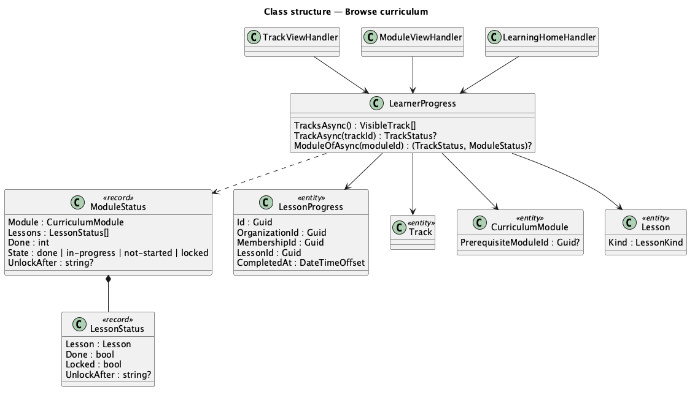
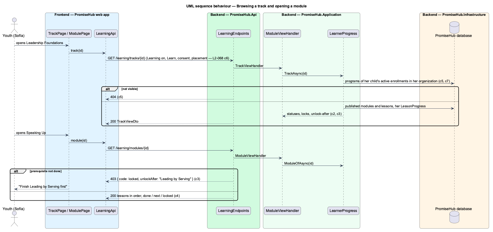

# Browse curriculum

## Overview

A youth's **Learning home** shows where they left off, their overall progress and each **track** their programs follow. A track holds **modules** in the order authors set; a module holds **lessons**. Youth see only what is published, and only what is unlocked opens.

Terms used in this document:

- **visible** — Published content of a Published track that one of the youth's active, non-archived programs follows (`Program.TrackId`), in the youth's own organization
- **done** — a lesson with a `LessonProgress` row for the youth's membership; a module whose every published lesson is done
- **locked** — a module whose prerequisite module is published and not done, or a lesson whose module is locked or which follows a lesson that is not done
- **unlock after** — the name of the module or lesson that must be done first

Ported from Waypoint `learning-experience/browse-curriculum` (`L2-LEARN-001`) with tenancy, the Learning gate and PromiseHub types (ADR 0051). The module quiz arrives with quizzes (prompt 61).

## Description

Frontend (`frontend/projects/learning/`):

- **`LearningPage`** (`/learning`, mock `learn-home`) — the header with the name the youth goes by in its subtitle, Continue where you left off, Your progress and Your tracks; the consent-required and no-cohort states when the server refuses, the resume alert of an unfinished setup, empty and completed states.
- **`TrackPage`** (`/learning/tracks/:id`, mock `learn-track`) — `ph-button-group` switches between the youth's tracks when there are two or more; modules in order with their status and, while locked, “Unlocks after …” and no link.
- **`ModulePage`** (`/learning/modules/:id`, mock `learn-module`) — progress, the anchor passage in `ph-scripture-block`, Continue, and lessons in order (done, next, locked); the locked and not-found states.

API client: `home()`, `track(id)`, `module(id)`; contracts `LearningHome`, `TrackView`, `ModuleView`, `LessonItem`, results with `locked` and `not-found` outcomes.

Backend:

- **`LearningEndpoints`** — `GET /learning/home`, `GET /learning/tracks/{id}`, `GET /learning/modules/{id}`, each with `RequireModule(Learning)`, `RequirePermission(Learn)`, `RequireGuardianConsent()` and `RequirePlacement()`.
- **`LearnerProgress`** (`PromiseHub.Application/Learning/`) — the youth's visible tracks, and per track the ordered module and lesson statuses with locks and unlock-after names, computed from the caller's membership and organization only.
- **`LearningHomeHandler`**, **`TrackViewHandler`**, **`ModuleViewHandler`** — project the statuses into `LearningHomeDto`, `TrackViewDto` and `ModuleViewDto`; a locked module answers 403 `{ code: "locked", unlockAfter }`, invisible content 404.
- Domain: **`LessonProgress`** (`PromiseHub.Domain/Learning/`), tenant-owned, one row per membership and lesson.

Leader guide notes are never projected. `GET /learning/home` replaces the placeholder `GET /learning/lessons` (ADR 0051).

Open questions: a youth choosing extra tracks outside their programs is not ported.

## Built so far

Prompt 57 delivered everything above. Acceptance tests: `backend/tests/PromiseHub.Api.Tests/LearningBrowseTests.cs`, `e2e/tests/learning/browse.spec.ts`.

## Requirements

| L2 ID | Refines (L1) | Requirement |
|-------|--------------|-------------|
| `L2-068` | `L1-023` | A youth opens Learning, sees where they left off and their tracks, browses a track's published modules and a module's published lessons in order, and can open only what is unlocked: a module unlocks when its prerequisite module is done, a lesson when every earlier lesson of its module is done. The server enforces every lock. |
| `L2-060` | `L1-023` | A youth who finished setup but is in no program sees a friendly waiting state, and lessons stay locked on the server until staff place them in a program. |
| `L2-056` | `L1-023` | A youth under the organization's consent age is refused youth work until a guardian consents. |

## Diagrams

### System context

Youth use what program directors publish; nothing unpublished reaches them.

### Containers

The web app calls the API with the session cookie; the API applies the Learning gate, the Learn permission and the consent and placement gates before any handler runs.

### Components

Every handler asks `LearnerProgress` whether the content is visible and unlocked for the caller's membership.

### Class structure

The types this slice reads and writes.

### Behaviour — browsing a track and opening a module

