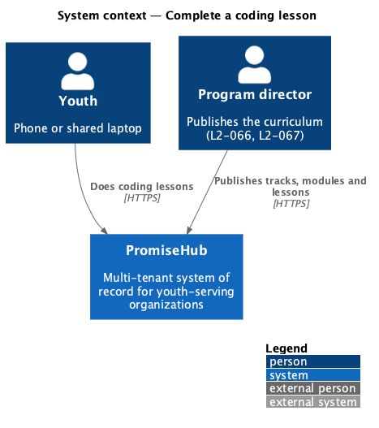
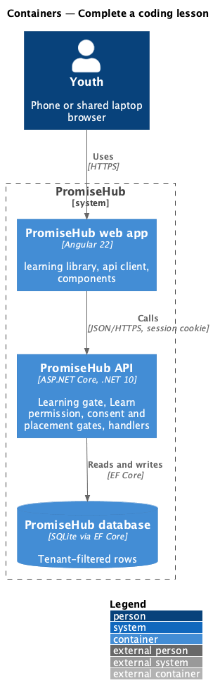
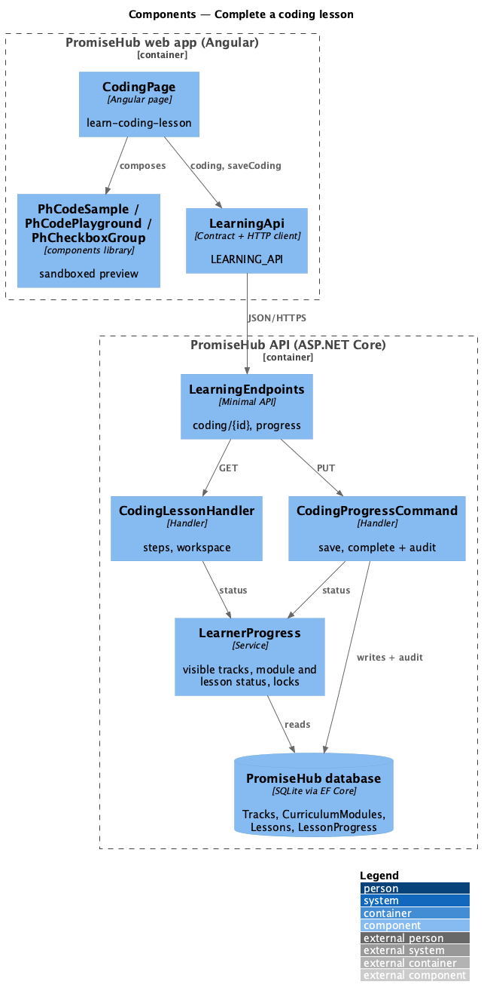
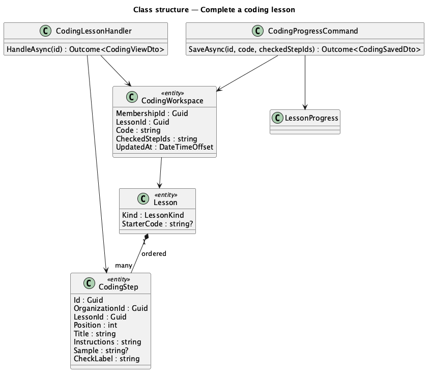
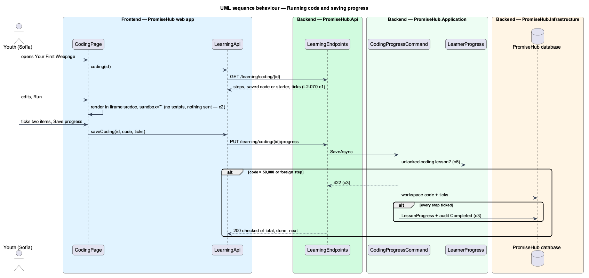

# Complete a coding lesson

## Overview

A **coding lesson** teaches in **steps**, each with instructions and a code sample, then gives the youth a **playground** to edit a small page of HTML and CSS and run it in a preview, and a **checklist** to tick. Saving keeps the youth's code and ticks on the server; ticking every item completes the lesson and unlocks the next.

Terms used in this document:

- **coding step** — one ordered step of a coding lesson: title, instructions, code sample and its checklist label (`CodingStep`)
- **workspace** — the youth's saved code and ticked steps for one lesson (`CodingWorkspace`)
- **sandboxed preview** — an `iframe` with `srcdoc` and an empty `sandbox` attribute: it renders markup and styles, runs no script and reaches nothing

Ported from Waypoint `learning-experience/complete-coding-lessons` (`L2-LEARN-008` criterion 1). Badge progress arrives with badges (prompt 66). Authoring steps and starter code is deferred (ADR 0051).

## Description

Frontend:

- **`CodingPage`** (`/learning/coding/:id`, mock `learn-coding-lesson`) — breadcrumb, each step in a card with `ph-code-sample`, Your turn with `ph-code-playground` (labelled editor, Run, preview region), the checklist as `ph-checkbox-group` with `ph-progress-bar`, Save progress (busy), the failed alert that keeps the code, the success alert with Next and toasts.
- **`PhCodeSample`** and **`PhCodePlayground`** (`frontend/projects/components/`, design-system `code-sample`, `code-playground`).

API client: `coding(id)`, `saveCoding(id, { code, checkedStepIds })`; contracts `CodingView`, `CodingStep`, `CodingSaved`.

Backend:

- **`LearningEndpoints`** — `GET /learning/coding/{id}`, `PUT /learning/coding/{id}/progress`.
- **`CodingLessonHandler`** — through `LearnerProgress` (404 invisible or not a coding kind, 403 locked): steps in order, the workspace code or the starter code, ticked steps, done, the submission of a project, the next lesson.
- **`CodingProgressCommand`** — validates code up to 50,000 characters and ticks of this lesson's steps only (422), saves the workspace, and when a Coding lesson has every step ticked adds `LessonProgress` once with an audit Completed on `LessonProgress`.
- Domain: **`CodingStep`** (`PromiseHub.Domain/Curriculum/`), `Lesson.StarterCode`; **`CodingWorkspace`** (`PromiseHub.Domain/Learning/`), tenant-owned, one per membership and lesson, ticks stored as comma-separated ids.

## Built so far

Nothing yet; prompt 57 builds this design (0%).

## Requirements

| L2 ID | Refines (L1) | Requirement |
|-------|--------------|-------------|
| `L2-070` | `L1-023` | A youth works through a coding lesson's steps and code samples, edits and runs code in a sandboxed preview, ticks its checklist, and saves progress on the server; ticking every item completes the lesson. A coding project is built in the same playground and submitted to the youth's mentor with an optional note. |
| `L2-068` | `L1-023` | A youth opens Learning, sees where they left off and their tracks, browses a track's published modules and a module's published lessons in order, and can open only what is unlocked: a module unlocks when its prerequisite module is done, a lesson when every earlier lesson of its module is done. The server enforces every lock. |

## Diagrams

### System context

Youth use what program directors publish; nothing unpublished reaches them.

### Containers

The web app calls the API with the session cookie; the API applies the Learning gate, the Learn permission and the consent and placement gates before any handler runs.

### Components

Every handler asks `LearnerProgress` whether the content is visible and unlocked for the caller's membership.

### Class structure

The types this slice reads and writes.

### Behaviour — running code and saving progress

