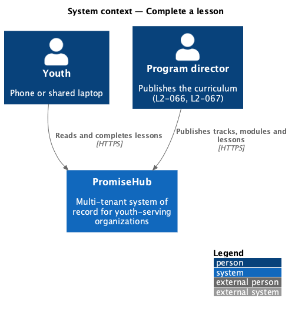
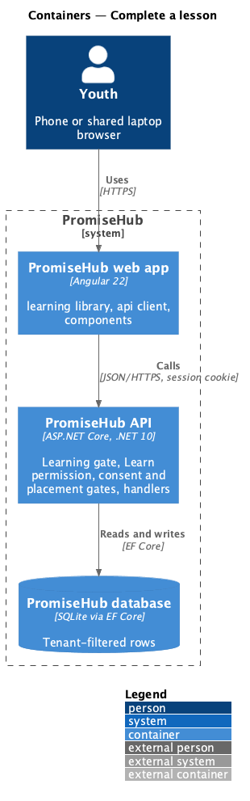
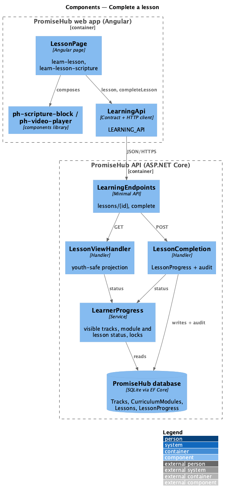
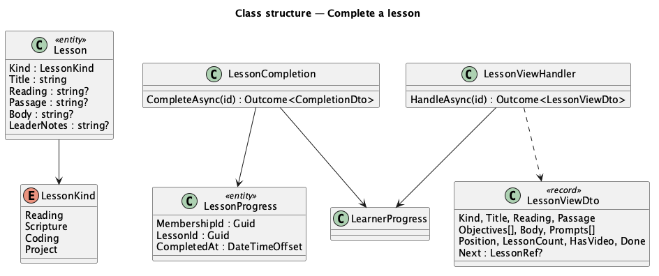
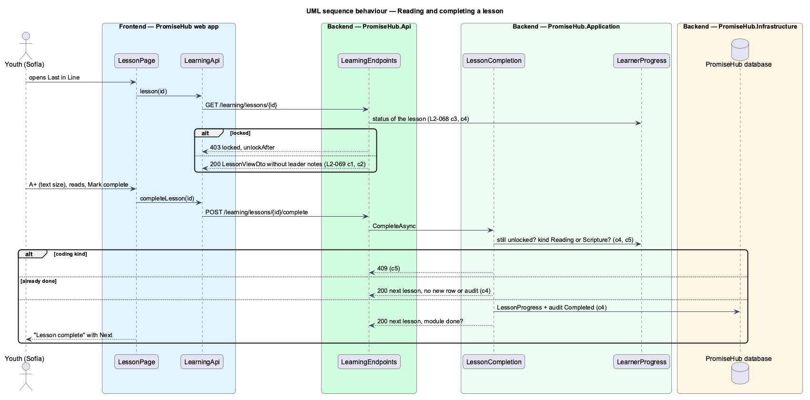

# Complete a lesson

## Overview

A **lesson** is what a youth reads in a module: objectives, teaching content and a reflection prompt; a **scripture lesson** also shows its passage in a scripture block. Marking a lesson complete saves it as done on the server and unlocks the next lesson, or, when it was the last, completes the module and unlocks any module that names it as prerequisite.

Terms used in this document:

- **lesson kind** — Reading, Scripture, Coding or Project (`LessonKind`); this design covers Reading and Scripture, [complete-coding-lessons](../complete-coding-lessons/README.md) and [submit-coding-projects](../submit-coding-projects/README.md) the others
- **passage** — the scripture text a scripture lesson quotes, with its reading as the reference
- **text size** — A− and A+ steps (normal, large, extra large) that resize the passage and teaching on the page

Ported from Waypoint `learning-experience/complete-lessons` (`L2-LEARN-002`). Routing to the reflection and saving the text size and a bookmark on the server wait for reflections (prompt 58).

## Description

Frontend (`frontend/projects/learning/`):

- **`LessonPage`** (`/learning/lessons/:id`, mocks `learn-lesson`, `learn-lesson-scripture`) — breadcrumb, header with the position in the module and minutes, What you'll learn, the teaching content in the reading style, `ph-scripture-block` for a scripture lesson with A− and A+, `ph-video-player` when the lesson has a video ([stream-lesson-video](../stream-lesson-video/README.md)), Think it over, Mark complete (busy), then the success alert with Next and a toast. Coding kinds open `CodingPage` instead.

API client: `lesson(id)`, `completeLesson(id)`; contracts `LessonView`, `LessonCompletion`.

Backend:

- **`LearningEndpoints`** — `GET /learning/lessons/{id}` and `POST /learning/lessons/{id}/complete` under the Learning gate, `Learn`, consent and placement.
- **`LessonViewHandler`** — the lesson through `LearnerProgress`: 404 when not visible, 403 `locked` with unlock-after when locked; projects kind, title, reading, passage, minutes, objectives, body, prompts, position, whether a video exists, whether done, and the next lesson; never leader notes.
- **`LessonCompletion`** — Reading and Scripture only (coding kinds 409); adds `LessonProgress` once, audits Completed on `LessonProgress`, and answers the next lesson and whether the module is now done. A second call answers the same without a second row or audit.
- Domain: `Lesson.Kind`, `Lesson.Passage` (`PromiseHub.Domain/Curriculum/`), `LessonProgress` (`PromiseHub.Domain/Learning/`).

## Built so far

Prompt 57 delivered everything above. Acceptance tests: `backend/tests/PromiseHub.Api.Tests/LearningLessonsTests.cs`, `e2e/tests/learning/lessons.spec.ts`.

## Requirements

| L2 ID | Refines (L1) | Requirement |
|-------|--------------|-------------|
| `L2-069` | `L1-023` | A youth reads a lesson (its objectives, teaching content, reflection prompt and, for a scripture lesson, the passage in a scripture block), watches its optional video, adjusts the reading size, and marks it complete, which is saved on the server and unlocks what comes next. |
| `L2-068` | `L1-023` | A youth opens Learning, sees where they left off and their tracks, browses a track's published modules and a module's published lessons in order, and can open only what is unlocked: a module unlocks when its prerequisite module is done, a lesson when every earlier lesson of its module is done. The server enforces every lock. |

## Diagrams

### System context

Youth use what program directors publish; nothing unpublished reaches them.

### Containers

The web app calls the API with the session cookie; the API applies the Learning gate, the Learn permission and the consent and placement gates before any handler runs.

### Components

Every handler asks `LearnerProgress` whether the content is visible and unlocked for the caller's membership.

### Class structure

The types this slice reads and writes.

### Behaviour — reading and completing a lesson

