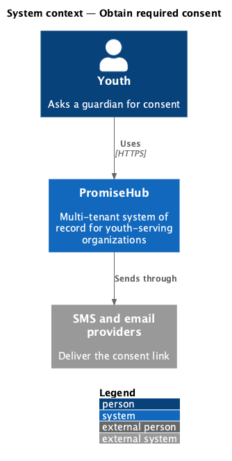
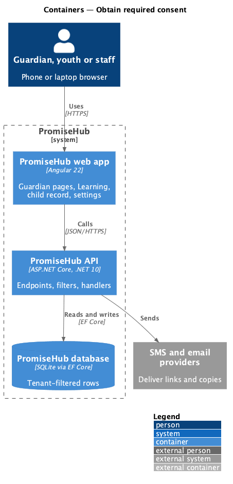
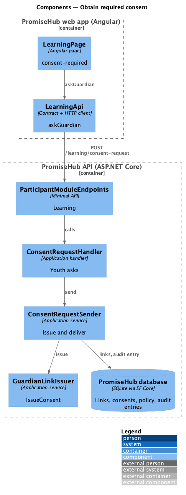
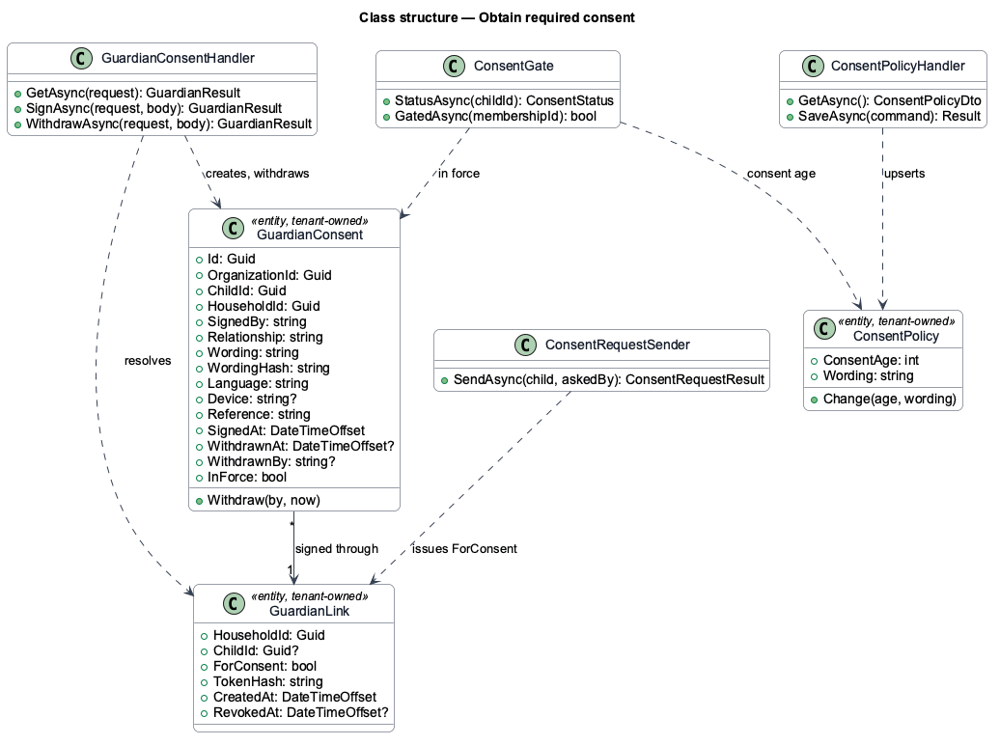
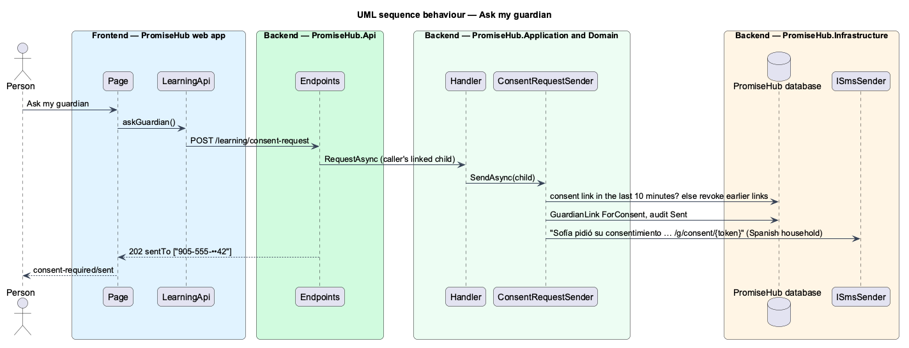

# Obtain required consent

## Overview

A gated youth needs a way forward. The consent-required state explains why Learning is closed and offers **Ask my guardian**, which texts or emails a consent link to the guardians of the youth's household who may sign. Waypoint asked the youth to type a guardian's name and email; PromiseHub already holds the household's guardians, so the youth only asks.

Terms used in this document:

- **signer** — a guardian of the household with `CanSign`, reached by a mobile or a working email
- **masked contacts** — `905-555-••42` and `c•••@example.com`, so the youth sees where the link went without reading the guardian's details

Ported from Waypoint `platform-services/obtain-required-consent`, with tenancy, the Roster and Learning module gates and PromiseHub types (ADR 0043, ADR 0046).

## Description

Frontend:

- **`LearningPage`** — the `consent-required` state with **Ask my guardian** (busy while sending), `sent` naming the masked contacts with **Check again**, `no-guardian`, and an error alert keeping the button.
- **`LearningApi.askGuardian`** — `POST /learning/consent-request`; maps 202, 422 `no-guardian` and errors.

Backend:

- **`ConsentRequestHandler`** (`Application/Guardian/`) — for the caller's linked child: 409 when consent is not required, then `ConsentRequestSender`.
- **`ConsentRequestSender`** — when a consent link was issued in the last 10 minutes answers the same contacts; otherwise revokes the child's earlier consent links, issues one through `GuardianLinkIssuer.IssueConsent`, texts each signer with a mobile or emails one with only a working email, in the household language, and audits the request; no signer answers 422 `no-guardian`.
- **`ParticipantModuleEndpoints`** — `POST /learning/consent-request` with Learning and `Learn`, without the consent filter.

Every row is tenant-owned and filtered by the organization (ADR 0002); a guardian link puts the request in its own organization (ADR 0015).

## Built so far

Nothing yet; prompt 52 builds this design.

## Requirements

| L2 ID | Refines (L1) | Requirement |
|-------|--------------|-------------|
| `L2-056` | `L1-023` | A youth whose linked child record is under the organization's consent age cannot use Learning until a guardian has consented. Admins set the age and the wording; the youth can ask a guardian for consent from the gate. |
| `L2-055` | `L1-013` | A guardian consents for a youth under the organization's consent age through a verified link, with no account: they read the organization's wording, say how they are related, tick the consent box and type their name. |

## Diagrams

### System context

Who uses this slice and which outside systems PromiseHub talks to.

### Containers

The web app calls the API; the API owns the database and the providers.

### Components

The page, its API client, and the endpoints, filters and handlers behind them.

### Class structure

The consent record, the consent link, the policy and the services that read and write them.

### Behaviour — ask my guardian

The steps in order, with the requirement each enforces.

