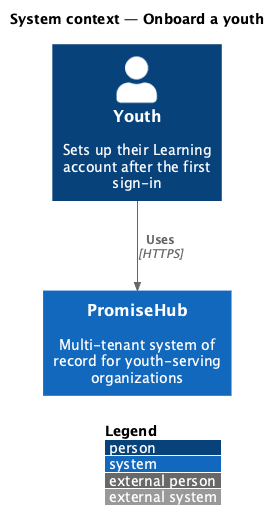
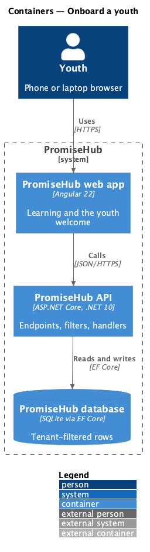
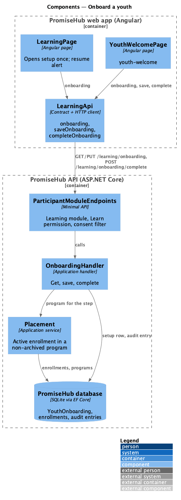
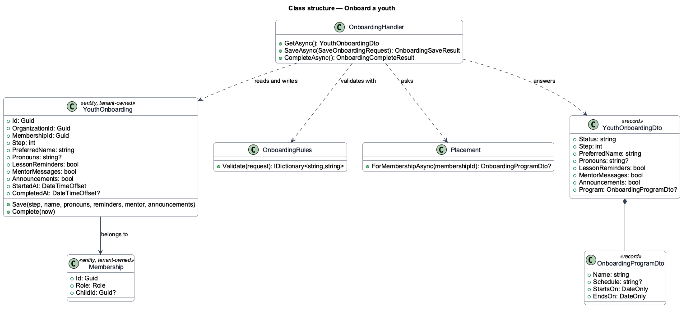
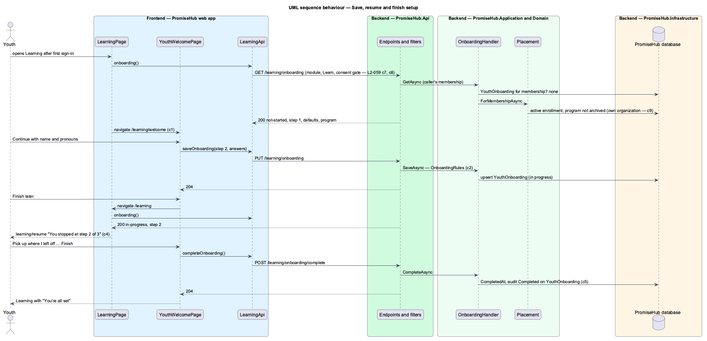

# Onboard a youth

## Overview

A youth account is ready to learn only once the youth has said what to call them, what they want to be told about and where they belong. The first time a youth opens Learning, a short setup (`youth-welcome`) walks through three steps: **You** (the name they go by and their pronouns), **Preferences** (lesson reminders, mentor messages, announcements) and **Your program** (the program staff placed them in, read only). The youth can leave at any step and come back to it later.

Terms used in this document:

- **setup** — one `YouthOnboarding` row per youth membership: the step to resume at, the answers saved so far and when it was completed
- **preferred name** — the name a youth goes by in Learning and with mentors; the child record keeps the legal name
- **placement** — the youth's linked child having an active enrollment in a program that is not archived; the Waypoint cohort is a PromiseHub program (ADR 0043)

Ported from Waypoint `authentication/onboard-youth`, with tenancy, the Learning module gate, the consent gate and PromiseHub types (ADR 0043, ADR 0046, ADR 0047). Staff onboarding after an invitation is a different flow ([invite-and-onboard-staff](../../staff/invite-and-onboard-staff/README.md), `L2-009`).

## Description

Frontend (`frontend/projects/learning/`, `frontend/projects/api/`):

- **`YouthWelcomePage`** at `/learning/welcome` — loads the setup, shows one step at a time with `ph-stepper`, saves each step with **Continue**, returns with **Back**, leaves with **Finish later** and completes with **Finish**; states `default`, `loading`, `invalid` (error beside the field and in `ph-error-summary`), `busy`, `error` (answers kept), `preferences`, `track`, `waiting` and `finishing`, then Learning with the toast "You’re all set".
- **`LearningPage`** — reads the setup after the lessons: status `not-started` opens `/learning/welcome` once; `in-progress` shows the `learning/resume` alert with the saved step and **Pick up where I left off**; `completed` shows nothing extra.
- **`LearningApi.onboarding`**, **`saveOnboarding`**, **`completeOnboarding`** — `GET`, `PUT /learning/onboarding` and `POST /learning/onboarding/complete`; contracts `YouthOnboarding`, `OnboardingProgram`, `OnboardingAnswers`, `OnboardingSaveResult`.
- **`PhSwitch`** (components) — gains the `description` input the design system's switch page already defines.

Backend:

- **`YouthOnboarding`** (`Domain/Learning/`, tenant-owned) — `MembershipId`, `Step`, `PreferredName`, `Pronouns`, `LessonReminders`, `MentorMessages`, `Announcements`, `StartedAt`, `CompletedAt`; `Save(...)` and `Complete(now)`. Unique per organization and membership.
- **`OnboardingHandler`** (`Application/Learning/`) — `GetAsync` answers the setup or its defaults (preferred name from the child's first name, else the first word of the person's name; reminders and mentor messages on, announcements off) and the placement; `SaveAsync` validates (`OnboardingRules`: name 1 to 60 characters after trimming, pronouns `she/her`, `he/him`, `they/them` or none, step 1 to 3) and upserts; `CompleteAsync` answers 409 without a saved preferred name, otherwise completes and audits Completed on `YouthOnboarding`.
- **`Placement`** (`Application/Learning/`) — the caller's linked child's active enrollment in a non-archived program, earliest start first, within the caller's organization; shared with the no-cohort lock ([await-cohort-placement](../await-cohort-placement/README.md)).
- **`ParticipantModuleEndpoints`** — the three endpoints with `RequireModule(Learning)`, `RequirePermission(Learn)` and `RequireGuardianConsent()`.
- **`AuditAction.Completed`** — new audit verb.

Every row is tenant-owned and filtered by the organization (ADR 0002); the membership comes from the session, never from the request (ADR 0005).

Open questions: the profile photo of Waypoint criterion 1 and the mentor on the program step are deferred (photo storage for youth; mentor assignments arrive with prompt 54). The saved preferences take effect once Learning sends reminders (prompt 57).

## Built so far

Prompt 53 delivered everything above. Acceptance tests: `backend/tests/PromiseHub.Api.Tests/YouthOnboardingTests.cs`, `e2e/tests/learning/youth-welcome.spec.ts`.

## Requirements

| L2 ID | Refines (L1) | Requirement |
|-------|--------------|-------------|
| `L2-059` | `L1-023` | After a youth's first sign-in, a three-step setup (`youth-welcome`) confirms the name they go by and their pronouns, picks what they want to be told about, and introduces the program they are placed in. Progress is saved on the server after every step, so the youth can leave and come back to the step they stopped on. |
| `L2-056` | `L1-023` | A youth whose linked child record is under the organization's consent age cannot use Learning until a guardian has consented. |

## Diagrams

### System context

The youth is the only person in this slice; nothing leaves PromiseHub.

### Containers

The web app calls the API; the API owns the database.

### Components

The wizard and Learning pages, the Learning client, and the endpoints, filters and handler behind them.

### Class structure

The setup row, the handler that reads and writes it and the placement query it shares with the no-cohort lock.

### Behaviour — save a step, leave, resume, finish

The steps in order, with the requirement each enforces.

