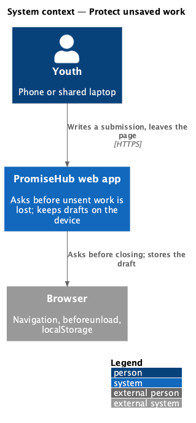
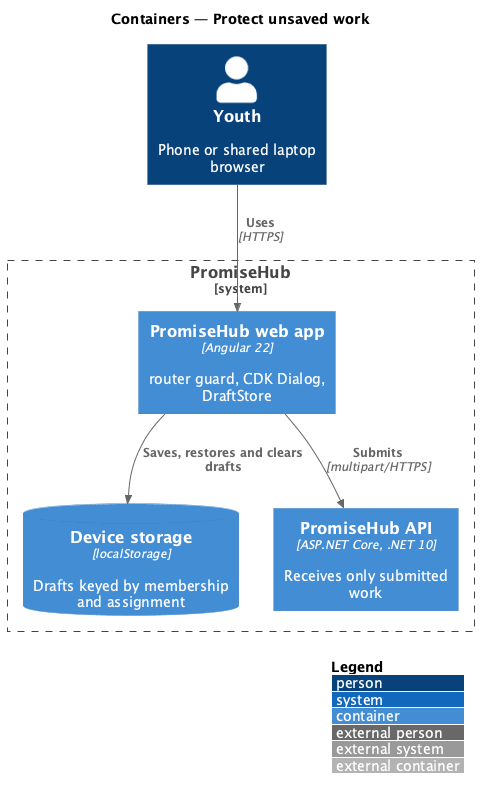
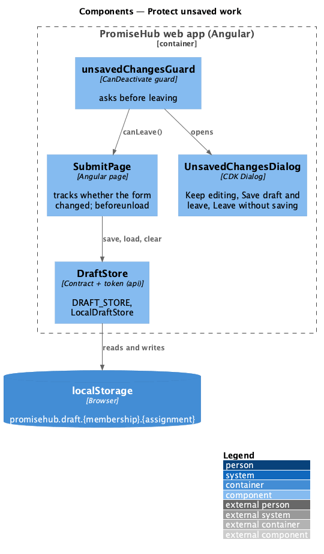
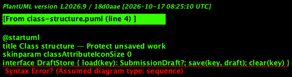
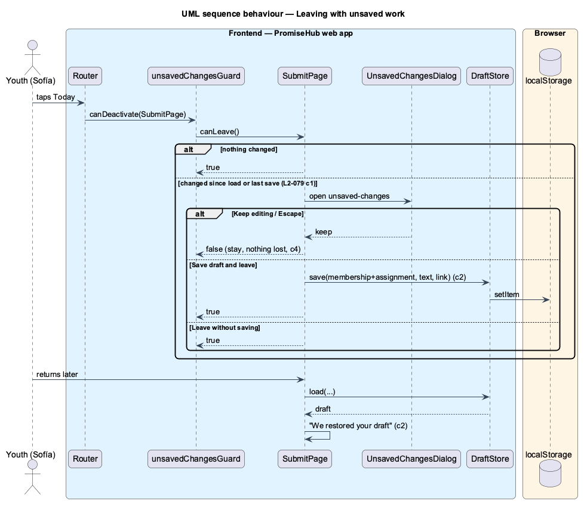

# Protect unsaved work

## Overview

A youth writing an assignment on a phone can lose her work by tapping a tab, following a link or closing the browser. This slice asks before that happens and lets her keep a **draft** on the device to pick up later. It applies to the assignment submit page and the reflection page (prompt 66); other forms adopt it as their journeys need it.

Terms used in this document:

- **changed** — the reflection or link differs from what the page loaded or last saved as a draft
- **draft** — the reflection and link kept in the browser's `localStorage` under the signed-in membership and the assignment; a file is never kept
- **leave** — any navigation inside the app away from the page, or closing or reloading the tab

Ported from Waypoint `non-functional/protect-unsaved-work` (`L2-NFR-007`). Drafts stay on the device rather than on the server (ADR 0056).

## Description

- **`DraftStore`** (`frontend/projects/api/`) — contract and `DRAFT_STORE` token with `load`, `save` and `clear` of a `SubmissionDraft` (text, link, saved at); `LocalDraftStore` keeps it in `localStorage` as `promisehub.draft.{membership}.{assignment}` and treats storage errors as no draft.
- **`SubmitPage`** — tracks whether the form changed, offers Save draft (toast "Draft saved"), restores a draft on load ("We restored your draft", Start over), clears it after a successful submit, and adds a `beforeunload` listener while changed.
- **`unsavedChangesGuard`** (`frontend/projects/learning/`) — a `CanDeactivate` guard for pages that implement `canLeave()`.
- **`UnsavedChangesDialog`** (`unsaved-changes`) — CDK Dialog with Leave without saving (ghost), Keep editing and Save draft and leave; Escape or Close keeps editing.
- **`AssignmentPage`** — offers Continue your draft when a draft exists for the assignment.
- **`ReflectionDraftStore`** (`frontend/projects/api/`) — contract and `REFLECTION_DRAFT_STORE` token with `load`, `save` and `clear` of a `ReflectionDraft` (mood, words, action, sharing choice, saved at); `LocalReflectionDraftStore` keeps it as `promisehub.reflection-draft.{membership}.{lesson}` (ADR 0060).
- **`ReflectionPage`** — the same protection for a reflection: changed means the mood, words, action or sharing choice differ from what loaded or was last kept; Save draft, restore with Start over, cleared by a successful save; leaving opens `LeaveReflectionDialog` (`leave-reflection`, the same three choices).

No backend change: drafts never leave the device.

## Built so far

Prompt 62 delivered everything above for the assignment submit page; `GET /me` now names the active membership (`membershipId`) so drafts are kept under it. Acceptance tests: `e2e/tests/learning/submissions.spec.ts` (leave, draft, restore, reload) and `backend/tests/PromiseHub.Api.Tests/LearningAssignmentBriefTests.cs` (the session's membership).

## Requirements

| L2 ID | Refines (L1) | Requirement |
|-------|--------------|-------------|
| `L2-079` | `L1-014` | A youth is warned before she leaves work she has not sent or saved, and can keep a draft on her device and find it again. |
| `L2-089` | `L1-023` | A youth writes a reflection on a lesson she can open, says how she feels about it and chooses, each time she saves, whether it stays private or is shared with her mentor. |

## Diagrams

### System context

### Containers

Drafts live only in device storage; only submitted work reaches the API.

### Components

### Class structure

### Behaviour — leaving with unsaved work

## Open questions

- Grading (prompt 63) uses its own leave dialog with a server draft (ADR 0057); reflections (prompt 66) use a device draft like assignments (ADR 0060). Other long forms adopt the guard when they are built.
