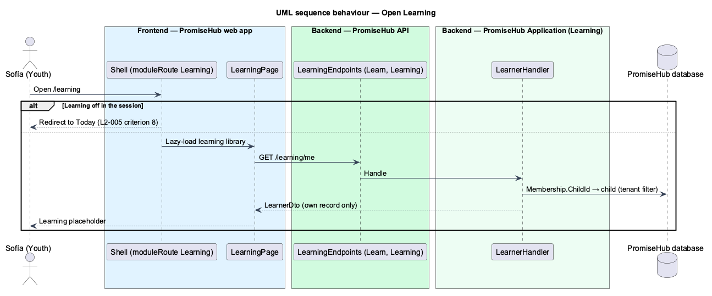

# Read own record

## Overview

The first slice of the **Learning** module (`L1-023`). A youth signs in with a youth account, a membership whose role is Youth and which links to one child record (`L2-045`). Before any lesson exists, the Learning page shows the youth that their lessons will appear there, and the server proves the two rules every later Learning endpoint follows: the module gate and the youth's own-record scope.

## Description

- **`LearnerHandler`** (`PromiseHub.Application/Learning/`) reads the caller's membership, then the child it links to through the tenant query filter, and returns `LearnerDto(personName, child)` where `child` is `LearnerChildDto(id, firstName, lastName, age)` or null when no child is linked.
- **`GET /learning/me`** (`LearningEndpoints`) requires `Permission.Learn` (Youth) and `RequireModule(ModuleId.Learning)`.
- **`LEARNING_API`** (`frontend/projects/api/src/lib/learning/`) with `HttpLearningApi.learner()`.
- **`LearningPage`** (`frontend/projects/learning/`) composes `ph-page-header`, `ph-card` and `ph-empty-state` (`learning`), loaded by `moduleRoute('learning', 'Learning', …)`.

## Requirements

| L2 ID | Refines (L1) | Requirement |
|-------|--------------|-------------|
| `L2-005` | `L1-002` | A module that is off is neither served nor rendered. |
| `L2-007` | `L1-003` | Permissions are enforced per endpoint and per field by role; the UI reflects them but never substitutes for them. |
| `L2-045` | `L1-003` | A youth signs in with a membership whose role is Youth, and that membership links to exactly one child record in the same organization, so every youth-facing page reads that child's data and no other. |

## Diagrams

### Behaviour — open Learning

The gate answers 404 while Learning is off; otherwise only the linked child is returned (`L2-005` criterion 6, `L2-007` criterion 9).

