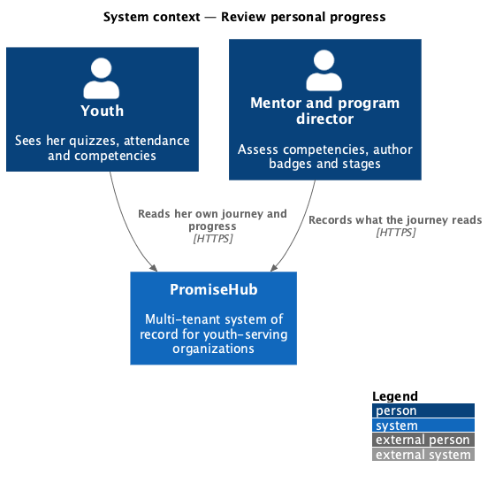
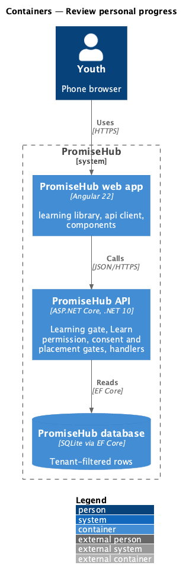
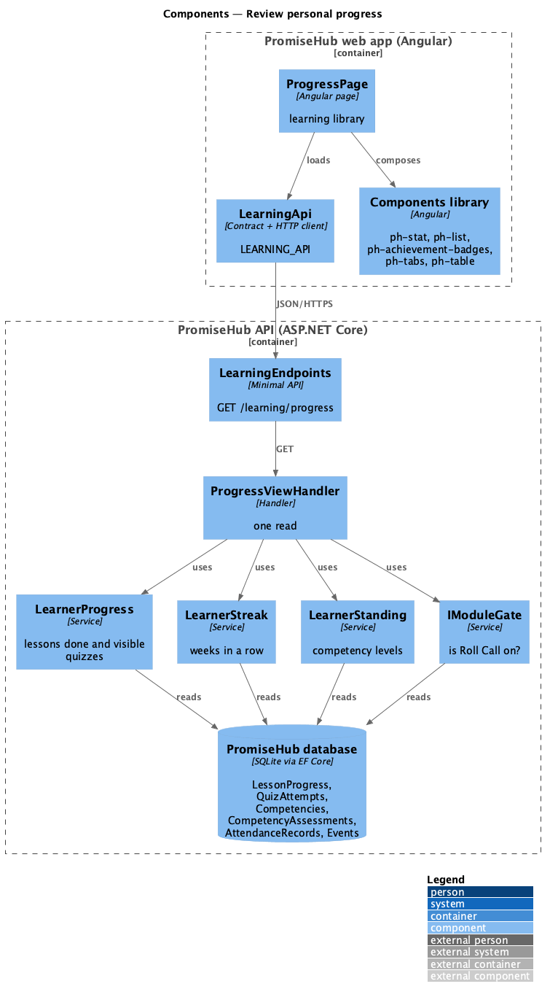
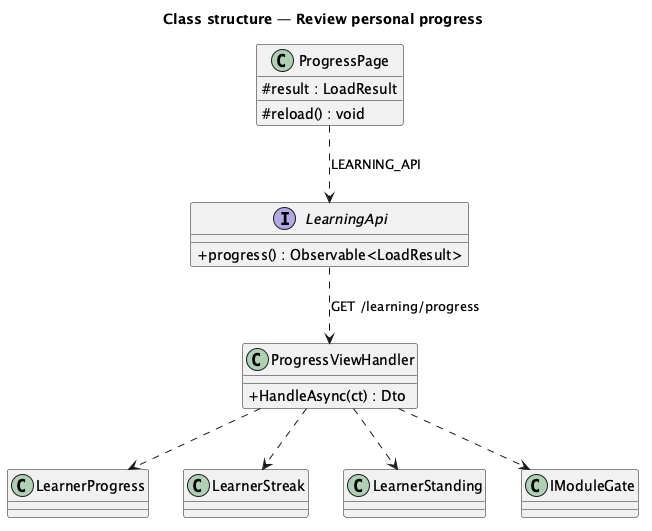
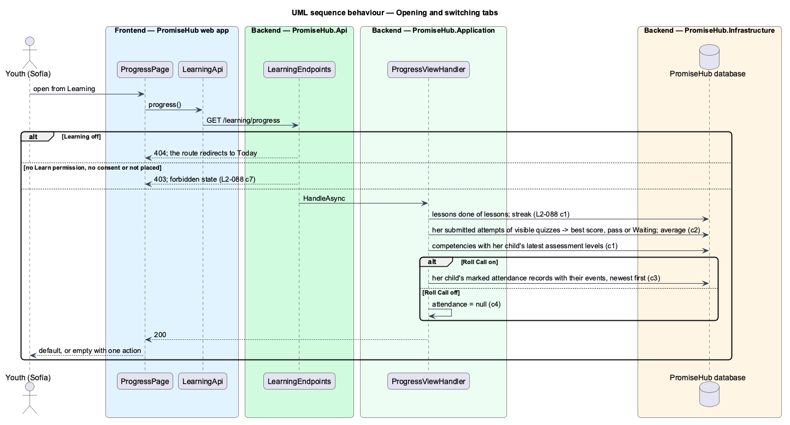

# Review personal progress

## Overview

Your progress (`learn-progress`) puts a youth's own numbers in one place, on three tabs: **Overview** (overall progress, quiz average, streak, attendance rate and her competencies with their levels), **Quizzes** (her quiz history) and **Attendance** (the sessions she was marked at).

Terms used in this document:

- **quiz history** — one row per published quiz of her followed tracks that she has submitted: her best scored attempt with Passed or Not passed, or Waiting while every submitted attempt awaits her mentor's approval (ADR 0055, ADR 0057)
- **quiz average** — the rounded mean of the best scores
- **attendance** — her child's attendance records marked Present, Signed out or Absent, read only while Roll Call is on (ADR 0059)
- **competency level** — the latest assessment of her child by a mentor (`L2-082`), Not started when none

Ported from Waypoint `learning-experience/review-personal-progress` (`L2-LEARN-010`, `ProgressQueryHandler`), with tenancy and module gates. Waypoint's shared check-ins are not part of this page; they belong to mentoring journeys.

## Description

Frontend (`frontend/projects/learning/`):

- **`ProgressPage`** (`/learning/progress`) — `ph-tabs` as an in-page tablist (Overview, Quizzes and, while the answer has attendance, Attendance) with labelled panels; `ph-stat` numbers, Your competencies (`ph-list` with a `ph-badge` level), `ph-table` for the quiz history and the sessions; empty, loading, error and forbidden states.

API client (`LEARNING_API`): `progress()` answering `LoadResult<LearnerProgressView>` (`QuizHistoryItem`, `AttendanceSummary`, `SessionAttendance`, `CompetencyLevelItem`).

Backend (`PromiseHub.Application/Learning/`):

- **`ProgressViewHandler`** — `GET /learning/progress`: lesson counts from `LearnerProgress.TracksAsync`, the streak from `LearnerStreak`, the quiz history from her `QuizAttempt` rows of the visible quizzes, competencies from `LearnerStanding`, and attendance from `AttendanceRecord` and `Event` rows of her child when `IModuleGate.IsOnAsync(RollCall)`.

Open questions: none. Decisions are recorded in ADR 0059.

## Built so far

Prompt 65 delivered everything above in slice 3: `GET /learning/progress` and `ProgressPage` with its three tabs, linked from the journey and Learning. Acceptance tests: `backend/tests/PromiseHub.Api.Tests/LearningProgressTests.cs`, `e2e/tests/learning/progress.spec.ts`.

## Requirements

| L2 ID | Refines (L1) | Requirement |
|-------|--------------|-------------|
| `L2-088` | `L1-023` | A youth sees her own progress in one place: overall progress, quiz average, streak, attendance and competencies, with her quiz history and session attendance on their own tabs. |

## Diagrams

### System context

The youth reads what mentors and program directors record; nothing on these pages changes state.

### Containers

### Components

The page loads one read through `LEARNING_API`; the handler composes the shared learner services.

### Class structure

### Behaviour — opening and switching tabs

The module gate answers first, then the permission, consent and placement gates; only then does the handler read her own rows.

