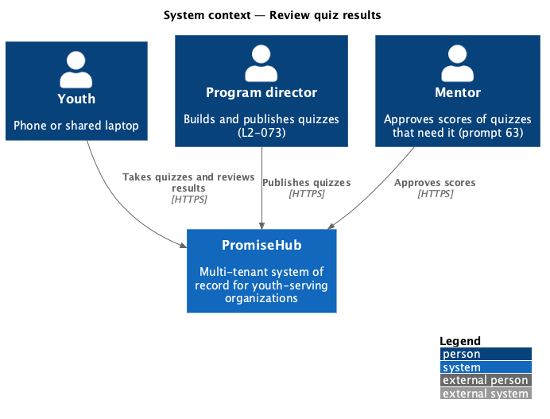
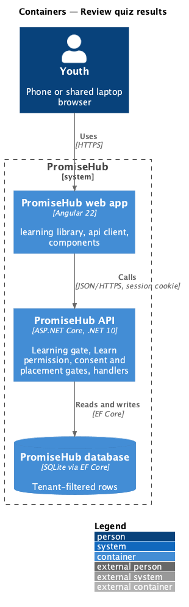
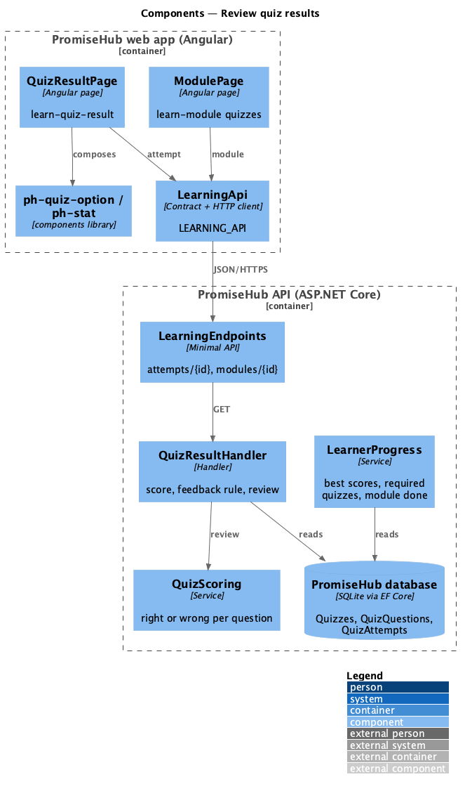
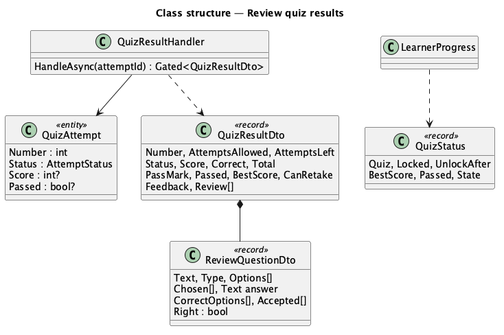
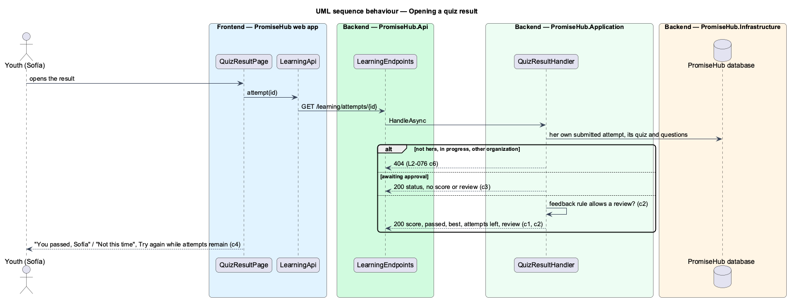

# Review quiz results

## Overview

After an attempt is submitted, the youth sees its **result**: the score, whether it passed against the quiz's pass mark, her best score and, as the quiz's **feedback rule** allows, a **review** of every question with her answer and the correct one. She can retake while attempts remain. A quiz whose scores a mentor approves holds the score back until approval (prompt 63). A quiz marked required holds its module back until it is passed.

Terms used in this document:

- **feedback rule** — `FeedbackMode` on the quiz: `ShowAnswers` (review after each attempt), `ScoreOnly` (never a review) or `AfterLastAttempt` (a review once no attempt is left; never with unlimited attempts)
- **awaiting approval** — an attempt of a quiz with `RequireApproval`, submitted and scored but not shown or counted until a mentor approves it
- **missed** — a correct option the youth did not choose

Ported from Waypoint `learning-experience/review-quiz-results` (`L2-LEARN-005`). Badge awards on a pass arrive with prompt 64.

## Description

Frontend (`frontend/projects/learning/`):

- **`QuizResultPage`** (`/learning/attempts/:id`, mock `learn-quiz-result`) — `ph-alert` (passed, not passed, no attempts left), `ph-stat` for the score, pass mark and attempt, the review as an ordered list of questions with `ph-quiz-option` items marked in words, Try again while attempts remain and Back to the module; awaiting approval and not-found use `ph-empty-state`.
- **`ModulePage`** — the quiz's status (passed, not passed, waiting for the mentor) and best score; a module whose required quiz is not passed stays in progress.

API client: `attempt(id)`; contracts `QuizResult`, `ReviewQuestion`.

Backend:

- **`QuizResultHandler`** — `GET /learning/attempts/{id}` for the caller's own submitted attempt (an attempt in progress, another youth's or another organization's is 404); answers the score, correct and total, passed, attempts used and left, the best score and whether a retake is possible; the review only when the feedback rule allows; nothing scored while awaiting approval.
- **`LearnerProgress`** — the module is complete when every published lesson is done and every published required quiz has a passing best score; this also unlocks modules that name it as prerequisite.

## Requirements

| L2 ID | Refines (L1) | Requirement |
|-------|--------------|-------------|
| `L2-076` | `L1-023` | A youth sees the score of a submitted attempt, whether it passed, and, as the quiz's feedback rule allows, each question with her answer and the correct one; she can retake while attempts remain. |

## Diagrams

### System context

### Containers

### Components

The result handler reads the attempt and the quiz's current questions; `LearnerProgress` turns best scores into module completion.

### Class structure

### Behaviour — opening a result

## Open questions

- The mentor's approve and override (`L2-MENTOR-004`) and the builder switch for `RequireApproval` are prompt 63.
