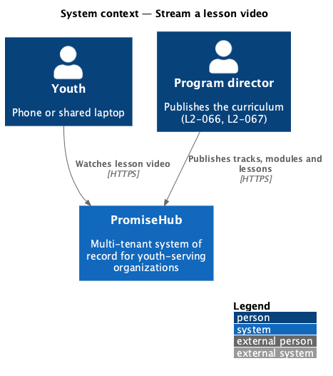
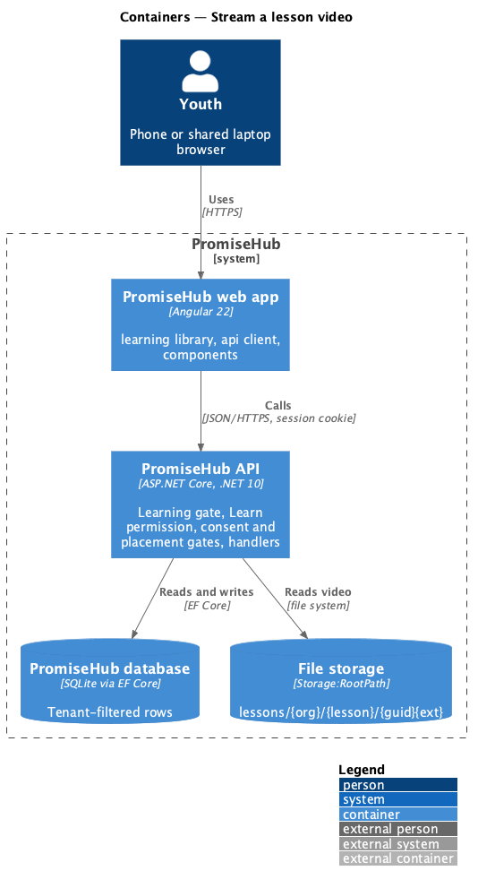
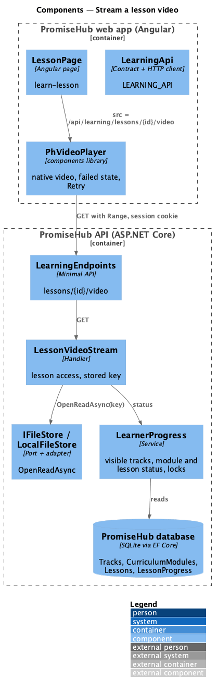
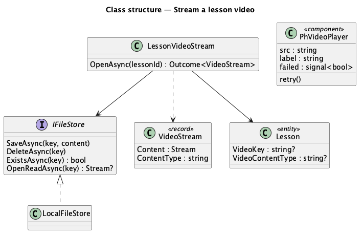
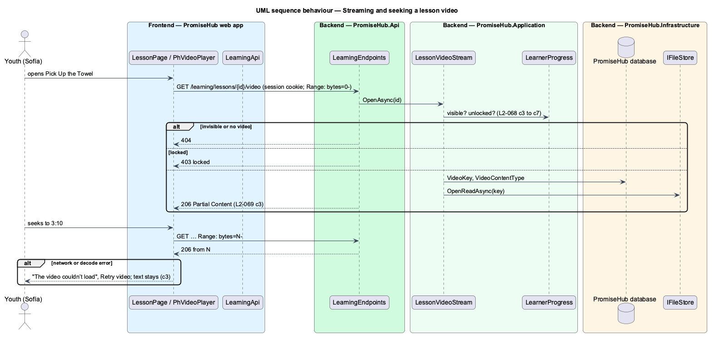

# Stream a lesson video

## Overview

A lesson may carry one **video**, uploaded by an author as MP4, MOV or WebM and stored through PromiseHub file storage without transcoding ([upload-lesson-video](../../curriculum/upload-lesson-video/README.md), ADR 0050). A youth watches it inside the lesson. The video is served only to a youth who may open the lesson, and supports seeking.

Terms used in this document:

- **range request** — an HTTP request with a `Range` header that asks for part of the file; the API answers 206 with that part, so the player can seek without downloading everything
- **session cookie** — the cookie PromiseHub signs people in with (ADR 0005); a `<video>` element sends it, so the stream needs no separate token

Ported from Waypoint `learning-experience/stream-lesson-video`. Waypoint signs expiring HLS URLs because its token lives in browser memory; PromiseHub streams the stored file under the session instead, and adaptive bitrate waits for transcoding (ADR 0051).

## Description

Frontend:

- **`PhVideoPlayer`** (`frontend/projects/components/`, design-system `video-player`) — a figure with a native `<video controls preload="metadata">` named by the lesson, a caption, and a failed state (“The video couldn’t load”, Retry video) raised by the element's `error` event; Retry reloads the source.
- **`LessonPage`** binds `src` to `LEARNING_API.lessonVideoUrl(id)` (`/api/learning/lessons/{id}/video`) when the lesson has a video.

Backend:

- **`LearningEndpoints`** — `GET /learning/lessons/{id}/video` under the Learning gate, `Learn`, consent and placement.
- **`LessonVideoStream`** (`PromiseHub.Application/Learning/`) — asks `LearnerProgress` for the lesson (404 invisible, 403 locked), then 404 when the lesson has no video, otherwise opens the stored key through **`IFileStore.OpenReadAsync`** and returns the stream, content type and file name.
- The endpoint answers `Results.Stream(stream, contentType, enableRangeProcessing: true)`, which handles `Range`, 206 and 416.
- **`LocalFileStore.OpenReadAsync`** opens a read-only `FileStream` under `Storage:RootPath`; the API tests' `FakeFileStore` returns a `MemoryStream`.

Keys come only from the lesson row, never from the request, so no other organization's file can be named.

Open questions: an object-storage adapter, transcoding and adaptive bitrate (`<TO SUPPLY>` with ADR 0050's follow-up).

## Built so far

Nothing yet; prompt 57 builds this design (0%).

## Requirements

| L2 ID | Refines (L1) | Requirement |
|-------|--------------|-------------|
| `L2-069` | `L1-023` | A youth reads a lesson (its objectives, teaching content, reflection prompt and, for a scripture lesson, the passage in a scripture block), watches its optional video, adjusts the reading size, and marks it complete, which is saved on the server and unlocks what comes next. |

## Diagrams

### System context

Youth use what program directors publish; nothing unpublished reaches them.

### Containers

The web app calls the API with the session cookie; the API applies the Learning gate, the Learn permission and the consent and placement gates before any handler runs.

### Components

Every handler asks `LearnerProgress` whether the content is visible and unlocked for the caller's membership.

### Class structure

The types this slice reads and writes.

### Behaviour — streaming and seeking a lesson video

