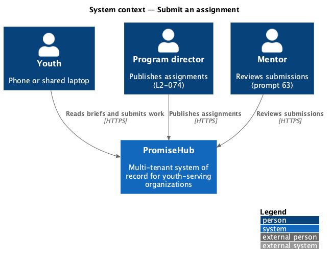
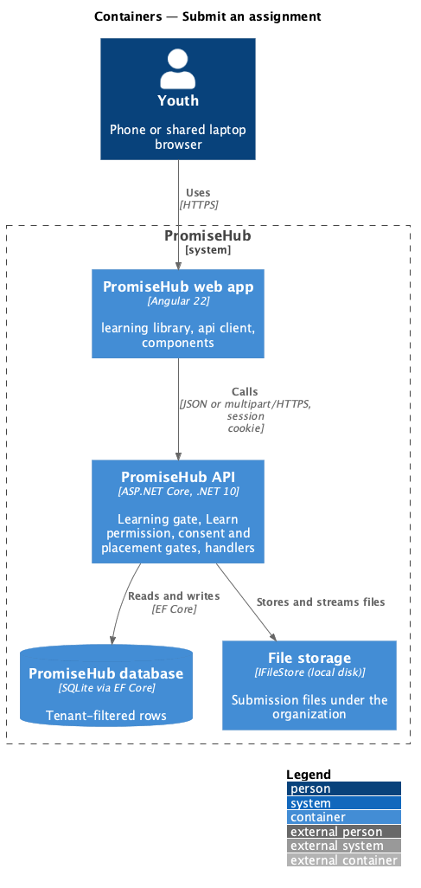
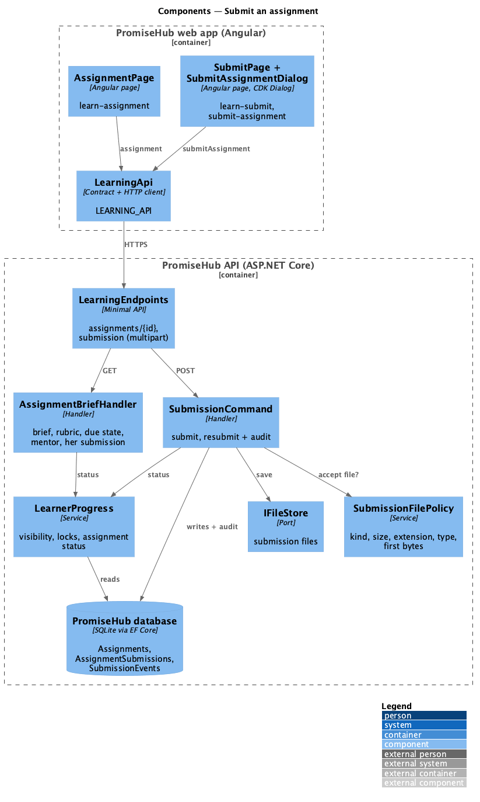
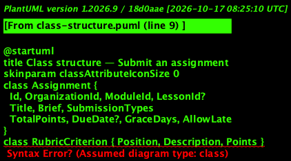
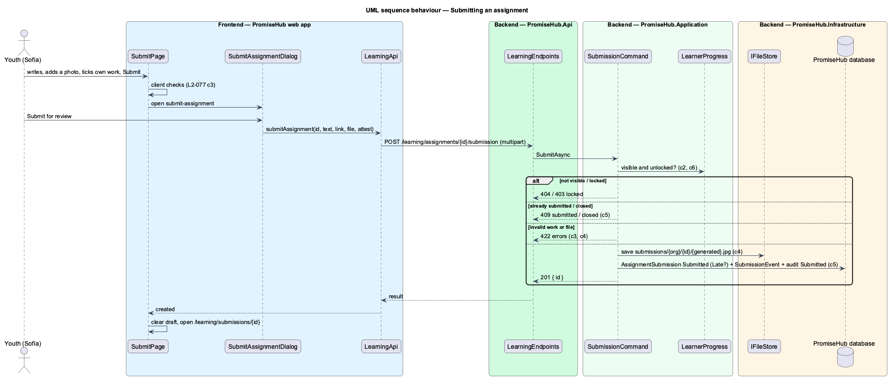

# Submit an assignment

## Overview

An **assignment** is a task a program director attaches to a module or one of its lessons, with the ways youth may submit, a rubric of criteria worth points and due rules ([author-assignments](../../curriculum/author-assignments/README.md), ADR 0054). A youth reads its brief, then sends work of the allowed kinds with an attestation that it is her own. Once sent, the work is read only to her; her mentor reviews it (prompt 63) and may ask for a revision ([track-and-revise-submissions](../track-and-revise-submissions/README.md)).

Terms used in this document:

- **brief** — what the youth reads before submitting: the task, due date, ways to submit, rubric with points and who reviews it
- **submission** — one youth membership's work for one assignment (`AssignmentSubmission`), at most one per membership and assignment
- **kind of work** — a written reflection (Text), a link (Link), a photo (Photo: JPG or PNG) or a file (File: PDF, JPG or PNG)
- **attestation** — the youth's confirmation that the work is her own; required on every submit
- **late / closed** — after the due date plus the grace period; late work is accepted and marked Late when the assignment allows it, otherwise the assignment is closed
- **unlocked** — an assignment attached to a lesson unlocks when that lesson is done; one attached to the whole module when the module is unlocked

Ported from Waypoint `learning-experience/submit-assignments` (`L2-LEARN-006`). Waypoint's separate upload step, media-consent check and coding-project submissions are not ported (ADR 0056).

## Description

Frontend (`frontend/projects/learning/`):

- **`ModulePage`** (`learn-module`) — lists the module's published assignments in an Assignments card with the due date, points and status, linking to the brief, or to the submission once sent.
- **`AssignmentPage`** (`/learning/assignments/:id`, mock `learn-assignment`) — `ph-stat` for due, ways to submit and points, the task, the rubric as a `ph-table`, the mentor, and Start submission, Continue your draft, See your submission or Revise your submission as the brief answers; late, closed, locked, not-found and error states.
- **`SubmitPage`** (`/learning/assignments/:id/submit`, mock `learn-submit`) — a `ph-textarea` for the reflection, a `ph-text-field` for a link and a `ph-file-upload` for a photo or file, each only when the assignment accepts it, and the attestation `ph-checkbox`. Client checks mirror the server's; errors show beside the fields and in `ph-error-summary`. Submit opens **`SubmitAssignmentDialog`** (`submit-assignment`) through CDK Dialog; confirming sends one multipart request and opens the status. Drafts and the leave warning belong to [protect-unsaved-work](../protect-unsaved-work/README.md).

API client (`LEARNING_API`): `assignment(id)`, `submitAssignment(id, work)`; contracts `AssignmentBrief`, `RubricLine`, `AssignmentItem`, `SubmissionWork`, `SubmitOutcome`.

Backend:

- **`LearningEndpoints`** — `GET /learning/assignments/{id}` and `POST /learning/assignments/{id}/submission` (multipart: `text`, `link`, `attest`, `file`) under the Learning gate, `Learn`, consent and placement.
- **`LearnerProgress`** — also loads the visible module's published assignments and the caller's submissions, and computes each assignment's lock (`AssignmentStatus`).
- **`AssignmentBriefHandler`** — the brief through `LearnerProgress`: 404 when not visible, 403 `locked` with unlock-after; the rubric, due state (`open`, `late`, `closed`), the mentor's name and her submission's id and status.
- **`SubmissionCommand.SubmitAsync`** — 409 `submitted` when she already has one, 409 `closed` past the due rules; validates the attestation, the kinds of work, the reflection (5,000) and link (absolute http or https, 500); checks a file with `SubmissionFilePolicy` (kind, 1 byte to 10 MB, extension, content type and first bytes agree), stores it through `IFileStore` under `submissions/{organization}/{submission}/`, records the submission with a `Submitted` event and audits `Submitted` without the text.
- Domain: `AssignmentSubmission`, `SubmissionEvent`, `SubmissionEventKind`, `SubmissionFileKind` and the shared `SubmissionStatus` (`PromiseHub.Domain/Learning/`).

Security (L2-031): the file is never trusted by name or type alone, is stored under a generated key outside any web root, and is served only to its owner as an attachment with `nosniff`. Tenancy: every row carries `OrganizationId`, the global tenant filter applies, and submissions are found only by the caller's membership.

## Built so far

<TO SUPPLY>

## Requirements

| L2 ID | Refines (L1) | Requirement |
|-------|--------------|-------------|
| `L2-077` | `L1-023` | A youth reads an assignment's brief, due date, ways to submit and rubric, then submits work of the allowed kinds (a written reflection, a link, a photo or a file) with an attestation that it is her own; once submitted it is read only to her. |
| `L2-074` | `L1-023` | Assignment authoring: the ways to submit, rubric and due rules the brief shows. |
| `L2-031` | `L1-016` | TLS everywhere, encryption at rest, OWASP Top 10 defences, secrets outside the repository. |

## Diagrams

### System context

Youth submit what program directors publish; mentors review it in prompt 63.

### Containers

The web app sends the work and its file in one multipart request; the API stores the file through file storage and the rest in the database.

### Components

Every handler asks `LearnerProgress` whether the assignment is visible and unlocked; the file policy runs before anything is stored.

### Class structure

The types this slice reads and writes.

### Behaviour — submitting

## Open questions

- Notifying the mentor of a new submission arrives with the review queue (prompt 63).
- Whether an accepted assignment counts toward a module being done is decided with progress (prompt 65); today it does not.
