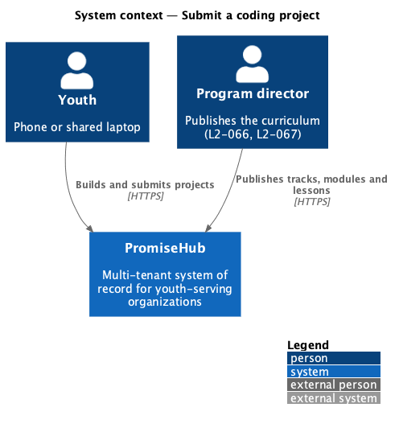
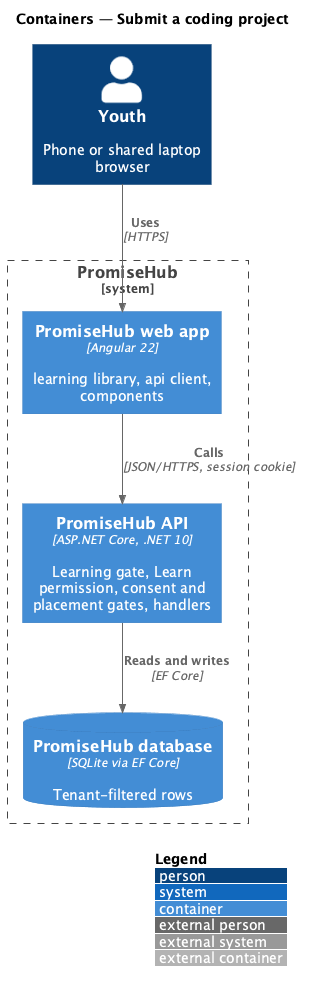
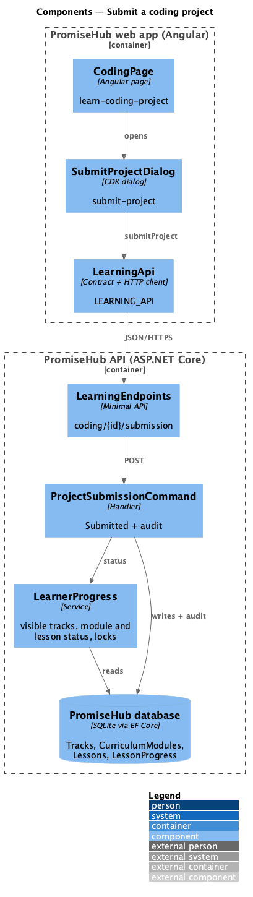
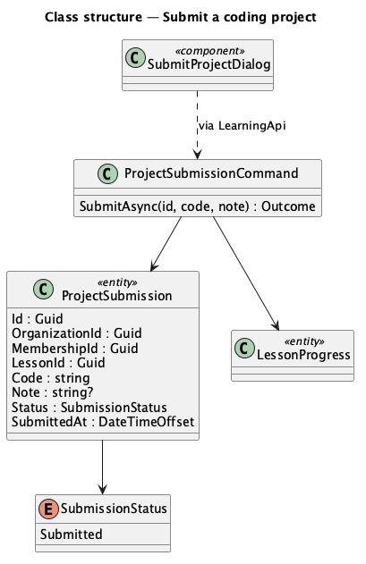
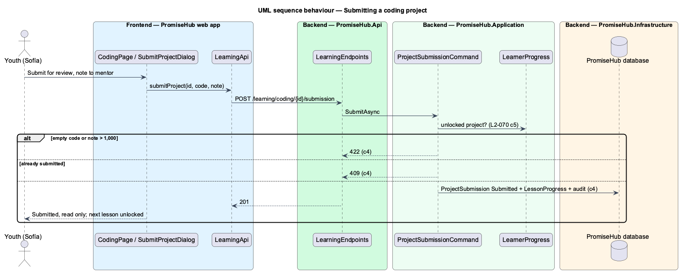

# Submit a coding project

## Overview

A **coding project** is the last lesson of a coding module: a brief, the same playground as a coding lesson, Save draft, and Submit for review, which sends the youth's page with an optional note to their mentor. Submitting completes the project for gating; the mentor's review arrives with assignment review.

Terms used in this document:

- **submission** — the youth's code and note sent for review, with status Submitted (`ProjectSubmission`)
- **draft** — the youth's saved code before submitting, kept in the workspace ([complete-coding-lessons](../complete-coding-lessons/README.md))

Ported from Waypoint `learning-experience/submit-coding-projects` (`L2-LEARN-008` criterion 2). Waypoint's attestation, cohort gallery and the review lifecycle (Under review, Approved, Needs revision) wait for prompts 62 and 68 (ADR 0051).

## Description

Frontend:

- **`CodingPage`** (`/learning/coding/:id`, mock `learn-coding-project`) — for a Project: the brief, `ph-code-playground`, Save draft (the same progress call with no ticks) and Submit for review, which opens **`SubmitProjectDialog`** (`submit-project`, CDK Dialog via `PhDialogs`) with the optional note; after submitting the badge reads Submitted, the playground is read only and an info alert names the mentor.

API client: `submitProject(id, { code, note })`; contract `ProjectSubmissionView` inside `CodingView`.

Backend:

- **`LearningEndpoints`** — `POST /learning/coding/{id}/submission`.
- **`ProjectSubmissionCommand`** — Project kind only (404 otherwise), unlocked (403), code required and up to 50,000 characters, note up to 1,000 (422), once per youth (409); saves `ProjectSubmission` as Submitted with the time, adds `LessonProgress` for gating, audits Created on `ProjectSubmission` and Completed on `LessonProgress`, answers 201.
- Domain: **`ProjectSubmission`** and **`SubmissionStatus`** (`PromiseHub.Domain/Learning/`), tenant-owned.
- The mentor's name in the alert comes from the youth's mentor assignment when Mentoring is on (`<TO SUPPLY>` until mentor review exists; the page names “your mentor” otherwise).

## Built so far

Nothing yet; prompt 57 builds this design (0%).

## Requirements

| L2 ID | Refines (L1) | Requirement |
|-------|--------------|-------------|
| `L2-070` | `L1-023` | A youth works through a coding lesson's steps and code samples, edits and runs code in a sandboxed preview, ticks its checklist, and saves progress on the server; ticking every item completes the lesson. A coding project is built in the same playground and submitted to the youth's mentor with an optional note. |
| `L2-068` | `L1-023` | A youth opens Learning, sees where they left off and their tracks, browses a track's published modules and a module's published lessons in order, and can open only what is unlocked: a module unlocks when its prerequisite module is done, a lesson when every earlier lesson of its module is done. The server enforces every lock. |

## Diagrams

### System context

Youth use what program directors publish; nothing unpublished reaches them.

### Containers

The web app calls the API with the session cookie; the API applies the Learning gate, the Learn permission and the consent and placement gates before any handler runs.

### Components

Every handler asks `LearnerProgress` whether the content is visible and unlocked for the caller's membership.

### Class structure

The types this slice reads and writes.

### Behaviour — submitting a coding project

