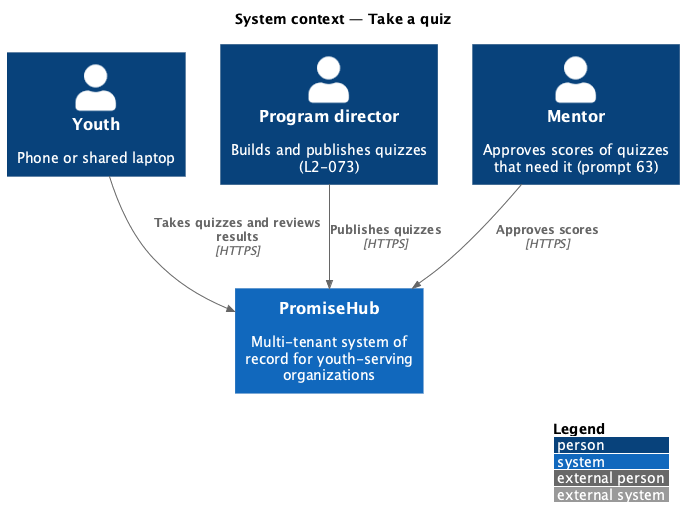
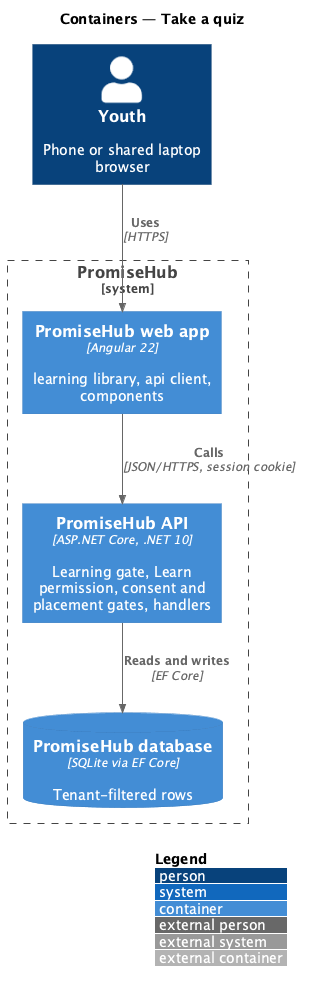
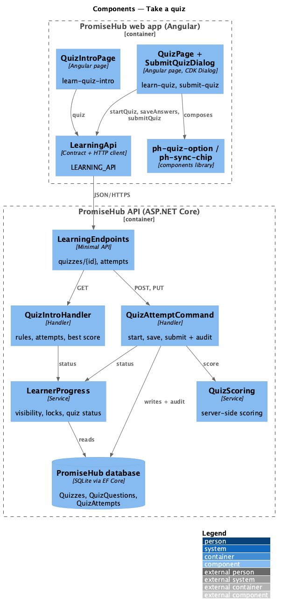
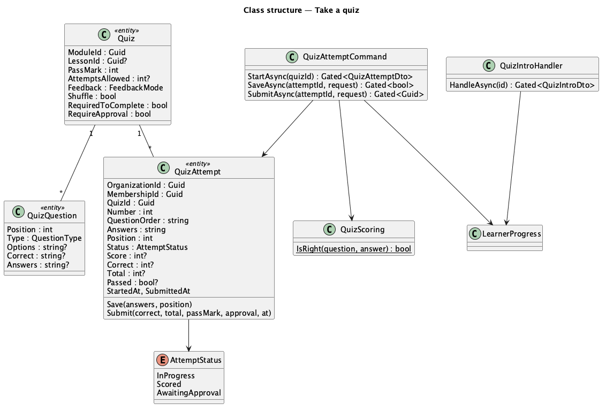
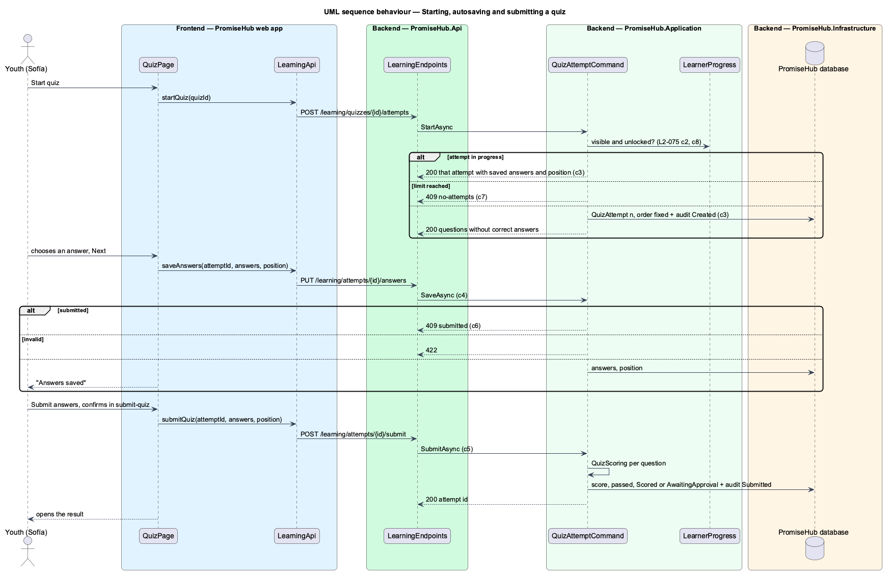

# Take a quiz

## Overview

A **quiz** is a set of questions a program director attaches to a module or one of its lessons ([author-quizzes](../../curriculum/author-quizzes/README.md)). A youth reads its rules, takes it one question at a time with every answer saved on the server, resumes it after an interruption, and submits it. Submitting scores the attempt on the server and locks it: its answers never change again. The server refuses an attempt beyond the quiz's limit.

Terms used in this document:

- **attempt** — one go at a quiz by one youth membership (`QuizAttempt`), numbered from 1, in progress until submitted
- **attempt order** — the order the attempt shows the questions in, fixed when it starts: the authored order, or a shuffled one when the quiz shuffles
- **autosave** — saving the answers and the current question with every change, so a reload resumes at the same place
- **best score** — the highest score among the youth's scored attempts; the one that counts (ADR 0055)
- **unlocked** — a whole-module quiz unlocks when the module is unlocked and every published lesson of it is done; a lesson quiz when its lesson is done

Ported from Waypoint `learning-experience/take-quizzes` (`L2-LEARN-004`). Waypoint's estimated time and badge reward are left out (badges are prompt 64).

## Description

Frontend (`frontend/projects/learning/`):

- **`ModulePage`** (`learn-module`) — lists the module's quizzes in a Quizzes card with their status and best score, linking to the intro while unlocked.
- **`QuizIntroPage`** (`/learning/quizzes/:id`, mock `learn-quiz-intro`) — `ph-stat` for questions, pass mark, attempts and this attempt, the rules, and Start quiz, Resume quiz, Try again or See your best attempt as the intro answers; locked, not-found and error states.
- **`QuizPage`** (`/learning/quizzes/:id/take`, mock `learn-quiz`) — starts or resumes the attempt, shows one question as a fieldset of `ph-quiz-option` (native radio or checkbox) or a `ph-text-field`, `ph-progress-bar`, Back and Next, and a `ph-sync-chip` for the save state. Every change queues a save; one save is in flight at a time and the latest answers win. A failed save marks the page offline and retries on the browser's `online` event. Submit answers on the last question opens **`SubmitQuizDialog`** (`submit-quiz`) through CDK Dialog, naming blank questions; confirming submits and opens the result.
- **`ph-quiz-option`** (`frontend/projects/components/`) — the design-system quiz option: a label wrapping a native input while taking, a list item marked correct, wrong or missed in the review.

API client (`LEARNING_API`): `quiz(id)`, `startQuiz(id)`, `saveAnswers(attemptId, answers, position)`, `submitQuiz(attemptId, answers, position)`; contracts `QuizIntro`, `QuizAttemptView`, `AttemptQuestion`, `QuizAnswer`.

Backend:

- **`LearningEndpoints`** — `GET /learning/quizzes/{id}`, `POST /learning/quizzes/{id}/attempts`, `PUT /learning/attempts/{id}/answers` and `POST /learning/attempts/{id}/submit` under the Learning gate, `Learn`, consent and placement.
- **`LearnerProgress`** — also loads the visible module's published quizzes and the caller's attempts, computes each quiz's lock and status (`QuizStatus`), and counts a required quiz toward the module being done.
- **`QuizIntroHandler`** — the intro through `LearnerProgress`: 404 when not visible, 403 `locked` with unlock-after; attempts used, the next attempt number, the attempt in progress and the best score; never correct answers.
- **`QuizAttemptCommand`** — `StartAsync` resumes the attempt in progress or creates the next one (409 `no-attempts` past the limit), fixing the attempt order and auditing Created on `QuizAttempt`; `SaveAsync` validates and stores the answers and position (409 `submitted` once submitted, 422 for a foreign question, an option out of range, two options on a one-answer question or a short answer over 200 characters); `SubmitAsync` saves the final answers, scores them through `QuizScoring`, records the score, passed and the time, and audits Submitted.
- **`QuizScoring`** — right when a multiple choice or true / false answer is the correct option, a multiple answer is exactly the correct options, a short answer matches an accepted answer ignoring capitals and surrounding spaces; score = rounded percentage right.
- Domain: `QuizAttempt` and `AttemptStatus` (`PromiseHub.Domain/Learning/`), `Quiz.RequireApproval` (`PromiseHub.Domain/Curriculum/`). Answers are stored as JSON text keyed by question id.

Tenancy: every row carries `OrganizationId`, the global tenant filter applies, and attempts are found only by the caller's membership, so another youth's or organization's attempt is 404.

## Requirements

| L2 ID | Refines (L1) | Requirement |
|-------|--------------|-------------|
| `L2-075` | `L1-023` | A youth reads a quiz's rules, takes it one question at a time with every answer saved on the server as she goes, resumes it where she stopped, and submits it, after which that attempt is scored on the server and can never change. The server refuses an attempt beyond the quiz's limit. |
| `L2-068` | `L1-023` | A youth opens Learning, sees where they left off and their tracks, browses a track's published modules and a module's published lessons in order, and can open only what is unlocked. The server enforces every lock. |

## Diagrams

### System context

Youth take what program directors publish; mentors approve scores of quizzes that need it (prompt 63).

### Containers

The web app calls the API with the session cookie; the API applies the Learning gate, the Learn permission and the consent and placement gates before any handler runs.

### Components

Every handler asks `LearnerProgress` whether the quiz is visible and unlocked; scoring happens only on the server.

### Class structure

The types this slice reads and writes.

### Behaviour — starting, autosaving and submitting

## Open questions

- Turning on "a mentor approves the score" in the quiz builder, and approving, arrive with prompt 63; until then `Quiz.RequireApproval` is false for every quiz an author makes.
- Editing a published quiz while attempts exist is allowed (ADR 0054); an attempt keeps its order for the questions that still exist and appends new ones, and is scored against the questions at submit time.
