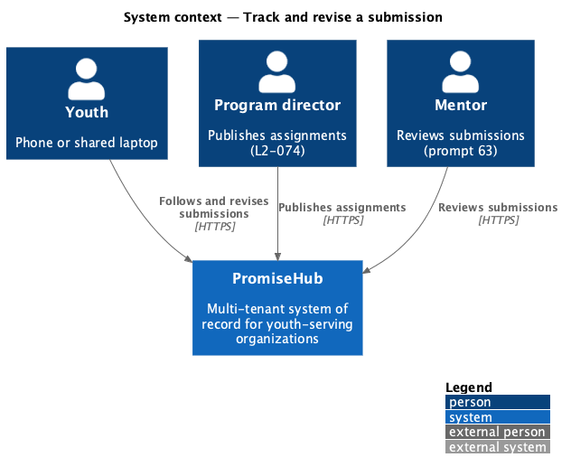
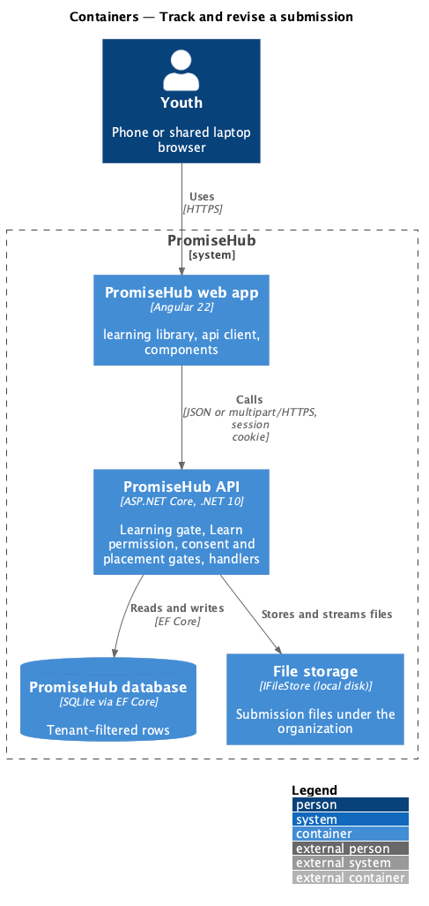
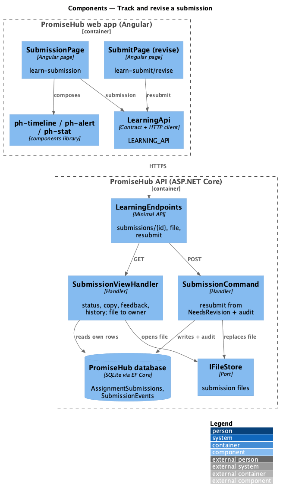
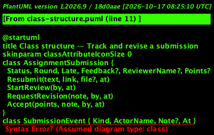
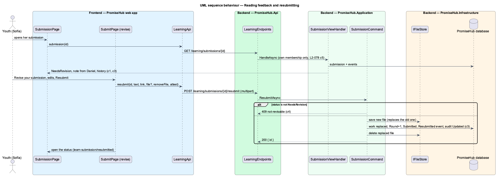

# Track and revise a submission

## Overview

After a youth submits an assignment ([submit-assignments](../submit-assignments/README.md)), her mentor reviews it (prompt 63). This slice lets her follow it: what she sent, its status, who did what and when, and the mentor's feedback. When the mentor asks for a revision she edits her work and sends it again.

Terms used in this document:

- **status** — Submitted, In review, Needs revision or Accepted (`SubmissionStatus`)
- **history** — the submission's steps in order, each with who and when (`SubmissionEvent`): submitted, review started, revision requested, resubmitted, accepted
- **feedback** — the mentor's latest note, with the mentor's name; with Accepted, the points awarded of the assignment's total
- **round** — 1 for the first submission, one more for every resubmission
- **resubmit** — replacing the work of a submission in Needs revision and returning it to Submitted

Ported from Waypoint `learning-experience/track-and-revise-submissions` (`L2-LEARN-007`). Badges on acceptance (prompt 64) and notifications of a status change (prompts 63 and 75) are not part of this slice.

## Description

Frontend (`frontend/projects/learning/`):

- **`SubmissionPage`** (`/learning/submissions/:id`, mock `learn-submission`) — the status as a `ph-badge`, an `ph-alert` with the next step or the mentor's note, `ph-stat` for points once accepted, What you sent (the reflection, link and file with Open), and What happened as a `ph-timeline`; Revise your submission while it needs revision; not-found and error states.
- **`SubmitPage`** in revise mode (`learn-submit/revise`) — loads the submission, shows the mentor's note, fills the reflection and link, keeps the earlier file unless it is removed or replaced, and Resubmit opens `submit-assignment` in its resubmit state.

API client (`LEARNING_API`): `submission(id)`, `resubmit(id, work)`, `submissionFileUrl(id)`; contracts `SubmissionView`, `SubmissionHistoryItem`.

Backend:

- **`LearningEndpoints`** — `GET /learning/submissions/{id}`, `GET /learning/submissions/{id}/file` and `POST /learning/submissions/{id}/resubmit` (multipart: `text`, `link`, `attest`, `file`, `removeFile`).
- **`SubmissionViewHandler`** — the caller's own submission only (anything else is 404): the assignment and module, status, late, round, the work, feedback, points of the total and the history; `FileAsync` opens the stored file for its owner.
- **`SubmissionCommand.ResubmitAsync`** — 409 `not-revisable` unless the status is Needs revision; the same checks as a submit; stores a replacing file, replaces the work, increments the round, returns to Submitted with a `Resubmitted` event, audits `Updated`, and deletes the replaced file after the save.
- **`AssignmentSubmission`** — `StartReview`, `RequestRevision` and `Accept` move the status and write history for prompt 63's review endpoints.

## Built so far

Prompt 62 delivered everything above; the mentor's review endpoints that move a submission past Submitted are prompt 63, and the tests apply the review through the domain as those endpoints will. Acceptance tests: `backend/tests/PromiseHub.Api.Tests/LearningSubmissionStatusTests.cs` and `e2e/tests/learning/submissions.spec.ts`.

## Requirements

| L2 ID | Refines (L1) | Requirement |
|-------|--------------|-------------|
| `L2-078` | `L1-023` | A youth follows her submission through Submitted, In review, Needs revision and Accepted, reads her mentor's feedback, and revises and resubmits when asked. |
| `L2-077` | `L1-023` | A youth reads an assignment's brief, due date, ways to submit and rubric, then submits work of the allowed kinds (a written reflection, a link, a photo or a file) with an attestation that it is her own; once submitted it is read only to her. |

## Diagrams

### System context

The mentor's review moves the status; the youth reads it and revises.

### Containers

### Components

The status page reads only the caller's own submission; resubmitting goes through the same command as submitting.

### Class structure

### Behaviour — reading feedback and resubmitting

## Open questions

- The mentor's review endpoints, rubric scores per criterion and the youth's notification of a status change arrive with prompt 63.
