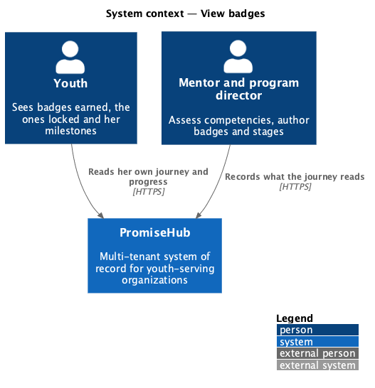
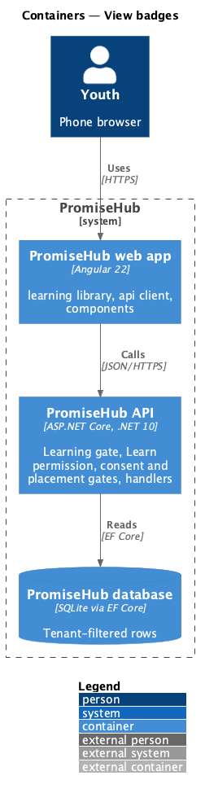
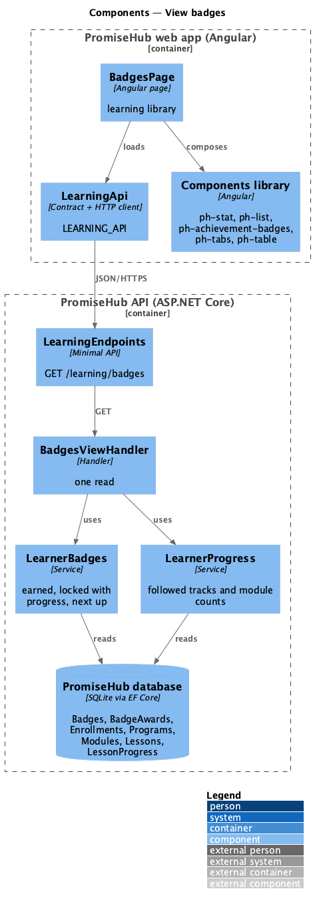
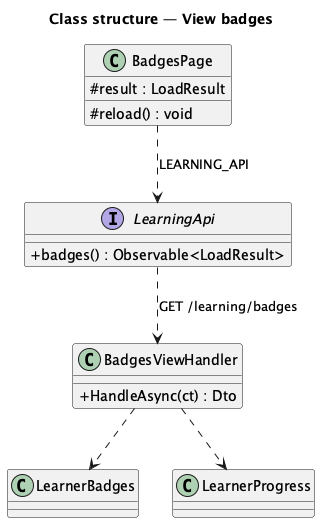
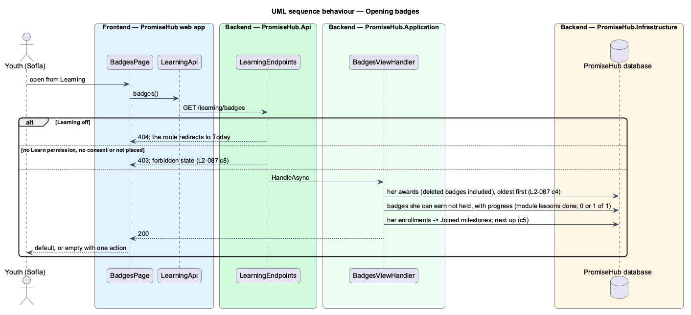

# View badges

## Overview

Badges (`learn-badges`) is the youth's collection: the badges she has earned, with when and who awarded a by-hand one, the badges she can still earn with what earns them and how far she is, and her **milestones**.

Terms used in this document:

- **earned badge** — a `BadgeAward` of her membership; it stays even if the badge was deleted later (ADR 0058)
- **locked badge** — a badge she can earn and does not hold; an automatic one carries **progress** (lessons done of the module for a module badge, 0 or 1 of 1 for a lesson, quiz or assignment badge), a by-hand one says the program team awards it
- **milestones** — when she joined each program she is in, each badge earned in order, and **Next up**: the locked automatic badge she is closest to, most done of its total and then by name (ADR 0059)

Ported from Waypoint `learning-experience/view-badges` (`L2-LEARN-009`), with tenancy and PromiseHub types.

## Description

Frontend (`frontend/projects/learning/`):

- **`BadgesPage`** (`/learning/badges`) — Your collection (`ph-progress-bar`), Earned and Still to unlock (`ph-achievement-badges`, captions with when, who and progress), Your milestones (`ph-list`), and the empty (none earned, Start a lesson), none (no badges to earn), loading, error and forbidden states.

API client (`LEARNING_API`): `badges()` answering `LoadResult<LearnerBadges>` (`EarnedBadge`, `LockedBadge`, `Milestone`).

Backend (`PromiseHub.Application/Learning/`):

- **`BadgesViewHandler`** — `GET /learning/badges`, from `LearnerBadges`.
- **`LearnerBadges`** — `ForAsync(tracks)`: her awards joined to their badges (ignoring the deleted filter for earned ones), the badges she can earn (not deleted; by hand, or automatic with a target lesson, module, quiz or assignment in a followed track) not held, in the order made, with progress from the same `TrackStatus` the roadmap uses; milestones from her active enrollments' `EnrolledAt` and her awards.

Open questions: none. Decisions are recorded in ADR 0059.

## Requirements

| L2 ID | Refines (L1) | Requirement |
|-------|--------------|-------------|
| `L2-087` | `L1-023` | A youth sees her journey through her tracks, her weekly streak, her progression stage, and the badges she has earned and those still locked. |

## Diagrams

### System context

The youth reads what mentors and program directors record; nothing on these pages changes state.

### Containers

### Components

The page loads one read through `LEARNING_API`; the handler composes the shared learner services.

### Class structure

### Behaviour — opening badges

The module gate answers first, then the permission, consent and placement gates; only then does the handler read her own rows.

