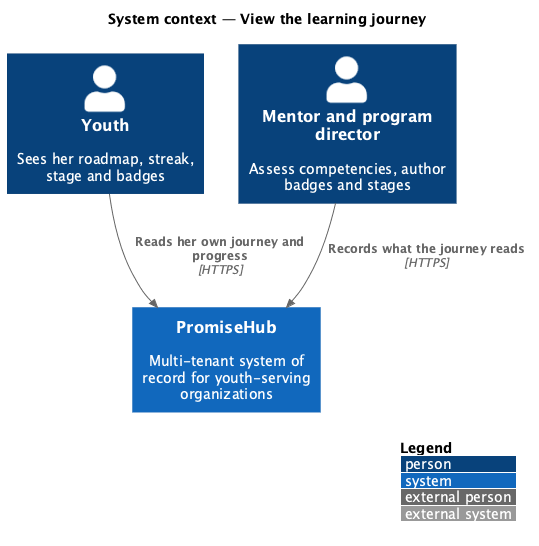
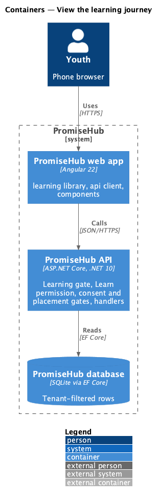
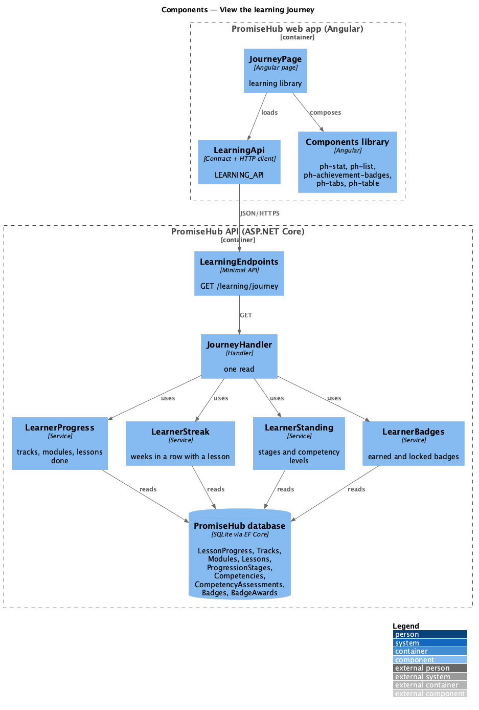
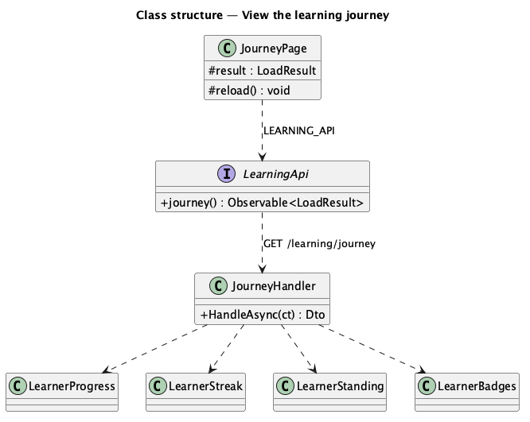
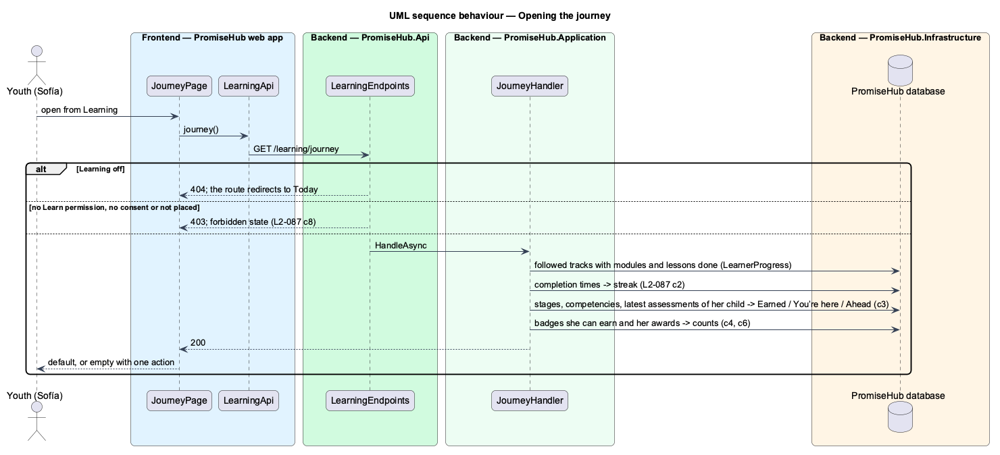

# View the learning journey

## Overview

Your journey (`learn-journey`) is where a youth sees how far she has come: her overall progress, her **streak**, the badges she has earned of those she can earn, her **stage** in the organization's progression framework, and a **roadmap** of every track her programs follow with each module done, in progress, not started or locked.

Terms used in this document:

- **roadmap** — each followed track with its published modules in order, counted as on Learning (`L2-068`, ADR 0051)
- **streak** — the weeks in a row, Monday to Sunday in UTC, with at least one lesson completed, counted back from this week or, while this week has none yet, from last week (ADR 0059)
- **stage** — a step of the progression framework (`L2-086`); earned when every competency in it has her latest mentor assessment at Proficient or Mastered; the first stage not earned is where she is
- **badges she can earn** — by-hand badges and automatic badges whose target is in a track she follows (ADR 0059)

Ported from Waypoint `learning-experience/view-learning-journey` (`L2-LEARN-009`, `JourneyQueryHandler`), with tenancy, the Learning module gate and PromiseHub types.

## Description

Frontend (`frontend/projects/learning/`):

- **`JourneyPage`** (`/learning/journey`) — `ph-stat` ×4 (Overall progress, Streak, Badges, Stage), a `ph-card` per track listing modules as `ph-list-item` (a link while open, none while locked, a `ph-badge` status) with Continue on the current module, Your stage (`ph-list`), Badges (`ph-progress-bar`, `ph-achievement-badges`, See all badges) and a link to Your progress. Loading, empty, error and forbidden states. Learning home links here from its Your journey card.

API client (`LEARNING_API`): `journey()` answering `LoadResult<Journey>` (`Journey`, `JourneyTrack`, `JourneyStage`, `JourneyBadge`). Components library: **`PhAchievementBadges`** (`ph-achievement-badges`), a labelled grid of `ph-achievement-badge`, added for this journey.

Backend (`PromiseHub.Application/Learning/`):

- **`JourneyHandler`** — `GET /learning/journey`: `LearnerProgress.TracksAsync` for the roadmap and counts, the current module (the one holding the first open lesson not done), `LearnerStreak.Weeks`, `LearnerStanding.StagesAsync` and the earned and total counts and medals from `LearnerBadges`.
- **`LearnerStreak`** — pure: weeks in a row from completion times and today.
- **`LearnerStanding`** — the youth's child, each competency of the organization not removed with its latest assessment level, grouped into stages in order with Earned, Current or Ahead.
- **`LearnerBadges`** — shared with [view-badges](../view-badges/README.md).
- Endpoint: `LearningEndpoints` behind `RequireModule(Learning)`, `RequirePermission(Learn)`, the consent and placement gates.

Open questions: none. Decisions are recorded in ADR 0059.

## Requirements

| L2 ID | Refines (L1) | Requirement |
|-------|--------------|-------------|
| `L2-087` | `L1-023` | A youth sees her journey through her tracks, her weekly streak, her progression stage, and the badges she has earned and those still locked. |

## Diagrams

### System context

The youth reads what mentors and program directors record; nothing on these pages changes state.

### Containers

### Components

The page loads one read through `LEARNING_API`; the handler composes the shared learner services.

### Class structure

### Behaviour — opening the journey

The module gate answers first, then the permission, consent and placement gates; only then does the handler read her own rows.

