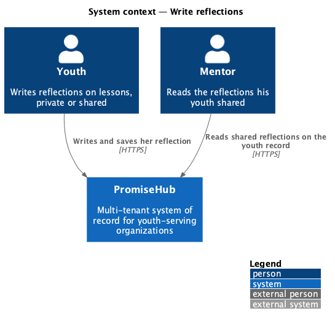
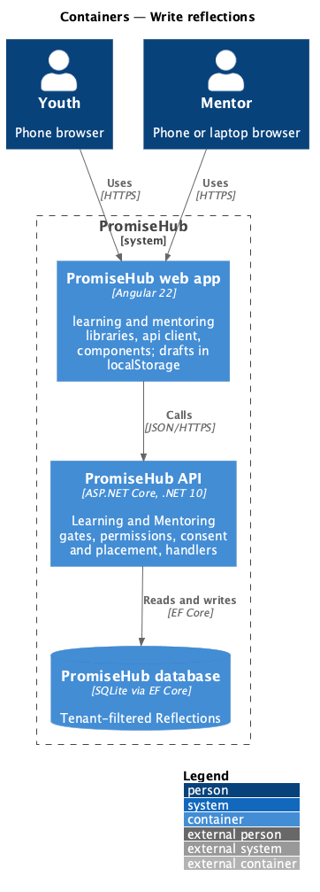
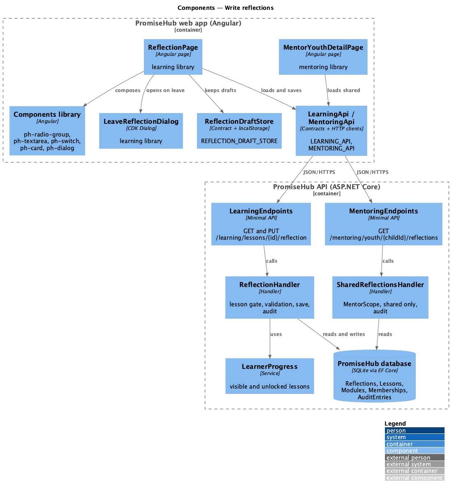
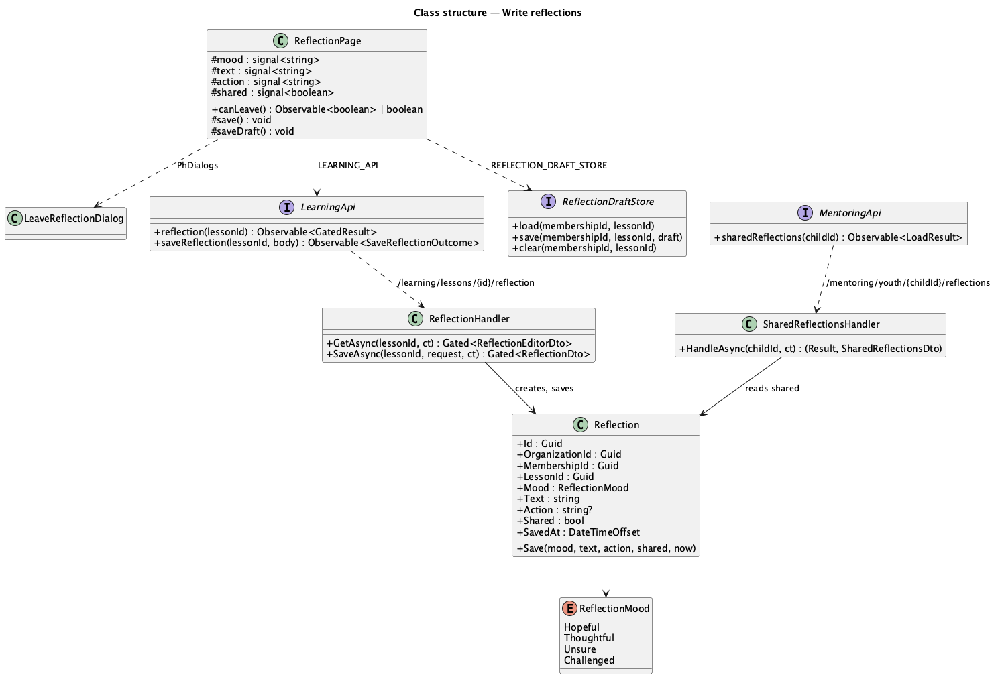
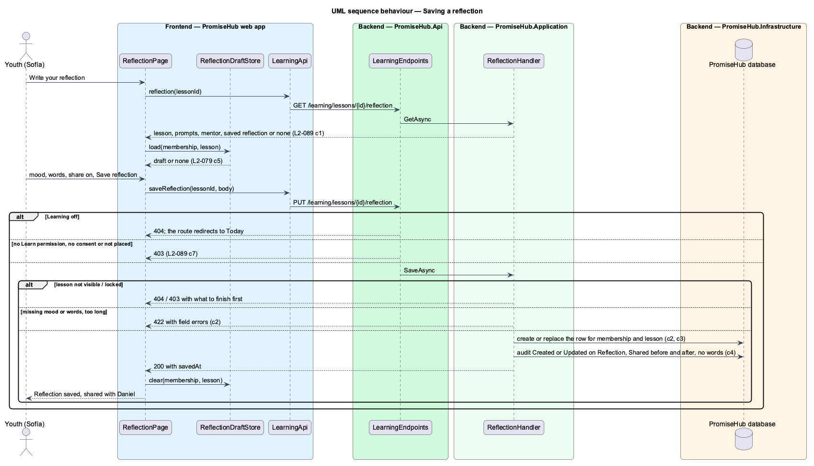
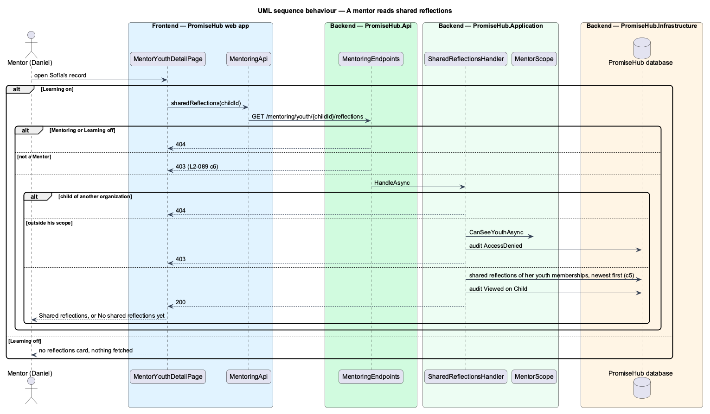

# Write reflections

## Overview

After a lesson, a youth may write a **reflection**: how she feels about the lesson, a few sentences in her own words, and one thing she will do this week. A reflection is personal. It stays **private** unless she **shares** it with her mentor, which she chooses each time she saves. A mentor reads the reflections his youth shared on their record and nothing else; no other role reads reflections at all. Leaving the page with unsaved words asks first, and a **draft** can be kept on the device (`protect-unsaved-work`).

Terms used in this document:

- **reflection** — one `Reflection` row per youth membership and lesson: mood, words, an optional action, whether it is shared, and when it was saved
- **mood** — one of Hopeful, Thoughtful, Unsure or Challenged
- **shared** — the reflection may be read by the youth's mentor; private otherwise
- **mentor** — a Mentor whose scope (`MentorScope`, ADR 0049) holds the youth's child: assigned directly or leading or supporting her active cohort
- **draft** — the unsaved form kept in the browser under the membership and the lesson; it never reaches the server (ADR 0060)

Ported from Waypoint `learning-experience/write-reflections` (`L2-LEARN-003`), with tenancy, the Learning and Mentoring module gates and PromiseHub types. Decisions are recorded in ADR 0060.

## Description

Frontend (`frontend/projects/learning/`):

- **`ReflectionPage`** (`/learning/lessons/:id/reflection`, mock `learn-reflection`) — Think about it (the lesson's prompts), Your words (`ph-radio-group` mood, `ph-textarea` words and action with counters), Who can see it (`ph-switch` naming her mentor), Save draft and Save reflection; the error summary and field errors as the server checks them; the saved, shared, draft-saved, restored, busy, failed, locked, forbidden, not-found, loading and error states. It implements `CanLeave` and listens to `beforeunload`.
- **`LeaveReflectionDialog`** (`leave-reflection`) — CDK Dialog: Leave without saving, Keep editing, Save draft and leave; returns a `LeaveChoice`.
- **`LessonPage`** — Think it over offers Write your reflection.

Mentoring frontend (`frontend/projects/mentoring/`):

- **`MentorYouthDetailPage`** — while Learning is on, a Shared reflections card lists `SharedReflections` newest first, or "No shared reflections yet".

API client (`frontend/projects/api/`): `LEARNING_API.reflection(lessonId)` answering `GatedResult<ReflectionEditor>`, `LEARNING_API.saveReflection(lessonId, SaveReflection)` answering `SaveReflectionOutcome` (saved with the `SavedReflection`, invalid with errors, or failed); `MENTORING_API.sharedReflections(childId)`; `ReflectionDraftStore` contract, `REFLECTION_DRAFT_STORE` token and `LocalReflectionDraftStore` (`promisehub.reflection-draft.{membership}.{lesson}`).

Backend:

- **`Reflection`** (`PromiseHub.Domain/Learning/`) — tenant-owned; `Save(mood, text, action, shared, now)`; limits `MaximumText` 5,000 and `MaximumAction` 1,000. **`ReflectionMood`** enum.
- **`ReflectionHandler`** (`PromiseHub.Application/Learning/`) — `GetAsync(lessonId)` answers `ReflectionEditorDto` (lesson, module, prompts, mentor name from `YouthMentorName`, the saved `ReflectionDto` or null); `SaveAsync(lessonId, SaveReflectionRequest)` checks the lesson through `LearnerProgress` (404 not visible, 403 locked), validates, creates or replaces the row and audits Created or Updated on `Reflection` with `Shared` before and after.
- **`SharedReflectionsHandler`** (`PromiseHub.Application/Mentoring/`) — `GET /mentoring/youth/{childId}/reflections`: 404 for a child outside the organization, 403 audited as AccessDenied outside `MentorScope`, otherwise the shared reflections of the child's youth memberships joined to their lessons and modules, newest first, audited as Viewed.
- **Endpoints** — `GET` and `PUT /learning/lessons/{id}/reflection` in `LearningEndpoints` (Learning, Learn, consent, placement); `GET /mentoring/youth/{childId}/reflections` in the Learning group of `MentoringEndpoints` (Mentoring, Learning, MentorYouth).
- **Persistence** — `Reflections` set, unique index on membership and lesson, migration `Reflections`.

Open questions: none. Waypoint's program-administrator read and free-form secondary answers are not ported (ADR 0060).

## Built so far

Prompt 66 delivered everything above in four slices: writing and saving a reflection (`GET` and `PUT /learning/lessons/{id}/reflection`, `ReflectionPage`, Write your reflection on the lesson); private or shared enforced on the server (`GET /mentoring/youth/{childId}/reflections`); the Shared reflections card on the mentor's youth record, with `ph-list-item` gaining the list's text variant in the components library; and unsaved-changes protection with the device draft. Saving also raises a toast; the saved alert stays on the page. Acceptance tests: `backend/tests/PromiseHub.Api.Tests/LearningReflectionsTests.cs`, `backend/tests/PromiseHub.Api.Tests/MentorReflectionsTests.cs`, `e2e/tests/learning/reflection.spec.ts`, `e2e/tests/mentoring/shared-reflections.spec.ts`.

## Requirements

| L2 ID | Refines (L1) | Requirement |
|-------|--------------|-------------|
| `L2-089` | `L1-023` | A youth writes a reflection on a lesson she can open, says how she feels about it and chooses, each time she saves, whether it stays private or is shared with her mentor. A mentor reads only the reflections his youth shared; nobody else reads reflections at all. |
| `L2-079` | `L1-014` | A youth is warned before she leaves work she has not sent or saved, and can keep a draft on her device and find it again. |

## Diagrams

### System context

The youth writes; her mentor reads only what she shares.

### Containers

Drafts stay in the browser; saved reflections live in the tenant-filtered database.

### Components

### Class structure

### Behaviour — saving a reflection

The gates answer first; the handler then checks the lesson, validates, saves one row and audits it without her words.

### Behaviour — a mentor reads shared reflections

