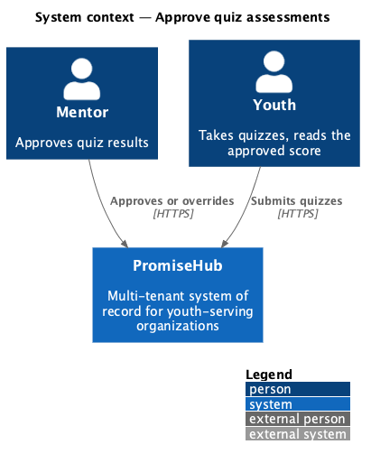
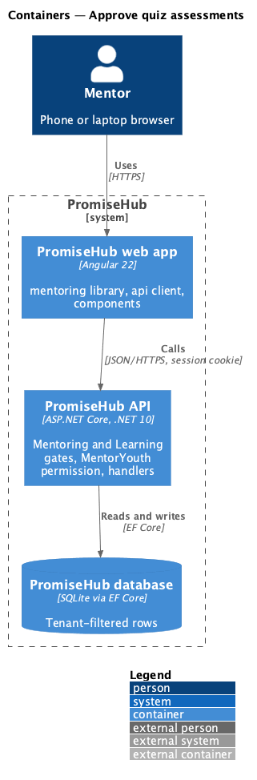
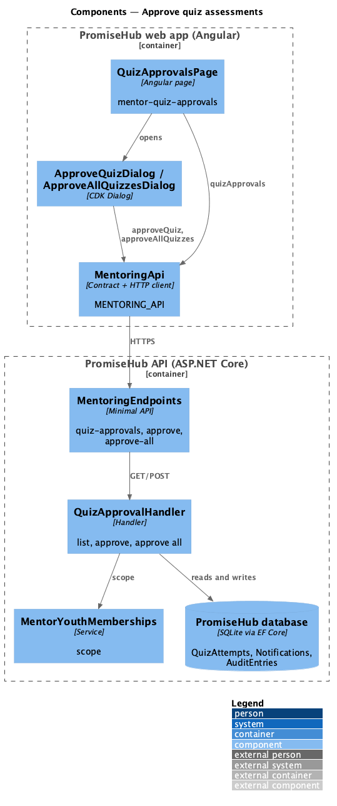
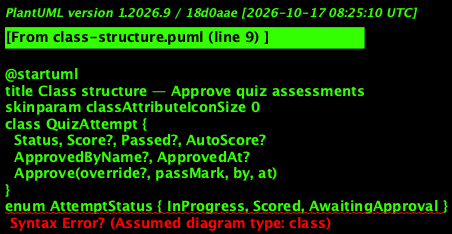
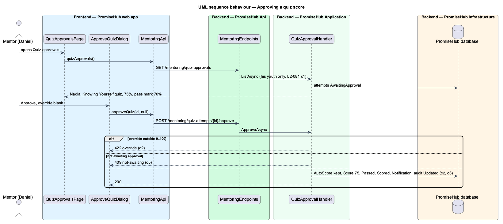

# Approve quiz assessments

## Overview

Some quizzes need a mentor's approval before their result counts (L2-073). A youth's attempt at one waits in Awaiting approval after she submits it ([take-quizzes](../../learning/README.md)). This slice lets her mentor confirm the auto-score or override it, one at a time or all at once.

Terms used in this document:

- **auto-score** — the percentage of questions right, scored on the server at submit (ADR 0055)
- **override** — a whole-number percentage from 0 to 100 the mentor approves instead of the auto-score
- **approved score** — what counts: the override, or the auto-score when there is none; the auto-score is kept beside it

Ported from Waypoint `mentoring/approve-quiz-assessments` (`L2-MENTOR-004`) with tenancy, the Mentoring and Learning gates and ADR 0057.

## Description

Frontend (`frontend/projects/mentoring/`):

- **`QuizBuilderPage`** (curriculum) — Mentor approves each score (`ph-switch`) saves `requireApproval` with the quiz's rules through `PUT /curriculum/quizzes/{id}`.
- **`QuizApprovalsPage`** (`/mentoring/reviews/quizzes`, mock `mentor-quiz-approvals`) — `ph-table` of attempts with the auto-score against the pass mark in words; Approve opens `ApproveQuizDialog` (optional override, `ph-text-field` number); Approve all opens `ApproveAllQuizzesDialog`; a toast after each approval; empty, error and loading states.

API client (`MENTORING_API`): `quizApprovals()`, `approveQuiz(id, override)`, `approveAllQuizzes()`; contracts `QuizApprovalItem`, `ApproveAllOutcome`.

Backend:

- **`MentoringEndpoints`** — `GET /mentoring/quiz-approvals`, `POST /mentoring/quiz-attempts/{{id}}/approve`, `POST /mentoring/quiz-approvals/approve-all`, gated by Mentoring and Learning and `MentorYouth`.
- **`QuizApprovalHandler`** — lists attempts in `AwaitingApproval` of the mentor's youth memberships; approves one (422 for an override outside 0 to 100, 409 `not-awaiting`, 404 outside scope) or all; each approval notifies the youth and is audited `Updated` with the auto-score and any override.
- **`QuizAttempt.Approve(override, passMark, by, at)`** — keeps `AutoScore`, sets `Score`, `Passed`, `ApprovedByName`, `ApprovedAt`, and `Status = Scored`, so the youth's result, best score and module completion count only approved scores.

## Built so far

Prompt 63 delivered everything above. Acceptance tests: `backend/tests/PromiseHub.Api.Tests/MentorQuizApprovalTests.cs`, `e2e/tests/mentoring/quiz-approvals.spec.ts` and the approval case in `e2e/tests/curriculum/curriculum-quizzes.spec.ts`.

## Requirements

| L2 ID | Refines (L1) | Requirement |
|-------|--------------|-------------|
| `L2-081` | `L1-024` | A mentor confirms an auto-scored quiz result, or overrides it, before it counts; the youth sees only the approved score. |
| `L2-065` | `L1-003` | Every Mentoring read is scoped on the server to what the signed-in mentor is assigned: their youth, and the cohorts they lead or support. A mentor can open the cohort page of a cohort they are on and nothing else. |
| `L2-007` | `L1-003` | Permissions are enforced per endpoint and per field by role; the UI reflects them but never substitutes for them. |
| `L2-032` | `L1-017` | Every change and every sensitive view is recorded and searchable by admins. |

## Diagrams

### System context

### Containers

### Components

### Class structure

### Behaviour — approving a quiz score

An override is checked, then the attempt is scored with the approved score and the youth notified.

## Open questions

- The question-by-question review of an attempt (Waypoint `quiz-review`) is not ported.
- Badges for a passed quiz arrive with prompt 64.
