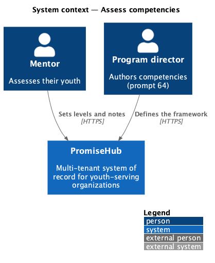
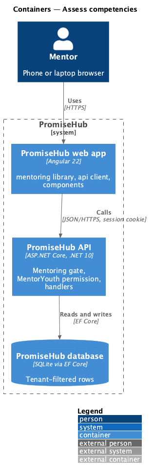
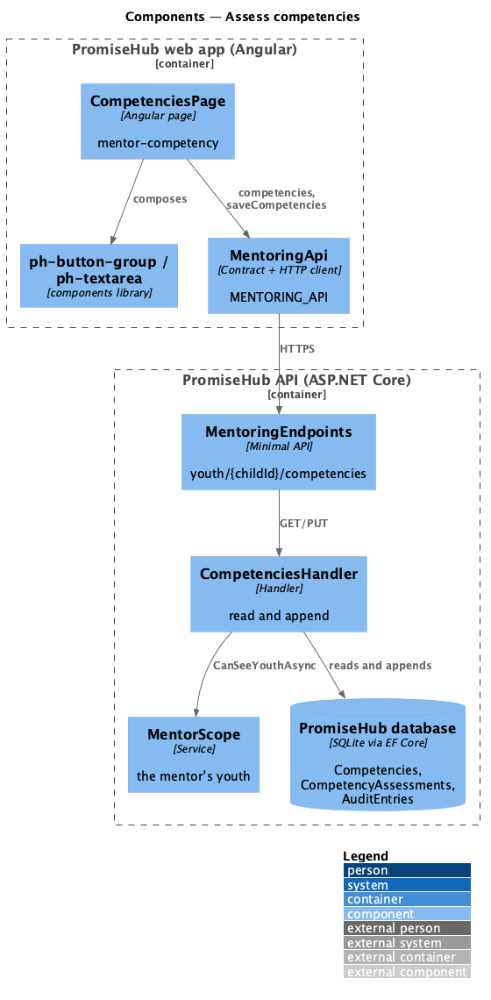
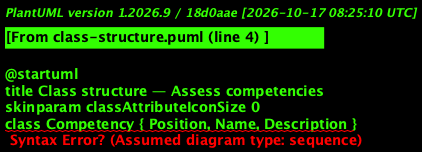
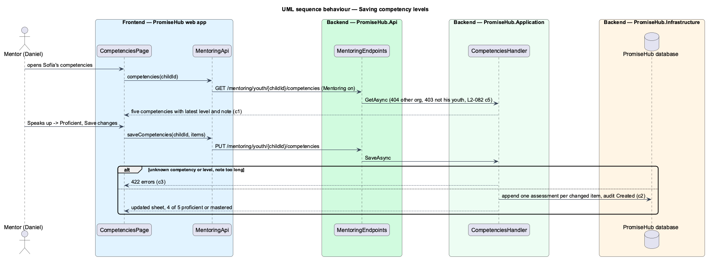

# Assess competencies

## Overview

An organization names the competencies it grows in its youth, such as Serves others or Speaks up. A mentor rates each of their youth on every competency (Not started, Developing, Proficient, Mastered) with a note, from the youth's record. Every save is kept; the latest per competency is what shows.

Terms used in this document:

- **competency** — one skill of the organization's framework, with a name, description and position; seeded until prompt 64 lets program directors author them
- **assessment** — one level and note for one child and competency, with who set it and when; appended, never changed
- **level** — `NotStarted`, `Developing`, `Proficient` or `Mastered`

Ported from Waypoint `mentoring/assess-competencies` (`L2-MENTOR-005`) without Waypoint's progression stages, with tenancy, the Mentoring gate and ADR 0057.

## Description

Frontend (`frontend/projects/mentoring/`, matched while Mentoring is on):

- **`CompetenciesPage`** (`/mentoring/youth/:childId/competencies`, mock `mentor-competency`, from Competencies on `MentorYouthDetailPage`) — a summary of how many are Proficient or Mastered; one `ph-card` per competency with its level `ph-badge`, a `ph-button-group` of the four levels and a notes `ph-textarea`; Save changes sends every competency; saved toast, invalid, failed, empty, forbidden, error and loading states.

API client (`MENTORING_API`): `competencies(childId)`, `saveCompetencies(childId, items)`; contracts `CompetencySheet`, `CompetencyItem`, `CompetencyLevel`, `CompetencyChange`.

Backend:

- **`MentoringEndpoints`** — `GET` and `PUT /mentoring/youth/{{childId}}/competencies`, gated by Mentoring and `MentorYouth`.
- **`CompetenciesHandler`** — 404 for a child outside the organization, 403 audited `AccessDenied` outside the mentor's youth; reads the organization's competencies with the latest assessment of each; saving checks every item (422 for an unknown competency or level, or notes over 2,000 characters), appends an assessment for each that changed, audits each `Created`, and answers the updated sheet.
- **`Competency`**, **`CompetencyAssessment`**, **`CompetencyLevel`** (`PromiseHub.Domain/Mentoring/`) — tenant-owned; the seeder adds five at Harbourview and three at Northgate.

## Requirements

| L2 ID | Refines (L1) | Requirement |
|-------|--------------|-------------|
| `L2-082` | `L1-024` | A mentor sets each competency of a youth to a level with a note, and the latest assessment per competency is what shows. |
| `L2-065` | `L1-003` | Every Mentoring read is scoped on the server to what the signed-in mentor is assigned: their youth, and the cohorts they lead or support. A mentor can open the cohort page of a cohort they are on and nothing else. |
| `L2-007` | `L1-003` | Permissions are enforced per endpoint and per field by role; the UI reflects them but never substitutes for them. |
| `L2-032` | `L1-017` | Every change and every sensitive view is recorded and searchable by admins. |

## Diagrams

### System context

### Containers

### Components

### Class structure

### Behaviour — saving competency levels

Only changed competencies become new assessments; earlier ones stay.

## Open questions

- Competencies on the youth's progress view and in reports arrive with prompts 65 and 80; authoring them with prompt 64.
