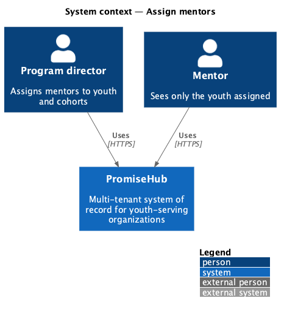
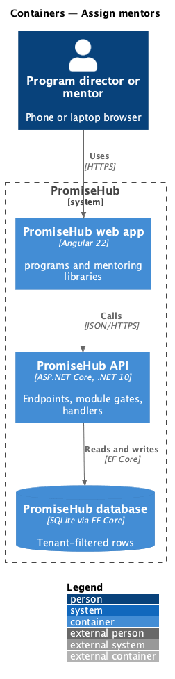
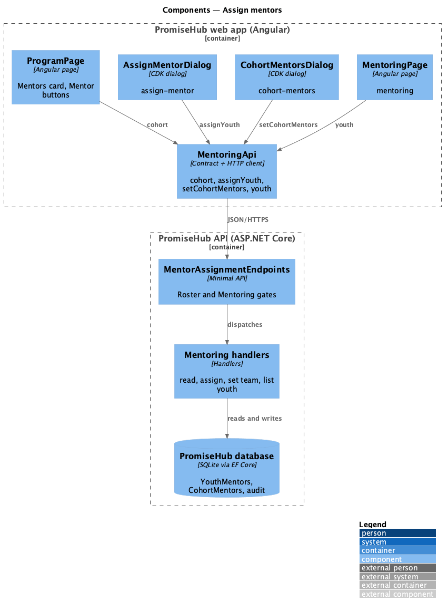
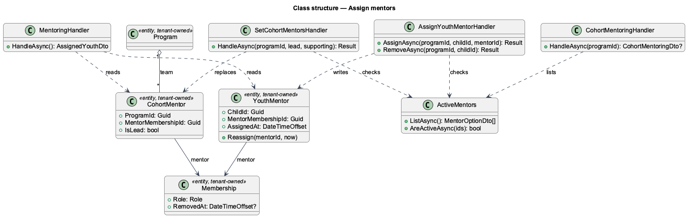
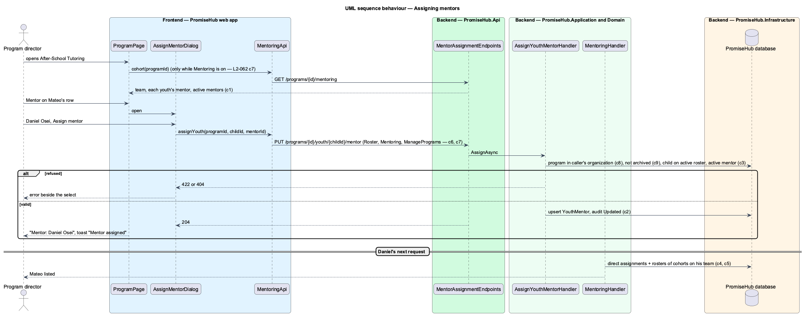

# Assign mentors

## Overview

A mentor in PromiseHub sees only the youth assigned to them (ADR 0043). This feature is where those assignments are made. While the Mentoring module is on, a program director opens a cohort (a program) and either assigns a mentor to one youth on its roster (`assign-mentor`) or sets the cohort's whole mentor team (`cohort-mentors`): one **lead mentor** and any **supporting mentors**. A mentor's list of youth then holds the youth assigned to them plus every youth on the roster of each cohort they lead or support.

Terms used in this document:

- **mentor** — a membership with the Mentor role that has not been removed, in the caller's organization
- **youth mentor** — the one mentor a child has in an organization, set from a cohort's roster
- **cohort team** — the lead and supporting mentors of a program; a mentor may lead one cohort and support another

Ported from Waypoint `program-administration/assign-mentors` (`L2-ADMIN-005` criteria 1 and 2), with tenancy, the Roster and Mentoring module gates and PromiseHub types (ADR 0043, ADR 0048).

## Description

Frontend:

- **`ProgramPage`** (`programs` library) — reads the session once; while `Mentoring` is among its modules, loads the cohort's mentoring and renders the **Mentors** card (`program`, `program/no-mentors`) and, on each roster row, the youth's mentor or "No mentor" with a **Mentor** button for managers. With Mentoring off neither is rendered nor requested (`program/mentoring-off`).
- **`AssignMentorDialog`** (`assign-mentor`) — a `ph-select` of active mentors with **Assign mentor** (busy while saving) and, when one is assigned, **Remove mentor**; a 422 shows beside the select, a failure as an alert with the choice kept. Success closes with the toast "Mentor assigned".
- **`CohortMentorsDialog`** (`cohort-mentors`) — `ph-select` for the lead and `ph-checkbox-group` for supporting mentors; the same busy, invalid and failed states.
- **`MentoringPage`** (`mentoring` library) — lists the caller's youth by name (`mentoring/assigned`) or the empty state.

API client (`frontend/projects/api/`): **`MentoringApi`** behind `MENTORING_API` gains `cohort(programId)`, `assignYouth(programId, childId, mentorId)`, `unassignYouth(programId, childId)` and `setCohortMentors(programId, leadMentorId, supportingMentorIds)`; contracts `CohortMentoring`, `MentorOption`, `YouthMentorRow`, `CohortTeam`.

Backend:

- **`MentorAssignmentEndpoints`** (`PromiseHub.Api`) — `GET /programs/{id}/mentoring` (any staff role), `PUT /programs/{id}/mentors`, `PUT` and `DELETE /programs/{id}/youth/{childId}/mentor` (`ManagePrograms`), all under `RequireModule(Roster)` and `RequireModule(Mentoring)`.
- **`PromiseHub.Application/Mentoring/`** — `CohortMentoringHandler` (read), `AssignYouthMentorHandler` (assign, remove), `SetCohortMentorsHandler` (replace the team), `ActiveMentors` (the organization's active Mentor memberships) and `MentoringHandler` (the caller's youth: direct assignments plus the active rosters of non-archived programs whose team includes the caller, distinct, ordered by name).
- **`PromiseHub.Domain/Mentoring/`** — `YouthMentor` (organization, child, mentor membership, assigned at; unique per child) and `CohortMentor` (organization, program, mentor membership, is lead; unique per program and mentor), both tenant-owned.
- **`PromiseHub.Infrastructure`** — `PromiseHubDbContext` maps both with the organization query filter; the `MentorAssignments` migration adds both tables (the term column is the `ProgramTerm` migration).

Rules: the child must be on the program's active roster (else 404); the mentor must be an active mentor of the organization (else 422); writes to an archived program answer 422; every write is audited (Updated on `YouthMentor` or `CohortMentors`, Deleted on `YouthMentor`). A program of another organization is not found (ADR 0002).

Open questions: caseload balance on the staff report (`L2-ADMIN-005` criterion 3) is deferred to reports (prompt 76); clearing a cohort's whole team is deferred.

## Built so far

Prompt 54 delivered everything above. Acceptance tests: `backend/tests/PromiseHub.Api.Tests/MentorAssignmentTests.cs`, `e2e/tests/programs/assign-mentors.spec.ts`.

## Requirements

| L2 ID | Refines (L1) | Requirement |
|-------|--------------|-------------|
| `L2-062` | `L1-024` | While Mentoring is on, a program director assigns a mentor to a youth on a cohort's roster and sets the cohort's lead and supporting mentors. A mentor's list of youth is the youth assigned to them plus the youth of every cohort they lead or support. |
| `L2-007` | `L1-003` | Every endpoint checks the caller's role on the server. |

## Diagrams

### System context

Who uses this slice of PromiseHub.

### Containers

The web app calls the API; the API owns the database and checks the organization's modules on every request.

### Components

The pages, dialogs and client in the web app, and the endpoints, handlers and entities in the API.

### Class structure

The entities, handlers and contracts with their relationships.

### Behaviour — assigning mentors

The steps in order, with the requirement criterion each enforces.

